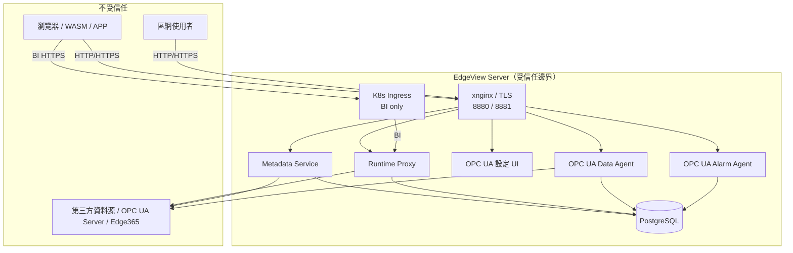

# CRA-01 威脅模型（Threat Modeling）

> 本文件依據 `CRA/(1)PID_TID.csv`、`CRA/(2)Analysis_TMRA.csv`、`CRA/(3)Database.csv`，並整合 `SDS/`、`SRS/`、`62443/` 文件彙整而成，作為 EU CRA（Cyber Resilience Act）技術文件中的**網路安全風險評鑑**與**威脅模型**證據。

## 1. 文件資訊

| 項目 | 內容 |
|------|------|
| 文件編號 | CRA-01 |
| 文件名稱 | 威脅模型（Threat Modeling） |
| 版本 | 1.0 |
| 狀態 | 初稿（配合 CRA 技術文件送審） |
| 日期 | 2026-11-19 |
| 產品名稱 | EdgeView（HMI/SCADA 圖控設計與執行平台） |
| 評估範圍 | EdgeView 完整系統（Client、xnginx、Metadata Service、Runtime Proxy、OPC UA 設定 UI/Data Agent/Alarm Agent、PostgreSQL） |
| 資料源基準 | OPC UA（`DataSource=3`）；威脅庫涵蓋 WebAccess / EdgeHub-BI / X |
| 文件語言 | 繁體中文（技術名詞保留英文） |
| 關聯文件 | [CRA-02 安全檢查點](CRA-02_Security_Checkpoint.md)、[CRA-03 編碼標準審查紀錄](CRA-03_Coding_Standards_Review_Record.md)、[CRA-04 產品安全使用手冊](CRA-04_Product_Security_User_Manual.md)、`SDS/08_Security_Design.md`、`SDS/11_Design_Decisions_and_Risks.md`、`SDS/13_Security_Remediation.md`、`62443/EdgeView_IEC62443-4-2_OPCUA.md` |

## 2. 目的與範圍

### 2.1 目的

1. 辨識 EdgeView 資產、信任邊界與攻擊面。
2. 依「設備屬性（PID）→ 適用威脅（TID）」方法選出適用的威脅，並逐項完成風險評鑑。
3. 對每個風險登錄（RID）指定緩解措施（MID）、風險處置與對應安全標準。
4. 作為 CRA 風險評鑑、IEC 62443-4-2 對照與後續安全檢查點（CRA-02）的依據。

### 2.2 範圍

| 類別 | 納入 |
|------|------|
| 元件 | Qt Designer/Viewer（桌面/瀏覽器/APP）、xnginx（8880/8881）、Metadata Service、Runtime Proxy、OPC UA 設定 UI（`/sc/opcua`）、OPC UA Data Agent（Runtime 28886／History 28887）、OPC UA Alarm Agent（28889）、PostgreSQL（`waxconfig`/`waxalarm`/`waxlog`） |
| 介面 | REST/JSON、WebSocket、OPC UA、HTTPS/TLS、內部 Bearer、ZeroMQ、第三方資料源（SQL/Influx/HTTP）、Firebase FCM |
| 資料 | 帳號/密碼、Session/CSRF、專案與設定、憑證/金鑰、稽核日誌、歷史與警報資料、上傳檔案 |

### 2.3 不在範圍（由外部承擔）

| 項目 | 責任方 |
|------|--------|
| 作業系統核心、開機完整性、安全開機 | OS／硬體 |
| 實體防拆、實體診斷介面、硬體安全金鑰／TPM／HSM | 硬體／機房 |
| 網路分段、防火牆、IDS/IPS、DDoS 清洗 | 網路設備／維運 |
| 資料庫平台本身的漏洞修補 | DB 平台維運 |
| 第三方 OPC UA Server、第三方資料庫 | 外部系統維運 |

> 上述項目在風險登錄中以「Risk sharing/transference」或「不適用（OS/硬體／網路設備）」處理，並於 CRA-04 使用手冊要求資產擁有者落實。

## 3. 參考文件與輸入

| 編號 | 來源 | 用途 |
|------|------|------|
| IN-01 | `CRA/(1)PID_TID.csv` | 已勾選之設備屬性（PID）與對應威脅（TID） |
| IN-02 | `CRA/(2)Analysis_TMRA.csv` | 逐項風險評鑑（RID）、風險等級、緩解（MID）、處置與標準對照 |
| IN-03 | `CRA/(3)Database.csv` | PID/TID/MID 對照資料庫與緩解措施分級（foundational/intermediate/leading） |
| IN-04 | `SDS/08_Security_Design.md` | 認證、授權、Session、CSRF、加密、傳輸、WebSocket、OPC UA 安全設計 |
| IN-05 | `SDS/11_Design_Decisions_and_Risks.md` | 風險登記 R-001~R-035、設計決策與技術債 |
| IN-06 | `SDS/13_Security_Remediation.md` | 已修復項目（R-001/R-002/R-003/R-006/R-008/R-009）與驗收 |
| IN-07 | `SRS/05_Nonfunctional_Requirements.md` | 安全／稽核／隱私 NFR |
| IN-08 | `62443/EdgeView_IEC62443-4-2_OPCUA.md`、`62443/Evidence.md` | IEC 62443-4-2 逐條對照與證據索引 |
| IN-09 | `edgeview.cdx.json` | SBOM（CycloneDX 1.7，元件／版本／授權） |

## 4. 方法論

### 4.1 流程

### 4.2 設備屬性與威脅選擇（PID → TID）

- 以 `(3)Database.csv` 的「設備屬性（PID）→ 威脅（TID）→ 緩解（MID）」三向關聯為知識庫。
- `(1)PID_TID.csv` 記錄本產品**實際具備**的屬性（`Select=TRUE`）與其適用威脅；未勾選者視為不適用。
- 共選出 **22 個設備屬性**、**40 個唯一威脅（TID）**，展開為 **97 筆風險登錄（RID）**。

### 4.3 風險評分（Qualitative）

| 等級 | 可能性（Likelihood） | 影響（Impact） |
|------|----------------------|----------------|
| Very Low | 需高度專業且條件嚴苛，幾乎不可行 | — |
| Low | 需特定條件或本機權限 | 輕微：可忽略的功能／資訊影響 |
| Moderate | 具一般技能即可嘗試 | 中度：局部功能中斷或敏感設定外洩 |
| High | 公開工具即可遠端嘗試 | 高度：可導致越權、資料外洩或服務中斷 |

**風險矩陣**（依 `(2)Analysis_TMRA.csv` 既有評分歸納）：

| 可能性 \ 影響 | Low | Moderate | High |
|---------------|-----|----------|------|
| High | Low | High | High |
| Moderate | Low | Moderate | High |
| Low | — | Low | Moderate |
| Very Low | — | Low | Low |

> `DREAD` 欄位在 `Analysis_TMRA.csv` 中未填值（Score 皆為 0），本版**不採用 DREAD**，僅以可能性 × 影響作為風險等級；DREAD 保留欄位供未來量化。

### 4.4 風險處置（Risk Treatment）

| 處置 | 說明 | 筆數 |
|------|------|------|
| Risk reduction（降低） | 以產品內建控制降低可能性或影響 | 50 |
| Risk acceptance（接受） | 已知限制、由 OS／部署承擔或成本不符 | 29 |
| Risk sharing/transference（分擔/移轉） | 由 OS、硬體、機房、VPN 或第三方承擔 | 18 |

### 4.5 標準對照

- **IEC 62443-4-2**：97 筆 RID 全部對應至 CR／EDR／HDR／NDR／SAR／ECR 條文（詳 `(2)Analysis_TMRA.csv` 與 `62443/EdgeView_IEC62443-4-2_OPCUA.md`）。
- **EN 18031-1/-2/-3**：分別有 70／67／62 筆 RID 標示對應（SUM/SSM/SCM/ACM/AUM/CCK/CRY/LGM/GEC/RLM 等）。
- **EU CRA Annex I**：於 §11 對應「essential cybersecurity requirements」。

### 4.6 涵蓋率

| 指標 | 數值 |
|------|------|
| 已選設備屬性（PID） | 22 |
| 唯一威脅（TID） | 40 |
| 風險登錄（RID） | 97 |
| 唯一緩解措施（MID） | 52 |
| 高風險（High） | 48 |
| 中風險（Moderate） | 43 |
| 低風險（Low） | 6 |

## 5. 系統描述與信任邊界

### 5.1 元件與關鍵資產

| 元件 | 角色 | 關鍵資產 |
|------|------|----------|
| Client（Designer/Viewer） | 畫面設計與執行 | Session、CSRF、專案腳本、模型、憑證、最近連線 |
| xnginx | 地端反向代理／TLS／限流 | TLS 憑證、路由設定、限流規則 |
| Metadata Service | 設定、專案、使用者、授權 | 帳號密碼雜湊、Session store、專案設定、稽核日誌、機器金鑰 `aes_secret` |
| Runtime Proxy | Record/告警摘要/第三方資料代理 | Session、資料源連線字串與密碼（AES 加密）、WebSocket Hub |
| OPC UA 設定 UI | OPC UA 專案/連線/Tag/警報/使用者設定 | 連線憑證（PFX）、使用者與專案授權 |
| OPC UA Data Agent | 即時值/寫值/歷史/瀏覽/憑證 | OPC UA 應用憑證、連線憑證、快取 |
| OPC UA Alarm Agent | 警報規則編譯與評估 | 警報設定、警報歷史 |
| PostgreSQL | 設定／警報／日誌儲存 | `waxconfig`、`waxalarm`、`waxlog`、`http_sessions` |

### 5.2 信任邊界

**邊界規則**（摘自 SDS-08 §2）：

1. 地端請求經 xnginx（TLS `8881`、限流）；EdgeHub/BI 經 K8s Ingress。
2. 後端之間與外部服務使用獨立認證（Basic/Token/憑證）。
3. DB 僅限內網，使用最小權限帳號。
4. 瀏覽器不直接連 DB／外部服務。
5. 後端（Metadata/Runtime/Agent/Alarm）僅綁 loopback，對外只暴露 xnginx。

### 5.3 主要攻擊面

| 攻擊面 | 入口 | 相關 TID |
|--------|------|----------|
| Web/HTTP | `/sc`、`/wxproxy`、`/sc/opcua`、`/system` | 319~325、401、408 |
| WebSocket | `/ws`（topic/action） | 310、406、407 |
| OPC UA | `/ua`、`/uadb`、`/uaam`、直接 OPC UA | 213、316、317、318、411 |
| 身分與 Session | 登入、Session、CSRF | 311~314、321、322、328、329 |
| 更新/供應鏈 | 安裝包、韌體/軟體更新 | 213、216、301、302、303 |
| 執行環境 | 腳本、插件、Deno、WDAC | 304、306、327 |
| 日誌/稽核 | 稽核查詢與匯出 | 315、222 |
| 網路服務 | REST、第三方 protocol（如 Modbus） | 222、404、405、406、407、408 |

## 6. 適用之設備屬性與威脅（PID/TID）

> 來源：`(1)PID_TID.csv`（`Select=TRUE`）。

### 6.1 System Software

| PID | 設備屬性 | TID | 威脅 |
|-----|----------|-----|------|
| PID-22 | 具備偵錯能力 | TID-224 | Excessive Access via Software Diagnostic Features |
| PID-272 | 具備密碼學韌體/軟體完整性保護機制 | TID-214 | Secrets Extracted from Device Root of Trust |
| PID-272 | 同上 | TID-330 | Cryptographic Timing Side-Channel |
| PID-2722 | 具備數位簽章韌體（私鑰） | TID-213 | Faulty FW/SW Update Integrity Verification |
| PID-274 | 更新時可選擇版本 | TID-216 | Firmware Update Rollbacks Allowed |

### 6.2 Application Software

| PID | 設備屬性 | TID | 威脅 |
|-----|----------|-----|------|
| PID-31 | 具應用層軟體執行中 | TID-301 | Applications Binaries Modified |
| PID-311 | 具 Web/HTTP 應用 | TID-319 | Cross Site Scripting (XSS) |
| PID-311 | 同上 | TID-320 | SQL Injection |
| PID-311 | 同上 | TID-321 | HTTP Application Session Hijacking |
| PID-311 | 同上 | TID-322 | Cross Site Request Forgery (CSRF) |
| PID-311 | 同上 | TID-323 | HTTP Path Traversal |
| PID-311 | 同上 | TID-324 | HTTP Direct Object Reference |
| PID-311 | 同上 | TID-325 | HTTP Injection/Response Splitting |
| PID-3121 | 支援物件導向語言 | TID-326 | Insecure Deserialization |
| PID-3122 | 支援手動記憶體管理語言 | TID-327 | Out of Bounds Memory Access |
| PID-32 | 可部署自訂/外部程式 | TID-302 | Install Untrusted Application |
| PID-321 | 可由工程軟體/IDE 部署程式 | TID-303 | Excessive Trust in Offboard Management/IDE Software |
| PID-322 | 具程式執行環境 | TID-304 | Manipulate Runtime Environment |
| PID-3232 | 於沙箱執行自訂程式 | TID-306 | Sandboxed Environments Escaped |
| PID-331 | 具未認證服務 | TID-310 | Remotely Accessible Unauthenticated Services |
| PID-332 | 具認證服務 | TID-311 | Default Credentials |
| PID-332 | 同上 | TID-312 | Credential Change Mechanism Can Be Abused |
| PID-332 | 同上 | TID-313 | Unauthenticated Session Changes Credential |
| PID-332 | 同上 | TID-328 | Hardcoded Credentials |
| PID-3321 | 以密碼認證使用者 | TID-314 | Passwords Can Be Guessed Using Brute-Force Attempts |
| PID-3321 | 同上 | TID-315 | Password Retrieval Mechanism Abused |
| PID-3321 | 同上 | TID-329 | Improper Password Storage |
| PID-3322 | 具密碼學使用者/工作階段認證 | TID-316 | Incorrect Certificate Verification Allows Authentication Bypass |
| PID-3322 | 同上 | TID-317 | Predictable Cryptographic Key |
| PID-3322 | 同上 | TID-318 | Insecure Cryptographic Implementation |
| PID-3322 | 同上 | TID-330 | Cryptographic Timing Side-Channel |
| PID-3322 | 同上 | TID-411 | Weak/Insecure Cryptographic Protocol |

### 6.3 Networking

| PID | 設備屬性 | TID | 威脅 |
|-----|----------|-----|------|
| PID-41 | 暴露遠端網路服務 | TID-222 | Critical System Service May Be Disabled |
| PID-41 | 同上 | TID-310 | Remotely Accessible Unauthenticated Services |
| PID-41 | 同上 | TID-401 | Undocumented Protocol Features |
| PID-41 | 同上 | TID-404 | Remotely Triggerable Deadlock/DoS |
| PID-41 | 同上 | TID-405 | Network Stack Resource Exhaustion |
| PID-41 | 同上 | TID-407 | Missing Message Replay Protection |
| PID-4111 | 協定不支援訊息認證 | TID-406 | Unauthorized Messages or Connections |
| PID-4112 | 協定不支援訊息加密 | TID-408 | Unencrypted Sensitive Data Communication |
| PID-4113 | 具敏感資料密碼學功能 | TID-221 | Authentication Bypass By Message Replay |
| PID-4113 | 同上 | TID-316 | Incorrect Certificate Verification Allows Authentication Bypass |
| PID-4113 | 同上 | TID-317 | Predictable Cryptographic Key |
| PID-4113 | 同上 | TID-318 | Insecure Cryptographic Implementation |
| PID-4113 | 同上 | TID-330 | Cryptographic Timing Side-Channel |
| PID-4113 | 同上 | TID-410 | Cryptographic Protocol Side Channel |
| PID-4113 | 同上 | TID-411 | Weak/Insecure Cryptographic Protocol |

## 7. 風險評鑑結果

### 7.1 統計

| 構面 | 分佈 |
|------|------|
| 風險等級 | High 48／Moderate 43／Low 6 |
| 類別 | Application Software 63／System Software 17／Networking 17 |
| 處置 | 降低 50／接受 29／分擔移轉 18 |
| 技能等級 | foundational 為多數；intermediate、leading 者多以「接受／分擔」處理 |

### 7.2 完整風險登錄表

> 欄位：RID｜TID｜威脅｜技能｜可能性(L)｜影響(I)｜風險｜緩解(MID)｜處置｜現況/備註。

| RID | TID | 威脅 | 技能 | L | I | 風險 | MID 緩解 | 處置 | 現況/備註 |
|-----|-----|------|------|---|---|------|----------|------|-----------|
| RID-001 | TID-213 | Faulty FW/SW Update Integrity Verification | foundational | Low | High | Moderate | MID-001 Software Only Bootloader Authentication | Risk sharing/transference | 作業系統層級處理，與產品無直接關聯 |
| RID-002 | TID-213 | Faulty FW/SW Update Integrity Verification | intermediate | Low | High | Moderate | MID-002 Hardware-backed Bootloader Authentication | Risk sharing/transference | 作業系統層級處理，與產品無直接關聯 |
| RID-003 | TID-213 | Faulty FW/SW Update Integrity Verification | leading | Low | High | Moderate | MID-003 Periodic/Continuous Integrity Measurement and Remote Attestation | Risk acceptance | 本產品不支援遠端證明 |
| RID-004 | TID-213 | Faulty FW/SW Update Integrity Verification | foundational | Low | High | Moderate | MID-026 Secure Firmware Update | Risk reduction | 安裝包有電子簽章（Advantech + DigiCert、SHA-256、RFC 3161 時間戳） |
| RID-005 | TID-213 | Faulty FW/SW Update Integrity Verification | foundational | Low | High | Moderate | MID-027 Validated Cryptographic Libraries | Risk reduction | 安裝時由作業系統進行驗證 |
| RID-006 | TID-214 | Secrets Extracted from Device Root of Trust | intermediate | Very Low | Moderate | Low | MID-028 Hardware-backed Key Storage | Risk sharing/transference | USB 授權私鑰保存在 dongle 晶片內，無法取得 |
| RID-007 | TID-214 | Secrets Extracted from Device Root of Trust | intermediate | Very Low | Moderate | Low | MID-028 Hardware-backed Key Storage | Risk sharing/transference | 同上 |
| RID-008 | TID-214 | Secrets Extracted from Device Root of Trust | intermediate | Very Low | Moderate | Low | MID-060 Dedicated Hardware Cryptographic Modules | Risk acceptance | 不交付專用密碼模組 |
| RID-009 | TID-214 | Secrets Extracted from Device Root of Trust | intermediate | Very Low | Moderate | Low | MID-060 Dedicated Hardware Cryptographic Modules | Risk acceptance | 同上 |
| RID-010 | TID-216 | Firmware Update Rollbacks Allowed | foundational | Low | Moderate | Low | MID-030 Firmware Rollback Protections | Risk acceptance | 產品不擋降版；Release Note 說明漏洞修正版本 |
| RID-011 | TID-221 | Authentication Bypass By Message Replay | foundational | Moderate | High | High | MID-036 Cryptographic Nonces | Risk acceptance | Web API 的 TLS 支援 anti-replay；無加密協定（如 Modbus）無法支援 |
| RID-012 | TID-221 | Authentication Bypass By Message Replay | foundational | Moderate | High | High | MID-037 Network Timestamps | Risk reduction | 控制命令檢查時間戳，超過設定時間即丟棄 |
| RID-013 | TID-222 | Critical System Service May Be Disabled | foundational | Moderate | Moderate | Moderate | MID-031 Physical Presence Validation | Risk sharing/transference | 靠機房／主機實體管控（非產品功能） |
| RID-014 | TID-222 | Critical System Service May Be Disabled | foundational | Moderate | Moderate | Moderate | MID-032 System Service Availability Manager | Risk reduction | 支援 Windows 服務與 watchdog 機制 |
| RID-015 | TID-222 | Critical System Service May Be Disabled | foundational | Moderate | Moderate | Moderate | MID-038 Authenticate for Administrative Actions | Risk reduction | 停用／重啟服務須先驗證管理身分 |
| RID-016 | TID-224 | Excessive Access via Software Diagnostic Features | foundational | Moderate | High | High | MID-018 Require Authentication for Privileged Functions | Risk reduction | 需足夠權限並經驗證才可執行特定功能 |
| RID-017 | TID-224 | Excessive Access via Software Diagnostic Features | foundational | Moderate | High | High | MID-039 Restrict Software Diagnostic Functions | Risk reduction | 區分使用者角色與權限 |
| RID-018 | TID-301 | Applications Binaries Modified | foundational | Low | High | Moderate | MID-001 Software Only Bootloader Authentication | Risk sharing/transference | 作業系統層級處理 |
| RID-019 | TID-301 | Applications Binaries Modified | intermediate | Low | High | Moderate | MID-002 Hardware-backed Bootloader Authentication | Risk sharing/transference | 作業系統層級處理 |
| RID-020 | TID-301 | Applications Binaries Modified | leading | Low | High | Moderate | MID-003 Periodic/Continuous Integrity Measurement and Remote Attestation | Risk acceptance | 本產品不支援遠端證明 |
| RID-021 | TID-301 | Applications Binaries Modified | intermediate | Low | High | Moderate | MID-009 Operating System-based Runtime Integrity Check | Risk sharing/transference | 作業系統層級處理 |
| RID-022 | TID-302 | Install Untrusted Application | leading | Moderate | High | High | MID-003 Periodic/Continuous Integrity Measurement and Remote Attestation | Risk acceptance | 本產品不支援遠端證明 |
| RID-023 | TID-302 | Install Untrusted Application | intermediate | Moderate | High | High | MID-009 Operating System-based Runtime Integrity Check | Risk sharing/transference | 作業系統層級處理 |
| RID-024 | TID-302 | Install Untrusted Application | foundational | Moderate | High | High | MID-031 Physical Presence Validation | Risk sharing/transference | 專案下載靠實體工程站與帳號管控 |
| RID-025 | TID-302 | Install Untrusted Application | foundational | Moderate | High | High | MID-038 Authenticate for Administrative Actions | Risk reduction | 需足夠權限才能設定／下載專案 |
| RID-026 | TID-302 | Install Untrusted Application | intermediate | Moderate | High | High | MID-040 Cryptographically Signed Custom Programs | Risk acceptance | 客戶專案無法由原廠逐一套用簽章 |
| RID-027 | TID-302 | Install Untrusted Application | foundational | Moderate | High | High | MID-041 Cryptographically Signed Vendor-supplied Programs | Risk reduction | 原廠 binary 檔案已簽章 |
| RID-028 | TID-302 | Install Untrusted Application | foundational | Moderate | High | High | MID-051 Disallow User-Provided Code | Risk acceptance | 允許自訂程式與腳本；腳本限制不安全命令，但無法保證完全涵蓋 |
| RID-029 | TID-303 | Excessive Trust in Offboard Management/IDE Software | foundational | Moderate | High | High | MID-041 Cryptographically Signed Vendor-supplied Programs | Risk reduction | 安裝包與安裝檔案皆電子簽章 |
| RID-030 | TID-303 | Excessive Trust in Offboard Management/IDE Software | foundational | Moderate | High | High | MID-042 Device Checks Consistency Between Binary/Running Code and Textual Code | Risk sharing/transference | 啟用 Windows WDAC，防止執行非法檔案 |
| RID-031 | TID-304 | Manipulate Runtime Environment | intermediate | Low | High | Moderate | MID-009 Operating System-based Runtime Integrity Check | Risk sharing/transference | WDAC 驗證 Deno 執行檔，但無法驗證客戶 JavaScript |
| RID-032 | TID-304 | Manipulate Runtime Environment | foundational | Low | High | Moderate | MID-012 OS-based Access Control Mechanisms | Risk sharing/transference | 權限邊界依賴 Windows ACL |
| RID-033 | TID-304 | Manipulate Runtime Environment | foundational | Low | High | Moderate | MID-013 Process and Thread Memory Segmentation | Risk reduction | 腳本於獨立 Deno 行程執行，行程隔離阻止覆寫 |
| RID-034 | TID-304 | Manipulate Runtime Environment | intermediate | Low | High | Moderate | MID-014 Sandboxing | Risk reduction | 腳本於獨立 Deno 行程；前後端白名單政策 |
| RID-035 | TID-304 | Manipulate Runtime Environment | intermediate | Low | High | Moderate | MID-015 Containerization | Risk acceptance | 無容器化 |
| RID-036 | TID-306 | Sandboxed Environments Escaped | foundational | Low | High | Moderate | MID-012 OS-based Access Control Mechanisms | Risk sharing/transference | 權限邊界依賴 Windows ACL |
| RID-037 | TID-306 | Sandboxed Environments Escaped | intermediate | Low | High | Moderate | MID-022 Segmentation Through Hardware-assisted VMs | Risk acceptance | 無硬體輔助 VM 分段 |
| RID-038 | TID-310 | Remotely Accessible Unauthenticated Services | foundational | Moderate | High | High | MID-034 Authenticate Network Messages | Risk acceptance | API 全須登入；無驗證協定（如 Modbus）無法支援 |
| RID-039 | TID-310 | Remotely Accessible Unauthenticated Services | foundational | Moderate | High | High | MID-034 Authenticate Network Messages | Risk acceptance | 同上 |
| RID-040 | TID-311 | Default Credentials | foundational | High | High | High | MID-043 Manage Default Login Credentials | Risk reduction | 網頁預設密碼須強制修改才能後續操作 |
| RID-041 | TID-312 | Credential Change Mechanism Can Be Abused | foundational | Moderate | High | High | MID-038 Authenticate for Administrative Actions | Risk reduction | 需足夠權限才能修改他人帳密 |
| RID-042 | TID-313 | Unauthenticated Session Changes Credential | foundational | Low | High | Moderate | MID-038 Authenticate for Administrative Actions | Risk reduction | 忘記密碼由具權限者配發啟動碼，登入後強制設定新密碼 |
| RID-043 | TID-314 | Passwords Can Be Guessed Using Brute-Force Attempts | intermediate | High | High | High | MID-045 Multi-factor Authentication | Risk acceptance | 無多因子驗證 |
| RID-044 | TID-314 | Passwords Can Be Guessed Using Brute-Force Attempts | foundational | High | High | High | MID-046 Authentication Attempts Timeouts and Lockouts | Risk reduction | 預設登入失敗 3 次鎖帳號 10 分鐘 |
| RID-045 | TID-315 | Password Retrieval Mechanism Abused | foundational | Low | High | Moderate | MID-017 Security-relevant Auditing and Logging | Risk reduction | 無法讀回舊密碼 |
| RID-046 | TID-316 | Incorrect Certificate Verification Allows Authentication Bypass | foundational | Moderate | High | High | MID-027 Validated Cryptographic Libraries | Risk reduction | 內建自簽憑證，SAN 含主機名與 IP；瀏覽器會警告 |
| RID-047 | TID-316 | Incorrect Certificate Verification Allows Authentication Bypass | foundational | Moderate | High | High | MID-027 Validated Cryptographic Libraries | Risk reduction | 同上 |
| RID-048 | TID-317 | Predictable Cryptographic Key | intermediate | High | High | High | MID-033 Unique Factory Preinstalled Secret Keys | Risk acceptance | 對外 TLS 金鑰首次安裝重啟後動態產生；對內 ZeroMQ 預設共用 access code，應強制由安裝包輸入 |
| RID-049 | TID-317 | Predictable Cryptographic Key | intermediate | High | High | High | MID-033 Unique Factory Preinstalled Secret Keys | Risk acceptance | 同上 |
| RID-050 | TID-317 | Predictable Cryptographic Key | foundational | High | High | High | MID-047 Sufficient Entropy for Keys | Risk reduction | 以 OpenSSL 3.x／OS CSPRNG 產生 RSA-2048 唯一金鑰 |
| RID-051 | TID-317 | Predictable Cryptographic Key | foundational | High | High | High | MID-047 Sufficient Entropy for Keys | Risk reduction | 同上 |
| RID-052 | TID-317 | Predictable Cryptographic Key | intermediate | High | High | High | MID-048 Hardware Random Number Generator | Risk sharing/transference | 以 OpenSSL 3.x／OS CSPRNG 產生 RSA-2048 唯一金鑰 |
| RID-053 | TID-317 | Predictable Cryptographic Key | intermediate | High | High | High | MID-048 Hardware Random Number Generator | Risk sharing/transference | 同上 |
| RID-054 | TID-317 | Predictable Cryptographic Key | intermediate | High | High | High | MID-060 Dedicated Hardware Cryptographic Modules | Risk acceptance | 無專用硬體加密模組 |
| RID-055 | TID-317 | Predictable Cryptographic Key | intermediate | High | High | High | MID-060 Dedicated Hardware Cryptographic Modules | Risk acceptance | 同上 |
| RID-056 | TID-318 | Insecure Cryptographic Implementation | foundational | Low | High | Moderate | MID-027 Validated Cryptographic Libraries | Risk reduction | 對外 TLS 用 OpenSSL 3.x；內部 ZeroMQ 用 libsodium AES-256-GCM，每訊息以 randombytes 產生 nonce，不自行實作密碼 |
| RID-057 | TID-318 | Insecure Cryptographic Implementation | foundational | Low | High | Moderate | MID-027 Validated Cryptographic Libraries | Risk reduction | 同上 |
| RID-058 | TID-318 | Insecure Cryptographic Implementation | intermediate | Low | High | Moderate | MID-060 Dedicated Hardware Cryptographic Modules | Risk acceptance | 無專用硬體加密模組 |
| RID-059 | TID-318 | Insecure Cryptographic Implementation | intermediate | Low | High | Moderate | MID-060 Dedicated Hardware Cryptographic Modules | Risk acceptance | 同上 |
| RID-060 | TID-319 | Cross Site Scripting (XSS) | foundational | Moderate | High | High | MID-071 Sanitized and Escaped User Data for Web Applications | Risk reduction | 待盤點驗證 |
| RID-061 | TID-320 | SQL Injection | foundational | Moderate | High | High | MID-072 Parameterized SQL Queries | Risk reduction | 待盤點驗證 |
| RID-062 | TID-321 | HTTP Application Session Hijacking | foundational | Moderate | High | High | MID-035 Encrypt Network Traffic | Risk reduction | 只走 HTTPS |
| RID-063 | TID-321 | HTTP Application Session Hijacking | foundational | Moderate | High | High | MID-073 Secure HTTP Session Management | Risk reduction | 亂數 Session ID、登入後換發、閒置逾時；Cookie 具 Secure/HttpOnly/SameSite |
| RID-064 | TID-322 | Cross Site Request Forgery (CSRF) | foundational | Moderate | High | High | MID-074 Cross Site Request Forgery Mitigations | Risk reduction | 狀態變更 API 有同步 token 或 double-submit；不可用無 token 的 GET |
| RID-065 | TID-323 | HTTP Path Traversal | foundational | Moderate | High | High | MID-075 Path Traversal Protections | Risk reduction | 依名稱／路徑讀檔的 Web API 皆正規化並檢查仍在允許根目錄內 |
| RID-066 | TID-324 | HTTP Direct Object Reference | foundational | Moderate | High | High | MID-076 Web Direct Object Reference Authentication | Risk reduction | API 需有效 Session，並依專案／物件 ACL 拒絕越權 ID |
| RID-067 | TID-325 | HTTP Injection/Response Splitting | foundational | Moderate | High | High | MID-078 HTTP Request/Response Validation | Risk reduction | 框架拒絕非法標頭；不將輸入寫入標頭；請求大小上限（nginx 100 MB） |
| RID-068 | TID-326 | Insecure Deserialization | foundational | Low | High | Moderate | MID-077 Secure Deserialization | Risk reduction | 跨信任邊界只用 Protobuf／JSON |
| RID-069 | TID-327 | Out of Bounds Memory Access | foundational | Moderate | High | High | MID-004 Memory Hardening Against Code Injection | Risk reduction | Windows 建置啟用 ASLR/DEP／堆疊保護 |
| RID-070 | TID-327 | Out of Bounds Memory Access | intermediate | Moderate | High | High | MID-005 Memory Safe Programming Languages | Risk acceptance | 部分程式為 C/C++，非記憶體安全語言 |
| RID-071 | TID-327 | Out of Bounds Memory Access | leading | Moderate | High | High | MID-006 Driver Memory Isolation | Risk acceptance | 無產品核心驅動隔離 |
| RID-072 | TID-327 | Out of Bounds Memory Access | foundational | Moderate | High | High | MID-013 Process and Thread Memory Segmentation | Risk sharing/transference | 產品以獨立行程運行，行程隔離由 OS 提供 |
| RID-073 | TID-328 | Hardcoded Credentials | foundational | Moderate | High | High | MID-043 Manage Default Login Credentials | Risk acceptance | 資料庫帳密寫死（部署時必須改以 Secret 管理） |
| RID-074 | TID-329 | Improper Password Storage | foundational | Low | High | Moderate | MID-049 Secure Password Storage | Risk reduction | 設定檔密碼一律 AES 加密 |
| RID-075 | TID-330 | Cryptographic Timing Side-Channel | foundational | Low | High | Moderate | MID-027 Validated Cryptographic Libraries | Risk reduction | OpenSSL 3.x／libsodium AES-256-GCM，randombytes nonce |
| RID-076 | TID-330 | Cryptographic Timing Side-Channel | foundational | Low | High | Moderate | MID-027 Validated Cryptographic Libraries | Risk reduction | 同上 |
| RID-077 | TID-330 | Cryptographic Timing Side-Channel | foundational | Low | High | Moderate | MID-027 Validated Cryptographic Libraries | Risk reduction | 同上 |
| RID-078 | TID-330 | Cryptographic Timing Side-Channel | foundational | Low | High | Moderate | MID-044 Strong Cryptographic Algorithms and Protocols | Risk reduction | 同上 |
| RID-079 | TID-330 | Cryptographic Timing Side-Channel | foundational | Low | High | Moderate | MID-044 Strong Cryptographic Algorithms and Protocols | Risk reduction | 同上 |
| RID-080 | TID-330 | Cryptographic Timing Side-Channel | foundational | Low | High | Moderate | MID-044 Strong Cryptographic Algorithms and Protocols | Risk reduction | 同上 |
| RID-081 | TID-401 | Undocumented Protocol Features | foundational | Low | High | Moderate | MID-079 Remove Undocumented Network Functionality | Risk reduction | 手冊須詳載支援功能（命令／模式／暫存器／錯誤碼）、通訊埠與加密方式 |
| RID-082 | TID-404 | Remotely Triggerable Deadlock/DoS | intermediate | Low | High | Moderate | MID-008 Decidable Protocols and Parsers | Risk reduction | 避免不合法或封包造成崩潰／卡死 |
| RID-083 | TID-404 | Remotely Triggerable Deadlock/DoS | foundational | Low | High | Moderate | MID-032 System Service Availability Manager | Risk reduction | Windows 服務自動啟動；異常崩潰有 watchdog 重啟 |
| RID-084 | TID-405 | Network Stack Resource Exhaustion | intermediate | Moderate | Moderate | Moderate | MID-008 Decidable Protocols and Parsers | Risk reduction | 每個服務有連線上限，單一連線不能佔滿 |
| RID-085 | TID-405 | Network Stack Resource Exhaustion | foundational | Moderate | Moderate | Moderate | MID-032 System Service Availability Manager | Risk reduction | 服務自動啟動與 watchdog 重啟 |
| RID-086 | TID-405 | Network Stack Resource Exhaustion | foundational | Moderate | Moderate | Moderate | MID-080 Network Request Processing Limits | Risk reduction | 達連線上限或請求逾時即禁止／中斷連線 |
| RID-087 | TID-406 | Unauthorized Messages or Connections | foundational | Moderate | High | High | MID-034 Authenticate Network Messages | Risk acceptance | API 全須登入；無驗證協定（如 Modbus）無法支援 |
| RID-088 | TID-406 | Unauthorized Messages or Connections | intermediate | Moderate | High | High | MID-081 Secure Network Tunnels | Risk sharing/transference | 無驗證加密的 Driver Protocol 須自架 VPN／專用網路 |
| RID-089 | TID-407 | Missing Message Replay Protection | foundational | Moderate | High | High | MID-036 Cryptographic Nonces | Risk acceptance | Web API TLS 支援 anti-replay；無加密協定無法支援 |
| RID-090 | TID-407 | Missing Message Replay Protection | foundational | Moderate | High | High | MID-037 Network Timestamps | Risk reduction | 控制命令檢查時間戳，逾時丟棄 |
| RID-091 | TID-408 | Unencrypted Sensitive Data Communication | foundational | High | High | High | MID-035 Encrypt Network Traffic | Risk acceptance | Web API 支援 TLS；無加密協定（如 Modbus）無法支援 |
| RID-092 | TID-408 | Unencrypted Sensitive Data Communication | intermediate | High | High | High | MID-081 Secure Network Tunnels | Risk reduction | 無驗證加密的 Driver Protocol 須自架 VPN／專用網路 |
| RID-093 | TID-410 | Cryptographic Protocol Side Channel | foundational | Low | Moderate | Low | MID-044 Strong Cryptographic Algorithms and Protocols | Risk acceptance | TLS／AES-GCM 不隱藏長度與頻率；無加密協定無法支援 |
| RID-094 | TID-411 | Weak/Insecure Cryptographic Protocol | foundational | Low | High | Moderate | MID-044 Strong Cryptographic Algorithms and Protocols | Risk reduction | 對外 TLS 用 OpenSSL 3.x；內部 ZeroMQ 用 libsodium AES-256-GCM |
| RID-095 | TID-411 | Weak/Insecure Cryptographic Protocol | foundational | Low | High | Moderate | MID-044 Strong Cryptographic Algorithms and Protocols | Risk reduction | 同上 |
| RID-096 | TID-411 | Weak/Insecure Cryptographic Protocol | intermediate | Low | High | Moderate | MID-082 Post-quantum Cryptography | Risk acceptance | 未部署後量子金鑰交換或簽章 |
| RID-097 | TID-411 | Weak/Insecure Cryptographic Protocol | intermediate | Low | High | Moderate | MID-082 Post-quantum Cryptography | Risk acceptance | 同上 |

### 7.3 高風險（High）清單

`RID-011, RID-012, RID-016, RID-017, RID-022, RID-023, RID-024, RID-025, RID-026, RID-027, RID-028, RID-029, RID-030, RID-038, RID-039, RID-040, RID-041, RID-043, RID-044, RID-046, RID-047, RID-048, RID-049, RID-050, RID-051, RID-052, RID-053, RID-054, RID-055, RID-060, RID-061, RID-062, RID-063, RID-064, RID-065, RID-066, RID-067, RID-069, RID-070, RID-071, RID-072, RID-073, RID-087, RID-088, RID-089, RID-090, RID-091, RID-092`

> 高風險集中在：更新/安裝信任（213/302/303）、認證與憑證（311/312/314/316/317）、Web 攻擊（319~325）、記憶體安全（327）、硬編碼憑證（328）與網路明文/重放（406~408）。

## 8. 緩解措施目錄（MID）

| MID | 緩解措施 | 主要落點 | 分級 |
|-----|----------|----------|------|
| MID-001 | Software Only Bootloader Authentication | OS／開機 | foundational |
| MID-002 | Hardware-backed Bootloader Authentication | OS／硬體 | intermediate |
| MID-003 | Periodic/Continuous Integrity Measurement and Remote Attestation | OS／遠端證明（未支援） | leading |
| MID-004 | Memory Hardening Against Code Injection | Windows ASLR/DEP | foundational |
| MID-005 | Memory Safe Programming Languages | 語言選擇 | intermediate |
| MID-006 | Driver Memory Isolation | OS／驅動 | leading |
| MID-008 | Decidable Protocols and Parsers | 協定／解析器 | intermediate |
| MID-009 | Operating System-based Runtime Integrity Check | OS／WDAC | intermediate |
| MID-012 | OS-based Access Control Mechanisms | Windows ACL | foundational |
| MID-013 | Process and Thread Memory Segmentation | 行程隔離 | foundational |
| MID-014 | Sandboxing | Deno 沙箱 | intermediate |
| MID-015 | Containerization | 部署（未採） | intermediate |
| MID-017 | Security-relevant Auditing and Logging | 稽核日誌 | foundational |
| MID-018 | Require Authentication for Privileged Functions | 權限驗證 | foundational |
| MID-022 | Segmentation Through Hardware-assisted VMs | 虛擬化（未採） | intermediate |
| MID-026 | Secure Firmware Update | 安裝包簽章 | foundational |
| MID-027 | Validated Cryptographic Libraries | OpenSSL/libsodium | foundational |
| MID-028 | Hardware-backed Key Storage | dongle | intermediate |
| MID-030 | Firmware Rollback Protections | 版本控管 | foundational |
| MID-031 | Physical Presence Validation | 機房／工程站 | foundational |
| MID-032 | System Service Availability Manager | watchdog | foundational |
| MID-033 | Unique Factory Preinstalled Secret Keys | 安裝時金鑰 | intermediate |
| MID-034 | Authenticate Network Messages | Session/Bearer | foundational |
| MID-035 | Encrypt Network Traffic | HTTPS/TLS | foundational |
| MID-036 | Cryptographic Nonces | TLS／nonce | foundational |
| MID-037 | Network Timestamps | `packetTimestamp` | foundational |
| MID-038 | Authenticate for Administrative Actions | 管理權限 | foundational |
| MID-039 | Restrict Software Diagnostic Functions | 角色權限 | foundational |
| MID-040 | Cryptographically Signed Custom Programs | 客戶專案（未逐一簽章） | intermediate |
| MID-041 | Cryptographically Signed Vendor-supplied Programs | 原廠簽章 | foundational |
| MID-042 | Device Checks Consistency Between Binary/Running Code and Textual Code | WDAC | foundational |
| MID-043 | Manage Default Login Credentials | 強制改密碼 | foundational |
| MID-044 | Strong Cryptographic Algorithms and Protocols | TLS 1.2/1.3、AES-GCM | foundational |
| MID-045 | Multi-factor Authentication | 外部 IdP（未內建） | intermediate |
| MID-046 | Authentication Attempts Timeouts and Lockouts | 3 次／10 分鐘 | foundational |
| MID-047 | Sufficient Entropy for Keys | CSPRNG | foundational |
| MID-048 | Hardware Random Number Generator | OS CSPRNG（無 HWRNG） | intermediate |
| MID-049 | Secure Password Storage | AES／雜湊（待強化） | foundational |
| MID-051 | Disallow User-Provided Code | 腳本限制 | foundational |
| MID-060 | Dedicated Hardware Cryptographic Modules | HSM（未交付） | intermediate |
| MID-071 | Sanitized and Escaped User Data for Web Applications | 輸出編碼 | foundational |
| MID-072 | Parameterized SQL Queries | 參數化查詢 | foundational |
| MID-073 | Secure HTTP Session Management | Session 管理 | foundational |
| MID-074 | Cross Site Request Forgery Mitigations | CSRF token | foundational |
| MID-075 | Path Traversal Protections | 路徑正規化 | foundational |
| MID-076 | Web Direct Object Reference Authentication | 物件 ACL | foundational |
| MID-077 | Secure Deserialization | Protobuf/JSON | foundational |
| MID-078 | HTTP Request/Response Validation | 標頭／大小驗證 | foundational |
| MID-079 | Remove Undocumented Network Functionality | 手冊／功能盤點 | foundational |
| MID-080 | Network Request Processing Limits | 限流／逾時 | foundational |
| MID-081 | Secure Network Tunnels | VPN／專用網路 | intermediate |
| MID-082 | Post-quantum Cryptography | 未部署 | intermediate |

## 9. 殘餘風險與已知限制

以下對應 `SDS/11` 的開放風險，於 CRA-04 使用手冊要求部署端配合：

| SDS 風險 | 說明 | 對應 TID | 狀態 | 建議處置 |
|----------|------|----------|------|----------|
| R-004 | 密碼雜湊未加鹽（SHA-256） | TID-329 | Open | 遷移 Argon2id/bcrypt + 遷移計畫 |
| R-005 | CSRF Token Cookie 非 HttpOnly | TID-322 | Open | HttpOnly + SameSite |
| R-007 | WS 登入掃描所有 Session | TID-321 | Open | 以 Session ID 驗證 |
| R-012 | 公開檔案端點 | TID-324 | Open | 授權／簽章 URL／限流 |
| R-015 | CORS/Origin 寬鬆 | TID-322 | Open | 明確白名單 |
| R-016 | 速率限制／鎖定不足（OPC UA 以外） | TID-314 | Mitigating | 登入專用限流、帳號鎖定 |
| R-017 | 稽核日誌可被管理者刪除 | TID-222 | Open | WORM／外部 SIEM |
| R-018/R-028 | 預設 DB 帳密 | TID-328 | Open | 強制環境變數／Secret |
| R-019 | 動態 SQL 組裝 | TID-320 | Open | 白名單／跳脫 |
| R-023 | 日誌可能含敏感請求 | TID-315 | Open | 遮罩敏感欄位 |
| R-024 | 權限檢查分散 | TID-324 | Open | 集中式授權 middleware |
| R-025 | Data Agent 時間戳未強制 | TID-407 | Open | 移除短路並補測試 |
| R-026 | Data Agent CORS 過寬 | TID-322 | Open | Origin 白名單 |
| R-027 | OPC UA 憑證自動接受 | TID-316 | Open | 信任清單、拒絕 SHA1 |
| R-035 | xnginx 設定變體漂移 | TID-401 | Open | 設定基準與煙霧測試 |

> 已修復（SDS-13）：R-001 Session secret、R-002 全域 TLS 驗證、R-003 `/record/queryrecord`、R-006 WebSocket 認證、R-008 輪詢間隔、R-009 Record TTL。仍須以測試報告補證（見 CRA-02 Checkpoint CP-4）。

## 10. STRIDE 對照

| STRIDE | 代表威脅（TID） | 主要控制 | 殘餘風險 |
|--------|-----------------|----------|----------|
| Spoofing | 311、316、317、318 | Session+CSRF、憑證、鎖定 | CSRF Cookie、憑證自動接受 |
| Tampering | 213、301、302、407 | 安裝包簽章、時間戳、稽核 checksum | 客戶專案未逐一簽章 |
| Repudiation | 315、222 | 稽核日誌（SHA3-256） | 管理員可刪日志 |
| Information Disclosure | 214、317、318、319~325、408 | TLS、AES、輸入驗證 | 明文 Driver Protocol、個別 client 停用驗證 |
| Denial of Service | 222、404、405 | 限流、連線池、watchdog | 登入/WS 限流門檻 |
| Elevation of Privilege | 224、304、306、324、328 | 角色/專案權限、沙箱、ACL | 權限檢查分散、硬編碼帳密 |

## 11. 與法規／標準對照

### 11.1 IEC 62443-4-2

全部 97 筆 RID 均對應 IEC 62443-4-2 條文；高頻條文包括：

| 條文 | 對應 RID 數 | 說明 |
|------|-------------|------|
| CR 4.3 Use of cryptography | 28 | 金鑰、協定、實作、時序 |
| CR 3.4 Software and information integrity | 9 | 更新、執行期完整性 |
| CR 3.5 Input validation | 5 | XSS／SQLi／路徑／標頭 |
| CR 1.1 Human user identification and authentication | 6（+RE 2、MFA 1） | 登入、權限、MFA |
| CR 2.1 Authorization enforcement | 4（+RE 1、ECR 1） | 授權、角色 |
| CR 7.1 Denial of service protection | 4 | 限流、資源 |
| CR 3.1 Communication integrity | 5 | TLS、訊息認證 |

> 逐條狀態與缺口見 `62443/EdgeView_IEC62443-4-2_OPCUA.md`。

### 11.2 EN 18031

| 標準 | 對應 RID 數 | 主要議題 |
|------|-------------|----------|
| EN 18031-1 | 70 | 網路安全（SUM/SSM/SCM/ACM/AUM/CCK/CRY/LGM/GEC/RLM） |
| EN 18031-2 | 67 | 隱私保護（存取控制、日誌） |
| EN 18031-3 | 62 | 金融/交易（本產品以一般控制對應） |

### 11.3 EU CRA Annex I（必要網路安全要求）

| CRA 要求 | 對應本章 | 狀態 |
|----------|----------|------|
| (1)(a) 設計即以適當安全等級保護 | §7、§8 | 部分符合（§9 殘餘風險） |
| (1)(b) 預設安全組態 | §7（RID-040/044）、CRA-04 | 部分符合（預設密碼強制修改、鎖定） |
| (1)(c) 漏洞處理與更新 | §7（RID-004/026/027）、CRA-02 | 部分符合（簽章、SBOM；測試證據待補） |
| (1)(d) 攻擊面最小化 | §7（RID-038/081）、SDS-08 | 部分符合（角色、服務分離） |
| (1)(e) 機密性與完整性 | §7（RID-062/064/317/318/408） | 部分符合（TLS/AES；明文協定除外） |
| (1)(f) 可用性與韌性 | §7（RID-014/083/085） | 部分符合（watchdog、限流） |
| (1)(g) 漏洞與事件資訊 | CRA-02、CRA-04 | 待補（VDP/SIEM 流程） |

## 12. 假設、限制與待補證據

### 12.1 假設

1. 部署端關閉 HTTP `8880` 或僅導向 HTTPS `8881`。
2. 後端僅綁 loopback，對外經 xnginx；DB 僅內網。
3. 作業系統、虛擬化、硬體與網路設備已由資產擁有者加固。
4. OPC UA 連線採 SignAndEncrypt；第三方資料源使用信任 CA。
5. 使用者遵循 CRA-04 的帳號、密碼與憑證管理要求。

### 12.2 限制

1. DREAD 未填值，未做量化風險。
2. 部分 RID 標示「待盤點驗證」（RID-060/061），需補程式碼盤點與測試。
3. `Analysis_TMRA.csv` 為初版，風險等級需由產品／資安共同複核。
4. 未涵蓋 OS/硬體/網路設備（已移轉）。

### 12.3 待補證據

| 優先 | 證據 | 對應 |
|------|------|------|
| P0 | 登入/權限/稽核/HTTPS/OPC UA 加密測試報告 | FR1~FR4、CP-4 |
| P0 | 密碼政策/加鹽/鎖定測試 | RID-044/074、R-004 |
| P0 | XSS/SQLi/CSRF/路徑/IDOR 盤點與測試 | RID-060~067 |
| P1 | 更新/程式簽章與完整性驗證 | RID-004/026/027/029 |
| P1 | SBOM 合併（含 OPC UA Agent/Alarm）+ Trivy/Grype + VEX | TID-213、TID-411 |
| P2 | 威脅模型複核紀錄與 VDP/SIEM 流程 | CRA Annex I (g) |

## 13. 變更與維護

| 時機 | 動作 |
|------|------|
| 新功能／架構變更 | 重新評估 PID/TID，新增 RID |
| 新漏洞或 CVE | 對應 TID/CWE，更新風險與緩解 |
| 每次版本發布 | 重跑 CRA-01、CRA-02、CRA-03 |
| 標準更新 | 同步 IEC 62443／EN 18031／CRA 對照 |

**版本紀錄**

| 版本 | 日期 | 變更 |
|------|------|------|
| 1.0 | 2026-11-19 | 初版，依三份 CRA CSV 與 SDS/SRS/62443 建立 |

## 14. 追溯

| 來源 | 對應章節 |
|------|----------|
| `(1)PID_TID.csv` | §6 |
| `(2)Analysis_TMRA.csv` | §7、§8、§11 |
| `(3)Database.csv` | §4.2、§6、§8 |
| `SDS/08` | §5、§9、§10 |
| `SDS/11`、`SDS/13` | §9 |
| `SRS/05` | §9（NFR-AUD/SEC/PRV） |
| `62443/*` | §11 |
| `CRA-02`、`CRA-03`、`CRA-04` | §9、§12 |
