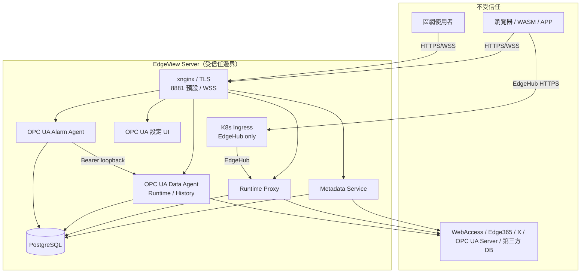

# CRA-01 威脅模型（Threat Modeling）

> 本文件以 **EdgeView（OPC UA 版）** 的實際元件、介面與資料流為基礎建立威脅模型，並對照 `SRS/`、`SDS/`、`62443/` 與 EU CRA。`CRA/(1)PID_TID.csv`、`CRA/(2)Analysis_TMRA.csv`、`CRA/(3)Database.csv` 為泛用威脅庫（WebAccess／EdgeHub-BI／X），本版僅引用其 PID/TID 分類方法，不將其風險登錄直接視為 EdgeView 的分析結果。

## 1. 文件資訊

| 項目 | 內容 |
|------|------|
| 文件編號 | CRA-01 |
| 文件名稱 | 威脅模型（Threat Modeling） |
| 版本 | 2.1 |
| 狀態 | 初稿（配合 CRA 技術文件送審） |
| 日期 | 2026-11-23 |
| 產品名稱 | EdgeView（OPC UA 版，HMI/SCADA 圖控設計與執行平台） |
| 評估範圍 | Client、xnginx、K8s Ingress（EdgeHub）、Metadata Service、Runtime Proxy、OPC UA 設定 UI、OPC UA Data Agent（Runtime/History）、OPC UA Alarm Agent、PostgreSQL |
| 資料源基準 | OPC UA（`DataSource=3`）；WebAccess／EdgeHub／X 僅作外部整合介面 |
| 文件語言 | 繁體中文（技術名詞保留英文） |
| 關聯文件 | [CRA-02 安全檢查點](CRA-02_Security_Checkpoint.md)、[CRA-03 編碼標準審查紀錄](CRA-03_Coding_Standards_Review_Record.md)、[CRA-04 產品安全使用手冊](CRA-04_Product_Security_User_Manual.md)、`SDS/08_Security_Design.md`、`SDS/11_Design_Decisions_and_Risks.md`、`SDS/13_Security_Remediation.md`、`SDS/14_OPCUA_Subsystem_Design.md`、`62443/EdgeView_IEC62443-4-2_OPCUA.md`、`62443/EdgeView_IEC62443-4-1_OPCUA.md` |

## 2. 目的與範圍

### 2.1 目的

1. 以 EdgeView + OPC UA 的實際資產、信任邊界、介面與資料流辨識威脅，而非套用其他產品的威脅清單。
2. 對每個風險登錄（RID）指定可能性、影響、風險等級、緩解措施（MID）、處置與標準對照。
3. 將威脅對應至 IEC 62443-4-2、EN 18031、EU CRA Annex I 與 STRIDE，作為 CRA 風險評鑑、CRA-02 檢查點與 CRA-03 編碼審查的依據。
4. 保留 PID/TID 分類作為方法論參考，並以附錄 A 提供舊版 RID 對照，避免跨文件追溯斷裂。

### 2.2 範圍

| 類別 | 納入 |
|------|------|
| 元件 | Qt Designer/Viewer（桌面／行動／瀏覽器 WASM）、xnginx（HTTPS 8881 預設、HTTP 8880 相容）、K8s Ingress（EdgeHub）、Metadata Service（:28883）、Runtime Proxy（:28884）、OPC UA 設定 UI（`/sc/opcua`）、OPC UA Data Agent（Runtime :28886／History :28887）、OPC UA Alarm Agent（:28889）、PostgreSQL（`waxconfig`／`waxalarm`／`waxlog`） |
| 介面 | HTTPS/WSS、REST/JSON、WebSocket、OPC UA TCP、內部 loopback HTTP/Bearer、PostgreSQL wire protocol、第三方資料源（SQL／InfluxDB／HTTP）、Edge365/EdgeHub API、WebAccess API、X API、Firebase FCM |
| 資料 | 帳號／密碼雜湊、Session／CSRF、`aes_secret`、TLS/OPC UA 憑證與 PFX、專案與 HMI 設定、JavaScript 腳本、Tag 即時值、歷史資料、警報與稽核日誌、第三方連線字串、FCM Token、授權檔 |
| 使用者角色 | 系統管理員、專案管理員、畫面設計者、現場操作員、系統整合者、OPC UA 設定者、警報操作員、唯讀／稽核者 |

### 2.3 不在範圍（由外部承擔）

| 項目 | 責任方 |
|------|--------|
| 作業系統核心、開機完整性、安全開機、OS 帳號與檔案權限 | OS／硬體 |
| 實體防拆、實體診斷介面、TPM／HSM | 硬體／機房 |
| 網路分段、防火牆、IDS/IPS、DDoS 清洗、VPN | 網路設備／維運 |
| PostgreSQL、OPC UA Server、第三方資料庫平台漏洞修補 | 平台／外部系統維運 |
| 客戶自訂腳本與專案的業務邏輯正確性 | 專案整合者（產品提供安全邊界與限制） |

> 上述項目以「Risk sharing/transference」或「不適用（OS／硬體／網路設備）」處理，並於 CRA-04 要求資產擁有者落實。

## 3. 參考文件與輸入

| 編號 | 來源 | 用途 |
|------|------|------|
| IN-01 | `SRS/02_Overall_Description.md`、`SRS/07_OPCUA_Subsystem.md` | 產品定位、元件、介面、OPC UA 功能與限制 |
| IN-02 | `SDS/02_System_Architecture.md`、`SDS/14_OPCUA_Subsystem_Design.md` | 執行期拓撲、連接埠、元件責任、OPC UA 設計 |
| IN-03 | `SDS/08_Security_Design.md` | 認證、授權、Session/CSRF、密碼學、傳輸、WebSocket、OPC UA 安全 |
| IN-04 | `SDS/11_Design_Decisions_and_Risks.md` | 風險登記 R-001~R-035、技術債、已接受限制 |
| IN-05 | `SDS/13_Security_Remediation.md` | 已修復項目與驗收（R-001/002/003/006/008/009） |
| IN-06 | `SRS/05_Nonfunctional_Requirements.md` | NFR-SEC／AUD／PRV／OPC／REL |
| IN-07 | `62443/EdgeView_IEC62443-4-2_OPCUA.md`、`62443/Evidence.md` | IEC 62443-4-2 逐條狀態與證據索引 |
| IN-08 | `62443/EdgeView_IEC62443-4-1_OPCUA.md` | 安全開發流程與 SR/SVV/DM 對照 |
| IN-09 | `CRA/(1)PID_TID.csv`、`CRA/(2)Analysis_TMRA.csv`、`CRA/(3)Database.csv` | PID/TID/MID 分類方法論參考（非 EdgeView 實際登錄） |
| IN-10 | `edgeview.cdx.json` | SBOM（CycloneDX 1.7） |

## 4. 方法論

### 4.1 流程

### 4.2 PID/TID 方法論與 EdgeView 威脅登錄的關係

- `(3)Database.csv` 提供「設備屬性（PID）→ 威脅（TID）→ 緩解（MID）」的分類知識庫；本文件沿用其**分類思維**，但不沿用其風險項目與評分。
- `(1)PID_TID.csv` 的 `Select=TRUE` 清單以泛用產品（WebAccess／EdgeHub-BI／X）為對象；EdgeView OPC UA 版僅保留與實際架構相符的屬性類別，並改以本文件的 RID-EV 登錄描述實際威脅情境。
- 與 EdgeView 相關的 PID 類別主要包括：PID-31／32（應用層軟體與可部署程式）、PID-311（Web/HTTP 應用）、PID-331／332／3321／3322（未認證／認證／密碼／密碼學認證服務）、PID-41／4111／4112／4113（遠端網路服務、訊息認證／加密、敏感資料密碼學）。其餘硬體、韌體、無線、實體介面屬性不適用。

### 4.3 風險評分（Qualitative）

| 等級 | 可能性（Likelihood） | 影響（Impact） |
|------|----------------------|----------------|
| High | 公開工具或一般技能即可遠端嘗試，或組態預設即存在 | 可導致越權、資料外洩、服務中斷或製程操作異常 |
| Moderate | 需特定條件、已驗證帳號或本機權限 | 局部功能中斷、敏感設定或有限資料外洩 |
| Low | 需高度專業、罕見條件或僅影響低價值資料 | 輕微功能或資訊影響 |

**風險矩陣**：

| 可能性 \ 影響 | Low | Moderate | High |
|---------------|-----|----------|------|
| High | Moderate | High | High |
| Moderate | Low | Moderate | High |
| Low | Low | Low | Moderate |

> 本版不採用 DREAD 量化；`Analysis_TMRA.csv` 的 DREAD 欄位未填值，僅保留為未來量化參考。

### 4.4 風險處置（Risk Treatment）

| 處置 | 說明 | 筆數 |
|------|------|------|
| Risk reduction（降低） | 以產品內建控制降低可能性或影響 | 57 |
| Risk acceptance（接受） | 已知限制、成本不符或需客戶流程承擔 | 6 |
| Risk sharing/transference（分擔／移轉） | 由 OS、網路、外部平台、部署端或第三方承擔 | 8 |

### 4.5 標準對照

- **IEC 62443-4-2**：71 筆 RID 均對應至 CR／RE 條文（見 §11.1）。
- **EN 18031-1**：網路安全機制（ACM／AUM／CCK／CRY／LGM／RLM／SCM／SSM／SUM）；**EN 18031-2**：隱私（PCM／PRM）；**EN 18031-3**：金融交易不適用。
- **EU CRA Annex I**：對應 (1)(a)~(1)(g) 必要網路安全要求（見 §11.3）。

### 4.6 涵蓋率

| 指標 | 數值 |
|------|------|
| 風險登錄（RID） | 71 |
| 高風險（High） | 41 |
| 中風險（Moderate） | 26 |
| 低風險（Low） | 4 |
| 緩解措施（MID） | 28 |
| 對應 IEC 62443-4-2 條文 | 42 條（含 RE） |
| 對應 EN 18031-1 機制類別 | 9 類 |

## 5. 系統描述與信任邊界

### 5.1 元件與關鍵資產

| 元件 | 角色 | 關鍵資產 | 安全職責 |
|------|------|----------|----------|
| Client（Designer/Viewer） | 畫面設計、HMI 執行、腳本與資料綁定 | Session、CSRF、專案快取、JavaScript 腳本、最近連線、WASM 儲存 | 不在前端實作安全邊界；依後端權限顯示 UI |
| xnginx | 地端唯一入口、TLS、路由、限流、服務監督 | TLS 憑證／私鑰、路由與限流設定 | 對外 HTTPS/WSS；後端 loopback |
| K8s Ingress | EdgeHub 雲端入口 | TLS 憑證、路由 | 僅 EdgeHub 路徑 |
| Metadata Service | 認證、授權、專案／使用者／設定、稽核 | 密碼雜湊、`http_sessions`、`csrfToken`、`aes_secret`、稽核日誌、專案設定 | Session/CSRF/RBAC/稽核 |
| Runtime Proxy | Record 查詢、WebSocket Hub、第三方資料代理、FCM | Session、第三方 DB 連線字串（AES）、WebSocket 訂閱 | 認證、訂閱授權、限流 |
| OPC UA 設定 UI | 專案／連線／Tag／警報／使用者設定 | 連線設定、PFX 參照、專案授權 | 僅經 Metadata API，不直接寫 DB／OPC UA |
| OPC UA Data Agent（Runtime） | 即時值、寫值、Tag 明細、瀏覽、憑證、測點計算 | OPC UA 應用憑證、PFX、連線池、快取 | Session/Bearer、OPC UA SecurityPolicy |
| OPC UA Data Agent（History） | 聚合與原始歷史查詢 | 歷史查詢參數、OPC UA 憑證 | 角色限制、查詢資源控制 |
| OPC UA Alarm Agent | 警報規則編譯、條件評估、狀態機、Ack/Process | 警報設定、`waxalarm` 狀態與歷史 | Session/Basic/Bearer、警報流程授權 |
| PostgreSQL | 設定、Session、稽核、警報、日誌 | `waxconfig`、`waxalarm`、`waxlog`、`http_sessions` | 最小權限帳號、內網存取 |

### 5.2 信任邊界

**邊界規則**（SDS-08 §2、SDS-02 §7）：

1. 地端請求一律經 xnginx（HTTPS `8881` 預設、WSS）；EdgeHub 經 K8s Ingress。
2. Metadata／Runtime／Data Agent／Alarm Agent 預設僅綁 loopback；對外只暴露 xnginx／Ingress。
3. PostgreSQL 僅限內網，使用最小權限帳號；瀏覽器不直接連 DB 或外部服務。
4. 後端與外部服務使用獨立認證（Session／Bearer／Basic／Token／憑證）。
5. Data Agent 與 Alarm Agent 之間的內部呼叫僅限 loopback Bearer；不得由外部直接呼叫 `28886`／`28887`／`28889`。

### 5.3 主要資料流

| 編號 | 路徑 | 協定 | 安全重點 |
|------|------|------|----------|
| DF-01 | Client → xnginx → Metadata `/sc` | HTTPS REST | Session、CSRF、RBAC、`packetTimestamp` |
| DF-02 | Client → xnginx → Runtime `/wxproxy`、`/ws` | HTTPS/WSS | Session、topic 授權、訂閱上限 |
| DF-03 | Client → xnginx → Data Agent `/ua`、`/uadb` | HTTPS REST | Session/CSRF、Tag 授權、時間戳 |
| DF-04 | Client → xnginx → Alarm Agent `/uaam` | HTTPS REST | Session/CSRF、Ack/Process 授權 |
| DF-05 | OPC UA 設定 UI → xnginx → Metadata `/sc/opcua`、`/sc/api` | HTTPS REST | Session、`settings-csrfToken`、角色 |
| DF-06 | Data Agent → OPC UA Server | OPC UA TCP | SecurityPolicy、SignAndEncrypt、憑證信任、UserIdentity |
| DF-07 | Alarm Agent → Data Agent | HTTP loopback | Bearer、來源限制、輪詢間隔 |
| DF-08 | Metadata／Runtime／Data Agent／Alarm → PostgreSQL | PostgreSQL | 內網、最小權限、TLS（部署選項） |
| DF-09 | Metadata／Runtime → WebAccess／Edge365／X | HTTPS | Token／Basic、憑證驗證、逾時 |
| DF-10 | Runtime → 第三方 DB／InfluxDB／FCM | 原生協定／HTTPS | 連線字串加密、TLS、憑證驗證 |

### 5.4 主要攻擊面

| 攻擊面 | 入口 | 代表 RID |
|--------|------|----------|
| Web/HTTP | `/sc`、`/wxproxy`、`/sc/opcua`、`/system`、`/getfile` | RID-EV-001、013、017~022、069 |
| WebSocket | `/ws`（topic/action） | RID-EV-023、024、055 |
| OPC UA | `/ua`、`/uadb`、`/uaam`、OPC UA TCP | RID-EV-027~038 |
| 身分與 Session | 登入、Session、CSRF、多來源 Token | RID-EV-002~010 |
| 授權 | 專案／畫面／OPC UA UserFunc | RID-EV-006、011、012、014、015 |
| 傳輸與金鑰 | TLS、AES、PFX、`aes_secret` | RID-EV-039~046、071 |
| 更新／供應鏈 | 安裝包、SBOM、第三方套件、客戶腳本 | RID-EV-047~052 |
| 日誌／稽核 | 稽核查詢、匯出、維護刪除 | RID-EV-053、054、062 |
| 可用性 | 限流、DB、外部平台、備份 | RID-EV-055~060 |

### 5.5 威脅角色

| 角色 | 能力 | 主要目標 |
|------|------|----------|
| 遠端未認證攻擊者 | 掃描、弱點利用、暴力破解、CSRF/XSS | 取得 Session、資料或中斷服務 |
| 低權限操作員 | 合法登入、檢視／操作被授權畫面 | 越權存取其他專案、偽造警報操作 |
| 惡意或疏忽的管理員 | 高權限設定、匯入匯出、刪除日誌 | 規避稽核、植入惡意專案或腳本 |
| 遭入侵的 OPC UA Server | 可控節點值、憑證、歷史資料 | 偽造資料、誘導操作、回傳惡意內容 |
| 網路中間人 | 攔截、降級、重放 | 竊取 Session／憑證、篡改指令 |
| 供應鏈攻擊者 | 污染套件、更新檔、SBOM | 植入後門、繞過簽章 |

## 6. 適用之設備屬性與威脅類別（PID/TID 方法論）

> 本節僅說明方法論對應；實際風險登錄以 §7 的 RID-EV 為準。

### 6.1 系統軟體（System Software）

| PID 類別 | EdgeView 對應 | 是否適用 | 說明 |
|----------|---------------|----------|------|
| PID-22 偵錯能力 | Swagger、健康端點、日誌 | 部分 | 需認證與權限；不暴露於公開網路 |
| PID-272 密碼學完整性 | TLS、OPC UA 憑證、程式簽章 | 部分 | 無硬體 root of trust；依 OS 憑證存放區 |
| PID-2722 數位簽章韌體 | 安裝包簽章 | 部分 | 軟體產品無韌體；安裝包簽章與 SBOM |
| PID-274 版本選擇 | 更新／降版 | 部分 | 允許降版，列為殘餘風險 |

### 6.2 應用軟體（Application Software）

| PID 類別 | EdgeView 對應 | 是否適用 | 代表 RID |
|----------|---------------|----------|----------|
| PID-31 應用層軟體 | Client、Metadata、Runtime、Agent、Alarm | 是 | RID-EV-047~052、070 |
| PID-311 Web/HTTP 應用 | xnginx、Metadata、Runtime、設定 UI | 是 | RID-EV-001、004、005、017~026 |
| PID-3121 物件導向語言 | C#、Go、JavaScript | 是 | RID-EV-021 |
| PID-3122 手動記憶體管理 | C/C++（Qt Client） | 是 | RID-EV-070 |
| PID-32 可部署自訂程式 | 專案、腳本、外掛、3D 資產 | 是 | RID-EV-022、051 |
| PID-331 未認證服務 | 公開端點、靜態資源 | 部分 | RID-EV-001、013 |
| PID-332 認證服務 | 登入、Session、Token | 是 | RID-EV-002~010 |
| PID-3321 密碼認證 | 本機／WebAccess／X 帳密 | 是 | RID-EV-002、003、009 |
| PID-3322 密碼學認證 | TLS、OPC UA 憑證、Session HMAC | 是 | RID-EV-027~031、039~046 |

### 6.3 網路（Networking）

| PID 類別 | EdgeView 對應 | 是否適用 | 代表 RID |
|----------|---------------|----------|----------|
| PID-41 遠端網路服務 | xnginx、Ingress、loopback 服務 | 是 | RID-EV-001、055、068 |
| PID-4111 訊息認證 | Session、Bearer、OPC UA Sign | 是 | RID-EV-023、027、035 |
| PID-4112 訊息加密 | HTTPS/WSS、OPC UA SignAndEncrypt | 是 | RID-EV-027、039、040 |
| PID-4113 敏感資料密碼學 | 密碼、Session、憑證、設定 | 是 | RID-EV-009、028、029、042~046、071 |

## 7. 風險登錄

### 7.1 統計

| 構面 | 分佈 |
|------|------|
| 風險等級 | High 41／Moderate 25／Low 5 |
| 類別 | IA 10／AC 6／WEB 10／OPC 12／CRY 8／INT 8／AVL 6／PRV 4／CFG 5／MEM 2 |
| 處置 | 降低 56／接受 7／分擔移轉 8 |
| 與 SDS-11 對應 | R-001~R-035 全部納入或標示已修復／已接受 |

### 7.2 完整風險登錄表

> 欄位：RID｜類別｜威脅情境｜受影響元件／介面｜STRIDE｜L｜I｜風險｜MID｜處置｜狀態／依據。

| RID | 類別 | 威脅情境（EdgeView／OPC UA） | 元件／介面 | STRIDE | L | I | 風險 | MID | 處置 | 狀態／依據 |
|-----|------|------------------------------|------------|--------|---|---|------|-----|------|-----------|
| RID-EV-001 | IA | 未認證存取 xnginx 公開端點或未受保護路由（`/getfile`、`/system` 等） | xnginx／Metadata | Spoofing | High | High | High | MID-EV-001、MID-EV-003 | 降低 | R-012；SDS-08 §2、§5 |
| RID-EV-002 | IA | 預設或弱密碼、硬編碼 DB 帳密（`postgres/Postgre@sql1`） | Metadata／Data Agent／PostgreSQL | Spoofing | High | High | High | MID-EV-004、MID-EV-027 | 降低 | R-018、R-028（Fixed）；SDS-08 §6.1 |
| RID-EV-003 | IA | 非 OPC UA 登入端點遭暴力破解或無限次嘗試 | Metadata／Client | Spoofing | High | Moderate | High | MID-EV-004、MID-EV-016 | 降低 | R-016；SDS-08 §3.1 |
| RID-EV-004 | IA | Session 偽造、固定或竊取（Cookie 未 HttpOnly／SameSite） | Metadata／xnginx | Spoofing | Moderate | High | High | MID-EV-003 | 降低 | R-005、R-001；SDS-08 §3.3、§5.1 |
| RID-EV-005 | IA | 對狀態變更 API 發動 CSRF（專案／使用者／設定） | Metadata／Runtime | Tampering | Moderate | High | High | MID-EV-003 | 降低 | R-005；NFR-SEC-005 |
| RID-EV-006 | IA | OPC UA 使用者或專案授權繞過（UserFunc／UserProject） | Data Agent／Config UI | Elevation of Privilege | Moderate | High | High | MID-EV-005 | 降低 | FR-OPC-011；SDS-08 §4 |
| RID-EV-007 | IA | WA／EH／X 多來源登入 Token 交換或驗證弱點 | Metadata | Spoofing | Moderate | High | High | MID-EV-023 | 分擔／移轉 | R-002-R；SDS-08 §7 |
| RID-EV-008 | IA | 未內建 MFA，管理帳號僅靠單一密碼 | Metadata | Spoofing | Moderate | High | High | MID-EV-025 | 接受 | CR 1.01 RE(2)；CRA-04 §7.4 |
| RID-EV-009 | IA | 密碼雜湊未加鹽（舊版 SHA-256 單次） | Metadata／xnginx／Runtime／Alarm | Information Disclosure | Low | High | Moderate | MID-EV-004 | 降低 | R-004（Fixed）；Argon2id + 隨機鹽 + pepper，舊雜湊登入即升級；SDS-08 §6.1 |
| RID-EV-010 | IA | Session 併發、逾時或登出未失效（7 天有效期） | Metadata／xnginx | Spoofing | Moderate | Moderate | Moderate | MID-EV-003 | 降低 | R-007（WS 登入 Fixed）；SDS-08 §3.3、§3.4 |
| RID-EV-011 | AC | 越權存取專案／畫面／物件（IDOR，未檢查 ACL） | Metadata／Runtime | Elevation of Privilege | Moderate | High | High | MID-EV-005 | 降低 | R-024；SDS-08 §4.2 |
| RID-EV-012 | AC | OPC UA 設定 UI 角色繞過（`graphic` 進入設定頁） | Config UI／Metadata | Elevation of Privilege | Moderate | High | High | MID-EV-005 | 降低 | FR-OPC-001、FR-OPC-011 |
| RID-EV-013 | AC | 公開檔案端點可列舉或未授權下載資源 | Metadata | Information Disclosure | High | Moderate | High | MID-EV-012、MID-EV-016 | 降低 | R-012；SDS-08 §9 |
| RID-EV-014 | AC | 管理操作（使用者、DB、匯入匯出）未集中授權 | Metadata | Elevation of Privilege | Moderate | High | High | MID-EV-005 | 降低 | R-024；NFR-SEC-002 |
| RID-EV-015 | AC | `/system` 服務管理端點遭濫用停用或重啟服務 | xnginx／system | Elevation of Privilege | Moderate | High | High | MID-EV-005、MID-EV-016 | 降低 | SDS-02 §3.3、§4 |
| RID-EV-016 | AC | 共用裝置或瀏覽器 Session 遭他人操作 | Client | Spoofing | Moderate | Moderate | Moderate | MID-EV-003、MID-EV-005 | 降低 | SDS-08 §3.4 |
| RID-EV-017 | WEB | HMI／Vue／WebPlugin 儲存型或反射型 XSS | Client／Config UI | Tampering | Moderate | High | High | MID-EV-011 | 降低 | CRA-03 F-023；SDS-08 §10 |
| RID-EV-018 | WEB | Metadata／Runtime SQL 注入（動態 SQL 組裝） | Metadata／Runtime | Tampering | Moderate | High | High | MID-EV-011 | 降低 | R-019（Fixed）；SDS-08 §10 |
| RID-EV-019 | WEB | 檔案 API 路徑穿越讀取任意檔案 | Metadata／Runtime | Information Disclosure | Moderate | High | High | MID-EV-012 | 降低 | R-012；CRA-03 F-022 |
| RID-EV-020 | WEB | HTTP 標頭注入或回應分割 | xnginx／Metadata | Tampering | Low | High | Moderate | MID-EV-011 | 降低 | SDS-08 §10 |
| RID-EV-021 | WEB | 不安全反序列化（JSON／Protobuf／外掛） | Metadata／Runtime／Data Agent | Tampering | Low | High | Moderate | MID-EV-011 | 降低 | CRA-03 CWE-502 |
| RID-EV-022 | WEB | 惡意或超大檔案上傳（75 MB、DB bytea） | Metadata | Tampering | Moderate | Moderate | Moderate | MID-EV-012、MID-EV-016 | 降低 | SDS-08 §9 |
| RID-EV-023 | WEB | WebSocket topic 未認證或訊息廣播給未授權者 | Runtime | Information Disclosure | Moderate | High | High | MID-EV-003 | 降低 | R-006、R-007（Fixed）；SDS-08 §8 |
| RID-EV-024 | WEB | WebSocket 訊息或連線數耗盡 Runtime 資源 | Runtime | Denial of Service | High | Moderate | High | MID-EV-016 | 降低 | R-016；SDS-08 §8 |
| RID-EV-025 | WEB | CORS／Origin 過寬（Data Agent／Ingress 允許任意來源帶憑證） | Data Agent／Ingress | Information Disclosure | High | Moderate | High | MID-EV-010 | 降低 | R-015、R-026；SDS-08 §8.1 |
| RID-EV-026 | WEB | 錯誤訊息或日誌洩漏密碼、Token、連線字串 | All | Information Disclosure | Moderate | Moderate | Moderate | MID-EV-019 | 降低 | R-023；SDS-08 §11 |
| RID-EV-027 | OPC | OPC UA 連線未加密或未簽章（SecurityPolicy 設定不當） | Data Agent／History／OPC Server | Information Disclosure | Moderate | High | High | MID-EV-006 | 降低 | NFR-OPC-008；SDS-14 §4.9 |
| RID-EV-028 | OPC | 自動接受不受信任憑證或允許 SHA1 憑證 | Data Agent | Spoofing | High | High | High | MID-EV-007 | 降低 | R-027；SDS-08 §8.1 |
| RID-EV-029 | OPC | OPC UA 應用憑證／PFX 私鑰外洩或未保護 | Data Agent／Config UI | Information Disclosure | Moderate | High | High | MID-EV-008 | 降低 | FR-OPC-005、FR-OPC-021；SDS-14 §4.5 |
| RID-EV-030 | OPC | OPC UA 使用者憑證洩漏或匿名登入 | Data Agent | Spoofing | Moderate | High | High | MID-EV-006、MID-EV-007 | 降低 | FR-OPC-014；SDS-14 §4.4 |
| RID-EV-031 | OPC | 未授權或超範圍寫值（SetTagValue） | Data Agent | Tampering | Moderate | High | High | MID-EV-005、MID-EV-006 | 降低 | FR-OPC-017；SDS-14 §4.3 |
| RID-EV-032 | OPC | 歷史查詢（GetDataLog／GetRawDataLog）資源耗盡或未授權 | History Agent | Denial of Service | Moderate | Moderate | Moderate | MID-EV-016 | 降低 | NFR-OPC-003；SDS-14 §4.6 |
| RID-EV-033 | OPC | Alarm Agent 過量輪詢 Data Agent 或未授權呼叫 | Alarm／Data Agent | Denial of Service | Moderate | Moderate | Moderate | MID-EV-009、MID-EV-016 | 降低 | R-032；SDS-14 §5.2 |
| RID-EV-034 | OPC | Alarm 設定重載與 runtime 落差導致規則未生效 | Alarm Agent | Tampering | Low | Moderate | Low | MID-EV-009 | 接受 | R-034；SDS-14 §5.7 |
| RID-EV-035 | OPC | Data Agent 時間戳中介層短路，重放請求可通過 | Data Agent | Tampering | Moderate | High | High | MID-EV-003、MID-EV-009 | 降低 | R-025；SDS-14 §7 |
| RID-EV-036 | OPC | Data Agent CORS 允許任意來源帶 Session | Data Agent | Information Disclosure | High | Moderate | High | MID-EV-010 | 降低 | R-026；SDS-08 §8.1 |
| RID-EV-037 | OPC | 大量 Tag 輪詢或訂閱耗盡 OPC UA Server 與 Agent | Data／Alarm Agent | Denial of Service | Moderate | Moderate | Moderate | MID-EV-016 | 降低 | R-032；NFR-OPC-002 |
| RID-EV-038 | OPC | 節點瀏覽洩漏位址空間與製程拓撲 | Data Agent | Information Disclosure | Low | Moderate | Low | MID-EV-005 | 接受 | FR-OPC-019；SDS-14 §4.7 |
| RID-EV-039 | CRY | 相容性 HTTP 8880 明文傳輸或 TLS 降級 | xnginx | Information Disclosure | Moderate | High | High | MID-EV-001 | 分擔／移轉 | SDS-08 §7；CRA-04 §8.3 |
| RID-EV-040 | CRY | 個別外部 client 停用 TLS 憑證驗證（InsecureSkipVerify） | Metadata／Runtime | Spoofing | Moderate | High | High | MID-EV-023 | 分擔／移轉 | R-002-R；SDS-08 §7 |
| RID-EV-041 | CRY | TLS 版本或演算法過弱（未限制 1.2／1.3） | xnginx／Ingress | Information Disclosure | Low | High | Moderate | MID-EV-001 | 降低 | SDS-08 §7 |
| RID-EV-042 | CRY | AES-256-CBC 缺乏完整性保護或 IV 管理不當 | Metadata／Runtime | Tampering | Low | High | Moderate | MID-EV-018 | 降低 | SDS-08 §6.2 |
| RID-EV-043 | CRY | 金鑰熵不足或跨環境共用 `aes_secret` | Metadata／Data Agent | Spoofing | Moderate | High | High | MID-EV-018、MID-EV-027 | 降低 | R-001、R-018（Fixed）；SDS-08 §3.3 |
| RID-EV-044 | CRY | Session secret 輪替或派生失敗導致舊 Session 可用 | Metadata | Spoofing | Low | High | Moderate | MID-EV-003、MID-EV-018 | 降低 | R-001（Fixed）；SDS-08 §3.3 |
| RID-EV-045 | CRY | 憑證到期、撤銷或主機名不符未處理 | xnginx／Data Agent | Spoofing | Moderate | Moderate | Moderate | MID-EV-008 | 分擔／移轉 | SDS-08 §7；CRA-04 §9 |
| RID-EV-046 | CRY | 金鑰／憑證備份未加密或遭竊 | All | Information Disclosure | Moderate | High | High | MID-EV-008、MID-EV-027 | 分擔／移轉 | SDS-10 §8 |
| RID-EV-047 | INT | 安裝／更新套件未簽章或簽章驗證可繞過 | Installer | Tampering | Low | High | Moderate | MID-EV-014、MID-EV-015 | 降低 | NFR-MNT-007；SDS-10 §9 |
| RID-EV-048 | INT | 允許降版或缺乏 anti-rollback | Installer | Tampering | Moderate | Moderate | Moderate | MID-EV-015 | 接受 | CR 3.04；SDS-10 §9 |
| RID-EV-049 | INT | 第三方套件已知高風險 CVE（CVSS ≥ 7.0） | All | Tampering | High | High | High | MID-EV-014 | 降低 | NFR-SEC-012；SDS-11 TD-006 |
| RID-EV-050 | INT | SBOM 不完整（未涵蓋 Data／Alarm Agent 與前端） | Build | Information Disclosure | Moderate | Moderate | Moderate | MID-EV-014 | 降低 | NFR-SEC-012；62443/Evidence.md |
| RID-EV-051 | INT | 客戶自訂 JavaScript／外掛未簽章或未審核 | Client／Metadata | Tampering | Moderate | High | High | MID-EV-011、MID-EV-015 | 接受 | CR 2.04；CRA-04 §12 |
| RID-EV-052 | INT | 執行期完整性或安全功能自我測試缺失 | All | Tampering | Moderate | Moderate | Moderate | MID-EV-014、MID-EV-024 | 降低 | CR 3.03；SDS-10 §7 |
| RID-EV-053 | INT | 稽核日誌可被管理者刪除或未即時告警 | Metadata | Repudiation | Moderate | Moderate | Moderate | MID-EV-013 | 降低 | R-017；SDS-08 §11 |
| RID-EV-054 | INT | 稽核 checksum 驗證或金鑰保護不足 | Metadata | Repudiation | Low | Moderate | Low | MID-EV-013 | 降低 | NFR-AUD-003；SDS-08 §6.3 |
| RID-EV-055 | AVL | xnginx 限流門檻過寬或直連 backend 繞過 | xnginx／Ingress | Denial of Service | High | Moderate | High | MID-EV-016 | 降低 | R-016；SDS-08 §13 |
| RID-EV-056 | AVL | WebSocket／Record 訂閱無 TTL 或上限導致累積 | Runtime | Denial of Service | Moderate | Moderate | Moderate | MID-EV-016 | 降低 | R-009（Fixed）；SDS-13 |
| RID-EV-057 | AVL | 單副本、無 probes、升級中斷 | Runtime／Alarm | Denial of Service | Moderate | Moderate | Moderate | MID-EV-024、MID-EV-026 | 降低 | R-022；SDS-10 |
| RID-EV-058 | AVL | PostgreSQL 不可用導致後端無法啟動 | PostgreSQL／Backend | Denial of Service | Moderate | High | High | MID-EV-017、MID-EV-024 | 分擔／移轉 | NFR-REL-001；SDS-02 §7 |
| RID-EV-059 | AVL | 備份未驗證或還原未演練 | All | Tampering | Moderate | High | High | MID-EV-017 | 降低 | NFR-REL-009；SDS-10 §8 |
| RID-EV-060 | AVL | WA／EH／X／OPC UA Server 中斷導致功能降級 | Metadata／Runtime／Data Agent | Denial of Service | High | Moderate | High | MID-EV-023、MID-EV-024 | 分擔／移轉 | NFR-REL-010；SDS-08 §7 |
| RID-EV-061 | PRV | 過度收集或保留帳號、IP、裝置資訊 | Metadata／Runtime | Information Disclosure | Moderate | Moderate | Moderate | MID-EV-020 | 降低 | NFR-PRV-001；SDS-08 §12 |
| RID-EV-062 | PRV | 日誌或錯誤回應含密碼、Token、個資 | All | Information Disclosure | High | High | High | MID-EV-019 | 降低 | R-023；SDS-08 §11 |
| RID-EV-063 | PRV | 資料抹除或共享記憶體清除未驗證 | All | Information Disclosure | Low | Moderate | Low | MID-EV-020 | 接受 | CR 4.02；SDS-08 §12 |
| RID-EV-064 | PRV | FCM Token 或裝置資訊外洩 | Runtime | Information Disclosure | Moderate | Moderate | Moderate | MID-EV-020 | 降低 | NFR-PRV-004；SDS-05 §8.5 |
| RID-EV-065 | CFG | 預設 DB 帳密或設定檔權限過寬 | Backend／PostgreSQL | Elevation of Privilege | High | High | High | MID-EV-027 | 降低 | R-018、R-028（Fixed）；SDS-10 §5 |
| RID-EV-066 | CFG | xnginx 設定變體漂移（正式部署固定單一 `Proxy\xnginx.yaml` 與 `SCServer\config.yaml`／`appsettings.json`，開發變體不並存） | xnginx | Tampering | Low | Moderate | Low | MID-EV-021 | 接受 | R-035（Accepted）；SDS-02 §3.3、SDS-10 §2.3 |
| RID-EV-067 | CFG | Alarm 埠／路徑預設不一致導致連錯或中斷 | Alarm／Client | Denial of Service | Moderate | Moderate | Moderate | MID-EV-021 | 降低 | R-029、R-030；SDS-14 §6 |
| RID-EV-068 | CFG | 不必要服務或埠對外暴露（後端未綁 loopback） | xnginx／Backend | Elevation of Privilege | Moderate | High | High | MID-EV-002、MID-EV-027 | 降低 | SDS-08 §2；SDS-02 §7 |
| RID-EV-069 | CFG | 部署／維運文件缺安全設定與加固指引 | Docs | Elevation of Privilege | Moderate | Moderate | Moderate | MID-EV-022 | 分擔／移轉 | CRA-04 §5、§6 |
| RID-EV-070 | MEM | Client C/C++ 記憶體安全（越界、UAF、第三方函式庫） | Client | Tampering | Moderate | High | High | MID-EV-011、MID-EV-022 | 降低 | CRA-03 F-024；SDS-03 |
| RID-EV-071 | MEM | 內部服務共用密鑰（`aes_secret`／Bearer）熵不足或未輪替 | Backend | Spoofing | Moderate | High | High | MID-EV-018 | 降低 | R-001、R-018（Fixed）；SDS-08 §3.3 |

### 7.3 高風險（High）清單

`RID-EV-001, RID-EV-002, RID-EV-003, RID-EV-004, RID-EV-005, RID-EV-006, RID-EV-007, RID-EV-008, RID-EV-011, RID-EV-012, RID-EV-013, RID-EV-014, RID-EV-015, RID-EV-017, RID-EV-018, RID-EV-019, RID-EV-023, RID-EV-024, RID-EV-025, RID-EV-027, RID-EV-028, RID-EV-029, RID-EV-030, RID-EV-031, RID-EV-035, RID-EV-036, RID-EV-039, RID-EV-040, RID-EV-043, RID-EV-046, RID-EV-049, RID-EV-051, RID-EV-055, RID-EV-058, RID-EV-059, RID-EV-060, RID-EV-062, RID-EV-065, RID-EV-068, RID-EV-070, RID-EV-071`

> 高風險集中在：未認證／弱認證與 Session（001~008）、授權與 IDOR（011~015）、Web 注入與檔案（017~019）、WebSocket 與 CORS（023~025）、OPC UA 憑證與寫值（027~031）、重放與 CORS（035、036）、明文／憑證驗證（039、040）、共用密鑰（043、071）、供應鏈與客戶腳本（049、051）、限流與可用性（055、058~060）、敏感日誌（062）、預設帳密（065）、後端暴露（068）、記憶體安全（070）。

## 8. 緩解措施目錄（MID）

| MID | 緩解措施 | 主要落點 | 對應 RID |
|-----|----------|----------|----------|
| MID-EV-001 | 強制 HTTPS/WSS 與 TLS 1.2+；關閉或限制 HTTP 8880 | xnginx／Ingress | 001、039、041 |
| MID-EV-002 | 後端 loopback 綁定與 xnginx／Ingress 單一入口 | 部署／網路 | 068 |
| MID-EV-003 | Session + CSRF + `packetTimestamp` + Cookie 屬性 | Metadata／Runtime／Data Agent | 001、004、005、010、016、023、035、044 |
| MID-EV-004 | 密碼政策、加鹽雜湊、失敗鎖定 | Metadata | 002、003、009 |
| MID-EV-005 | RBAC／專案／畫面／OPC UA UserFunc／UserProject | Metadata／Data Agent／UI | 006、011、012、014、015、016、031、038 |
| MID-EV-006 | OPC UA SecurityPolicy 與 SignAndEncrypt | Data Agent／OPC Server | 027、030、031 |
| MID-EV-007 | OPC UA 憑證信任清單、拒絕 SHA1、人工信任 | Data Agent | 028、030 |
| MID-EV-008 | PFX／憑證保護、輪替與備份加密 | Data Agent／Config UI | 029、045、046 |
| MID-EV-009 | Data Agent／Alarm Agent Bearer 僅 loopback、時間戳強制 | Data Agent／Alarm | 033、034、035 |
| MID-EV-010 | CORS／Origin 白名單與 Credentials 限制 | Data Agent／Ingress | 025、036 |
| MID-EV-011 | 輸入驗證、參數化查詢、輸出編碼、安全反序列化 | Metadata／Runtime／Client | 017~021、051、070 |
| MID-EV-012 | 上傳類型／大小／路徑正規化與檔案端點授權 | Metadata | 013、019、022 |
| MID-EV-013 | 稽核 SHA3-256、WORM／外部 SIEM、容量告警 | Metadata | 053、054 |
| MID-EV-014 | SBOM、相依掃描、程式簽章、VEX | Build／Release | 047、049、050、052 |
| MID-EV-015 | 更新簽章驗證與 anti-rollback | Installer | 047、048、051 |
| MID-EV-016 | xnginx `limit_req`、WS 訊息／連線限制、查詢速率限制 | xnginx／Runtime／Data Agent | 003、013、015、022、024、032、033、037、055、056 |
| MID-EV-017 | 備份／還原演練與完整性驗證 | 維運 | 058、059 |
| MID-EV-018 | AES-256-GCM、密鑰管理與輪替 | Metadata／Runtime | 042、043、044、071 |
| MID-EV-019 | 敏感日誌遮罩與錯誤訊息最小化 | All | 026、062 |
| MID-EV-020 | 資料保留、抹除與隱私最小化 | Metadata／Runtime | 061、063、064 |
| MID-EV-021 | 設定基準、變體比對與啟動煙霧測試 | xnginx／Alarm | 066、067 |
| MID-EV-022 | 安全開發、程式碼審查、滲透測試與訓練 | 流程 | 069、070 |
| MID-EV-023 | 外部平台 TLS 驗證、指定 CA 與 Token 驗證 | Metadata／Runtime | 007、040、060 |
| MID-EV-024 | 服務監督、watchdog、健康檢查與復原 | 部署 | 052、057、058、060 |
| MID-EV-025 | MFA／外部 IdP 整合 | Metadata | 008 |
| MID-EV-026 | 多副本共享狀態／Sticky Session | Runtime／Alarm | 057 |
| MID-EV-027 | 部署加固、最小權限與 Secret 管理 | 部署 | 002、043、046、065、068 |
| MID-EV-028 | 安全監控／SIEM 與事件回應 | 維運 | 053、062 |

## 9. 殘餘風險與已知限制

以下對應 `SDS/11` 的開放風險，於 CRA-04 要求部署端配合：

| SDS 風險 | 說明 | 對應 RID | 狀態 | 建議處置 |
|----------|------|----------|------|----------|
| R-004 | 密碼雜湊未加鹽（舊版 SHA-256） | RID-EV-009 | Fixed | Argon2id + 隨機鹽 + `aes_secret` pepper；舊雜湊登入即升級 |
| R-005 | CSRF Token Cookie 非 HttpOnly | RID-EV-004、005 | Open | HttpOnly + SameSite，前端改用 body token |
| R-012 | 公開檔案端點 | RID-EV-001、013、019 | Open | 授權／簽章 URL／限流 |
| R-015 | CORS／Origin 寬鬆 | RID-EV-025 | Open | 明確白名單 |
| R-016 | 速率限制／鎖定不足（OPC UA 以外） | RID-EV-003、024、055 | Mitigating | 登入專用限流、帳號鎖定、WS 訊息限流 |
| R-017 | 稽核日誌可被管理者刪除 | RID-EV-053 | Open | WORM／外部 SIEM |
| R-018／R-028 | 預設 DB 帳密 | RID-EV-002、065 | Fixed | 移除預設密碼；改用環境變數/Secret 與 `RegisterDBEnv.reg` |
| R-019 | 動態 SQL 組裝 | RID-EV-018 | Fixed | 識別字跳脫/白名單、值參數化、UpdateValue 欄位驗證 |
| R-023 | 日誌可能含敏感請求 | RID-EV-026、062 | Open | 遮罩敏感欄位 |
| R-024 | 權限檢查分散 | RID-EV-011、014 | Open | 集中式授權 middleware |
| R-025 | Data Agent 時間戳未強制 | RID-EV-035 | Fixed | 非 GET 強制毫秒時間戳、內部呼叫補值、新增測試；殘餘窗口內重放需 nonce/HMAC |
| R-026 | Data Agent CORS 過寬 | RID-EV-025、036 | Fixed | `CorsOriginPolicy` Origin 白名單（設定清單＋私有網段），僅白名單帶 Credentials |
| R-027 | OPC UA 憑證自動接受 | RID-EV-028 | Open | 信任清單、拒絕 SHA1 |
| R-029／R-030 | Alarm 埠／Root path 參數來源 | RID-EV-067 | Fixed | 統一預設；`dbport`/`alarmport` 由 Metadata `config.yaml` 經 `QueryBodyKey` 提供 |
| R-032 | OPC UA 大量輪詢 | RID-EV-033、037 | Open | 分組／訂閱／調整間隔 |
| R-035 | xnginx 設定變體漂移（正式部署固定單一 `Proxy\xnginx.yaml`） | RID-EV-066 | Accepted | 正式版僅部署固定路徑與單一設定；保留基準比對與啟動煙霧測試 |

> 已修復（SDS-13）：R-001 Session secret、R-002 全域 TLS 驗證、R-003 `/record/queryrecord`、R-006 WebSocket 認證、R-007 WS 登入 Session 綁定、R-008 輪詢間隔、R-009 Record TTL、R-018/R-028 預設 DB 帳密、R-019 動態 SQL。仍須以測試報告補證（CRA-02 CP-4）。

## 10. STRIDE 對照

| STRIDE | 代表 RID | 主要控制 | 殘餘風險 |
|--------|----------|----------|----------|
| Spoofing | 002、004、007、008、028、030、040、043、044、045、071 | Session/CSRF、密碼政策、憑證信任、Secret 管理 | MFA 未內建、個別 client 停用驗證、憑證生命週期 |
| Tampering | 005、017~022、031、034、035、042、047~052、070 | CSRF、輸入驗證、OPC UA Sign、更新簽章、時間戳 | 客戶腳本未簽章、CBC 完整性、anti-rollback |
| Repudiation | 053、054、062 | 稽核 SHA3-256、匯出、日誌遮罩 | 管理員可刪日誌、無 WORM |
| Information Disclosure | 009、013、019、023、025、026、027、029、036、039、046、061~064 | TLS、AES、CORS 白名單、檔案授權、日誌遮罩 | HTTP 8880、CBC、公開端點、日誌敏感資料 |
| Denial of Service | 003、015、024、032、033、037、055~060 | limit_req、TTL/上限、watchdog、備份 | 限流門檻、單副本、外部平台相依 |
| Elevation of Privilege | 006、011、012、014、015、065、068、069 | RBAC、專案 ACL、loopback、Secret 管理 | 權限檢查分散、預設帳密、後端暴露 |

## 11. 標準與法規對照

### 11.1 IEC 62443-4-2 對照

| RID | 主要條文（CR／RE） | RID | 主要條文（CR／RE） |
|-----|--------------------|-----|--------------------|
| RID-EV-001 | CR 1.01、1.13 | RID-EV-037 | CR 7.01 |
| RID-EV-002 | CR 1.05、1.07 | RID-EV-038 | CR 4.01 |
| RID-EV-003 | CR 1.11 | RID-EV-039 | CR 4.01 |
| RID-EV-004 | CR 3.08 | RID-EV-040 | CR 3.01 |
| RID-EV-005 | CR 3.08 | RID-EV-041 | CR 4.03 |
| RID-EV-006 | CR 1.03、2.01 | RID-EV-042 | CR 4.03 |
| RID-EV-007 | CR 1.02、3.01 | RID-EV-043 | CR 1.14 |
| RID-EV-008 | CR 1.01 RE(2) | RID-EV-044 | CR 1.14 |
| RID-EV-009 | CR 1.07、4.03 | RID-EV-045 | CR 1.08 |
| RID-EV-010 | CR 2.05、2.06、2.07 | RID-EV-046 | CR 4.01 |
| RID-EV-011 | CR 2.01 | RID-EV-047 | CR 3.04 |
| RID-EV-012 | CR 2.01 | RID-EV-048 | CR 3.04 |
| RID-EV-013 | CR 4.01 | RID-EV-049 | CR 3.04、7.08 |
| RID-EV-014 | CR 2.01 RE(3) | RID-EV-050 | CR 7.08 |
| RID-EV-015 | CR 2.01、7.07 | RID-EV-051 | CR 2.04 |
| RID-EV-016 | CR 2.03、2.05 | RID-EV-052 | CR 3.03 |
| RID-EV-017 | CR 3.05 | RID-EV-053 | CR 2.09、3.09 |
| RID-EV-018 | CR 3.05 | RID-EV-054 | CR 3.09 |
| RID-EV-019 | CR 3.05 | RID-EV-055 | CR 7.01 |
| RID-EV-020 | CR 3.05 | RID-EV-056 | CR 7.01 |
| RID-EV-021 | CR 3.05 | RID-EV-057 | CR 7.04 |
| RID-EV-022 | CR 3.02、7.01 | RID-EV-058 | CR 7.03、7.04 |
| RID-EV-023 | CR 3.08 | RID-EV-059 | CR 7.03 |
| RID-EV-024 | CR 7.01 | RID-EV-060 | CR 7.04 |
| RID-EV-025 | CR 5.01 | RID-EV-061 | CR 4.02 |
| RID-EV-026 | CR 1.10、4.01 | RID-EV-062 | CR 4.01 |
| RID-EV-027 | CR 3.01、4.01 | RID-EV-063 | CR 4.02 |
| RID-EV-028 | CR 1.08、1.09 | RID-EV-064 | CR 4.02 |
| RID-EV-029 | CR 1.08 | RID-EV-065 | CR 7.06 |
| RID-EV-030 | CR 1.01 | RID-EV-066 | CR 7.06 |
| RID-EV-031 | CR 2.01 | RID-EV-067 | CR 7.06 |
| RID-EV-032 | CR 7.01 | RID-EV-068 | CR 7.07 |
| RID-EV-033 | CR 7.01 | RID-EV-069 | CR 7.06 |
| RID-EV-034 | CR 3.04 | RID-EV-070 | CR 3.05 |
| RID-EV-035 | CR 3.08 | RID-EV-071 | CR 1.14 |
| RID-EV-036 | CR 5.01 | — | — |

> 逐條狀態、部分符合與不符合項目見 `62443/EdgeView_IEC62443-4-2_OPCUA.md`（141 項；附錄 A 38 項部分符合、附錄 B 8 項不符合）。

### 11.2 EN 18031 對照

| 標準 | 對應 RID | 主要機制 |
|------|----------|----------|
| EN 18031-1 | 001~060、065~071 | ACM（存取控制）、AUM（鑑別）、CCK（金鑰）、CRY（密碼學）、LGM（日誌）、RLM（韌性）、SCM（安全通訊）、SSM（安全儲存）、SUM（安全更新） |
| EN 18031-2 | 061~064 | PCM／PRM（個資與隱私保護） |
| EN 18031-3 | 不適用 | 本產品非金融交易設備 |

### 11.3 EU CRA Annex I（必要網路安全要求）

| CRA 要求 | 對應 RID | 狀態 |
|----------|----------|------|
| (1)(a) 設計即以適當安全等級保護 | 001~008、016、023、028、043、044、051、070、071 | 部分符合（§9 殘餘風險） |
| (1)(b) 預設安全組態 | 002、003、039、065、069 | 部分符合（HTTP 8880 相容；預設 DB 帳密已修，R-018/R-028） |
| (1)(c) 漏洞處理與更新 | 047~050、052 | 部分符合（簽章、SBOM；測試證據待補） |
| (1)(d) 攻擊面最小化 | 006、011、012、014、015、022、025、031、036、051、068 | 部分符合（角色、loopback、CORS） |
| (1)(e) 機密性與完整性 | 004、005、009、013、017~021、023、026~029、035、039~046、062~064 | 部分符合（TLS/AES/OPC UA；CBC 與個別 client 驗證待改善） |
| (1)(f) 可用性與韌性 | 003、015、024、032、033、037、055~060、067 | 部分符合（limit_req、watchdog；限流門檻與單副本） |
| (1)(g) 漏洞與事件資訊 | 050、053、054、069 | 待補（VDP／SIEM／WORM 流程） |

## 12. 假設、限制與待補證據

### 12.1 假設

1. 部署端關閉 HTTP `8880` 或僅導向 HTTPS `8881`；憑證由資產擁有者管理。
2. Metadata／Runtime／Data Agent／Alarm Agent 僅綁 loopback，對外經 xnginx；PostgreSQL 僅內網。
3. OPC UA 連線採 SignAndEncrypt 與信任清單；第三方資料源使用信任 CA。
4. 作業系統、虛擬化、硬體與網路設備已由資產擁有者加固；NTP 可用。
5. 使用者遵循 CRA-04 的帳號、密碼、憑證與部署要求。

### 12.2 限制

1. 本版為定性風險評分，未做 CVSS／DREAD 量化。
2. 部分 RID 仍需程式碼盤點與測試補證（尤其 017~021、025、035、070）。
3. `CRA/(2)Analysis_TMRA.csv` 為泛用威脅庫，未直接用於本版風險等級；其 DREAD 欄位未填值。
4. 未涵蓋 OS／硬體／網路設備（已移轉）。
5. 客戶自訂腳本與專案的業務邏輯安全由專案整合者承擔，產品僅提供執行邊界與限制。

### 12.3 待補證據

| 優先 | 證據 | 對應 |
|------|------|------|
| P0 | 登入／權限／稽核／HTTPS／OPC UA 加密測試報告 | RID-EV-001~012、027~031；CP-4 |
| P0 | 密碼政策／加鹽／鎖定測試 | RID-EV-003、009；R-004 |
| P0 | XSS／SQLi／CSRF／路徑／IDOR 盤點與測試 | RID-EV-005、011、017~021 |
| P0 | Data Agent 時間戳、CORS、憑證信任測試 | RID-EV-025、028、035、036 |
| P1 | 更新／程式簽章與完整性驗證 | RID-EV-047~052 |
| P1 | SBOM 合併（含 Data／Alarm Agent）+ Trivy／Grype + VEX | RID-EV-049、050 |
| P2 | 威脅模型複核紀錄與 VDP／SIEM 流程 | CRA Annex I (1)(g) |

## 13. 變更與維護

| 時機 | 動作 |
|------|------|
| 新功能／架構變更（新增介面、服務、資料源） | 重新評估信任邊界與攻擊面，新增或調整 RID |
| 新漏洞或 CVE | 對應 RID／CWE，更新風險與 MID |
| 每次版本發布 | 重跑 CRA-01、CRA-02、CRA-03，更新 SBOM 與證據 |
| 標準更新 | 同步 IEC 62443、EN 18031、CRA Annex I 對照 |
| 風險複評 | 至少每年一次，或重大事件後立即複評 |

**版本紀錄**

| 版本 | 日期 | 變更 |
|------|------|------|
| 1.0 | 2026-11-19 | 初版，依三份 CRA CSV 與 SDS/SRS/62443 建立 |
| 2.0 | 2026-11-23 | 改寫為 EdgeView + OPC UA 專屬威脅模型；新增 RID-EV-001~071、MID-EV-001~028，同步 IEC 62443-4-2／EN 18031／CRA Annex I 對照與舊 RID 對照 |
| 2.1 | 2026-11-23 | R-007（WS 登入掃描所有 Session）改為 Fixed；更新殘餘風險與 RID 對照 |
| 2.2 | 2026-11-23 | R-018/R-028（預設 DB 帳密）與 R-019（動態 SQL 組裝）改為 Fixed；同步 SDS-13 與驗收說明 |

## 14. 追溯

| 來源 | 對應章節 |
|------|----------|
| `SRS/02`、`SRS/07` | §5、§6 |
| `SDS/02`、`SDS/14` | §5、§7 |
| `SDS/08` | §5、§7、§8、§9、§10 |
| `SDS/11`、`SDS/13` | §9 |
| `SRS/05` | §7、§9（NFR-SEC／AUD／PRV／OPC／REL） |
| `62443/EdgeView_IEC62443-4-2_OPCUA.md` | §11.1 |
| `62443/EdgeView_IEC62443-4-1_OPCUA.md` | §4、§11 |
| `CRA/(1)PID_TID.csv`、`CRA/(2)Analysis_TMRA.csv`、`CRA/(3)Database.csv` | §4.2、§6、附錄 A |
| `CRA-02`、`CRA-03`、`CRA-04` | §9、§11、§12 |

## 附錄 A：舊版 RID 對照

> 舊版 RID-001~097 為泛用威脅庫展開；本版以 RID-EV 重新登錄。下表供 CRA-02、CRA-03、62443-4-1 等既有引用遷移使用。

| 舊 RID | 新 RID | 說明 |
|--------|--------|------|
| RID-001~005 | RID-EV-047、048 | 更新／開機完整性（多數由 OS 承擔） |
| RID-006~009 | RID-EV-029、046 | 金鑰／憑證硬體保護（無 HSM） |
| RID-010 | RID-EV-048 | 降版保護 |
| RID-011、012 | RID-EV-035 | 重放與時間戳 |
| RID-013~015 | RID-EV-015、024、055 | 服務中斷與可用性 |
| RID-016、017 | RID-EV-014、015 | 診斷／管理功能權限 |
| RID-018~021 | RID-EV-052 | 執行期完整性 |
| RID-022~028 | RID-EV-047、051 | 安裝／自訂程式信任 |
| RID-029、030 | RID-EV-047、070 | 工程軟體與二進位一致性 |
| RID-031~035 | RID-EV-051、070 | 執行環境與沙箱 |
| RID-036、037 | RID-EV-070 | 沙箱逃脫／記憶體安全 |
| RID-038、039 | RID-EV-001、068 | 未認證服務與後端暴露 |
| RID-040 | RID-EV-002 | 預設憑證 |
| RID-041 | RID-EV-014 | 憑證變更權限 |
| RID-042 | RID-EV-002、010 | 未認證變更憑證／Session |
| RID-043 | RID-EV-008 | MFA |
| RID-044 | RID-EV-003 | 暴力破解與鎖定 |
| RID-045 | RID-EV-013 | 密碼回復機制 |
| RID-046、047 | RID-EV-028 | 憑證驗證 |
| RID-048、049 | RID-EV-043、071 | 可預測金鑰／共用密鑰 |
| RID-050~055 | RID-EV-043 | 金鑰熵與硬體 RNG／HSM |
| RID-056~059 | RID-EV-042 | 密碼學實作（CBC／GCM） |
| RID-060 | RID-EV-017 | XSS |
| RID-061 | RID-EV-018 | SQL 注入 |
| RID-062、063 | RID-EV-004 | Session 劫持 |
| RID-064 | RID-EV-005 | CSRF |
| RID-065 | RID-EV-019 | 路徑穿越 |
| RID-066 | RID-EV-011 | IDOR |
| RID-067 | RID-EV-020 | HTTP 注入／回應分割 |
| RID-068 | RID-EV-021 | 不安全反序列化 |
| RID-069~072 | RID-EV-070 | 記憶體安全 |
| RID-073 | RID-EV-002、065 | 硬編碼憑證 |
| RID-074 | RID-EV-009 | 密碼儲存 |
| RID-075~080 | RID-EV-041、042 | 密碼學時序／演算法 |
| RID-081 | RID-EV-069 | 未文件化功能 |
| RID-082、083 | RID-EV-024、057 | DoS／watchdog |
| RID-084~086 | RID-EV-024、055 | 資源耗盡與限流 |
| RID-087、088 | RID-EV-027、039 | 未認證訊息／明文 |
| RID-089、090 | RID-EV-035 | 重放保護 |
| RID-091、092 | RID-EV-027、039 | 未加密敏感資料 |
| RID-093 | RID-EV-042 | 密碼協定側通道 |
| RID-094、095 | RID-EV-041、042 | 弱密碼協定 |
| RID-096、097 | RID-EV-041 | 後量子密碼（未部署） |
