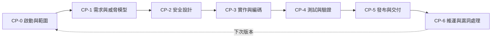

# CRA-02 安全檢查點（Security Checkpoint）

> 本文件定義 EdgeView 在 EU CRA（Cyber Resilience Act）與 IEC 62443-4-1 安全開發流程下的**階段檢查點（Checkpoint）與門檻（Gate）**，逐點登錄狀態、證據與待補事項，作為 CRA 技術文件中的「安全開發流程」證據。

## 1. 文件資訊

| 項目 | 內容 |
|------|------|
| 文件編號 | CRA-02 |
| 文件名稱 | 安全檢查點（Security Checkpoint） |
| 版本 | 1.2 |
| 狀態 | 初稿（含未通過／有條件通過項） |
| 日期 | 2026-11-23 |
| 產品名稱 | EdgeView（HMI/SCADA 圖控設計與執行平台） |
| 適用範圍 | EdgeView 完整系統與其 SDLC |
| 關聯文件 | [CRA-01 威脅模型](CRA-01_Threat_Modeling.md)、[CRA-03 編碼標準審查紀錄](CRA-03_Coding_Standards_Review_Record.md)、[CRA-04 產品安全使用手冊](CRA-04_Product_Security_User_Manual.md)、`SDS/08`、`SDS/11`、`SDS/13`、`62443/Evidence.md` |

## 2. 目的與範圍

1. 在產品生命週期各階段設置可驗證的安全檢查點，確保 CRA Annex I 與 IEC 62443-4-1 要求被落實。
2. 明確每個檢查點的**進入條件、檢查項目、證據、狀態與門檻決策**。
3. 追蹤未完成項與風險接受，避免未經評估即發布。
4. 與 CRA-01（威脅模型）、CRA-03（編碼審查）、CRA-04（使用手冊）互相追溯。

## 3. 名詞與狀態定義

| 名詞／狀態 | 說明 |
|-----------|------|
| Checkpoint（CP） | 階段的檢查點，於門檻前執行 |
| Gate | 是否允許進入下一階段的決策 |
| 通過（Pass） | 檢查項目具備且證據充分 |
| 有條件通過（Conditional） | 主要控制具備，但證據或補強項待完成；附條件放行 |
| 未通過（Fail） | 缺少必要控制或證據，不得放行 |
| 不適用（N/A） | 該項目不適用本產品（如硬體/實體介面） |
| 待補（Open） | 尚未執行或證據未提供 |
| 風險接受（Accepted） | 經核決接受殘餘風險，登錄於 CRA-01 §9 與 SDS-11 |

## 4. 角色與責任

| 角色 | 責任 |
|------|------|
| 產品負責人（PO） | 確認範圍、門檻決策、風險接受核決 |
| 安全負責人（Security Lead） | 維護檢查點、威脅模型、弱點與事件流程 |
| 開發負責人（Dev Lead） | 落實設計與編碼控制、修復發現 |
| 測試負責人（QA Lead） | 安全測試、回歸與證據產出 |
| 維運負責人（Ops Lead） | 部署加固、備份還原、監控與修補 |
| 獨立審查者（Reviewer） | 抽查證據、確認門檻未自我放行 |

## 5. 檢查點流程

## 6. 檢查點總表與門檻

| CP | 階段 | 進入條件 | 門檻（Exit） | 目前決策 |
|----|------|----------|--------------|----------|
| CP-0 | 啟動與範圍 | 產品版本、元件清單 | 範圍/邊界/角色核准 | 通過 |
| CP-1 | 需求與威脅模型 | 範圍核准 | SRS 安全需求、威脅模型、風險登錄 | 有條件通過 |
| CP-2 | 安全設計 | 需求基線 | SDS 安全設計、信任邊界、加密選擇 | 有條件通過 |
| CP-3 | 實作與編碼 | 設計核准 | 編碼標準、靜態檢查、秘密管理 | 有條件通過 |
| CP-4 | 測試與驗證 | 可建置版本 | 安全測試報告、負向測試、掃描結果 | 未通過（待補） |
| CP-5 | 發布與交付 | 測試通過 | SBOM、簽章、加固指南、Release Note | 有條件通過 |
| CP-6 | 維運與漏洞處理 | 已發布 | VDP、監控、修補 SLA、EOL | 有條件通過 |

## 7. 各檢查點清單

### 7.1 CP-0 啟動與範圍

| ID | 檢查項目 | 對應要求 | 證據 | 狀態 |
|----|----------|----------|------|------|
| CP0-01 | 產品版本與元件清單已定義 | CRA Annex VII、IEC 62443-4-1 | `README.md §1.1`、`62443/README.md §1` | 通過 |
| CP0-02 | 系統邊界、信任邊界與外部相依已定義 | CRA Annex I (1)(a) | `SDS/08 §2`、CRA-01 §5 | 通過 |
| CP0-03 | 角色與責任已指派 | IEC 62443-4-1 | 本文件 §4 | 有條件通過（需簽核） |
| CP0-04 | 資料源基準（OPC UA）與變體（WA/BI/X）界定 | CRA Annex VII | `SDS/01 §2`、`62443/README.md` | 通過 |
| CP0-05 | 適用法規/標準清單 | CRA | `62443/README.md`、CRA-01 §11 | 通過 |

**門檻決策：通過。** 待補：CP0-03 簽核。

### 7.2 CP-1 需求與威脅模型

| ID | 檢查項目 | 對應要求 | 證據 | 狀態 |
|----|----------|----------|------|------|
| CP1-01 | 安全功能需求已定義 | IEC 62443-4-1、CRA Annex I | `SRS/05`、`SRS/07` | 通過 |
| CP1-02 | 安全非功能需求（認證/授權/加密/稽核） | CRA Annex I (1)(a)(e) | `SRS/05 §5.2、§5.9、§5.10` | 通過 |
| CP1-03 | 威脅模型與風險登錄 | CRA Annex I、IEC 62443-3-2 | CRA-01 §7（71 RID） | 有條件通過（初稿，待複核） |
| CP1-04 | 風險評分方法與處置原則 | IEC 62443-3-3 | CRA-01 §4 | 通過 |
| CP1-05 | 安全需求 ↔ 威脅 ↔ 設計追溯 | CRA、IEC 62443-4-1 | `SDS/12`、CRA-01 §14 | 有條件通過（需補測試 ID） |
| CP1-06 | 適用標準與法規對照 | CRA、EN 18031 | CRA-01 §11、`62443/*` | 通過 |

**門檻決策：有條件通過。** 條件：CRA-01 風險等級經產品/資安複核簽核；補「風險 ↔ 測試案例」追溯。

### 7.3 CP-2 安全設計

| ID | 檢查項目 | 對應要求 | 證據 | 狀態 |
|----|----------|----------|------|------|
| CP2-01 | 認證與 Session 設計 | CR 1.1、3.8 | `SDS/08 §3` | 通過 |
| CP2-02 | 授權模型（專案/角色/安全區） | CR 2.1 | `SDS/08 §4` | 通過 |
| CP2-03 | CSRF 與請求完整性 | CR 3.8 | `SDS/08 §5` | 有條件通過（Cookie HttpOnly 待改，R-005） |
| CP2-04 | 密碼學設計（TLS/AES/雜湊） | CR 4.1、4.3 | `SDS/08 §6`、`SDS/13` | 有條件通過（密碼雜湊待強化，R-004） |
| CP2-05 | 傳輸安全與憑證管理 | CR 1.8、1.9、3.1、4.1 | `SDS/08 §7` | 有條件通過（個別 client 停用驗證，R-002-R） |
| CP2-06 | WebSocket 安全 | CR 3.8 | `SDS/08 §8`、`SDS/13 §5` | 通過（R-006、R-007 已修） |
| CP2-07 | OPC UA 子系統安全 | CR 1.x、3.1、4.1 | `SDS/08 §8.1`、`SDS/14` | 有條件通過（R-025~R-028 未關閉） |
| CP2-08 | 檔案上傳與輸入輸出控制 | CR 3.5 | `SDS/08 §9、§10` | 有條件通過（下載端點授權待補，R-012） |
| CP2-09 | 安全設計風險登記 | IEC 62443-4-1 | `SDS/11` | 通過 |

**門檻決策：有條件通過。** 條件：列出 R-004/R-005/R-002-R/R-025~R-028 的修復版本與補償控制。

### 7.4 CP-3 實作與編碼

| ID | 檢查項目 | 對應要求 | 證據 | 狀態 |
|----|----------|----------|------|------|
| CP3-01 | 編碼標準已定義（Go/C++/QML/C#/JS/SQL） | IEC 62443-4-1 | CRA-03 §3 | 通過 |
| CP3-02 | 秘密不寫入原始碼/版本庫 | CRA Annex I (e) | `SDS/13 §2`、CRA-03 §6 | 有條件通過（DB 預設帳密，R-018/R-028） |
| CP3-03 | 輸入驗證與參數化查詢 | CR 3.5 | `SDS/08 §10`、`SDS/13 §4` | 有條件通過（動態 SQL，R-019） |
| CP3-04 | 不安全函式與記憶體安全 | CR 3.2 | CRA-03 §4（CWE 對照） | 有條件通過（C/C++ 記憶體安全） |
| CP3-05 | 密碼學使用既有函式庫 | CR 4.3 | `SDS/08 §6` | 通過（OpenSSL/libsodium） |
| CP3-06 | 日誌不記錄敏感資料 | CR 2.8、CRA 隱私 | `SDS/08 §12` | 有條件通過（R-023 DumpRequest） |
| CP3-07 | 靜態分析/程式碼審查紀錄 | IEC 62443-4-1 | CRA-03 §6~§8 | 有條件通過（工具報告待補） |
| CP3-08 | 第三方元件與 SBOM 盤點 | CR 7.8、CRA Annex I | `edgeview.cdx.json`、`62443/Evidence.md §3` | 有條件通過（OPC UA Agent/Alarm 未合併） |

**門檻決策：有條件通過。** 條件：關閉或補償 R-018/R-019/R-023/R-028；提供靜態分析報告；補齊 SBOM 合併。

### 7.5 CP-4 測試與驗證

| ID | 檢查項目 | 對應要求 | 證據 | 狀態 |
|----|----------|----------|------|------|
| CP4-01 | 認證/授權/Session 測試 | CR 1.1、2.1、3.8 | 待補 | 待補 |
| CP4-02 | CSRF／時間戳／重放測試 | CR 3.8 | 待補 | 待補 |
| CP4-03 | HTTPS/TLS 組態與憑證測試 | CR 1.8、1.9、4.1 | 待補 | 待補 |
| CP4-04 | OPC UA SecurityMode/憑證/鎖定測試 | CR 1.1、3.1、4.1 | 待補 | 待補 |
| CP4-05 | Web 弱點測試（XSS/SQLi/路徑/IDOR/CSRF） | CR 3.5 | 待補（RID-EV-005、011、017~021 待盤點） | 待補 |
| CP4-06 | 負向測試（未登入 topic、越權、無效 token） | CR 3.8 | `SDS/13 §5.3、§5.4、§9` 為驗收條件，報告待補 | 有條件通過 |
| CP4-07 | 弱點掃描（SCA/SAST/DAST） | CR 3.2、3.4 | 待補 | 待補 |
| CP4-08 | 滲透測試 | CRA Annex I | 待補 | 待補 |
| CP4-09 | 效能/資源耗盡（限流）測試 | CR 7.1 | 待補 | 待補 |
| CP4-10 | 備份/還原演練 | CR 7.3、7.4 | 待補 | 待補 |
| CP4-11 | 修復項回歸（R-001/002/003/006/008/009） | IEC 62443-4-1 | `SDS/13 §9` 驗收條件 | 有條件通過（需報告） |

**門檻決策：未通過。** 條件：至少完成 CP4-01~CP4-07、CP4-11 並提供報告；滲透測試可列後續但需風險接受。這是目前**主要缺口**。

### 7.6 CP-5 發布與交付

| ID | 檢查項目 | 對應要求 | 證據 | 狀態 |
|----|----------|----------|------|------|
| CP5-01 | SBOM 產出（CycloneDX） | CR 7.8、CRA Annex I | `edgeview.cdx.json`（929 元件） | 有條件通過（缺 OPC UA Agent/Alarm） |
| CP5-02 | 更新/安裝包簽章 | CR 3.4、3.10 | Advantech + DigiCert、SHA-256、RFC 3161 | 通過 |
| CP5-03 | 版本與 Release Note（含安全修正） | CRA Annex I (c) | 流程存在（待附樣本） | 有條件通過 |
| CP5-04 | 安全設定/加固指南 | CRA Annex II | CRA-04 | 通過（初稿） |
| CP5-05 | 安全使用者資訊 | CRA Annex II | CRA-04 | 通過（初稿） |
| CP5-06 | 已知限制與殘餘風險揭露 | CRA Annex II | CRA-01 §9、CRA-04 §13 | 通過 |
| CP5-07 | 漏洞處置與 VEX | CRA Annex I | 待補 | 待補 |
| CP5-08 | 授權/第三方 Notice | CRA | `62443/Evidence.md §3` | 有條件通過（Notice 全文待補） |

**門檻決策：有條件通過。** 條件：補 OPC UA Agent/Alarm SBOM、VEX、Release Note 安全段落、第三方授權清冊。

### 7.7 CP-6 維運與漏洞處理

| ID | 檢查項目 | 對應要求 | 證據 | 狀態 |
|----|----------|----------|------|------|
| CP6-01 | 漏洞監控與 SBOM 更新 | CRA Annex I (c) | 流程（待文件化） | 待補 |
| CP6-02 | 安全修補 SLA 與版本支援 | CRA | 待補 | 待補 |
| CP6-03 | 弱點揭露政策（VDP）與聯絡窗口 | CRA Annex II | CRA-04 §15 | 有條件通過（需正式 VDP） |
| CP6-04 | 事件回應與通報流程 | CRA Article 14 | 待補 | 待補 |
| CP6-05 | 稽核日誌與監控 | CR 2.8、6.2 | `SDS/08 §11` | 有條件通過（無 SIEM/WORM） |
| CP6-06 | 備份/還原與容量告警 | CR 7.3 | `62443/*` | 有條件通過 |
| CP6-07 | EOL/停產與資料處置 | CRA | CRA-04 §16 | 有條件通過 |
| CP6-08 | 安全更新與回滾政策 | CR 3.10 | CRA-04 §11 | 通過（政策） |

**門檻決策：有條件通過。** 條件：建立 VDP、修補 SLA、事件通報流程文件，並與 CRA-04 同步。

## 8. 現況總覽

| CP | 決策 | 主要待補 |
|----|------|----------|
| CP-0 | 通過 | 角色簽核 |
| CP-1 | 有條件通過 | 風險複核、測試追溯 |
| CP-2 | 有條件通過 | R-004/R-005/R-002-R/R-025~R-028 修復計畫 |
| CP-3 | 有條件通過 | 秘密管理、動態 SQL、日誌遮罩、SAST、SBOM 合併 |
| CP-4 | **未通過** | 安全測試報告、掃描、滲透、還原演練 |
| CP-5 | 有條件通過 | VEX、Release Note、授權清冊、OPC UA SBOM |
| CP-6 | 有條件通過 | VDP、SLA、事件流程、SIEM/WORM |

### 8.1 缺口優先序

| 優先 | 缺口 | 對應 CP | 來源 |
|------|------|---------|------|
| P0 | 安全測試報告（登入/權限/稽核/HTTPS/OPC UA） | CP-4 | `62443/Evidence.md §5` |
| P0 | 密碼雜湊與政策 | CP-2/CP-3 | R-004、CR 1.05/1.07 |
| P0 | 硬編碼 DB 帳密 | CP-3 | R-018/R-028 |
| P0 | XSS/SQLi/路徑/IDOR 盤點 | CP-4 | RID-EV-005、011、017~021 |
| P1 | SBOM 合併與 VEX | CP-5 | `62443/Evidence.md §3` |
| P1 | 更新/程式簽章驗證 | CP-5 | CR 3.4/3.10 |
| P2 | VDP/SIEM/WORM | CP-6 | CR 2.09/3.09/6.02 |

## 9. 例外與風險接受

| 例外 ID | 項目 | 理由 | 補償控制 | 核決 | 到期 |
|---------|------|------|----------|------|------|
| EX-01 | 無 MFA（RID-EV-008） | 產品未內建 IdP | 外部 IdP/反向代理、鎖定 | 待核決 | 待定 |
| EX-02 | 客戶專案未逐一簽章（RID-EV-051） | 商業流程限制 | 原廠 binary 簽章、WDAC、權限 | 待核決 | 待定 |
| EX-03 | 無硬體加密模組（RID-EV-029/046） | 軟體產品 | OS 憑證存放、CSPRNG | 待核決 | 待定 |
| EX-04 | 明文 OPC UA／HTTP 8880（RID-EV-027/039） | 第三方協定與相容性 | VPN/專用網路、關閉 8880 | 待核決 | 待定 |

> 例外須於每次發布前複核，並同步 CRA-01 §9 與 CRA-04 §13。

## 10. 簽核

| 角色 | 姓名 | 決策 | 日期 |
|------|------|------|------|
| 產品負責人 |  |  |  |
| 安全負責人 |  |  |  |
| 開發負責人 |  |  |  |
| 測試負責人 |  |  |  |
| 獨立審查者 |  |  |  |

## 11. 版本紀錄

| 版本 | 日期 | 變更 |
|------|------|------|
| 1.0 | 2026-11-19 | 初版，建立 CP-0~CP-6 與現況 |
| 1.1 | 2026-11-23 | 對齊 CRA-01 v2.0：RID 數 97→71、舊 RID 改為 RID-EV 並更新例外項 |
| 1.2 | 2026-11-23 | 更新 CP2-06／CP4-06：R-007 WS 登入 Session 綁定已修復 |

## 12. 追溯

| 來源 | 對應 |
|------|------|
| CRA-01 | CP-1、CP-2、§9 |
| CRA-03 | CP-3 |
| CRA-04 | CP-5、CP-6 |
| `SDS/13` | CP-3、CP-4 |
| `62443/Evidence.md` | CP-4、CP-5、§8.1 |
