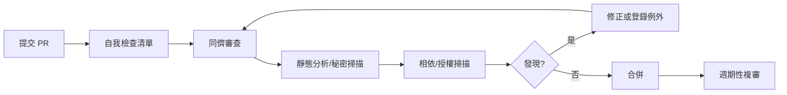

# CRA-03 編碼標準審查紀錄（Coding Standards Review Record）

> 本文件記錄 EdgeView 各語言／子系統所適用之編碼標準、安全編碼準則、審查流程、審查紀錄與發現（findings）。內容彙整自 `SDS/08`、`SDS/11`、`SDS/13` 與程式碼審查，並對應 CRA Annex I 與 IEC 62443-4-1／4-2 的「安全開發」要求。

## 1. 文件資訊

| 項目 | 內容 |
|------|------|
| 文件編號 | CRA-03 |
| 文件名稱 | 編碼標準審查紀錄（Coding Standards Review Record） |
| 版本 | 1.1 |
| 狀態 | 初稿（部分發現仍為 Open） |
| 日期 | 2026-11-23（彙整日） |
| 產品名稱 | EdgeView（HMI/SCADA 圖控設計與執行平台） |
| 範圍 | Client（C++/QML/JS）、Metadata Service（Go）、Runtime Proxy（Go）、OPC UA Data Agent（C#）、OPC UA Alarm Agent（Go）、OPC UA 設定 UI（Vue/JS）、SQL／設定檔 |
| 關聯文件 | [CRA-01 威脅模型](CRA-01_Threat_Modeling.md)、[CRA-02 安全檢查點](CRA-02_Security_Checkpoint.md)、[CRA-04 產品安全使用手冊](CRA-04_Product_Security_User_Manual.md)、`SDS/08`、`SDS/11`、`SDS/13` |

## 2. 目的與範圍

1. 建立各語言的編碼標準與安全編碼準則（secure coding）。
2. 以 CWE 對照常見弱點，作為程式碼審查清單。
3. 記錄審查週期、範圍、發現、修復狀態與例外。
4. 作為 CRA-02 CP-3（實作與編碼）與 CP-4（測試與驗證）的證據。

> 本紀錄為**彙整性審查紀錄**：發現（findings）以 `SDS/11` 風險登記與 `SDS/13` 修復紀錄為事實來源；正式發布前仍需補靜態分析與相依掃描報告（見 §9）。

## 3. 適用語言與編碼標準

| 子系統 | 語言／框架 | 編碼標準與工具 | 重點 |
|--------|-----------|----------------|------|
| Client | C++20、QML、JavaScript | Qt 6 編碼慣例、`clang-format`／`clang-tidy`、QML/QDoc 規範（`AGENTS.md`） | RAII/智慧指標、邊界檢查、QML 型別與 QDoc、JS 不使用 `eval` |
| Metadata Service | Go 1.23、Gin | `gofmt`、`go vet`、`staticcheck`、`gosec` | 錯誤處理、`context`、參數化 SQL、無硬編碼秘密、日誌遮罩 |
| Runtime Proxy | Go 1.23、Gin、Gorilla WebSocket | 同上 | WebSocket 認證、併發安全、TTL／上限、限流 |
| OPC UA Data Agent | C#／.NET、ASP.NET Core | .NET 編碼慣例、Roslyn analyzers、nullable | 非同步、憑證驗證、無預設帳密、CORS |
| OPC UA Alarm Agent | Go、Gin | Go 標準工具鏈 | Session 共用、告警狀態機、稽核 |
| OPC UA 設定 UI | Vue 2.7、JavaScript | ESLint（`eslint:recommended`）、Vue 官方風格 | 輸出編碼、避免 `v-html` 注入、API 錯誤處理 |
| SQL／設定 | SQL、YAML/INI | 參數化查詢、最小權限、無明文秘密 | 識別字白名單、連線字串以 Secret 管理 |

### 3.1 共通安全編碼準則

1. **輸入驗證**：所有外部輸入（HTTP/WS/表單/檔名/標頭）須驗證型別、長度、範圍；以白名單為原則。
2. **輸出編碼**：HTML/JS/URL/SQL/日誌輸出須依語境編碼或跳脫。
3. **參數化查詢**：SQL 一律使用參數（`$1`）；動態識別字須白名單與跳脫。
4. **秘密管理**：不得將密碼、金鑰、Token 寫入原始碼、設定範例或日誌；以環境變數／Secret 提供。
5. **密碼學**：使用 OpenSSL／libsodium 等成熟函式庫；不自製密碼演算法；使用 CSPRNG。
6. **認證與授權**：預設拒絕；管理操作需授權；不依前端隱藏作為安全邊界。
7. **錯誤處理**：不洩漏堆疊／敏感資訊；回傳一致錯誤碼（`-100/-101/-102/-500/-501`）。
8. **資源管理**：設定逾時、連線／訊息上限、TTL，避免資源耗盡。
9. **日誌**：記錄安全事件但不記錄密碼／Token／完整憑證。
10. **記憶體安全**：C/C++ 使用 RAII、邊界檢查、ASLR/DEP；避免不安全字串函式。

## 4. 安全編碼檢查清單（CWE 對照）

| CWE | 弱點 | 檢查重點 | 審查狀態 |
|-----|------|----------|----------|
| CWE-79 | XSS | 輸出編碼、CSP、避免 `innerHTML`／`v-html` | 待盤點驗證（RID-EV-017） |
| CWE-89 | SQL Injection | 參數化查詢、動態識別字白名單 | Open（R-019） |
| CWE-22 | Path Traversal | 路徑正規化、禁止 `..`、根目錄限制 | 有條件（RID-EV-019） |
| CWE-352 | CSRF | 同步 token／double-submit、SameSite | Open（R-005） |
| CWE-306 | Missing Authentication | 端點／topic／服務皆需認證 | 已修（R-003/R-006）、公開端點待處理（R-012） |
| CWE-798 | Hardcoded Credentials | 掃描原始碼與設定 | Open（R-018/R-028） |
| CWE-259 | Hardcoded Password | 同上 | 同上 |
| CWE-916 | Weak Password Hash | 加鹽、慢雜湊（Argon2id/bcrypt） | Open（R-004） |
| CWE-327 | Broken/Risky Crypto | 停用弱演算法、TLS 1.2+ | 部分符合 |
| CWE-295 | Improper Cert Validation | 不全域停用、信任清單 | 全域已修（R-002）、個別 client Open（R-002-R/R-027） |
| CWE-330 | Insufficient Randomness | CSPRNG、足夠熵 | 符合（MID-EV-008、018） |
| CWE-311 | Missing Encryption | 敏感傳輸加密（TLS） | 部分符合（明文協定除外） |
| CWE-319 | Cleartext Transmission | 停用 HTTP 或導向 HTTPS | 待部署配合（8880） |
| CWE-294 | Replay | 時間戳／nonce | 部分符合（R-025） |
| CWE-400 | Resource Exhaustion | 限流、上限、TTL | 部分符合（R-009/R-016） |
| CWE-532 | Log Exposure | 遮罩敏感欄位、避免 DumpRequest | Open（R-023） |
| CWE-209 | Error Info Leak | 一般化錯誤訊息 | 待盤點 |
| CWE-502 | Insecure Deserialization | 僅 Protobuf/JSON、長度限制 | 符合（RID-EV-021） |
| CWE-787 | OOB Write | 邊界檢查、記憶體安全 | 接受（C/C++，ASLR/DEP） |
| CWE-125 | OOB Read | 同上 | 接受 |
| CWE-416 | Use After Free | 智慧指標、生命週期 | 待工具驗證 |
| CWE-863 | Incorrect Authorization | 集中授權、預設拒絕 | Open（R-024） |
| CWE-942 | Permissive CORS | Origin 白名單 | Open（R-015/R-026） |
| CWE-601 | Open Redirect | 驗證轉址 | 待盤點 |
| CWE-918 | SSRF | 外部 URL 白名單、限制內網 | 待盤點 |
| CWE-611 | XXE | 停用外部實體、限制 XML 解析 | 待盤點（Client Xml） |
| CWE-190 | Integer Overflow | 長度／索引檢查 | 待工具驗證 |

## 5. 審查流程

- **PR 前**：開發者依 §4 清單自檢；不得提交秘密。
- **PR 中**：至少一位審查者；安全相關變更需安全負責人複核。
- **自動化**：CI 執行 `gofmt -l`、`go vet`、`staticcheck`、`gosec`、`clang-tidy`、ESLint、`dotnet build`／analyzers、秘密掃描（如 gitleaks）、SCA（如 Trivy/Grype）。
- **記錄**：發現登錄於 §7；修復後回填狀態與證據。

## 6. 審查週期與紀錄

| 紀錄 ID | 日期 | 子系統 | 範圍 | 方法 | 主要發現 | 結果 |
|---------|------|--------|------|------|----------|------|
| CSR-2026-01 | 2026-11 | Metadata／Runtime／xnginx | 認證、Session、CSRF、TLS | 人工 + SDS 追溯 | F-001、F-002、F-003、F-007、F-008 | 有條件通過 |
| CSR-2026-02 | 2026-11 | Runtime WebSocket | topic/action、登入、訂閱 | 人工 + SDS 追溯 | F-004、F-006、F-009 | 有條件通過 |
| CSR-2026-03 | 2026-11 | Runtime 設定／輪詢 | 輪詢間隔、資源上限 | 人工 + SDS 追溯 | F-005 | 通過（已修） |
| CSR-2026-04 | 2026-11 | OPC UA Data Agent | CORS、憑證、時間戳 | 人工 + SDS 追溯 | F-018、F-019、F-020 | 有條件通過（未修） |
| CSR-2026-05 | 2026-11 | Metadata Web/HTTP | 端點、輸入、授權、日誌 | 人工 + 清單 | F-010、F-011、F-012、F-015、F-016、F-017、F-022、F-023 | 有條件通過 |
| CSR-2026-06 | 2026-11 | Client（C++/QML/JS） | 記憶體安全、腳本、QML | 人工 + 清單 | F-024 | 有條件通過（接受） |
| CSR-2026-07 | 2026-11 | DB／設定／Secrets | 連線字串、金鑰 | 人工 + 設定檢查 | F-014、F-025 | 有條件通過 |

> 上表為本版**彙整紀錄**；正式複審需補工具報告與日期／審查者簽核（見 §10）。

## 7. 發現明細（Findings）

| ID | CWE | 位置／模組 | 描述 | 風險 | 修正／補償 | 狀態 | 來源 |
|----|-----|------------|------|------|------------|------|------|
| F-001 | CWE-798 | Metadata／Runtime 啟動 | Session secret 硬編碼 | Critical | 改 `SESSION_SECRET` 或 `aes_secret` HKDF 派生；無則啟動失敗 | Fixed | R-001 / SDS-13 |
| F-002 | CWE-295 | Runtime `wxproxy.go` | 全域 `InsecureSkipVerify` | High | 移除全域覆寫；個別 client 逐步改 CA | Fixed（全域）／Open（R-002-R） | R-002 |
| F-003 | CWE-306 | Runtime `RecordController` | `/record/queryrecord` 無認證 | Critical | 路由停用、Swagger 移除 | Fixed | R-003 |
| F-004 | CWE-306 | Runtime `webSocket.go` | 部分 topic 未認證即處理／廣播 | Medium | 分派前檢查 `AlreadyLogin`；systeminfo 登入後註冊 | Fixed | R-006 |
| F-005 | CWE-835／CWE-400 | Runtime `config.go` | EH/X 輪詢間隔 `-1` 造成忙迴圈 | High | 預設 1000ms；`normalizeIntervalMs` 夾 100ms | Fixed | R-008 |
| F-006 | CWE-400／CWE-401 | Runtime `RecordDataPolling` | 無 TTL／上限／統計 | Medium | idle TTL、上限、reaper、`Stats()` | Fixed | R-009 |
| F-007 | CWE-916／CWE-759 | Metadata `UserModel` | 密碼 SHA-256 單次、無鹽 | High | 遷移 Argon2id/bcrypt + 遷移計畫 | Open | R-004 |
| F-008 | CWE-1004／CWE-352 | Metadata `loginController` | CSRF Token Cookie 非 HttpOnly | Medium | HttpOnly + SameSite + body token | Open | R-005 |
| F-009 | CWE-307／CWE-203 | Runtime `loginController` | `verifyToken` 掃描所有 Session | Medium | 以 Session ID 驗證 | Open | R-007 |
| F-010 | CWE-306／CWE-639 | Metadata 檔案端點 | 公開 GET（`/getfile` 等） | Medium | 授權／簽章 URL／限流 | Open | R-012 |
| F-011 | CWE-942 | Ingress／Runtime | CORS/Origin 寬鬆 | Medium | 明確白名單、移除強制 Origin | Open | R-015 |
| F-012 | CWE-307／CWE-400 | xnginx／登入 | 限流門檻偏高、僅 OPC UA 有鎖定 | High | 登入專用限流、非 OPC UA 鎖定、WS 限流 | Mitigating | R-016 |
| F-013 | CWE-779 | Metadata `Maintenance` | 稽核日誌可被管理者刪除 | Medium | WORM／外部儲存、分權 | Open | R-017 |
| F-014 | CWE-798／CWE-1392 | Metadata／OPC UA Agent | 預設 DB 帳密寫死 | High | 強制環境變數／Secret、啟動檢查 | Open | R-018/R-028 |
| F-015 | CWE-89 | Metadata `convert.go` | 動態 SQL 組裝 | Medium | 白名單、跳脫、測試 | Open | R-019 |
| F-016 | CWE-532 | Metadata `authorizeCore` | `DumpRequest` 可能含敏感請求 | High | 遮罩欄位、降低等級 | Open | R-023 |
| F-017 | CWE-863 | Metadata 各 controller | 權限檢查分散、無統一 middleware | Medium | 集中式授權 middleware + 測試 | Open | R-024 |
| F-018 | CWE-294／CWE-345 | OPC UA Data Agent | `PacketTimestampMiddleware` 短路 | High | 移除短路、補時間戳測試 | Open | R-025 |
| F-019 | CWE-942 | OPC UA Data Agent | `SetIsOriginAllowed(_=>true).AllowCredentials()` | High | Origin 白名單、限制 Credentials | Open | R-026 |
| F-020 | CWE-295 | OPC UA Data Agent | `AutoAcceptUntrustedCertificates=true`、允許 SHA1 | High | 信任清單、拒絕 SHA1 | Open | R-027 |
| F-021 | CWE-1188 | OPC UA Alarm／部署 | 預設埠不一致（8090／28889） | Medium | 統一預設與文件 | Open | R-029 |
| F-022 | CWE-22 | Web API 檔案讀取 | 路徑穿越風險 | High | 正規化 + 根目錄限制（待驗證） | 待盤點 | RID-EV-019 |
| F-023 | CWE-79 | Web／QML 輸出 | XSS／輸出編碼 | High | 依語境編碼、CSP（待盤點） | 待盤點 | RID-EV-017 |
| F-024 | CWE-787／CWE-125 | Client C/C++ | 記憶體邊界與 UAF | High | ASLR/DEP、RAII、邊界檢查 | 接受（搭配硬化） | RID-EV-070 |
| F-025 | CWE-330 | 安裝／金鑰 | 對內 ZeroMQ 預設共用 access code | High | 安裝時強制輸入唯一 access code | Open | RID-EV-043／071 |

### 7.1 發現狀態統計

| 狀態 | 數量 |
|------|------|
| Fixed | 6（F-001~F-004、F-005、F-006） |
| Open | 13 |
| Mitigating | 1 |
| 待盤點／待驗證 | 3 |
| 接受 | 1 |

> 註：F-001~F-006 對應 `SDS/13 §1` 已修項目，仍需 CP-4 回歸測試報告。

## 8. 語言別符合性檢查表

### 8.1 Go（Metadata／Runtime／Alarm）

| 檢查項 | 狀態 | 備註 |
|--------|------|------|
| `gofmt`／`go vet` 無錯誤 | 待補 | CI 報告待附 |
| 錯誤處理不忽略 | 部分符合 | 需 `staticcheck` 驗證 |
| 參數化 SQL | 部分符合 | 動態 SQL（F-015） |
| 無硬編碼秘密 | 不符 | F-014/F-025 |
| 日誌遮罩 | 不符 | F-016 |
| 併發安全（map/slice） | 部分符合 | R-009 已補併發保護 |

### 8.2 C++／Qt／QML

| 檢查項 | 狀態 | 備註 |
|--------|------|------|
| RAII／智慧指標 | 部分符合 | 待 `clang-tidy` |
| 邊界與整數檢查 | 部分符合 | C/C++（F-024） |
| QML 型別與 QDoc | 符合 | `AGENTS.md` 規範 |
| JS 不使用 `eval` | 部分符合 | 腳本引擎限制 |
| 編譯硬化（ASLR/DEP） | 符合 | Windows 建置 |

### 8.3 C#／.NET（OPC UA Data Agent）

| 檢查項 | 狀態 | 備註 |
|--------|------|------|
| Nullable／analyzers | 待補 | 建置報告待附 |
| 憑證驗證 | 不符 | F-020 |
| CORS 白名單 | 不符 | F-019 |
| 無預設帳密 | 不符 | F-014 |
| 時間戳中介層 | 不符 | F-018 |

### 8.4 JavaScript／Vue（設定 UI）

| 檢查項 | 狀態 | 備註 |
|--------|------|------|
| ESLint 無 error | 待補 | 報告待附 |
| 輸出編碼／避免 `v-html` | 部分符合 | F-023 |
| API 錯誤處理 | 部分符合 | 統一代碼 |

### 8.5 SQL／設定

| 檢查項 | 狀態 | 備註 |
|--------|------|------|
| 參數化查詢 | 部分符合 | F-015 |
| 識別字白名單 | 部分符合 | `convert.go` |
| 連線字串以 Secret 管理 | 不符 | F-014 |
| 設定範例無明文秘密 | 待補 | 需檢視 `config.yaml`／`appsettings.json` |

## 9. 工具與 CI

| 類別 | 建議工具 | 狀態 |
|------|----------|------|
| Go 格式／靜態 | `gofmt`、`go vet`、`staticcheck`、`gosec` | 待接入／待附報告 |
| C/C++ 靜態 | `clang-tidy`、`cppcheck` | 待接入 |
| C# 靜態 | Roslyn analyzers、`dotnet format` | 待接入 |
| JS 靜態 | ESLint | 待接入 |
| 秘密掃描 | gitleaks／trufflehog | 待接入 |
| 相依／SBOM | Syft、Trivy、Grype | SBOM 已產出（`edgeview.cdx.json`），掃描報告待補 |
| DAST | OWASP ZAP | 待補 |

## 10. 例外與豁免

| ID | 項目 | 理由 | 補償控制 | 核決 | 到期 |
|----|------|------|----------|------|------|
| WV-01 | C/C++ 記憶體安全（F-024） | 產品含 C++ 元件 | ASLR/DEP、行程隔離、程式碼審查 | 待核決 | 待定 |
| WV-02 | 客戶自訂程式未簽章 | 商業流程 | 原廠簽章、WDAC、權限 | 待核決 | 待定 |
| WV-03 | 明文第三方 Driver Protocol | 協定限制 | VPN／專用網路、文件標示 | 待核決 | 待定 |

> 豁免須於 CRA-02 §9 同步登錄，並在下次發布前複核。

## 11. 簽核與複審

| 角色 | 姓名 | 結論 | 日期 |
|------|------|------|------|
| 開發負責人 |  |  |  |
| 安全負責人 |  |  |  |
| 測試負責人 |  |  |  |
| 獨立審查者 |  |  |  |

**複審週期**：每次主要版本、重大架構變更、或高風險發現修復後。

## 12. 版本紀錄

| 版本 | 日期 | 變更 |
|------|------|------|
| 1.0 | 2026-11-19 | 初版，彙整編碼標準、CWE 清單、審查紀錄與發現 |
| 1.1 | 2026-11-23 | 對齊 CRA-01 v2.0：舊 RID/MID 改為 RID-EV/MID-EV |

## 13. 追溯

| 來源 | 對應 |
|------|------|
| `SDS/08` | §3、§4、§7 |
| `SDS/11` | §6、§7 |
| `SDS/13` | §6、§7（F-001~F-006） |
| `62443/Evidence.md` | §9、§11 |
| CRA-02 | CP-3、CP-4 |
| CRA-01 | RID 對照（§4、附錄 A） |
