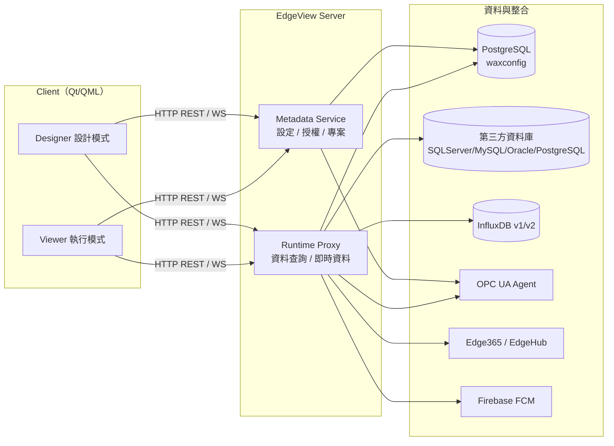

# EdgeView 軟體需求規格書（SRS）與軟體設計規格書（SDS）

> 本目錄彙整 EdgeView 產品的軟體需求規格（Software Requirements Specification, SRS）與軟體設計規格（Software Design Specification, SDS）。內容依據下列三個程式碼庫的實際實作逆向整理，並輔以既有 EdgeView 文件與功能清單。

## 1. 文件資訊

| 項目 | 內容 |
|------|------|
| 產品名稱 | EdgeView（HMI/SCADA 圖控設計與執行平台） |
| 文件版本 | 1.0 |
| 文件狀態 | 初版（依現行程式碼現況整理） |
| 文件語言 | 繁體中文（技術名詞保留英文原文） |
| 整理日期 | 2026-11-13 |
| 適用對象 | 產品經理、系統分析師、前後端工程師、測試工程師、DevOps、資安與稽核人員 |

### 1.1 程式碼基準（Code Baseline）

| 子系統 | 角色 | 程式碼路徑 | 技術棧 |
|--------|------|------------|--------|
| 前端 Client（Designer + Viewer） | HMI 畫面設計與執行 | Git Repo: [EdgeView client](https://dev.azure.com/SWOrchestrationCenter/EdgeSync%20360/_git/wax_hmi-designer-client.git) | C++ / Qt 6 / QML、SCDraw2D/SCDraw3D、NanoCanvas |
| 後端 Metadata Service | 設定、專案、使用者、授權、OPC UA 設定 | Git Repo: [EdgeView metadata server](https://dev.azure.com/SWOrchestrationCenter/EdgeSync%20360/_git/wax_metadata-service.git) | Go / Gin / PostgreSQL |
| 後端 Runtime Proxy | 第三方資料查詢、即時資料代理、告警摘要 | Git Repo: [EdgeView datasource server](https://dev.azure.com/SWOrchestrationCenter/EdgeSync%20360/_git/wax_rutime_proxy) | Go / Gin / Gorilla WebSocket / PostgreSQL |

### 1.2 參考文件

- `D:\Document\2026 EdgeView Features.docx`：EdgeView 功能藍圖（3D、Data Source Group、Theme、Grid/RWD 等）。
- `D:\Document\EdgeViewDoc\docs\Server\meta\*`：Metadata Service 既有 API 文件（Widdershins/Swagger 產生）。
- `D:\Document\EdgeViewDoc\docs\Server\record\*`：Runtime Proxy 既有 REST/WebSocket API 文件。
- `wax_metadata-service\docs\swagger.yaml`、`wax_rutime_proxy\docs\swagger.yaml`：OpenAPI 定義。
- `wax_rutime_proxy\websocket 開發文件.md`：WebSocket topic/action 設計說明。

## 2. 系統定位摘要

EdgeView 為三層式 HMI/SCADA 平台：

- **Designer**：專案/畫面設計、Widget 屬性編輯、Tag/Variable/Record 綁定、事件腳本、動畫、3D 場景、匯入匯出、使用者與系統設定。
- **Viewer**：載入已設計畫面，透過 WebSocket 接收即時資料、告警摘要，提供操作、巡邏、縮放、通訊狀態、資料來源狀態等執行期功能。
- **Metadata Service**：提供設定 API 與授權（登入、Session、CSRF、專案權限），管理專案物件樹、Display、Variable、DataModel、Record、Recipe、Alarm、User/Group、OPC UA 組態、系統設定、稽核與匯入匯出。
- **Runtime Proxy**：提供 Record 查詢/預覽/分頁、Datalog 歷史查詢、WebSocket 即時資料與告警摘要、Edge365 反向代理、Firebase 推播。

## 3. 文件索引

### 3.1 SRS（軟體需求規格書）

| 編號 | 檔案 | 內容 |
|------|------|------|
| SRS-01 | [SRS/01_Introduction.md](SRS/01_Introduction.md) | 目的、範圍、對象、定義、參考、文件結構 |
| SRS-02 | [SRS/02_Overall_Description.md](SRS/02_Overall_Description.md) | 產品定位、系統脈絡、使用者角色、營運環境、限制與假設 |
| SRS-03 | [SRS/03_Functional_Requirements.md](SRS/03_Functional_Requirements.md) | 功能需求（FR-CLI / FR-META / FR-RT），含優先級與驗收條件 |
| SRS-04 | [SRS/04_External_Interface_Requirements.md](SRS/04_External_Interface_Requirements.md) | 使用者、硬體、軟體、通訊介面需求 |
| SRS-05 | [SRS/05_Nonfunctional_Requirements.md](SRS/05_Nonfunctional_Requirements.md) | 效能、安全、可靠度、可維護、可攜、i18n、稽核 |
| SRS-06 | [SRS/06_Acceptance_and_Traceability.md](SRS/06_Acceptance_and_Traceability.md) | 驗收準則與需求追溯 |

### 3.2 SDS（軟體設計規格書）

| 編號 | 檔案 | 內容 |
|------|------|------|
| SDS-01 | [SDS/01_Introduction.md](SDS/01_Introduction.md) | 設計目標、範圍、原則、參考 |
| SDS-02 | [SDS/02_System_Architecture.md](SDS/02_System_Architecture.md) | 系統架構、元件、部署、技術棧 |
| SDS-03 | [SDS/03_Client_Design.md](SDS/03_Client_Design.md) | Qt/QML Client 詳細設計 |
| SDS-04 | [SDS/04_Metadata_Service_Design.md](SDS/04_Metadata_Service_Design.md) | Metadata Service 詳細設計 |
| SDS-05 | [SDS/05_Runtime_Proxy_Design.md](SDS/05_Runtime_Proxy_Design.md) | Runtime Proxy 詳細設計 |
| SDS-06 | [SDS/06_Data_Model.md](SDS/06_Data_Model.md) | ER 圖與資料表字典 |
| SDS-07 | [SDS/07_Interface_Design.md](SDS/07_Interface_Design.md) | 完整 REST / WebSocket 介面目錄與錯誤碼 |
| SDS-08 | [SDS/08_Security_Design.md](SDS/08_Security_Design.md) | 認證、授權、加密、Session、風險 |
| SDS-09 | [SDS/09_Key_Flows.md](SDS/09_Key_Flows.md) | 關鍵作業循序圖 |
| SDS-10 | [SDS/10_Deployment_and_Operations.md](SDS/10_Deployment_and_Operations.md) | 組態、連接埠、部署、日誌、維運 |
| SDS-11 | [SDS/11_Design_Decisions_and_Risks.md](SDS/11_Design_Decisions_and_Risks.md) | 設計取捨、已知限制與技術債 |
| SDS-12 | [SDS/12_Traceability.md](SDS/12_Traceability.md) | SRS ↔ SDS ↔ 程式碼追溯 |

## 4. 需求編號規則

| 前綴 | 意義 | 範例 |
|------|------|------|
| `FR-CLI-nnn` | Client（Designer/Viewer）功能需求 | `FR-CLI-010` |
| `FR-META-nnn` | Metadata Service 功能需求 | `FR-META-020` |
| `FR-RT-nnn` | Runtime Proxy 功能需求 | `FR-RT-020` |
| `NFR-xxx-nnn` | 非功能需求（PERF/SEC/REL/MNT/PORT/I18N/AUD） | `NFR-SEC-001` |
| `IF-xxx-nnn` | 外部介面需求 | `IF-COM-001` |

優先級定義：

- **Must**：產品核心，缺少即無法交付。
- **Should**：重要，可在次要版本補齊。
- **Could**：加分功能，視資源排入。

## 5. 名詞與縮寫

| 名詞 | 說明 |
|------|------|
| HMI | Human Machine Interface，人機介面 |
| SCADA | Supervisory Control and Data Acquisition |
| Designer | EdgeView 設計模式（`openMode = edit/config`） |
| Viewer | EdgeView 執行模式（`openMode = view/preview`） |
| Display / Drawing | 畫面（Drawing 為 Client 用語，Display 為後端資料表用語） |
| Widget | 畫面元件，如按鈕、儀表、圖表、3D Viewer |
| Tag | 裝置/資料來源的即時點位 |
| Variable | 專案或畫面層級變數，可為常數、系統或運算式 |
| DataModel | 資料模型，包含一組 Variable 定義，可跨畫面重用 |
| Record | 資料錄查詢定義（SQL / InfluxQL / HTTP） |
| Recipe | 配方，包含參數值與單位 |
| Alarm | 警報設定與摘要 |
| ObjectPath | 專案物件樹，使用 PostgreSQL `ltree` 儲存階層路徑 |
| CSRF Token | 跨站請求偽造防護權杖，REST/WS 皆需帶入 |
| Session | 伺服器端工作階段，儲存於 PostgreSQL `http_sessions` |
| Edge365 / EdgeHub | Advantech 雲端平台與其資料來源 |
| BI | Business Intelligence / EdgeHub 模式（`SourceTypeBI`） |
| X | 另一資料來源平台（`SourceTypeX`） |
| FCM | Firebase Cloud Messaging |

## 6. 文件維護原則

1. 需求變更時，同步更新 SRS 對應條目與 SDS 追溯表（`SDS/12_Traceability.md`）。
2. 程式碼行為與文件不一致時，以程式碼為事實來源，並在 SDS-11 記錄差異與待改善項。
3. 所有 API 路徑以 Metadata Service 與 Runtime Proxy 的實際路由註冊為準。
4. 本文件不包含機密金鑰、憑證或實際帳號密碼。
