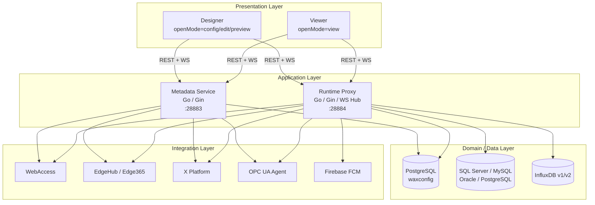
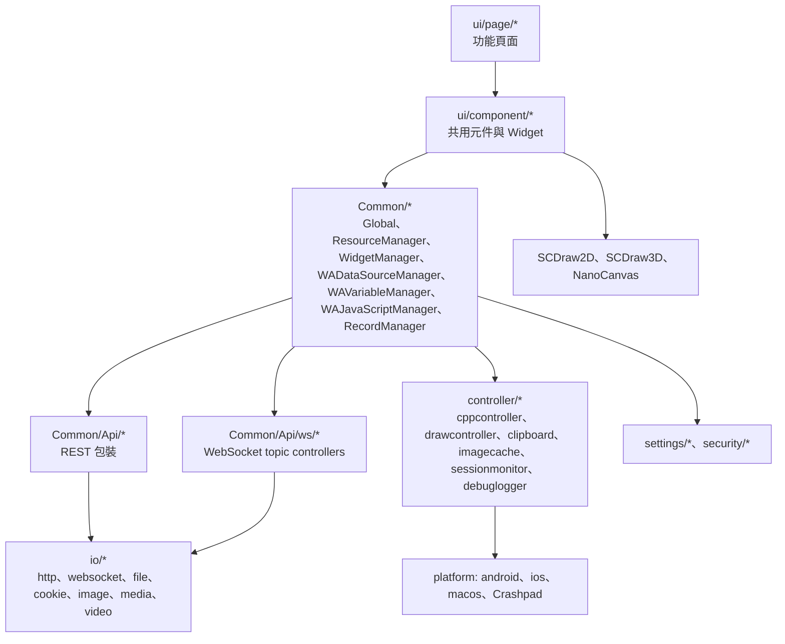
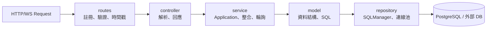
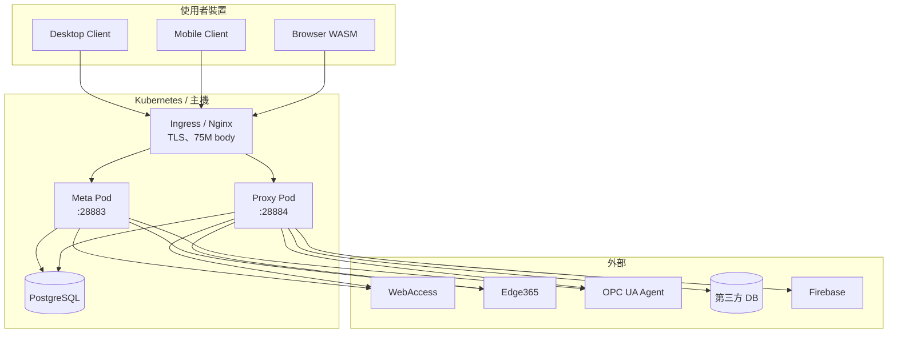
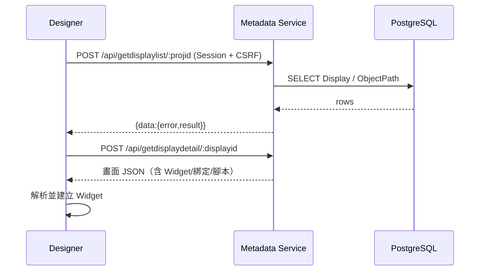
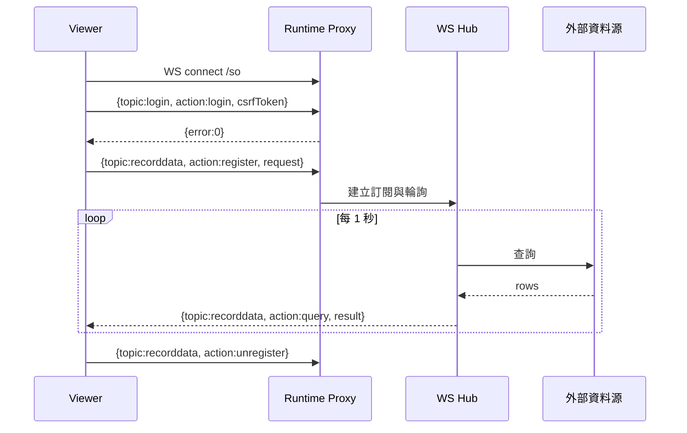
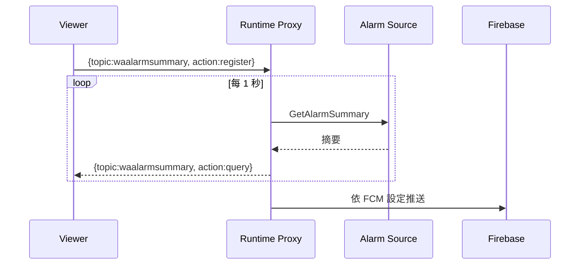

# SDS-02 系統架構（System Architecture）

## 1. 架構總覽

EdgeView 採三層式架構：**Client（Qt/QML）**、**EdgeView Server（Metadata + Runtime）**、**資料與整合層**。Client 同時與兩個後端通訊；後端共用 PostgreSQL 設定資料庫，但職責分離。

## 2. 元件責任

| 元件 | 責任 | 不負責 |
|------|------|--------|
| Client UI（QML Pages） | 頁面流程、版面、使用者互動 | 直接存取資料庫 |
| Client Common 單例 | 全域狀態、資源、綁定、腳本、路徑、設定 | 後端商業邏輯 |
| Client API/WS 層 | REST/WS 呼叫、重試、錯誤處理 | 資料格式的長期儲存 |
| Client 渲染層 | 2D/3D/NanoCanvas 繪製、批次、快取 | 業務規則 |
| Client Controller | 檔案、HTTP、圖片、剪貼簿、Session、除錯 | UI 排版 |
| Metadata Controller | 請求解析、驗證、回應 | SQL 細節（交由 model） |
| Metadata Service | 應用流程、權限、整合 | HTTP 路由（routes） |
| Metadata Model | 資料表 CRUD、SQL 組裝 | 請求格式 |
| Metadata Repository | SQLManager、連線池、交易 | 業務規則 |
| Runtime Controller | REST/WS 請求處理 | 資料源細節 |
| Runtime Service | 查詢、輪詢、告警、代理、通知 | UI |
| Runtime Repository | 多資料源連線與方言 | 業務規則 |
| WebSocket Hub | 連線、topic/action、訂閱、廣播 | 資料查詢 |

## 3. 分層設計

### 3.1 Client 分層

### 3.2 後端分層（兩個 Go 服務共用樣式）

## 4. 執行期拓撲與連接埠

| 元件 | 預設位址 | 協定 | 備註 |
|------|----------|------|------|
| Client | 動態 | — | 桌面/行動/瀏覽器 |
| Metadata HTTP | `127.0.0.1:28883` | HTTP | `net.http` |
| Metadata HTTPS | 停用（`port: -1`） | HTTPS | 可設定 |
| Metadata Proxy 目標 | `127.0.0.1:28884` | HTTP | `proxy.net.http` |
| Runtime HTTP | `127.0.0.1:28884` | HTTP | `proxy.net.http` |
| Runtime WebSocket | `/so` | WS | BI 模式為 `/` |
| Runtime REST | `/record/*`、`/foo/*` | HTTP | 見 SDS-07 |
| PostgreSQL | 依設定 | PostgreSQL | 設定資料庫 |
| OPC UA Agent | `127.0.0.1:5123`（資料）、`8090`（告警） | HTTP | 依設定 |
| Edge365 Ingress | 依環境 | HTTPS | `/apihub`、`/dbmaster`、`/alarm` |

### 4.1 部署圖

## 5. 通訊與資料流

### 5.1 設定資料流（Designer）

### 5.2 即時資料流（Viewer）

### 5.3 告警資料流

## 6. 技術架構決策摘要

| 決策 | 選擇 | 理由 | 影響 |
|------|------|------|------|
| UI 技術 | Qt/QML | 跨平台、GPU 加速、豐富元件 | 需要 Qt 建置與平台打包 |
| 2D 渲染 | SCDraw2D（QRhi） | 批次繪製、管線快取、跨後端 | 學習曲線與自訂 shader |
| 3D 渲染 | threepp/qt-threepp | 成熟 3D 引擎與 glTF 支援 | 套件較大、需資產管理 |
| 設定後端 | Go + Gin | 高效、易部署、生態完整 | 需自行維護分層 |
| 即時通訊 | WebSocket | 雙向、低延遲 | 需處理重連與認證 |
| 設定儲存 | PostgreSQL + JSONB | 關聯 + 彈性 | 需管理 schema 與遷移 |
| 多資料源 | 每來源獨立 manager | 方言差異大 | 維護成本 |
| 部署 | Docker/K8s | 標準化、可擴充 | 需 Ingress/Session 設計 |

## 7. 架構限制與邊界

1. Metadata 與 Runtime 雖共用 PostgreSQL，但不共用程式碼；資料表契約需保持同步（例如 `Record`、`DataSource`）。
2. WebSocket Hub 為單程序記憶體狀態；多副本需 Sticky Session 或外部 Pub/Sub。
3. Client 的 Designer/Viewer 共用執行檔，模式切換需清理設計期狀態。
4. 外部平台中斷時，依功能降級（見 SRS-05 NFR-REL-010）。
5. 瀏覽器模式不支援原生檔案系統、Crashpad、Session 監控。

## 8. 與需求對照

| 架構元素 | 對應需求 |
|----------|----------|
| Client 分層與模式 | FR-CLI-001~095 |
| Metadata 分層與 API | FR-META-001~045 |
| Runtime REST/WS | FR-RT-001~025 |
| 部署與連線 | IF-COM-001~008、NFR-PORT-001~005 |
| 安全邊界 | NFR-SEC-001~014 |
