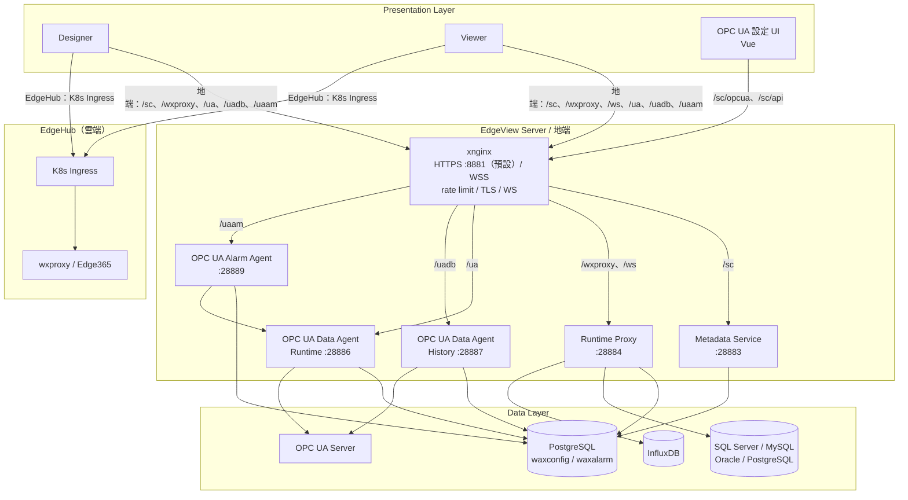
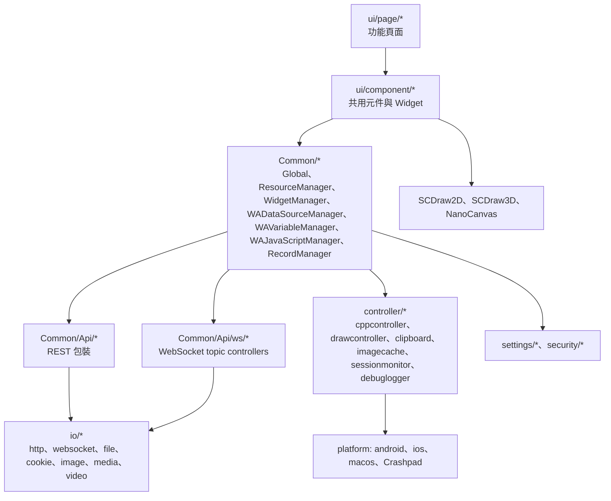
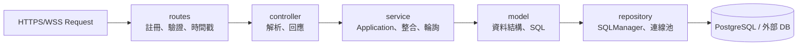
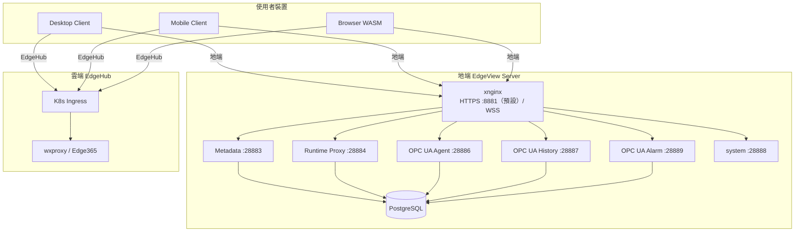
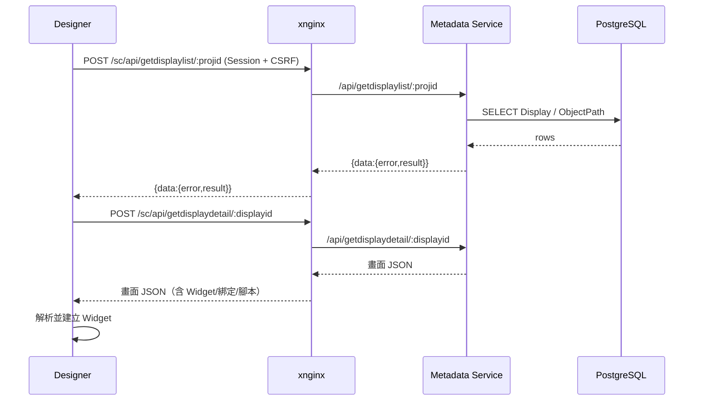
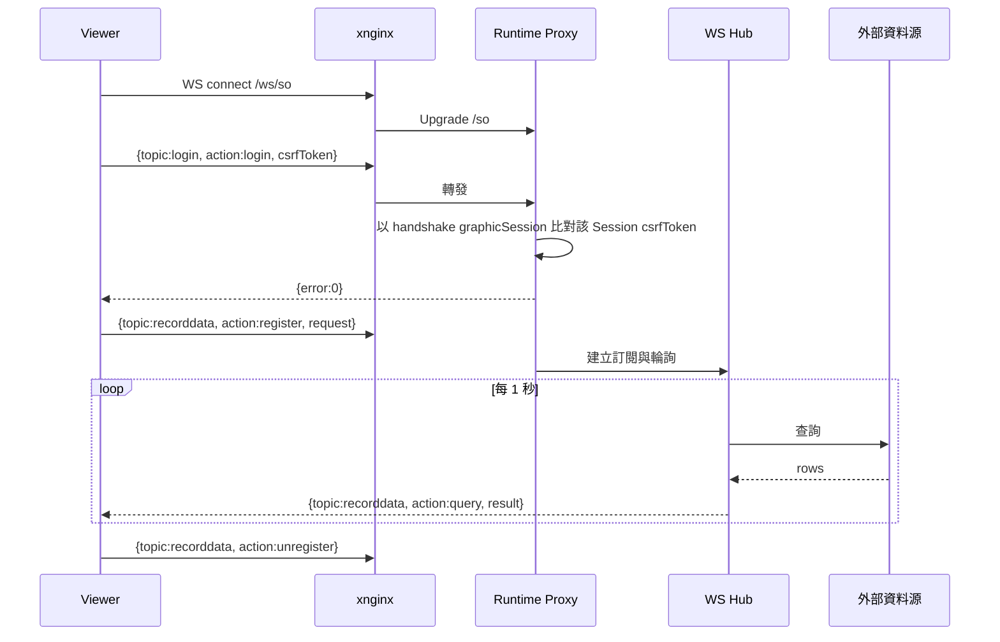
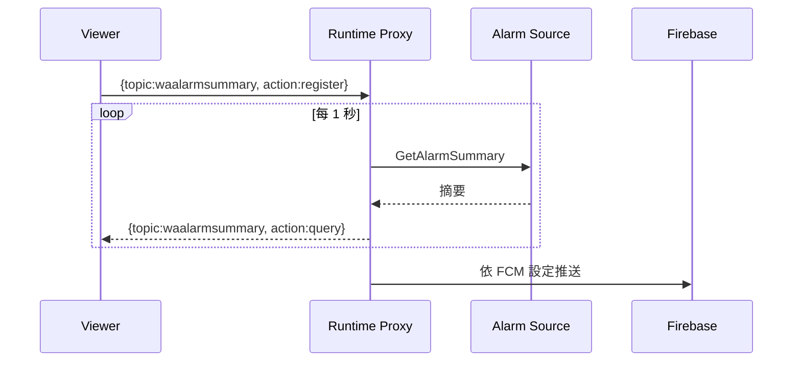
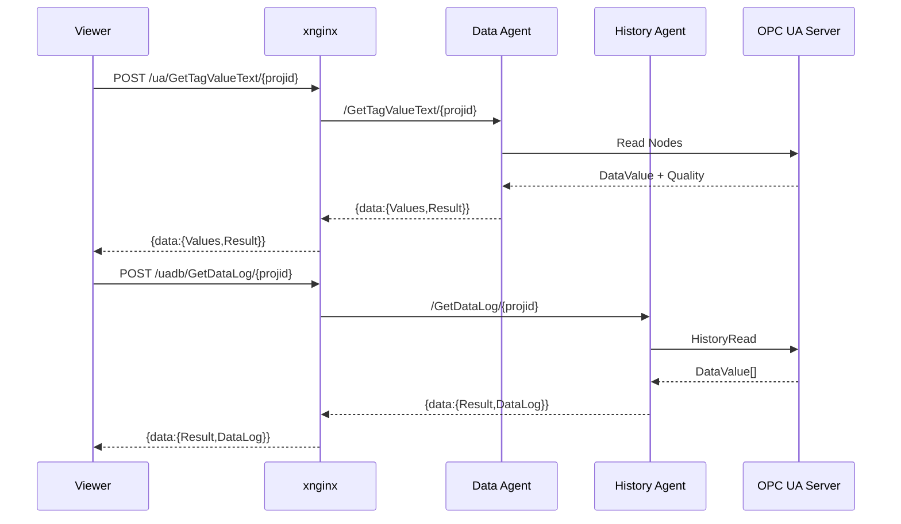

# SDS-02 系統架構（System Architecture）

## 1. 架構總覽

EdgeView 採三層式架構：**Client（Qt/QML）**、**EdgeView Server（Nginx + Metadata + Runtime + OPC UA Agent/Alarm）**、**資料與整合層**。

通訊路徑依資料源區分：

1. **EdgeHub（雲端）**：Client 透過 **K8s Ingress** 連線 `wxproxy<suffix>` 與 Edge365 雲端服務。
2. **WebAccess / OPC UA / X（地端）**：Client 透過 **xnginx reverse proxy**（預設 HTTPS `8881`，`protocol: https`；WebSocket 即 WSS）統一路由到 Metadata、Runtime Proxy、OPC UA Data Agent、OPC UA Alarm Agent。
3. **OPC UA 設定 UI**：同樣經 xnginx `/sc/opcua` 與 `/sc/api`。

Client 對 OPC UA Agent 的呼叫在**邏輯上是直連**（不經 Runtime Proxy），但**實體上仍經 xnginx**（`/ua`、`/uadb`、`/uaam`）。

## 2. 元件責任

| 元件 | 責任 | 不負責 |
|------|------|--------|
| Client UI（QML Pages） | 頁面流程、版面、使用者互動 | 直接存取資料庫 |
| Client Common 單例 | 全域狀態、資源、綁定、腳本、路徑、設定 | 後端商業邏輯 |
| Client API/WS 層 | REST/WS 呼叫、重試、錯誤處理 | 資料格式的長期儲存 |
| Client 渲染層 | 2D/3D/NanoCanvas 繪製、批次、快取 | 業務規則 |
| Client Controller | 檔案、HTTP、圖片、剪貼簿、Session、除錯 | UI 排版 |
| Metadata Controller | 請求解析、驗證、回應 | SQL 細節（交由 model） |
| Metadata Service | 應用流程、權限、整合 | HTTP 路由（routes） |
| Metadata Model | 資料表 CRUD、SQL 組裝 | 請求格式 |
| Metadata Repository | SQLManager、連線池、交易 | 業務規則 |
| Runtime Controller | REST/WS 請求處理 | 資料源細節 |
| Runtime Service | 查詢、輪詢、告警、代理、通知 | UI |
| Runtime Repository | 多資料源連線與方言 | 業務規則 |
| WebSocket Hub | 連線、topic/action、訂閱、廣播 | 資料查詢 |
| OPC UA 設定 UI | OPC UA 專案/連線/Tag/警報/使用者設定 | 直接存取 DB、OPC UA |
| OPC UA Data Agent（Runtime） | 即時值、寫值、Tag 明細、瀏覽、憑證、測點計算 | 專案/畫面/Record |
| OPC UA Data Agent（History） | 聚合/原始歷史查詢 | 即時寫值、專案設定 |
| OPC UA Alarm Agent | 告警規則編譯、評估、狀態機、清單/歷史/Ack | 設定寫入、UI |
| xnginx | 地端反向代理、TLS、靜態 UI、WebSocket、限流、服務監督 | 業務邏輯、雲端 EdgeHub |
| K8s Ingress | EdgeHub 雲端入口、TLS、路由 | 地端 OPC UA Agent/Alarm |

## 3. 分層設計

### 3.1 Client 分層

### 3.2 後端分層（Go 服務共用樣式；Data Agent 為 C# 分層）

### 3.3 地端反向代理（xnginx）

`wax_nginx_ingress` 以 Go 產生/監督 Nginx 與後端程序，是**地端 Client 的唯一入口**（EdgeHub 例外走 K8s Ingress）。

| 項目 | 設計 |
|------|------|
| 入口 | HTTPS `8881`（預設，`protocol: https`）；HTTP `8880` 僅相容舊版 |
| 協定 | 對外預設 HTTPS／WSS；內部 loopback 為 HTTP |
| 路由 | 依 `apps[].app_name` 產生 `/{app_name}/` location 與 upstream |
| WebSocket | `websocket: true` 的 app 產生 `/ws/` Upgrade/Connection |
| 限流 | 每個 app `limit_req_zone`（預設 `4090r/s`、burst 256、`429`） |
| TLS | `nginx.ssl.cert/key`（PEM）、`pfx` |
| 服務監督 | 啟動/重啟 `WxMetaService`、`wxproxy`、`wax_opcua_agent`、`wxalarmagent`、`nginx` |
| 設定變體 | `xnginx.yaml`（主/WebAccess）、`xnginx.webaccess.yaml`、`xnginx.opcua.yaml`、`xnginx.x.yaml` |

| 對外路徑 | upstream | 服務 |
|----------|----------|------|
| `/sc/` | `sc:28883` | Metadata |
| `/wxproxy/` | `wxproxy:28884` | Runtime REST |
| `/ws/` | `wxproxy:28884` | Runtime WebSocket |
| `/ua/` | `ua:28886` | OPC UA Data Agent |
| `/uadb/` | `uadb:28887` | OPC UA History |
| `/uaam/` | `uaam:28889` | OPC UA Alarm |
| `/system/` | `system:28888` | 服務管理 |

> 所有 `xnginx*.yaml` 的 `protocol` 預設為 `https`（WebSocket 即 `wss`）；`http`／`both`（`8880`）僅為相容舊版。
>
> `xnginx.x.yaml` 只開 HTTPS `8881`，apps 為 `waxconfig`/`waxapi`/`waxnotify`/`sc`/`wxproxy`，無 `system`。
>
> Nginx `proxy_pass .../` 會去掉前綴，因此 Client `/ua/GetTagValueText` → Agent `/GetTagValueText`；`/sc/api` → Metadata `/api`；`/wxproxy/record` → Runtime `/record`。

## 4. 執行期拓撲與連接埠

| 元件 | 預設位址 | 協定 | 備註 |
|------|----------|------|------|
| Client | 動態 | — | 桌面/行動/瀏覽器 |
| **xnginx HTTPS/WSS** | `0.0.0.0:8881` | HTTPS／WSS | **地端統一入口（預設）**；`http://:8880` 僅 `protocol: http 或 both` |
| Metadata HTTP | `127.0.0.1:28883` | HTTP（loopback） | xnginx `/sc/` upstream；對外 HTTPS |
| Runtime HTTP/WS | `127.0.0.1:28884` | HTTP／WS（loopback） | xnginx `/wxproxy/`、`/ws/` upstream；對外 HTTPS／WSS |
| OPC UA Data Agent（Runtime） | `127.0.0.1:28886` | HTTP（loopback） | xnginx `/ua/` upstream；對外 HTTPS |
| OPC UA Data Agent（History） | `127.0.0.1:28887` | HTTP（loopback） | xnginx `/uadb/` upstream；對外 HTTPS |
| OPC UA Alarm Agent | `127.0.0.1:28889` | HTTP（loopback） | xnginx `/uaam/` upstream；對外 HTTPS |
| 服務管理 system | `127.0.0.1:28888` | HTTP（loopback） | xnginx `/system/`；對外 HTTPS |
| OPC UA 設定 UI | `/sc/opcua/` | 對外 HTTPS | xnginx 靜態/路由 |
| PostgreSQL | 依設定 | PostgreSQL | `waxconfig`/`waxalarm` |
| OPC UA Server | 依現場 | OPC UA TCP | 可加密 |
| K8s Ingress | 依環境 | HTTPS | **僅 EdgeHub** `/apihub`、`/dbmaster`、`/alarm`、`wxproxy` |

### 4.1 部署圖

## 5. 通訊與資料流

### 5.1 設定資料流（Designer）

### 5.2 即時資料流（Viewer）

### 5.3 告警資料流

### 5.4 OPC UA 直連資料流（Viewer）

> OPC UA 即時/歷史 Tag 值的**邏輯路徑**是 Client → Data Agent（不經 Runtime Proxy），**實體路徑**為 Client → xnginx → Data Agent（`/ua`、`/uadb`）。Runtime Proxy 僅保留 Record 查詢、`opcuaalarmsummary` WebSocket 摘要、Edge365 代理與 FCM。

## 6. 技術架構決策摘要

| 決策 | 選擇 | 理由 | 影響 |
|------|------|------|------|
| UI 技術 | Qt/QML | 跨平台、GPU 加速、豐富元件 | 需要 Qt 建置與平台打包 |
| 2D 渲染 | SCDraw2D（QRhi） | 批次繪製、管線快取、跨後端 | 學習曲線與自訂 shader |
| 3D 渲染 | threepp/qt-threepp | 成熟 3D 引擎與 glTF 支援 | 套件較大、需資產管理 |
| 設定後端 | Go + Gin | 高效、易部署、生態完整 | 需自行維護分層 |
| 即時通訊 | WebSocket | 雙向、低延遲 | 需處理重連與認證 |
| 設定儲存 | PostgreSQL + JSONB | 關聯 + 彈性 | 需管理 schema 與遷移 |
| 多資料源 | 每來源獨立 manager | 方言差異大 | 維護成本 |
| 地端入口 | xnginx reverse proxy | 統一 TLS/路由/限流/服務監督 | 需維護 datasource 變體設定 |
| 雲端入口 | K8s Ingress | EdgeHub 雲端服務 | 僅 EdgeHub 模式使用 |
| 部署 | Docker/K8s 或主機 | 標準化、可擴充 | 需 Ingress/xnginx/Session 設計 |

## 7. 架構限制與邊界

1. Metadata 與 Runtime 雖共用 PostgreSQL，但不共用程式碼；資料表契約需保持同步（例如 `Record`、`DataSource`）。
2. WebSocket Hub 為單程序記憶體狀態；多副本需 Sticky Session 或外部 Pub/Sub。
3. Client 的 Designer/Viewer 共用執行檔，模式切換需清理設計期狀態。
4. 外部平台中斷時，依功能降級（見 SRS-05 NFR-REL-010）。
5. 瀏覽器模式不支援原生檔案系統、Crashpad、Session 監控。
6. OPC UA Data Agent 分 Runtime/History 兩個進程；Client 經 xnginx `/ua`、`/uadb` 存取，不直接連 28886/28887。
7. Alarm Agent 與 Data Agent 共用 Metadata Session key；多副本需共享 DB 與一致的 `aes_secret`。
8. 地端所有服務（Metadata/Runtime/Data Agent/Alarm）只綁 loopback，對外僅 xnginx HTTPS `8881`（預設，WebSocket 為 WSS）；HTTP `8880` 僅相容舊版。
9. EdgeHub 走 K8s Ingress，不使用地端 xnginx；兩者路徑與認證需分別測試。

## 8. 與需求對照

| 架構元素 | 對應需求 |
|----------|----------|
| Client 分層與模式 | FR-CLI-001~095 |
| Metadata 分層與 API | FR-META-001~045 |
| Runtime REST/WS | FR-RT-001~025 |
| OPC UA 子系統 | FR-OPC-001~045、IF-OPC-001~011、NFR-OPC-001~020 |
| xnginx 地端入口 | IF-OPC-011、IF-SW-012、IF-UM-007 |
| 部署與連線 | IF-COM-001~008、NFR-PORT-001~005 |
| 安全邊界 | NFR-SEC-001~014 |
