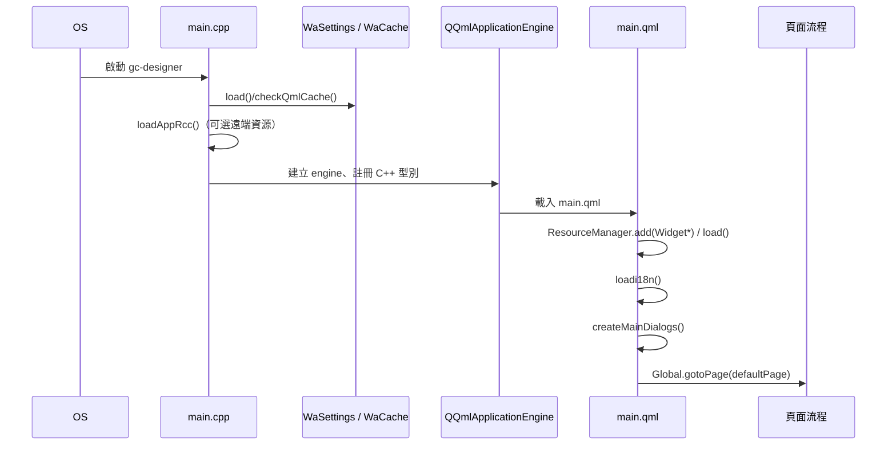
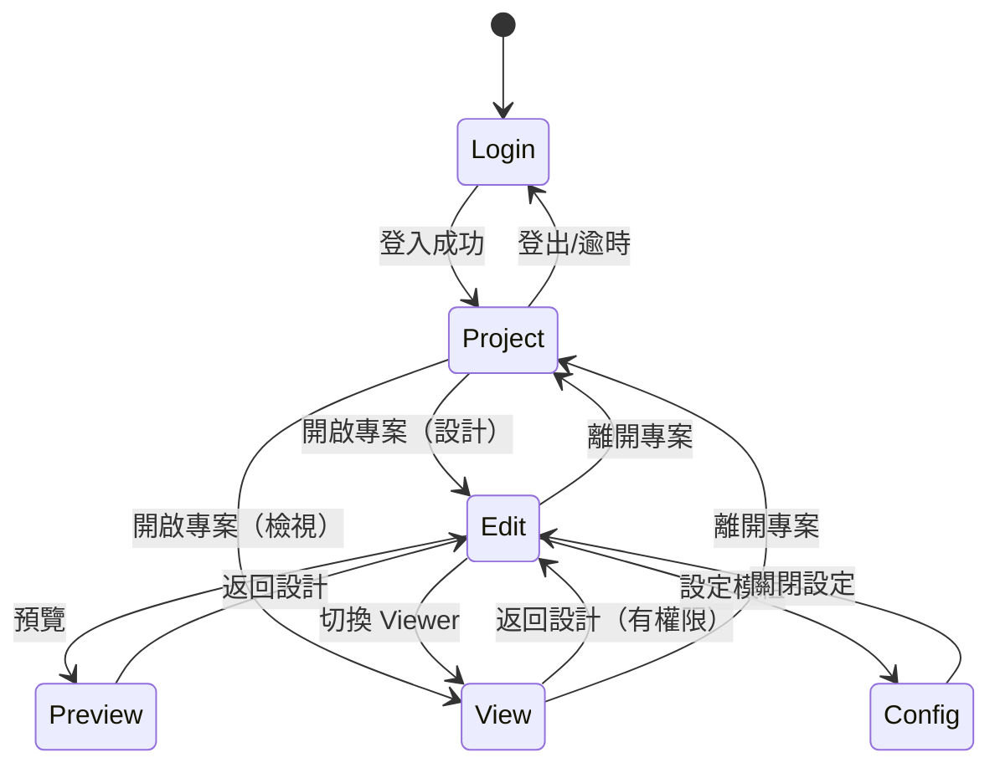
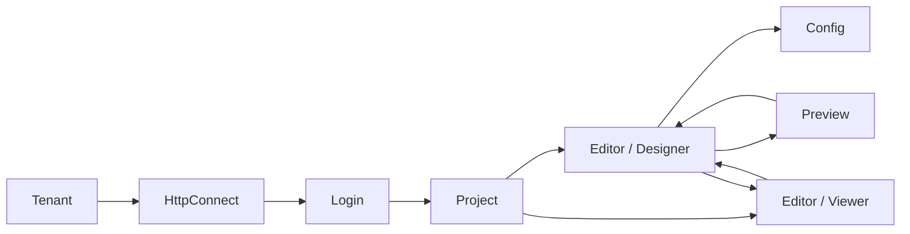
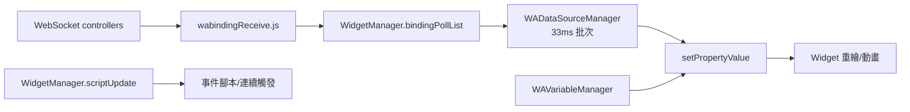
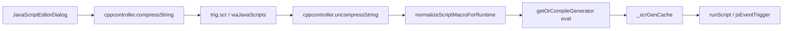
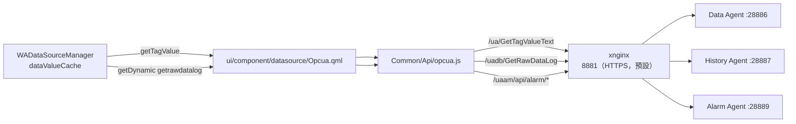

# SDS-03 Client 設計（Designer / Viewer）

> 程式碼根目錄：`wax_hmi-designer-client\wa-hmi-designer`  
> 建置目標：`gc-designer`（Qt 6 / QML）

## 1. 設計概述

Client 是單一 Qt 應用程式，同時具備 **Designer**（設計）與 **Viewer**（執行）能力。兩者共用 Widget 庫、渲染管線、資料綁定與 API 層，差異在於 `openMode`、可見的編輯 UI、以及是否建立設計期狀態。

- 入口：`main.cpp`
- 根 QML：`main.qml`（`ApplicationWindow`）
- 全域狀態：`Common/Global.qml`
- 常數/列舉：`Common/Define.qml`
- 資源註冊：`Common/ResourceManager.qml`
- Widget 基底：`ui/component/widgets/BaseWidget.qml`
- 渲染：`SCDraw2D/`、`SCDraw3D/`、`NanoCanvas/`

## 2. 啟動流程

### 2.1 `main.cpp` 重要工作

| 工作 | 說明 |
|------|------|
| 設定初始化 | `WaSettings`、`WaCache` 就緒後才載入 QML |
| 遠端資源 | `loadAppRcc()` 下載/快取伺服器 rcc |
| 平台初始化 | Windows/macOS/Linux/Android/iOS/WASM 分支 |
| 全域物件 | `g_engine`、`g_maxUploadFileSize`（5 MB） |
| Crashpad | `WX_ENABLE_CRASHPAD` 時初始化 |
| 圖形設定 | `QSurfaceFormat`、OpenGL/ES |
| 結束處理 | `g_exitApp` 與清理 |

### 2.2 `main.qml` 重要工作

1. 註冊 Widget：`ResourceManager.add("Widget<Name>", "qrc:/ui/component/widgets/WA<Name>.qml")`。
2. 載入資源與語系。
3. 建立主對話框（登入、錯誤、通知等）。
4. 導向 `defaultPage`（Tenant/Login/Project）。
5. 提供 `Global.gotoPage(componentId, properties)` 頁面導航。

## 3. 模式狀態機（openMode）

`Common/Define.qml` 定義：

| 值 | 模式 | 說明 |
|----|------|------|
| 0 | `config` | 設定頁（使用者、群組、專案設定等） |
| 1 | `edit` | Designer 編輯 |
| 2 | `preview` | 設計預覽（執行期效果，仍在設計流程） |
| 3 | `view` | Viewer 執行 |

`Global.currentOpenMode` 預設 `edit`；提供 `isConfigMode/isEditMode/isPreviewMode/isViewMode`。

### 3.1 進入 Viewer 的處理順序

`EditorFunction._viewDrawing()` 與 `ViewerFunction` 會執行：

1. 儲存目前畫面（必要時）。
2. `wahttp.cancelAll()` 取消未完成請求。
3. `WidgetManager.clearAllWidgetBinding()` 解除設計期綁定。
4. `Global.currentOpenMode = view`。
5. `Global.viewPageCtrl.clear()` / `appendPage(vwDrawId)` 建立 Viewer 頁面堆疊。
6. `editor.clearAllProcess()` 清理設計期計時器與狀態。
7. Viewer 載入畫面、建立綁定與 WebSocket 訂閱。

### 3.2 Viewer 元件

| 檔案 | 責任 |
|------|------|
| `ui/page/Editor/module/ViewerFunction.qml` | Viewer 功能（縮放、導覽、狀態） |
| `ui/page/Editor/module/ViewerMenuBar.qml` | Viewer 選單（File/View/Goto/Help） |
| `ui/page/Editor/module/content/ViewerContent.qml` | 畫面內容與資料載入 |
| `component/dialog/ViewerAboutDialog.qml` | 關於 |
| `ViewerCommStatusDialog.qml` | 通訊狀態 |
| `ViewerDataSourceDialog.qml` | 資料來源狀態 |
| `ViewerVariableDialog.qml` | 變數監看 |
| `ViewerZoomDialog.qml` | 縮放 |

## 4. 目錄與模組責任

| 路徑 | 責任 | 關鍵檔案 |
|------|------|----------|
| `main.cpp` / `main.qml` | 入口、模組/Widget 註冊、全域對話框 | `main.cpp`、`main.qml` |
| `Common/` | QML 單例與共用邏輯 | `Global.qml`、`Define.qml`、`ResourceManager.qml`、`WidgetManager.qml`、`WADataSourceManager.qml`、`WAVariableManager.qml`、`WAJavaScriptManager.qml`、`RecordManager.qml`、`PathManager.qml`、`SettingsManager.qml` |
| `Common/Api/` | REST 領域包裝 | `project.js`、`display.js`、`variable.js`、`record.js`、`alarm.js`、`user.js`、`opcua.js`、`scene3d.js` 等 |
| `Common/Api/ws/` | WebSocket topic controllers | `loginController.qml`、`recorddataController.qml`、`*AlarmSummaryController.qml`、`systeminfoController.qml`、`WsService.qml` |
| `ui/global/` | 物件模型、屬性 schema、綁定引擎、數學 | `waobjectProperties.js`、`waobjectJson.js`、`wabindings.js`、`wabindingReceive.js`、`bezierCurve.js`、`quaternion.js`、`vector.js` |
| `ui/component/` | 共用元件與 Widget | `widgets/BaseWidget.qml`、`widgets/WA*.qml`、`chart/Chart.js`、`shapes/`、`masks/` |
| `ui/page/` | 功能頁面 | `Tenant/`、`HttpConnect/`、`Login/`、`Project/`、`Editor/`、`Config/`、`GeneralSettings/`、`LogDataMaintenance/` |
| `controller/` | C++ 控制器 | `cppcontroller`、`drawcontroller`、`clipboard`、`imagecachecontroller`、`mouseeventspy`、`sessionmonitor`、`debuglogger` |
| `io/` | I/O 抽象 | `http/`、`websocket/`、`file/`、`cookie/`、`image/`、`media/`、`video/`、`audio/`、`iframe/`、`screen/` |
| `settings/` | 設定與快取 | `WaSettings`、`WaCache`、`wasmsettings` |
| `security/` | 加密 | `aes`、`qaesencryption`、`aes_web_lib` |
| `SCDraw2D/` | 2D 向量渲染 | `screnderer`、`scnode`、`batch/scbatchplanner`、`legacy/` |
| `SCDraw3D/` | 3D 渲染 | `scdraw3d.h`、`qt-threepp`、`SCDraw3D.Core` |
| `NanoCanvas/` | 文字/向量 canvas | `nanocanvas`、`anovg_rhi`、`fontatlasmanager` |
| `offscreen/` | 離屏渲染縮圖 | `OffscreenRender` |
| `i18n/` | 多語系 | `i18n.cpp`、`i18n_*.ts` |
| `Crashpad/` | 當機回報 | 預編譯 SDK |
| `RoniaKit/`、`Assets/`、`android/`、`ios/`、`macos/` | 平台/皮膚/資產 | — |

## 5. 頁面流程

### 5.1 頁面責任

| 頁面 | 責任 | 主要 API |
|------|------|----------|
| `Tenant/Index.qml` | 租戶/組織選擇；Cookie `IFPTenant`、`RootOrgID` | `ProjectAPI.getTenantlist` |
| `HttpConnect/BaseHttpConnect.qml` | 伺服器位址、最近清單、OpenGL 檢查 | 連線測試 |
| `Login/BaseLogin.qml` | 帳密/EdgeHub/OPC UA 登入、版本檢查、改密 | `UserAPI`、`SystemAPI`、`BIAPI`、`OemAPI` |
| `Project/BaseProject.qml` | 專案清單/樹、開啟、圖片更新、單專案自動 Viewer | `ProjectAPI` |
| `Editor/Index.qml` | Designer 畫布、左右面板、頂部工具列 | `DisplayAPI`、`VariableAPI`、`DataModelAPI` |
| `Config/Index.qml` | 設定模組 | `UserAPI`、`GroupAPI`、`ProjectAPI`、`ImportExport` |
| `GeneralSettings/Index.qml` | 語系/字型、資料更新 | `SettingsAPI` |
| `LogDataMaintenance/Index.qml` | 日誌維護 | `LogMaintAPI` |

### 5.2 Editor 面板

| 區域 | 檔案 | 功能 |
|------|------|------|
| 左：Widget | `left/Widgets.qml` | Widget 庫、拖放 |
| 左：資料來源 | `left/DataSource.qml` | 資料來源瀏覽 |
| 左：變數 | `left/VariExplorer.qml` | 變數瀏覽 |
| 左：裝置 | `left/DeviceExplorer.qml` | Tag/裝置樹 |
| 左：資訊 | `left/Information.qml` | 物件資訊 |
| 右：屬性 | `right/Properties.qml`、`PropertyData.qml` | 屬性編輯 |
| 右：圖層 | `right/LayerSettings.qml` | 圖層/鎖定/隱藏 |
| 右：繪圖樹 | `right/DrawingTree.qml` | 物件樹 |
| 右：綁定 | `right/BindingDataForm.qml` | Tag/Variable/Record 綁定 |
| 右：圖表 | `ChartCategoryForm.qml`、`ChartDataListForm.qml`、`ChartStyleForm.qml` | 圖表設定 |
| 右：腳本 | `right/JSListForm.qml` | 腳本清單 |
| 中央 | `content/EditorContent.qml`、`EditorAtPath.qml` | 畫布 |
| 頂部 | `top/Header.qml`、`ScaleModule.qml` | 選單、縮放 |

## 6. 核心單例設計

### 6.1 `Global`

| 成員 | 說明 |
|------|------|
| `currentOpenMode` / `is*Mode` | 模式狀態 |
| `urlPrefix`、`serverInfo` | 後端位址 |
| `axios` | HTTP 客戶端（`WaAxiosMJS`） |
| `websocket` | `WaWebSocket` |
| `csrfToken` | CSRF 權杖 |
| `gotoPage()` | 頁面導航 |
| `handleUnauthorize()` | `-100` 處理 |
| `checkOpenGLVersion()` | 圖形能力 |
| `viewPageCtrl` | Viewer 頁面堆疊 |

### 6.2 `ResourceManager`

- 元件/物件註冊：`pathIdMap`、`idPathMap`、`idComponentMap`、`idObjectMap`、`nameIDMap`。
- 支援 `remoteRcc`（遠端資源）。
- 使用 `QQmlIncubator` 非同步建立物件，提供 `forceCompletion`。
- API：`add()`、`get()`、`load()`、`newObject()`。

### 6.3 `WidgetManager`

- `bindingPageTags`、`bindingPollList`：綁定與輪詢清單。
- `clearAllWidgetBinding()`：切換模式時解除。
- `scriptUpdate(frames)`：驅動連續腳本與動畫。
- `usedJS`：已使用腳本追蹤。
- `scheduleJSInit`：延遲初始化腳本。

### 6.4 `WADataSourceManager`

- `connect(dbID)`：建立資料來源連線狀態。
- Tag 批次更新計時器 33 ms。
- `getTagValue` / `getTagValueSync`。
- Tag 型別快取。

### 6.5 `WAVariableManager`

- 變數類型：常數、系統、運算式。
- `updateInterval`、刷新佇列。
- `variableObj`、`replaceVari`、`replaceCrossVari`。
- 支援擴充函式（exrandom 等）。

### 6.6 `WAJavaScriptManager`

- 巨集登錄（`Define.availableScriptFiles`）。
- `initScriptInstance()` 注入原型。
- `jsContentReplace()`、`/*__SC_MACRO_V2__*/`。
- `decodeScriptBody()`：解壓/解密。
- `normalizeScriptMacroForRuntime()`：v1 `yield*` → v2 `yield`。
- `getOrCompileGenerator()`：以壓縮源為 key 的快取編譯。
- `compileBoundGenerator()`：綁定實例狀態。

### 6.7 `RecordManager`

- Record 中介資料物件。
- 查詢/輪詢狀態。
- `RecordAPI`/Proxy 呼叫。

### 6.8 `PathManager`

- 路徑樹快取（`dataList`）。
- `PathAPI`：`pathDetail`、`getPathChildren`、`getPathLimitChildren`。
- `Define.fileType`、`childTypes`。

### 6.9 `SettingsManager`

- 伺服器 INI：`<urlPrefix>/about/settings.<platform>.ini`。
- 版本門檻：`supported: version.checkNewer(4,2,1)`。

## 7. 資源與 Widget 系統

### 7.1 Widget 註冊

`main.qml` 以 `ResourceManager.add("Widget<Name>", "qrc:/ui/component/widgets/WA<Name>.qml")` 註冊。範例：

| 類型 | Widget |
|------|--------|
| 基礎 | `WALabel`、`WAButton`、`WATextField`、`WASelect`、`WACheckBox`、`WARadioButton`、`WASwitch` |
| 顯示 | `WAImage`、`WAGIF`、`WALottieAnimation`、`WASvgCanvas`、`WAVideo`、`WAWebPlugin` |
| 儀表 | `WAGauge`、`WACircularGauge`、`WACircularGaugeColor`、`WAKnob`、`WALCDNumber` |
| 容器 | `WAGroup`、`WADrawing`、`WADrawingRectangle`、`WANavigation` |
| 資料 | `WADataLog*`、`WAArrayTable`、`WARealTimeGroupSelector`、`WAStateTimelineChart`、`WARecipe` |
| 告警 | `WAAlarmLogTable`、`WAAlarmSumTable`、`EHAlarm*`、`OpcuaAlarm*`、`XAlarm*` |
| 3D/自訂 | `ThreedViewer`、`WACustom`、`WACustomRectangle` |

### 7.2 `BaseWidget.qml`

`BaseWidget.qml`（約 331 KB）是 Widget 基底，負責：

1. 幾何與轉換（x/y/width/height/rotation/scale）。
2. 圖層與可見性。
3. 屬性設定管線（`setPropertyValue`）。
4. 資料綁定（Tag/Variable/Record）。
5. 動畫（mode/filter/function/path）。
6. 效果與遮罩。
7. 事件腳本（oneLine/js/event trigger）。
8. 生命週期（`allWidgetsCreated`、`allVariableCreated`、async life token）。

### 7.3 屬性系統

- `ui/global/waobjectProperties.js`（約 621 KB）：屬性 schema、型別、預設值、驗證。
- `ui/global/waobjectJson.js`（約 96 KB）：JSON 匯入/匯出。
- `validate.js`：值驗證。
- `PropertyBindingDialog`、`BindVariableDialog`：綁定 UI。

## 8. 資料綁定管線

### 8.1 綁定資料結構

`ui/global/wabindings.js` 預設欄位：

| 欄位 | 說明 |
|------|------|
| `sourceId` | 資料來源/Tag/Variable/Record ID |
| `sourceType` | `WebAccess`、`Opcua`、`BI`、`X` |
| `dataType` | 資料型別 |
| `target` | 目標 Widget 屬性 |
| `pickable` | 是否可操作 |
| `output` | 輸出格式 |
| `animation` | `mode`、`filter`、`function` |
| `range` | 數值範圍 |
| `interval`/`basicInterval` | 更新間隔 |
| `blinkingMultiple` | 閃爍倍率 |
| `variableInterval` | 變數更新間隔 |

### 8.2 接收與套用

- `receiveBindings` → `receiveWebAccess` / `receiveWebAccess_MQTT` → `setPropertyValue`。
- 數值套用時依 `range`、`filter`、`function` 轉換。
- 動畫依 `animation.mode` 與 `target` 執行。

## 9. 腳本引擎

### 9.1 儲存與載入

- 儲存前：`WAJavaScriptManager.jsContentReplace()` 正規化巨集，`compressString` 壓縮。
- 載入後：`decodeScriptBody()` 解壓，v1 巨集遷移，`eval` 成 generator function。
- 快取：以壓縮源為 key，避免重複編譯。
- 執行：`BaseWidget.eventTrigger()` → `runScript()`；連續觸發由 `jsEventTrigger(frames)`。
- 條件：`jsEventTriggerCheckCondition()` 透過 `WADataSourceManager.getTagValue()` 與 `getVariable()` 判斷。
- 保護：`_hasJSWork()`、`scheduleJSInit()`、`abortPendingScripts()`、`invalidateAsyncTriggers()`、`_beginAsyncLife()` token。

### 9.2 巨集與非同步

- 巨集庫（WebAccess、資料存取、UI 操作）以 `Define.availableScriptFiles` 登錄。
- v2 巨集以 `yield` 表示非同步；v1 `yield*` 會自動轉換。
- 非同步腳本有生命週期 token，切換畫面時取消，避免更新已銷毀 Widget。

## 10. 渲染設計

### 10.1 SCDraw2D

| 模組 | 責任 |
|------|------|
| `screnderer`/`screnderermgr` | 渲染器與管理 |
| `scnode`/`scshape` | 場景節點與形狀 |
| `screct`、`scellipse`、`scarc`、`scpie`、`scpolygon`、`scpipe` | 幾何 |
| `scpolygontess` | 多邊形三角化 |
| `batch/scbatchplanner`、`scbatchitem` | 批次繪製規劃 |
| `scgradientubopool`、`scuniformbufferpool`、`scpipelinecache` | GPU 資源與管線快取 |
| `legacy/` | 舊 GL/ES2 shader 路徑 |

- 以 QRhi 為抽象層，支援 OpenGL/Vulkan/D3D/Metal（依 Qt）。
- QML 型別：`BaseShape`、`BaseRectangle`、`BaseEllipse`、`BaseArc`、`BasePie`、`BasePolygon`、`BasePipe`、`BasePipeEx`、`BasePipePath`、`BasePipeOverlap`。
- Singleton：`SCColor`、`SCGlobal`。
- Shader 編譯為 `.qsb`。

### 10.2 NanoCanvas

- ANOVG（`anovg.c`、`anovg_rhi.cpp`）跑在 QRhi。
- `nanocanvas.cpp`（約 52 KB）、`fontatlasmanager`、`nanocanvasfontregistry`、`nanocanvasrhibufferpool`。
- 用於文字與向量繪製、字型圖集。

### 10.3 SCDraw3D

- `threepp` + `qt-threepp`，QML 模組 `SCDraw3D.Core`。
- 提供 `ThreeViewportItem`、JS runtime。
- API：`registerSCDraw3DQmlTypes()`、`setSceneCacheBasePath()`、`setViewportSampleCount()`。
- 支援 glTF、OBJ/MTL、FBX、STL、Collada、USD、SVG、DDS、RGBE、URDF/Xacro。
- 功能：陰影、PMREM/IBL、蒙皮、粒子、水。
- Widget：`ui/component/widgets/ThreedViewer.qml`；設定：`ThreedViewerSettingsDialog.qml`；API：`Common/Api/scene3d.js`。

### 10.4 離屏與縮圖

- `offscreen/OffscreenRender` 使用 `QQuickRenderControl` + FBO → `QImage`。
- 用於畫面縮圖、預覽、匯出。

## 11. I/O 與通訊

### 11.1 HTTP

| 元件 | 說明 |
|------|------|
| `Global.axios` | `WaAxiosMJS` 實例 |
| `Common/Api/httpRequest.js` | 請求包裝 |
| `Common/mjs/axios.mjs` | Axios 風格 API |
| `io/http/wahttp.*` | C++ HTTP |
| `io/http/wahttp_web.*` | 瀏覽器版本 |
| `io/http/persistentCookieJar.*` | Cookie 保存 |

- 連線上限 255、佇列 1024、等待 120 秒（Viewer 10 秒）。
- 地端 URL 預設以 `https://<EVS>:8881/sc` 為基底（`serverInfo.protocol` 預設 `https:`）；xnginx 再依路徑轉發：
  - `/sc/*` → Metadata `28883`
  - `/wxproxy/*` → Runtime Proxy `28884`
  - `/ws/*` → Runtime Proxy WebSocket（WSS）
  - `/ua/*` → OPC UA Data Agent `28886`
  - `/uadb/*` → OPC UA History `28887`
  - `/uaam/*` → OPC UA Alarm Agent `28889`
- 常用 Metadata 路徑：`/api/about`、`/api/sysstatus`、`/api/alarm/*`、`/api/datalog/query`、`/api/datamodel/*`。
- EdgeHub（雲端）：`https://wxproxy<suffix>/apihub`、`/dbmaster`、`/alarm`，經 K8s Ingress，不使用地端 xnginx。
- OPC UA 邏輯直連（實體經 xnginx）：
  - 即時：`{opcuaUrlPrefix}/GetTagValueText/{projid}`（`/ua`）
  - 歷史：`{opcuaUrlPrefix}db/GetDataLog/{projid}`、`/GetRawDataLog/{projid}`（`/uadb`）
  - 警報：`{opcuaUrlPrefix}am/api/alarm/*`（`/uaam`）
  - `opcuaUrlPrefix` 預設 `protocol//host/ua`（`protocol` 預設 `https:`，即 `https://<host>/ua`）；根路徑（無 xnginx）才用 Metadata `QueryBodyKey` 回傳的 `ip`/`port`/`dbport`/`alarmport`（來自 `config.yaml` `opcua.agent`／`opcua.alarm`）。
- 相容舊版：僅當伺服器 `protocol: http|both` 時才使用 `http://<EVS>:8880/sc`。

### 11.2 WebSocket

| 元件 | 說明 |
|------|------|
| `Global.websocket` | `WaWebSocket` |
| URL | `${wsprotocol}//${serverInfo.host}/ws/so`；`wsprotocol` 由 `serverInfo.protocol` 推導，預設 `https:` → **`wss:`** |
| 認證 | WS handshake 帶 `graphicSession` Cookie；login 只比對該 Session 的 `csrfToken`（R-007）；原生 Qt 由 `WaWebSocket` 補帶 Cookie，WASM 由瀏覽器自動帶同源 Cookie |
| 功能 | 自動重連、topic 訂閱 |
| 主題 | `login`、`waalarmsummary`、`systeminfo`、`recorddata`、`ehalarmsummary`、`opcuaalarmsummary`、`xalarmsummary` |
| Controller | `Common/Api/ws/<Topic>Controller.qml` 自動建立 |

### 11.2.1 OPC UA 直連資料源

| 行為 | 實作 |
|------|------|
| 建立連線物件 | `WADataSourceManager.connect(dbID)` 讀 `/sc/api/DataSource/querybodykey/{dbID}`，建立 `Opcua.qml` |
| 即時值 | `Opcua.getTagValue` → `opcua.js tagvaluetext` → `/ua/GetTagValueText/{projid}` |
| 寫值 | `setTagValue`/`setTagValueText` → `/ua/SetTagValue*` |
| 歷史 | `getdatalog`/`getrawdatalog` → `/uadb/GetDataLog`、`/uadb/GetRawDataLog` |
| 警報 | `alarmAck`/`getAlarmLog`/`alarmProcessHistory` → `/uaam/api/alarm/*` |
| 快取/批次 | `dataValueCache`、`_batchTagTimer` 33 ms |
| 掃描週期 | `Global.treetimer`：伺服器 `client_data_update_interval`、本機 `dataUpdateInterval`，最低 500 ms、預設 1000 ms |
| 認證 | 請求 header `csrfToken`；沿用 Metadata Session Cookie |

> 上述「直連」為邏輯直連：Client 只看到 xnginx `/ua`、`/uadb`、`/uaam`，不直接連 28886/28887/28889。`Common/Api/ws/OpcuaalarmsummaryController.qml` 仍透過 Runtime Proxy WebSocket（`/ws`）取得摘要。

### 11.3 MQTT

- 程式碼存在（`io/mqtt/`、`ui/global/WAMqttManager.qml`）但停用：`main.cpp` 與 CMake 未啟用。
- 僅測試頁 `ui/page/JunyuTest/module/mqtttest.qml` 參考。

## 12. 設定與持久化

| 元件 | 儲存 | 用途 |
|------|------|------|
| `WaSettings` | 環境/CLI/INI、QML 快取指紋 | 啟動設定、渲染選擇、版本 |
| `WaCache` | QSettings（桌面）/ WASM storage | 連線、租戶、腳本、圖片、頁面狀態 |
| `WaIO` | 本機檔案（QSaveFile/QLockFile）或 WASM | 檔案讀寫 |
| `PathManager` | 記憶體 + API | 路徑樹 |
| `ResourceManager` | 記憶體 | 元件/物件快取 |
| `RecordManager` | 記憶體 | Record 狀態 |
| `imagecachecontroller` | 檔案 | 圖片快取 |
| `debuglogger` | 共享記憶體 ring | 除錯日誌（2 MB、200 ms/64 KB 批次） |

## 13. 安全設計（Client 端）

| 機制 | 實作 |
|------|------|
| 加密 | `security/aes`、`qaesencryption`、Web AES 函式庫 |
| 腳本保護 | 壓縮/加密儲存 |
| CSRF | `Global.csrfToken`，REST/WS 皆帶 |
| Session | Cookie + `handleUnauthorize()` |
| 權限 | 依後端回傳的專案安全設定隱藏/停用功能 |
| 輸入驗證 | `validate.js`、屬性 schema |
| 平台 | Session 鎖定/遠端連線事件（`sessionmonitor`） |
| 當機 | Crashpad |

## 14. 建置與平台

| 平台 | 重點 |
|------|------|
| Windows | MSVC、Crashpad、Session 監控、憑證 |
| macOS | entitlement、app bundle |
| Linux | RPATH `$ORIGIN/../lib` |
| Android | ABI `armeabi-v7a`、`arm64-v8a`（可含 `x86_64`）、OpenSSL、SDK 36 |
| iOS | app bundle、Firebase（選用） |
| WASM | `wasmsettings`、`wahttp_web`、`aes_web_lib`、`.wasm.br` 壓縮 |

CMake 目標：`gc-designer`；連結 `RoniaKit`、`SCDraw2D`、`SCDraw3D`、`nanocanvas`、`fontstore`、`glm`、`ZXing`（選用）、Firebase（選用）。

## 15. 設計限制與注意事項

1. `BaseWidget.qml`、`waobjectProperties.js`、`Chart.js` 體積龐大，修改需注意效能與回歸。
2. 模式切換必須完整清理綁定、腳本與計時器，否則會出現幽靈更新。
3. 瀏覽器模式不支援原生檔案/當機回報/Session 監控。
4. 遠端 rcc 需處理版本與快取一致性。
5. 3D 資產較大，需快取與載入策略。
6. 腳本 `eval` 需注意安全性與 CSP（WASM 模式）。
7. OPC UA 即時/歷史值經 xnginx 直連 Data Agent；若 xnginx/Agent 不可達，Widget 顯示 Bad Quality，不影響 Record/其他資料源。
8. 根路徑部署時需設定 Metadata `config.yaml` 的 `opcua.agent.dbport`／`opcua.alarm.port`（或 `opcuaAgent.dbUrl`／`alarmUrl`）；`dbport`/`alarmport` 由 `QueryBodyKey` 回傳，非 `DataSourceBody`。
9. 手冊的圖紙/變數更新率（25/50/100 ms）與外部資料掃描（最低 500 ms）為不同層級，UI 需避免誤導。
10. 模型（`WACustom`/`WACustomRectangle`）與 DataModel 密碼、匯入刪除保護需維持；詳見 SDS-15。

## 16. 需求對照

| 設計區塊 | 對應需求 |
|----------|----------|
| 啟動/登入/頁面 | FR-CLI-001~020 |
| 專案/畫面/物件樹 | FR-CLI-021~045 |
| Widget/綁定/腳本 | FR-CLI-046~075 |
| 設定/維運 | FR-CLI-076~095 |
| OPC UA 直連資料源 | FR-OPC-015、FR-OPC-018、FR-OPC-035~037 |
| 使用手冊功能（UI/控件/變數/腳本/模型） | FR-UM-021~050、SDS-15 |
| 渲染/I/O/設定 | NFR-PERF-001~012、NFR-PORT-001~005、NFR-I18N-001~006 |
| 安全 | NFR-SEC-001~014、NFR-OPC-007~008 |
