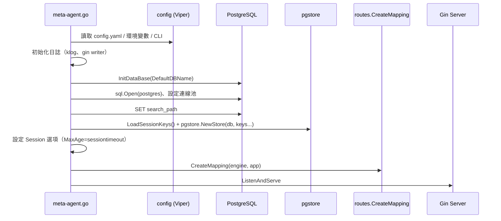
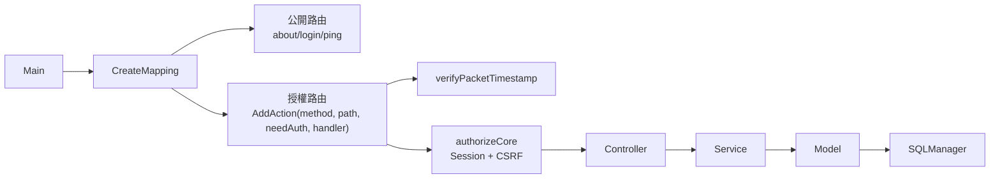
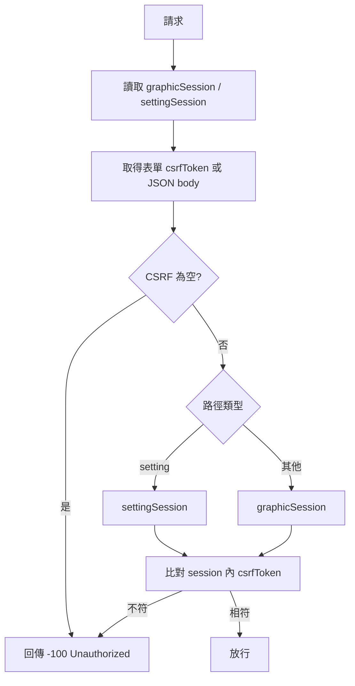

# SDS-04 Metadata Service 設計

> 程式碼根目錄：`wax_metadata-service`  
> 語言/框架：Go / Gin / PostgreSQL  
> 入口：`meta-agent.go`（`package main`）

## 1. 設計概述

Metadata Service 是 EdgeView 的**設定與管理中樞**，提供專案、畫面、Widget 內容、變數、資料模型、Record、告警、使用者/群組、OPC UA、配方、3D 場景、檔案資源、匯入匯出、稽核與系統設定等 API。服務以 Session + CSRF + 時間戳驗證保護，並可切換資料源模式（WebAccess、EdgeHub/Edge365、X、OPC UA）。

### 1.1 主要能力

| 能力 | 代表路由 | Controller |
|------|----------|------------|
| 租戶/組織/登入 | `/api/tenantlist`、`/api/orglist`、`/api/login*` | `loginController` |
| 專案 | `/api/project/*` | `ProjectController` |
| 畫面/顯示 | `/api/getdisplay*`、`/api/display*` | `DisplayController` |
| 物件樹/路徑 | `/api/getnextlevelpath`、`/api/searchunderpath` | `ObjectPathController` |
| 變數 | `/api/variable/*` | `VariableController` |
| 資料模型 | `/api/datamodel/*`、`/api/dm/*` | `DataModelController` |
| Record | `/api/record/*`、`/api/datalog/*` | `RecordController` |
| 告警 | `/api/alarm/*` | `AlarmController` |
| 使用者/群組 | `/api/user/*`、`/api/group/*`、`/api/userscy/*` | `UserController`、`GroupController` |
| OPC UA | `/api/opcua/*`（約 40 條） | `controller/opcua/*` |
| 3D 場景 | `/api/editor3d/*` | `Scene3DController` |
| 檔案/圖片/音訊/外掛 | `/api/upload*`、`/api/image*`、`/api/uploadaudio`、`/api/pluginfile` | 對應 Controller |
| 設定 | `/api/setting/*`、`/api/settings/*`、`/api/langfont/*` | `SettingsController` |
| 匯入/匯出 | `/api/export`、`/api/v2/*` | `ImpExpController`、`bun-imex` |
| 稽核/日誌 | `/api/auditlog/*`、`/api/logmaint/*` | `AuditLogController`、`MaintenanceController` |
| 授權/版本/系統 | `/api/about`、`/api/license`、`/api/sysstatus` | 系統服務 |

完整路由目錄見 SDS-07。地端對外路徑為 `/sc/api/*`（xnginx `/sc` → Metadata `28883`）；EdgeHub 模式經 K8s Ingress。

## 2. 啟動流程

### 2.1 關鍵啟動行為

| 階段 | 行為 |
|------|------|
| 設定 | Viper 載入 `config.yaml`，支援 `ENSAAS_SERVICES` / `VCAP_SERVICES` / `LOG_ENV` |
| 日誌 | `log.tofile=true` 且非 EdgeHub 模式時，Gin 輸出導入 klog |
| 資料庫 | 連線 `waxconfig`（預設 schema `public`，私有雲 `wx`） |
| Session | `sessions.SessionsMany(["graphicSession","settingSession"])` |
| CORS | `usecors=true` 時允許 localhost/私有 IP，支援 WASM |
| 靜態/文件 | Swagger（`docs/`）、favicon、預設資源、前端檔案 |
| 初始化 | `InitAfterSQLIsReady`：同步 WA 管理員、複製使用者、初始化授權 |
| 關閉 | 監聽 SIGINT/SIGTERM，`cancelFuncs` + `quit` channel |

### 2.2 Session 選項

| 模式 | Path | Domain | MaxAge | HttpOnly | SameSite | Secure |
|------|------|--------|--------|----------|----------|--------|
| 一般 | `/` | — | `sessiontimeout`（604800） | 是 | Lax | 條件式（HTTPS） |
| EdgeHub | `/` | `Meta365.CookieDomain()` | `sessiontimeout` | 是 | Lax | 條件式（HTTPS） |

> `Secure` 由 `pgstore.Save()` 依 request 的 TLS 或 `X-Forwarded-Proto: https` 逐次判斷，保留 HTTP 8880 相容性。

> Session key 由 `service/session_secret.go` 的 `LoadSessionKeys()` 解析：`SESSION_SECRET` 優先，否則使用 `aes_secret` 經 HKDF 派生，皆無則啟動失敗（見 SDS-13）。

## 3. 組態設計

`config.yaml` 主要欄位：

| 區塊 | 欄位 | 說明 |
|------|------|------|
| `by_system_timezone` | bool | 依系統時區 |
| `cert` | `crt`、`key` | TLS 憑證路徑 |
| `datasource` | int | 資料源模式（4=WebAccess） |
| `driftseconds` | int | 時間戳容許漂移（300 秒） |
| `edge365` | `iapp`、`license`、`meta` | Edge365 整合與授權 |
| `firebase_token_valid_days` | int | FCM token 有效天數 |
| `ingresspathname` | string | Ingress 前綴（`/sc`） |
| `log` | `filemaxmb`、`tofile` | 日誌 |
| `net.http` | `host`、`port` | 服務位址（28883，loopback） |
| `net.https` | `host`、`port` | HTTPS（`port=-1` 停用；對外 HTTPS 由 xnginx 提供） |
| `opcua.agent` | `host`、`port`、`dbport`、`protocol` | OPC UA Data/History Agent；`QueryBodyKey` 回傳 `ip`/`port`/`dbport`/`protocol` |
| `opcua.alarm` | `host`、`port`、`protocol` | OPC UA Alarm Agent；`QueryBodyKey` 回傳 `alarmip`/`alarmport`/`alarmprotocol` |
| `opcua.cert` | `domains`、`name` | 憑證產生 |
| `proxy.net.http` | `host`、`port` | Runtime Proxy（28884） |
| `sessiontimeout` | int | Session 秒數 |
| `systeminfo_interval_ms` | int | 系統資訊輪詢（3000） |
| `usecors` | bool | CORS |
| `wa_alarm_summary_interval_ms` | int | WA 告警摘要（1000） |
| `waxcert` | string | 憑證工具 |
| `websocket_auth_timeout` | int | WS 認證逾時（10） |
| `xproxy.agent.urlsuffix` | string | X Proxy 前綴 |
| `alarm.metadataReloadMs` | int | 告警中介資料重載（30000） |
| `alarm.net.http` | `host`、`port` | 告警服務（28889，loopback） |
| `opcuaAgent` | `enabled`、`baseUrl`、`dbUrl`、`alarmUrl`、`pollIntervalMs` | 共用 OPC UA Agent 端點；`dbUrl`/`alarmUrl` 會覆寫 `opcua.agent.dbport`／`opcua.alarm.port` |

> 對外協定預設為 **HTTPS／WSS**：Client 一律經 xnginx（`protocol: https`，`8881`）存取，Metadata 僅在 loopback 以 HTTP 提供上游；`http://:8880` 僅相容舊版。

### 3.1 設定優先順序

命令列 > 環境變數（`ENSAAS_SERVICES`/`VCAP_SERVICES`/`LOG_ENV`）> `config.yaml` > 程式預設值。

## 4. 路由與仲介層

### 4.1 註冊機制

- `routes.AddAction(method, path, needAuth, handler)` 統一註冊。
- `needAuth=true` 時進入授權流程。
- 每條授權路由先驗 `packetTimestamp`，再驗 Session/CSRF。

### 4.2 `authorizeCore` 流程

### 4.3 `verifyPacketTimestamp`

- 從 JSON body `data.packetTimestamp` 或表單 `packetTimestamp` 取得毫秒時間戳。
- 與伺服器時間差超過 `driftseconds*1000` 即拒絕，回傳 `-102 APIErrorPacketTimeout`。
- `driftseconds=0` 可停用（不建議）。

### 4.4 驗證與錯誤

| 項目 | 行為 |
|------|------|
| Panic | `panicHandle` 攔截並回傳統一錯誤 |
| 錯誤碼 | `0` 成功、`-100` 未授權、`-101` 無權限、`-102` 時間戳、`-500` 伺服器、`-501` 參數 |
| Session 遺失 | 回傳 `-100`，Client 觸發重新登入 |
| 權限 | 依 `UserInfo`、專案 `Userscy`、`Group` 檢查 |

## 5. Controller 設計

### 5.1 目錄與責任

| 套件 | Controller | 責任 |
|------|-----------|------|
| `device` | `loginController` | 租戶、組織、登入/登出、改密、Session、授權切換 |
| `device` | `ProjectController` | 專案 CRUD、版本、權限、圖片、單專案模式 |
| `device` | `DisplayController` | 畫面 CRUD、縮圖、版本、複製、匯入 |
| `device` | `ObjectPathController` | 物件樹、路徑、搜尋、資料夾 |
| `device` | `VariableController` | 變數 CRUD、版本、匯入/匯出 |
| `device` | `DataModelController` | DataModel CRUD、版本、密碼、匯入 |
| `device` | `RecordController` | Record CRUD、查詢、Datalog |
| `device` | `AlarmController` | 告警定義/群組/Tag |
| `device` | `UserController`/`GroupController` | 使用者、群組、權限 |
| `device` | `DataSourceController` | 資料來源設定（WA/EdgeHub/OPC UA/X） |
| `device` | `TagController` | Tag 查詢/匯入 |
| `device` | `TemplateController` | 範本 |
| `device` | `RecipeController` | 配方 |
| `device` | `Scene3DController` | 3D 場景/資產/網格 |
| `device` | `ImageController`/`AudioController`/`FileController`/`PluginFileController` | 資源上傳與管理 |
| `device` | `FirebaseController` | FCM token/通知設定 |
| `device` | `SettingsController` | INI/語系/字型/系統設定 |
| `device` | `MQTTBrokerController` | MQTT 設定（停用） |
| `device` | `OEMController` | OEM/品牌 |
| `device` | `FileCacheController` | 遠端資源快取中介資料 |
| `device` | `SymbolFactoryResourceController` | Symbol Factory 資源 |
| `device` | `pingController` | 健康檢查 |
| `log` | `ActionLogController`/`AuditLogController`/`MaintenanceController` | 操作/稽核/維護日誌 |
| `opcua` | `Project`/`Connection`/`Tag`/`User`/`Alarm`/`Test` | OPC UA 專案、連線、Tag、使用者、告警、測試 |
| `setting` | `ImpExpController` | 匯入/匯出 |

### 5.2 Controller 慣例

1. 綁定請求至 `BaseRequest`（含 `csrfToken`、`packetTimestamp`）。
2. 取得 DB 連線：`app.WithCfg` / `WithActionLog` / `WithSetting`。
3. 呼叫 `service`/`model`。
4. 以 `BaseResponse` 回傳：`{data:{error,reason,result}}`。
5. 錯誤使用統一常數，不洩漏 SQL 細節。

## 6. Service 設計

| 服務 | 檔案 | 責任 |
|------|------|------|
| Application | `service/app.go` | 連線佇列、生命週期、DB 注入、初始化 |
| SQLInit | `service/SQLInit.go` | 建表、遷移、索引、預設資料 |
| Auth/BasicAuth | `authService.go`、`basicAuth.go` | 登入快取、內部 API Basic Auth、各平台認證 |
| Session | `sessionAPI.go` | Session 建立/查詢/刪除 |
| WA 整合 | `WAAPI.go` | WebAccess 專案、Tag、使用者同步 |
| EdgeHub/Edge365 | `BIAPI.go`、`edge365.go`、`balsam.go` | IApp、etcd、GraphQL、License、組織 |
| X 整合 | `XAPI.go` | X 平台登入/資料 |
| OPC UA | `OpcAPI.go`、`opcuaCert.go` | Agent 溝通、憑證產生 |
| 匯入/匯出 | `bun-imex.go`、`zip.go` | bun 工具、壓縮 |
| 檔案 | `staticFileService.go`、`favicon.go`、`defualtResource.go` | 靜態資源 |
| 稽核 | `audit_log.go` | 稽核寫入/查詢/checksum |
| 授權 | `license.go` | License 解析、功能旗標、系統 ID |
| 加密 | `AES.go`、`aes_secret.go`、`secret_*.go` | AES、平台金鑰保存 |
| 系統 | `sysusage*.go`、`klogIoWriter.go`、`middleware.go` | 使用量、日誌、仲介層 |

### 6.1 Application 併發模型

- `connectionQueue chan byte`：限制同時 DB 操作數（容量 `MaxDatabaseConnections=50`）。
- `actionLogConnectionQueue`：日誌 DB 專用佇列，避免影響主流程。
- `cancelFuncs []context.CancelFunc`：關閉時取消背景工作。
- `quit chan os.Signal`：接收終止訊號。
- `shutdownAfter`：優雅關閉等待時間。

### 6.2 資料庫存取（Repository）

`repository.ISQLManager` 提供：

| 方法 | 用途 |
|------|------|
| `ExecuteNonQuery(sql, params)` | INSERT/UPDATE/DELETE |
| `ExecuteQuerySingleResult` | 單列查詢 |
| `ExecuteQueryMultiResult` | 多列查詢 |

- 使用 `database/sql` + `lib/pq`。
- 參數化查詢（`$1,$2,...`）避免注入。
- `RowResult map[string]interface{}` 為通用列型別。
- 交易由 service 控制（BEGIN/COMMIT/ROLLBACK）。

## 7. 資料初始化與遷移

`service/SQLInit.go` 於啟動時執行：

1. `CREATE EXTENSION IF NOT EXISTS "uuid-ossp"`、`ltree`。
2. 建立核心資料表（若不存在）。
3. 執行 `ALTER TABLE ... ADD COLUMN IF NOT EXISTS` 補欄位。
4. 建立索引與唯一鍵。
5. 寫入預設資料（管理員、預設群組、系統設定）。
6. 版本升級腳本（`_changes/`、`migrations/`）。

> 設計特性：以「幂等 ALTER」支援就地升級；缺點是 schema 分散於程式碼，需搭配 SDS-06 文件維護。

## 8. 整合設計

### 8.1 WebAccess

- 認證：`WebAccessBasicAuth`，取得 Session/Token 並快取（TTL 5 分鐘、最多 1024 筆）。
- 同步：`SyncWAAdminUser`、`CopyWAUser`。
- 專案/Tag：`WAAPI.go` 呼叫 WebAccess API。

### 8.2 Edge365 / EdgeHub

- 設定：`edge365.meta`（cluster/namespace/exdomain）、`iapp`、`license`。
- etcd：`pivot-etcd:2379`、namespace `iapps`。
- API：`/apihub`（資料）、`/dbmaster`（專案）、`/alarm`（告警）。
- 認證：`InternalServerAPIBasicAuth`。
- License：`edgeview_app`、demo 模式。

### 8.3 X 平台

- `XBasicAuth` 登入；`XAPI.go` 取得專案/資料。
- 告警：`XAlarmPolling`（Runtime）。

### 8.4 OPC UA

- **設定擁有者**：`OPCUA_Project`/`Connect`/`Tag`/`ConstTag`/`TagAlarm`/`AlarmAction`/`AlarmLevel`/`User*` 由 Metadata 管理。
- **設定 UI**：`wax_opcua_agent_ui` 透過 `/sc/api/opcua/*`、`/sc/api/setting/opcua/*` 操作，不直接連 DB。
- **Data Agent**：`opcuaAgent`（28886/28887）讀取上述設定；Metadata 不代理即時/歷史值。
- **Alarm Agent**：`alarm`（28889）讀取 `OPCUA_TagAlarm/Action/Level`；設定變更由 UI/Metadata 寫入。
- 憑證：`opcuaCert.go` 產生自簽憑證（需 `pkcs12`）；Data Agent 亦可上傳 PFX。
- 詳細設計見 SDS-14。

### 8.5 Firebase

- `FirebaseController` 管理 token；`firebase_token_valid_days=30`。
- 推播由 Runtime 執行。

## 9. 稽核與日誌

| 類型 | 儲存 | 內容 |
|------|------|------|
| 操作日誌 | 動作 DB（`waxlog`/`waxsclog`） | 使用者、動作、目標、時間 |
| 稽核日誌 | `AuditLog` | 登入、設定變更、匯入匯出 |
| 系統日誌 | klog 檔案 | 啟動、錯誤、API 拒絕 |
| 稽核匯出 | `AuditLogExport` | CSV/JSON，含 checksum |
| 維護 | `MaintenanceController` | 清理、壓縮、統計 |

## 10. 安全設計（服務端）

| 機制 | 實作 |
|------|------|
| Session | `graphicSession`/`settingSession`，PostgreSQL store |
| CSRF | Session 內 `csrfToken`，請求需一致 |
| 時間戳 | `packetTimestamp` ± `driftseconds` |
| 密碼 | 使用者密碼 mail 雜湊（見風險） |
| 加密 | AES（設定、憑證、敏感欄位） |
| 權限 | 專案/群組/使用者三層 |
| 上傳限制 | 5 MB（Client）、Nginx 75 MB |
| CORS | 僅本機/私有網段 |
| TLS | 可設定；預設關閉 |
| 憑證 | 自簽 OPC UA 憑證 |

詳細威脅與修正見 SDS-08、SDS-11。

## 11. 效能與可靠性

| 項目 | 設計 |
|------|------|
| DB 連線 | 佇列上限 50；閒置 3；最大開啟 3（Session DB） |
| 快取 | Basic Auth 5 分鐘、授權/設定快取 |
| 逾時 | HTTP 讀寫逾時、外部 API context |
| 重試 | 外部整合依實作 |
| 優雅關閉 | 訊號 + context 取消 + 佇列排空 |
| Panic | 仲介層攔截 |

## 12. 擴充點

1. 新增領域：`controller/<domain>` + `model/<domain>` + `routes.AddAction`。
2. 新增資料表：`SQLInit.go` 建立 + `model` 結構 + 文件更新。
3. 新增資料源：`config.SourceType*` + `service` 分支 + Client 設定。
4. 新增匯入格式：`bun-imex.go` + `ImpExpController`。
5. 新增語系/字型：`i18n` 資源 + `SettingsController`。

## 13. 已知限制

1. DB 預設密碼已移除（R-018/R-028），改由環境變數/Secret 提供（Session secret 已改為 env/機器金鑰派生）。
2. 部分內部 HTTPS 呼叫仍停用憑證驗證（R-002-R）。
3. 密碼雜湊已改 Argon2id（R-004）；pepper 綁定 `aes_secret`/`SESSION_SECRET`，輪替金鑰會使已升級密碼失效。
4. Schema 迁移分散於程式碼。
5. EdgeHub 模式部分功能（本機 DB）停用。
6. MQTT 相關路由/UI 保留但未啟用。
7. 單程序背景工作（告警重載、同步）在多副本需協調。

## 14. 需求對照

| 設計區塊 | 對應需求 |
|----------|----------|
| 啟動/認證/物件樹 | FR-META-001~012 |
| 內容/裝置/OPC UA | FR-META-013~035 |
| 設定/檔案/匯入匯出/稽核 | FR-META-036~045 |
| OPC UA 設定（UI/Agent/Alarm） | FR-OPC-001~012、FR-OPC-028~045 |
| REST/錯誤碼/Session | IF-COM-001~004、NFR-SEC-001~010 |
| 部署/可維運 | NFR-PORT-001~005、NFR-MNT-001~005 |
