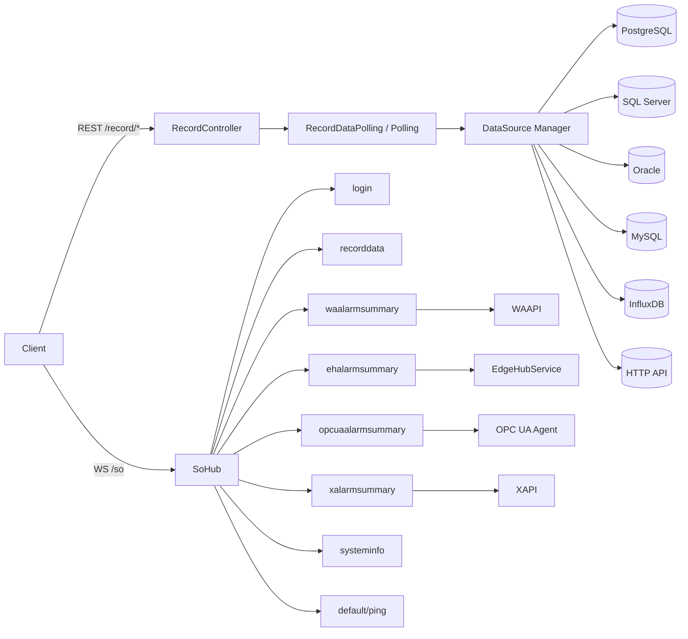
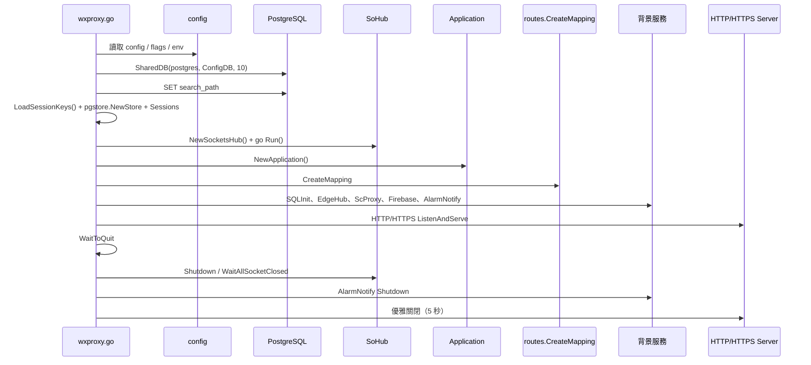
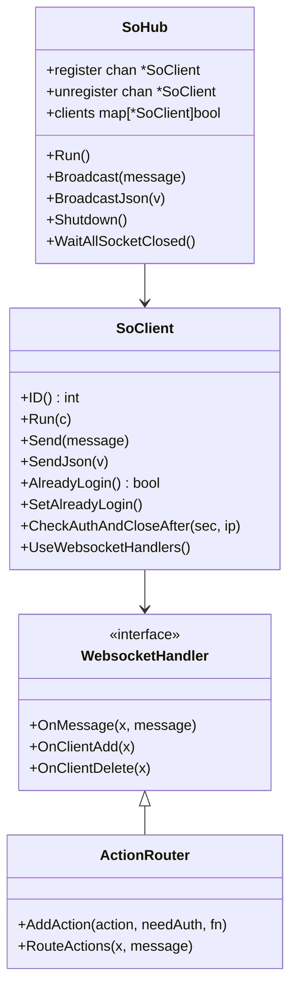
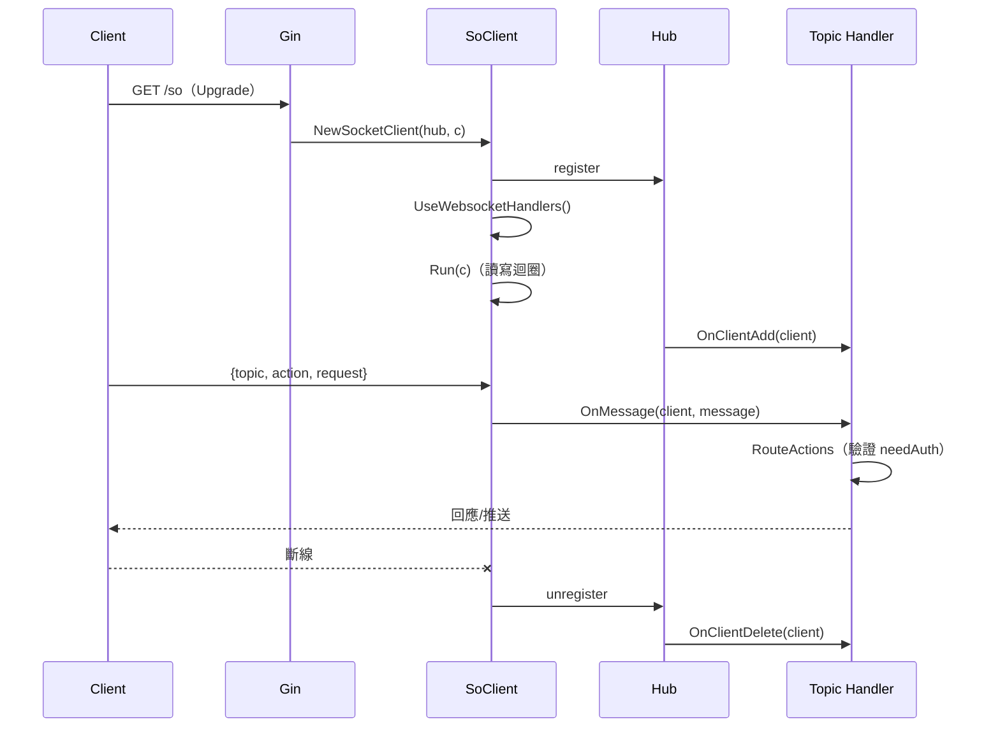
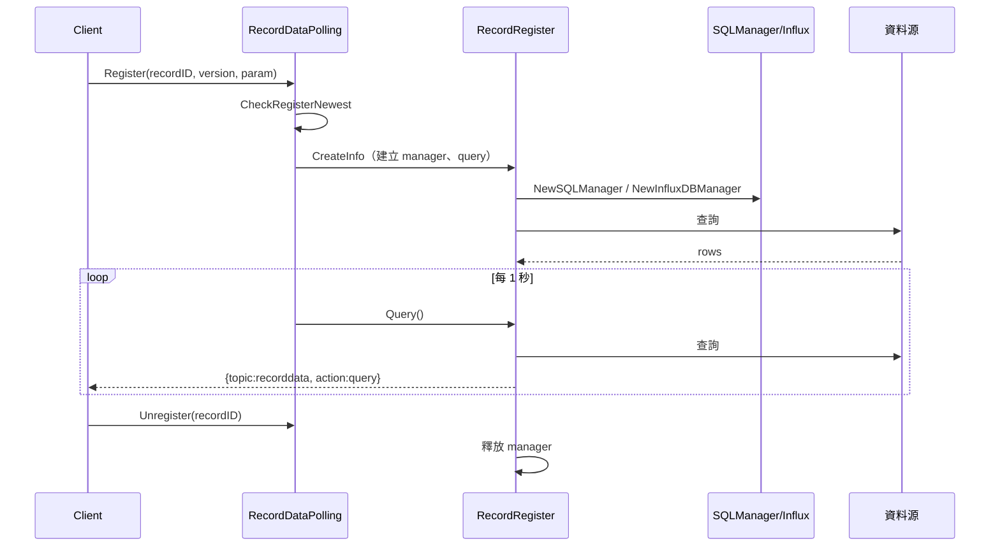

# SDS-05 Runtime Proxy 設計

> 程式碼根目錄：`wax_rutime_proxy`  
> 語言/框架：Go 1.23 / Gin / Gorilla WebSocket / PostgreSQL  
> 入口：`wxproxy.go`（`package main`）

## 1. 設計概述

Runtime Proxy 是 EdgeView 的**執行期資料服務**，負責：

1. 依 `Record` 定義查詢多種資料源（PostgreSQL、SQL Server、Oracle、MySQL、InfluxDB v1/v2、HTTP）。
2. 以 WebSocket 提供即時資料、告警摘要、系統資訊。
3. 代理 WebAccess、EdgeHub/BI、X、OPC UA 的資料與指令。
4. 發送 Firebase 推播。
5. 提供 BI 模式（Edge365）相容的 `/` WebSocket 進入點。



## 2. 啟動流程



### 2.1 啟動重點

| 步驟 | 說明 |
|------|------|
| TLS | 全域 `InsecureSkipVerify` 已移除；個別 client 仍停用驗證（R-002-R） |
| DB | `repository.SharedDB` 連線池 10；`search_path` 依環境 |
| Session | `graphicSession`；key 由 `LoadSessionKeys()` 解析（env 或 `aes_secret` HKDF）；`MaxAge=sessiontimeout` |
| WS 路徑 | WebAccess/OPC UA/X：`/so`；BI：`/`，並掛 `EdgeHubOptions` |
| 認證逾時 | 連線後 `websocket_auth_timeout` 秒內需完成 login，否則關閉 |
| 背景服務 | EdgeHub、SC Proxy、Firebase、AlarmNotify |
| 關閉 | 先停 Hub 與通知，再關 HTTP |

## 3. 組態設計

| 區塊 | 欄位 | 預設 | 說明 |
|------|------|------|------|
| `datasource` | int | 1 | 1=WebAccess、2=BI、3=OPC UA、4=X |
| `driftseconds` | int | 300 | 時間戳容許漂移 |
| `sessiontimeout` | int | 604800 | Session 秒數 |
| `proxy.net.http` | `host`/`port` | `127.0.0.1:28884` | 服務位址 |
| `proxy.net.https` | `host`/`port` | `localhost:-1` | HTTPS（停用） |
| `cert` | `crt`/`key` | — | TLS 憑證 |
| `log` | `filemaxmb`/`tofile` | 15/false | 日誌 |
| `systeminfo_interval_ms` | int | 3000 | 系統資訊輪詢 |
| `wa_alarm_summary_interval_ms` | int | 1000 | WA 告警摘要 |
| `opcua_alarm_summary_interval_ms` | int | 1000 | OPC UA 告警摘要 |
| `opcua.alarm` | `host`/`port`/`protocol`/`user`/`password` | `127.0.0.1:8090` | OPC UA 告警 |
| `websocket_auth_timeout` | int | 10 | WS 認證秒數 |
| `firebase_token_valid_days` | int | 30 | FCM token |
| `edge365.meta` | cluster/namespace/exdomain | — | Edge365 |
| `edge365.apps` | route/service_name/svc | — | apihub/dbmaster/alarm |
| `db_datetime_format` | mysql date/datetime/time | — | 方言格式 |
| `by_system_timezone` | bool | true | 時區 |

### 3.1 命令列旗標

`config.go` 支援 `-protocol`、`-port`、`-hostname`、`-cert`、`-key`、`-datasource`、`-sessiontimeout`、`-driftseconds` 等，覆寫 `config.yaml`。

### 3.2 資料源模式

| 值 | 常數 | 行為 |
|----|------|------|
| 1 | `SourceTypeWebAccess` | 使用本機 PostgreSQL `waxconfig`；WS `/so` |
| 2 | `SourceTypeBI` | 使用 Edge365；WS `/`；關閉本機日誌檔 |
| 3 | `SourceTypeOPCUA` | OPC UA Agent 資料源 |
| 4 | `SourceTypeX` | X 平台 |

## 4. WebSocket Hub 設計

### 4.1 元件



### 4.2 連線生命週期



### 4.3 訊息格式

請求：

```json
{
  "topic": "recorddata",
  "action": "register",
  "request": {
    "id": 123,
    "version": 1,
    "param": { "tag": "AI-001" }
  }
}
```

回應/推送：

```json
{
  "topic": "recorddata",
  "action": "register",
  "error": 0,
  "reason": "",
  "result": { ... }
}
```

- `TopicMessage`：`topic`、`action`、`request`。
- `ErrorMessage`：加上 `error`、`reason`。
- `ResponseMessage[T]`：再加上 `result`。
- 未分類 topic 會落到 `default`（PingPong），僅回 ping/pong，**不檢查認證**。

### 4.4 Topic 與 Action

| Topic | Action | 認證 | 用途 |
|-------|--------|------|------|
| `login` | `login` | 否（以 CSRF 驗證） | WS 登入，驗證 `csrfToken` |
| `recorddata` | `register`、`unregister`、`update`、`updatevalue`、`prevpage`、`nextpage`、`gotopage` | 是 | Record 即時資料與分頁 |
| `waalarmsummary` | `register`、`unregister` | 是 | WebAccess 告警摘要 |
| `ehalarmsummary` | `register`、`unregister` | 是 | EdgeHub 告警摘要 |
| `opcuaalarmsummary` | `register`、`unregister` | 是 | OPC UA 告警摘要 |
| `xalarmsummary` | `register`、`unregister` | 是 | X 告警摘要 |
| `systeminfo` | 無（連線即訂閱） | 否 | 系統/通訊狀態 |
| `default` | ping/pong | 否 | 心跳與未知 topic 回應 |

### 4.5 認證規則

- `loginController.login`：以 `csrfToken` 反查 `http_sessions` 的 session data，成功後 `SetAlreadyLogin`。
- 其他 `needAuth=true` 的 action：檢查 `client.AlreadyLogin()`，未登入回 `-100`。
- 連線後若逾時未登入，`CheckAuthAndCloseAfter` 主動關閉。
- **風險**：`systeminfo` 與 `default` 未要求登入。

## 5. REST 設計

### 5.1 路由

| Method | Path | 認證 | 用途 |
|--------|------|------|------|
| POST | `/record/queryrecord` | — | 已停用（路由未註冊，見 SDS-13 R-003） |
| POST | `/record/schema` | 是 | 資料庫 schema |
| POST | `/record/tableschema` | 是 | 資料表 schema |
| POST | `/record/previewquery` | 是 | 預覽查詢 |
| POST | `/record/preview` | 是 | 預覽 Record |
| POST | `/record/previewhttp` | 是 | HTTP 資料源預覽 |
| POST | `/record/runrecordcmd` | 是 | 執行 Record 指令 |
| POST | `/record/prevpage` | 是 | 上一頁 |
| POST | `/record/nextpage` | 是 | 下一頁 |
| POST | `/record/gotopage` | 是 | 指定頁 |
| POST | `/record/querydatalog` | 是 | 歷史資料查詢 |
| GET | `/foo/serverTime` | 否 | 伺服器時間 |
| POST | `/foo/queryAll` | 是 | 範例查詢 |
| POST | `/foo/insertOne` | 是 | 範例寫入 |
| GET | `/swagger/*any` | 否 | API 文件 |

### 5.2 認證與時間戳

- `authorizeCore`：
  - 支援 Basic Auth（WebAccess、X）或 Session + `csrfToken`。
  - Session 名稱 `graphicSession`。
  - 驗證失敗清 Cookie 並回 `-100`。
- `verifyPacketTimestamp`：JSON 或表單 `packetTimestamp`，誤差 > `driftseconds` 回 `-102`。
- `/record/queryrecord` 已停用（路由未註冊）；其他 `/record/*` 端點皆需 Session + CSRF。

### 5.3 回應格式

```json
{
  "data": {
    "error": 0,
    "reason": "",
    "result": { }
  }
}
```

錯誤碼：`0`、`-100`、`-101`、`-102`、`-500`、`-501`。

## 6. Record 查詢設計

### 6.1 資料模型

`Record`（`record` 表）：`id`、`name`、`projid`、`source`、`type`、`funcname`、`enable`、`version`、`info`（JSONB）。
`recordbody`：`Item`/`Value` 鍵值，組成 `Info`。

### 6.2 查詢流程



### 6.3 輪詢與分頁

- 固定 1 秒 ticker（`RecordDataPolling`、`Polling`）。
- 分頁：`prevpage`/`nextpage`/`gotopage`，頁碼存於 `Info["page"]`。
- `max_data_size` 限制回傳筆數，超過截斷並可由 Client 分頁。
- `updatevalue`：寫入資料源（依 Record 定義）。
- 併發保護：`RecordRegister.Mu` 保護 `Info`；`CreateInfo` 與 `Unregister` 競爭以 map 比對避免錯誤註冊。
- 快取：無明確 TTL；以訂閱生命週期為準（風險）。

### 6.4 方言支援

| 資料源 | 管理器 | 方言重點 |
|--------|--------|----------|
| PostgreSQL | `DatabaseSQLManager` | `$1` 參數、JSONB |
| SQL Server | `DatabaseSQLManager` | `@p1`、TOP |
| Oracle | `DatabaseSQLManager` | `:1`、ROWNUM |
| MySQL | `DatabaseSQLManager` | `?`、LIMIT |
| InfluxDB v1 | `InfluxDBManager` | InfluxQL |
| InfluxDB v2 | `InfluxDBManager` | Flux |
| HTTP | `httpService` | GET/POST + JSON 解析 |

`service/convert.go` 負責 SQL/Influx 字串組裝與識別字跳脫。

## 7. 即時資料與輪詢服務

| 服務 | 檔案 | 週期 | 說明 |
|------|------|------|------|
| Record 輪詢 | `RecordDataPolling.go`、`Polling.go` | 1 秒 | 查詢並推送 |
| System Info | `SystemInfoPolling.go` | 3000 ms | SC Server API 狀態 |
| WA 告警 | `WAAlarmPolling.go` | 1000 ms | `AlarmSummary(100000)` |
| OPC UA 告警 | `OpcuaAlarmPolling.go` | 1000 ms | Agent `:8090`；連線資訊 TTL 60 秒 |
| EH 告警 | `EHAlarmPolling.go` | `EHAlmSummaryIntervalMs`（預設 -1） | EdgeHub 告警 |
| X 告警 | `XAlarmPolling.go` | `XAlmSummaryIntervalMs`（預設 -1） | X 平台；連線資訊 TTL 60 秒 |

> **風險**：EH/X 間隔未從 `config.yaml` 綁定，維持 `-1`，`time.Sleep` 可能立即返回造成高頻輪詢。

## 8. 外部整合

### 8.1 WebAccess

- `WAAPI.go`：以 Basic Auth 呼叫 WA API。
- 告警摘要：`AlarmSummary(MaxNoAlarmSummaryWa=100000)`。
- 資料查詢：WA 專案/Tag。

### 8.2 EdgeHub / Edge365

- `edgeHubService.go`：`/apihub`、`/dbmaster`、`/alarm`。
- `DataSourceEdgeHubService.go`：EdgeHub 資料源。
- BI 模式：WS 掛在 `/`，並使用 `EdgeHubOptions`。

### 8.3 OPC UA

- 資料：Agent `:5123`（db `:5124`）。
- 告警：`:8090`，`opcua.alarm` 設定。
- 連線資訊快取 60 秒。

### 8.4 X 平台

- `XAPI.go` 認證與資料。
- 告警：`XAlarmPolling`，`xConnInfoTTL=60s`。

### 8.5 Firebase

- `firebaseService.go`：初始化 Admin SDK（`firebase-adminsdk.json`）。
- `AlarmNotifyService.go`：依告警變更推播。
- Token 有效 30 天。

### 8.6 SC Proxy

- `scProxyService.go`：代理 SC Server API（`/foo/*`、systeminfo）。
- `ProxyRequest` 封裝轉發。

## 9. Repository 與資料庫

| 項目 | 說明 |
|------|------|
| `SharedDB` | 共用 `*sql.DB`，連線池 10 |
| `ISQLManager` | `ExecuteNonQuery`、`ExecuteQuerySingleResult`、`ExecuteQueryMultiResult` |
| Schema | `public`（或 `wx`） |
| Session 表 | `http_sessions`（pgstore） |
| 設定表 | `record`、`recordbody`、`datasource`、`datasourcebody` |
| SQLInit | 建立/修補 runtime 所需表 |

## 10. 併發與可靠性

| 機制 | 說明 |
|------|------|
| Hub 單一 goroutine | `register`/`unregister`/`broadcast` channel 序列化 |
| Client 寫入佇列 | `send` channel + 專屬 goroutine，避免慢客戶端阻塞 |
| 讀取逾時 | `pongWait`/`pingPeriod`（依實作） |
| 訂閱鎖 | `RecordDataPolling.mu`、`RecordRegister.Mu` |
| Panic 回復 | REST 仲介層；WS 個別 handler |
| 優雅關閉 | Hub、AlarmNotify、HTTP 依序關閉 |
| 連線上限 | DB 10；WS 無硬上限（依資源） |

## 11. 安全設計（服務端）

| 機制 | 實作 |
|------|------|
| Session | `graphicSession`（PostgreSQL） |
| CSRF | REST/WS 登入驗證 |
| 時間戳 | REST `packetTimestamp` |
| Basic Auth | WA/X 內部整合 |
| WS 認證逾時 | 10 秒 |
| TLS | 可設定；全域 `InsecureSkipVerify` 已移除；個別 client 待改指定 CA（R-002-R） |
| CORS | 由 EdgeHubOptions/Ingress 控制 |

## 12. 效能設計

| 項目 | 設計 |
|------|------|
| 輪詢頻率 | Record 1 秒、告警 1 秒、系統 3 秒 |
| 批次 | 每次查詢回傳多列，`max_data_size` 控制 |
| 連線重用 | `SharedDB` 池、HTTP client 重用 |
| 快取 | 告警連線資訊 60 秒、Session |
| 背壓 | Client send channel；過慢可丟棄/關閉 |
| 資源回收 | Unregister 釋放 manager；斷線自動清理 |

## 13. 擴充點

1. 新增 topic：實作 `WebsocketHandler` + `init()` 註冊 + `AddAction`。
2. 新增資料源：`repository` 方言 + `service/convert.go` + `DataSource` 設定。
3. 新增告警來源：輪詢服務 + topic controller。
4. 新增推播：`AlarmNotifyService`。
5. 新增代理：`scProxyService` 路由。

## 14. 已知限制

1. `/record/queryrecord` 已停用（不再列出）。
2. EH/X 告警間隔未初始化。
3. 全域 TLS 不驗證已移除；個別 client 仍停用（R-002-R）。
4. Session secret 已改為 env/`aes_secret` HKDF，無硬編碼。
5. `systeminfo`/`default` 未要求登入。
6. Record 快取無 TTL，長期訂閱可能累積。
7. 多副本需 Sticky Session（Hub 為記憶體狀態）。
8. Oracle/MySQL/Influx 方言需依實際驅動驗證。

## 15. 需求對照

| 設計區塊 | 對應需求 |
|----------|----------|
| REST 查詢 | FR-RT-001~009 |
| WebSocket 即時 | FR-RT-010~017 |
| 代理/通知/關閉 | FR-RT-018~025 |
| 介面格式 | IF-COM-001~008 |
| 效能/安全/可靠 | NFR-PERF、NFR-SEC、NFR-REL |
