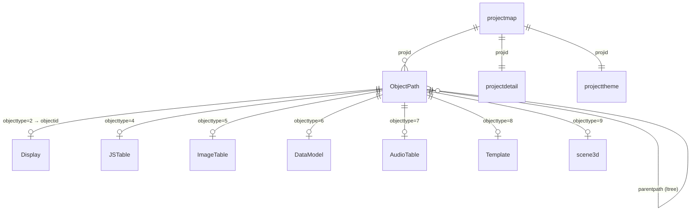
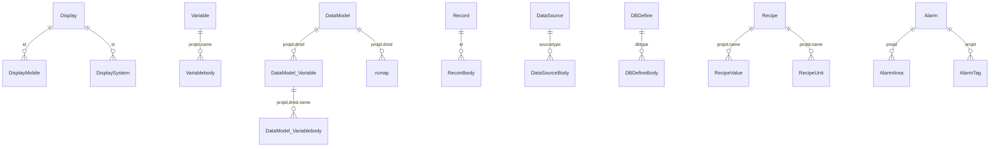
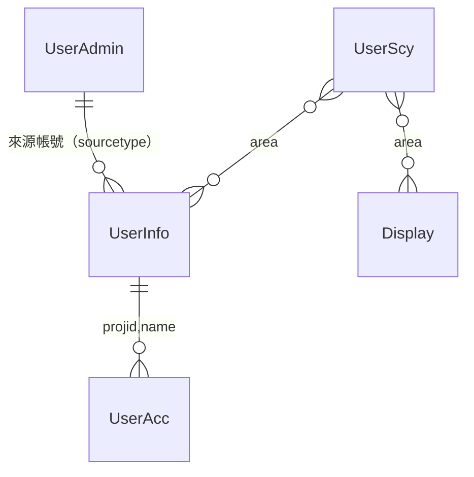
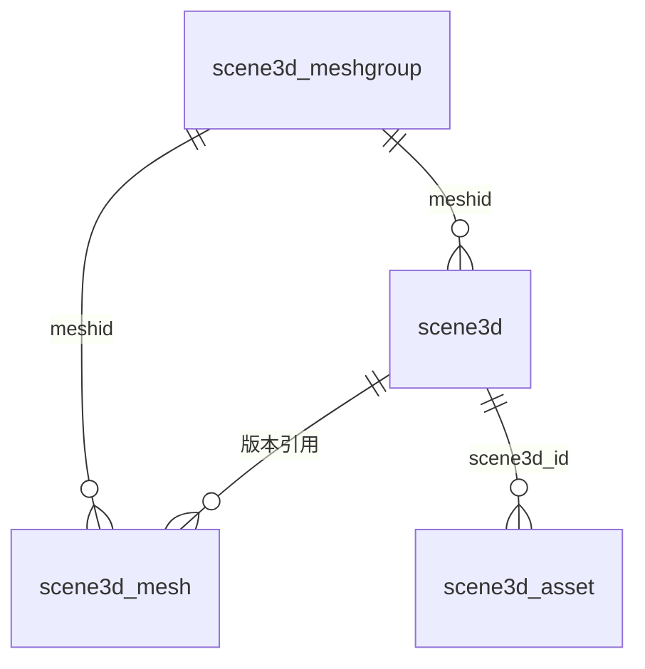

# SDS-06 資料模型與資料字典

## 1. 概述

EdgeView 以 **PostgreSQL** 作為設定資料庫，Metadata Service 與 Runtime Proxy 共用同一實例與 schema，但各自負責不同資料表：

| 服務 | 主要讀寫 | 說明 |
|------|----------|------|
| Metadata Service | 幾乎所有設定表（含 `OPCUA_*`） | 建立、遷移、維護 |
| Runtime Proxy | `record`/`recordbody`、`datasource`/`datasourcebody`、`http_sessions`、`fcm_device*` | 只讀設定、寫入 Session/推播 |
| OPC UA Data Agent | 只讀 `OPCUA_*`、`http_sessions` | 連線/Tag/Const 設定、Session 驗證 |
| OPC UA Alarm Agent | 只讀 `OPCUA_TagAlarm`/`Action`/`Level`；寫 `opcua_active_alarm`/`opcua_alarm_history` | 規則編譯、警報狀態/歷史 |
| OPC UA 設定 UI | 無直接 DB | 全部經 Metadata API |

資料庫名稱：

| 用途 | 預設 DB | Schema |
|------|---------|--------|
| 設定 | `waxconfig` | `public`；私有雲 `wx` |
| 動作日誌 | `waxlog`／`waxsclog` | `public` |
| OPC UA 警報 runtime | `waxalarm` | `public` |
| Session | 設定 DB | `public`（`http_sessions`） |

## 2. 命名與設計慣例

| 慣例 | 說明 |
|------|------|
| 表名 | 多為 PascalCase（`ObjectPath`、`DataSource`），少數 snake_case（`http_sessions`、`fcm_device`、`auditlog`） |
| 主鍵 | 代理鍵 `id serial` 或複合鍵（`projid` + `name`） |
| 專案隔離 | 以 `projid` 為範圍 |
| 版本 | `version int` 或 `version uuid` |
| 時間 | `createtime date/timestamp`、`modifytime`、Unix ms（`datetime_utc`、`unix_ts_ms`） |
| 彈性欄位 | JSON/JSONB（`content`、`info`、`value`、`data`） |
| 階層 | `ltree`（`ObjectPath.parentpath`） |
| 外鍵 | 主要用於 3D 資產；其餘多為邏輯關聯 |
| 大小寫 | SQL 未加引號時 PostgreSQL 轉小寫，查詢需一致 |

## 3. 領域關聯

### 3.1 專案與物件樹



### 3.2 內容與資料



### 3.3 使用者與權限



> `UserScy` 為專案內角色/群組；`UserInfo.area int[]` 指向 `UserScy.id`。

### 3.4 3D 場景



## 4. 資料表目錄

### 4.1 專案與物件

| 資料表 | 主鍵 | 主要欄位 | 用途 |
|--------|------|----------|------|
| `projectmap` | `projid`（serial） | `sourcetype`、`sourceprojid` | 本機專案 ↔ 外部專案對應 |
| `projectdetail` | `projid` | `defaultpage`、`asyncdraw`、`highlightchange`、`initenabled`、`toolbarvisible`、`viewmode`、`scaletype`、`lang`、`fullscreen`、`userhomeenabled`、`showconfirmdialog`、`decimalSeparatorMode`、`usedevicetypeonly` | 專案顯示設定 |
| `projecttheme` | `projid` | `systemtheme`、`viewtheme`、`viewthemeenabled`、`content` | 主題 |
| `ObjectPath` | `id`（serial） | `objectname`、`parentpath ltree`、`objecttype`、`objectid`、`projid`、`displayid` | 物件樹（核心索引） |
| `EdgeHub_Project` | `projid`（serial） | `tenantid`（unique） | EdgeHub 租戶對應 |
| `oemsettings` | `id=1` | `data jsonb`、`login_logo`、`product_icon` | OEM 品牌 |

`ObjectPath` 索引：

| 索引 | 型別 | 欄位 |
|------|------|------|
| `gist_objectpath_idx` | GIST | `parentpath` |
| `btree_objectpath_idx` | BTree | `parentpath` |
| `index_objectpathquery` | BTree | `objecttype`、`objectid` |

### 4.2 畫面與內容

| 資料表 | 主鍵 | 主要欄位 | 用途 |
|--------|------|----------|------|
| `Display` | `id`（serial） | `projid`、`name`、`content text`、`version int`、`thumbnailfile bytea`、`createtime date` | 2D 畫面內容（JSON） |
| `DisplayMobile` | `id`,`type` | `content`、`version bigint`、`thumbnailfile`、`createtime` | 行動版畫面 |
| `DisplaySystem` | `id`,`type` | `name`、`sourcetype`、`content`、`thumbnailfile`、`createtime` | 系統內建畫面 |
| `JSTable` | `id` | `name`、`content text`、`version` | JavaScript 腳本 |
| `ImageTable` | `id`（serial） | `filename`、`imagefile bytea` | 圖片 |
| `AudioTable` | `id`（serial） | `filename`、`audiofile bytea` | 音訊 |
| `Template` | `id` | `projid`、`name`、`content`、`version` | 範本 |
| `PluginFile` | `id`（serial） | `projid`、`name`、`type`、`content bytea` | 外掛/ZIP 資源 |
| `file_cache_meta` | `id`（serial） | `parentpathid`、`filename`、`objecttype`、`salt`、`projid`、`ver` | 遠端資源快取 |
| `symbol_factory_resource` | `id`（serial） | `name`、`path`、`modtime`、`size`、`imagefile` | Symbol Factory 圖庫 |
| `font` | `id`（serial） | `family`（unique）、`enabled`、`type`、`filename`、`filecontent`、`editor/edittime/creator/createtime` | 字型 |
| `i18n` | `lang` | `enabled`、`editor`、`edittime`、`creator`、`createtime` | 語系 |

`Display` 內容結構（概念）：

```json
{
  "version": "2.x",
  "canvas": { "width": 1920, "height": 1080, "background": "#FFFFFF" },
  "widgets": [
    {
      "type": "WidgetLabel",
      "id": "w1",
      "props": { "x": 100, "y": 80, "width": 240, "height": 40, "text": "Tank 1" },
      "bindings": [
        { "sourceType": "WebAccess", "sourceId": "AI-001", "target": "text", "interval": 1000 }
      ],
      "events": [{ "trigger": "onClick", "scriptId": 12 }]
    }
  ],
  "layers": [{ "id": "L1", "name": "Main", "visible": true, "locked": false }]
}
```

> 實際 schema 由 `waobjectJson.js`、`waobjectProperties.js` 定義；此處僅示意主要區塊。

### 4.3 變數與資料模型

| 資料表 | 主鍵 | 主要欄位 | 用途 |
|--------|------|----------|------|
| `Variable` | `projid`,`displayid`,`name` | `label`、`type`、`consttype`、`value`、`regex`、`spanhi`、`spanlo`、`level`、`area`、`sequence`、`interval`、`decpl`、`event` | 畫面變數 |
| `Variablebody` | `projid`,`displayid`,`name`,`item` | `value` | 變數擴充屬性 |
| `DataModel` | `projid`,`id uuid` | `name`、`password`、`importpw`、`content`、`version`、`thumbnail` | 資料模型 |
| `DataModel_Variable` | `projid`,`dmid`,`name` | `label`、`type`、`consttype`、`value`、`regex`、`spanhi`、`spanlo`、`level`、`area`、`sequence`、`interval`、`decpl`、`version uuid`、`event` | DataModel 變數 |
| `DataModel_Variablebody` | `projid`,`dmid`,`name`,`item` | `value` | 變數擴充屬性 |
| `rcmap` | `projid`,`dmid`,`mapname` | `objecttype`、`objectid` | DataModel 對應的物件 |

### 4.4 資料來源與查詢

| 資料表 | 主鍵 | 主要欄位 | 用途 |
|--------|------|----------|------|
| `DataSource` | `sourcetype` | `dbtype`、`name`（unique）、`descript` | 資料來源定義 |
| `DataSourceBody` | `sourcetype`,`item` | `value` | 連線參數（host/port/user/password/…） |
| `DBDefine` | `dbtype` | `name`、`descript` | 資料庫範本 |
| `DBDefineBody` | `dbtype`,`item` | `defval` | 範本預設值 |
| `Record` | `id`（serial） | `name`、`projid`、`source`、`type`、`funcname`、`enable`、`version` | 查詢定義 |
| `Recordbody` | `id`,`item` | `value jsonb` | 查詢參數/設定 |

`DataSourceBody.item` 常見鍵：

| 鍵 | 說明 |
|----|------|
| `ip` / `host` | 主機 |
| `port` | 埠 |
| `protocol` | `http`/`https`/`tcp`；HTTP 類型資料源預設 `https` |
| `username` | 帳號 |
| `password` | 密碼（可能加密） |
| `database` / `dbname` | 資料庫名 |
| `url` | HTTPS/Influx 端點 |
| `token` / `org` / `bucket` | Influx v2 |

`Recordbody.item` 常見鍵：

| 鍵 | 說明 |
|----|------|
| `sql` / `query` | SQL 或 Influx 查詢 |
| `table` / `columns` | 資料表/欄位 |
| `start` / `end` / `interval` | 時間範圍 |
| `max_data_size` | 回傳上限 |
| `page_size` | 分頁大小 |
| `url` / `method` / `body` | HTTP 資料源 |

### 4.5 告警

| 資料表 | 主鍵 | 主要欄位 | 用途 |
|--------|------|----------|------|
| `Alarm` | `projid` | `singleaudioid`、`multiaudioid` | 告警音設定 |
| `AlarmArea` | `projid`,`name` | `description`、`areaaudio`、`audioid` | 告警區域 |
| `AlarmTag` | `projid`,`name`,`tagname` | `audioid` | Tag 告警音 |
| `OPCUA_TagAlarm` | `projid`,`tagname`,`item` | `alarmtype`、`value` | OPC UA 告警規則（EAV） |
| `OPCUA_AlarmAction` | `projid` | `report`、`alarmsummary`、`ack`、`alarmlog`、時間戳 | 專案告警門檻 |
| `OPCUA_AlarmLevel` | `projid`,`level` | `levelname`、`colorcode`、時間戳 | 告警等級/顏色 |

### 4.6 使用者與安全

| 資料表 | 主鍵 | 主要欄位 | 用途 |
|--------|------|----------|------|
| `UserAdmin` | `sourcetype`,`name` | `password`（Argon2id，相容舊 SHA-256）、`active` | 平台管理員 |
| `UserInfo` | `projid`,`name` | `password`、`usertype`、`home`、`area int[]`、`ack`、`change`、`sourceuserid`、`modifytime` | 專案使用者 |
| `UserAcc` | `projid`,`name`,`displayid` | `ack`、`change` | 畫面權限 |
| `UserScy` | `id`（serial） | `projid`、`name`、`descript`、`area int[]` | 角色/群組 |
| `TrendGroup` | `type`,`id`,`item` | `projid`、`value` | 趨勢群組 |
| `http_sessions` | pgstore | `key`、`data`、`expires_on` | Session（兩服務共用） |
| `OPCUA_User` | `name`（unique） | `password text`、… | OPC UA 使用者 |
| `OPCUA_UserFunc` | `id`,`function` | `edit` | 功能權限 |
| `OPCUA_UserProject` | `userid`,`projid` | `usertype` | 專案權限 |
| `OPCUA_LoginLock` | 依實作 | 鎖定狀態 | 登入鎖定 |

### 4.7 OPC UA 設定（waxconfig）

| 資料表 | 主鍵 | 主要欄位 | 用途 |
|--------|------|----------|------|
| `OPCUA_Project` | `projid` | `projname`（unique）、`description`、`createtimestamp`、`modifytimestamp` | OPC UA 專案 |
| `OPCUA_Connect` | `projid`,`name` | `uri`、時間戳；FK→Project | 連線 |
| `OPCUA_ConnectBody` | `projid`,`name`,`item` | `value`、`cert bytea`；FK→Connect | 連線參數/憑證 |
| `OPCUA_Tag` | `projid`,`tagname` | `connectname`、`nodeid`、`description`、`spanhi/lo`、`datatype`、`displayint/dec`、`scalingtype`、`scalingfactor1/2`、`reverse`、`area`、`level` | OPC UA Tag |
| `OPCUA_TagConfig` | `projid`,`type` | `spanhi/lo`、`displayint/dec` | Tag 預設 |
| `OPCUA_ConstTag` | `projid`,`tagname` | `description`、`datatype`、`value`、`area`、`level`、`spanhi/lo`、`arylen`、時間戳 | 常數/計算/系統測點主表 |
| `OPCUA_Consttagbody` | `projid`,`tagname`,`item` | `value` | 公式/設定（EAV） |
| `OPCUA_TagAlarm` | `projid`,`tagname`,`item` | `alarmtype`、`value` | 告警規則（EAV） |
| `OPCUA_AlarmAction` | `projid` | `report`、`alarmsummary`、`ack`、`alarmlog` | 專案門檻 |
| `OPCUA_AlarmLevel` | `projid`,`level` | `levelname`、`colorcode` | 等級/顏色 |

`OPCUA_ConnectBody.item` 常見鍵：`ApplicationUrl`、`Username`、`Password`、`PfxFile`、`PfxPassword`、`SecurityMode`、`SecurityPolicy`、`DomainNames`、`AuthMode`。

`OPCUA_Consttagbody.item` 常見鍵：`formula`、`systype`、`source`、`divide`、`valuelimit`、`resetminutes`。

`OPCUA_TagAlarm.item` 常見鍵：`HHALARM`、`HIALARM`、`LOALARM`、`LLALARM`、`ROCALARM`、`DEVHALARM`、`DEVLALARM`、`HHALARMLEVEL`、`HHENABLE`、`HHALARMMESSAGE`、`DELAYTIME`、`TONORMALDELAY`、`ASSOCTAGNAME`、`HLDEADBAND`、`DEVDEADBAND`、`HISTORIZING`。

### 4.7.1 OPC UA Alarm Runtime（waxalarm）

| 資料表 | 主鍵 | 主要欄位 | 用途 |
|--------|------|----------|------|
| `opcua_active_alarm` | `id`（bigserial） | `projid`、`tag`、`alarm_type`、`alarm_level`、`alarm_limit`、`discrete_state`、`alarm_message`、`condition_state`、`status`、`current_value`、`alarm_value`、`to_normal_time`、`close_time`、`handler`、`active_types jsonb`、`alarm_time` | 進行中/已關閉警報 |
| `opcua_alarm_history` | — | `alarm_id`、`status`、`alarm_time`、`handler`、`commenter`、`record` | 警報事件歷程 |

- `opcua_active_alarm` 部分唯一索引：`(projid, tag) WHERE status <> 0`，確保同 Tag 僅一個未關閉執行個體。
- `opcua_alarm_history` 索引：`(alarm_id, alarm_time DESC)`。
- 設定表（`opcua_tagalarm`/`opcua_alarmaction`/`opcua_alarmlevel`）仍由 Metadata Service 擁有；Alarm Agent 只讀。

### 4.8 配方與 3D

| 資料表 | 主鍵 | 主要欄位 | 用途 |
|--------|------|----------|------|
| `Recipe` | `projid`,`name` | `description`、`editarea`、`editlevel`、`dwarea`、`dwlevel`、`readonly`、`tolerance decimal` | 配方 |
| `RecipeValue` | `projid`,`name`,`seqnbr` | `item`、`value` | 配方值 |
| `RecipeUnit` | `projid`,`name`,`unit`,`seqnbr` | `tagname` | 配方單位 |
| `scene3d` | `id uuid` | `projid`、`name`、`appjson`、`qml`、`meshid`、`version`、`open_qml_version_ms`、`createtime` | 3D 場景 |
| `scene3d_meshgroup` | `id uuid` | — | 網格群組 |
| `scene3d_mesh` | `id uuid` | `meshid` FK、`mesh_name`、`rel_dir`、`mesh_content bytea` | 網格檔 |
| `scene3d_asset` | `id uuid` | `scene3d_id`、`rel_dir`、`logical_name`、內容 | 資產（材質/貼圖） |

### 4.9 設定、日誌與通知

| 資料表 | 主鍵 | 主要欄位 | 用途 |
|--------|------|----------|------|
| `Settings` | `name` | `value jsonb` | 系統設定（如 `client_data_update_interval=3000`） |
| `MQTTBroker` | `id` | `host`、`username`、`pwd`、`tcpport`、`tlsport`、`websocketport`、`websockettlsport`、`keepalive` | MQTT（停用） |
| `ActionLog` | `id` | `projid`、`datetime_utc`、`offset_ms`、`acttype`、`tagname`、`username`、`ip_address`、`paramjson` | 操作日誌 |
| `ActionLogUser` | `projid`,`username` | — | 日誌使用者索引 |
| `auditlog` | `unix_ts_ms`,`event_id` | `project_id`、`category_id`、`action_id`、`user_id`、`user_name`、`user_role_id`、`client_host`、`target`、`changes jsonb`、`status_id`、`reason_id`、`checksum` | 稽核（防篡改） |
| `Maintenance` | `logtype` | `maint_hour`、`maint_minute`、`delete_expired`、`expired_time`、`expired_time_unit`、`last_maint_time_utc`、`daily_backup` | 日誌維護 |
| `fcm_device` | `deviceid` | `datasource`、`token`、`platform`、`language`、`continueminute`、`lastupdate` | 推播裝置 |
| `fcm_device_project` | `deviceid`,`projectid` | `projecttoken`、`projectname`、`alarmlevel` | 裝置專案訂閱 |
| `testtable` | `pk` | `json_val jsonb`、`int_val`、`string_val` | 範例/測試 |

## 5. 列舉與代碼

### 5.1 ObjectPath.objecttype

| 值 | 常數 | 意義 | 對應資料表 |
|----|------|------|------------|
| 1 | `ObjectTypeProject` | 專案根 | `projectmap` |
| 2 | `ObjectTypeDrawing` | 畫面 | `Display` |
| 3 | `ObjectTypeFolder` | 資料夾 | — |
| 4 | `ObjectTypeScript` | 腳本 | `JSTable` |
| 5 | `ObjectTypeImage` | 圖片 | `ImageTable` |
| 6 | `ObjectTypeModel` | 資料模型 | `DataModel` |
| 7 | `ObjectTypeAudio` | 音訊 | `AudioTable` |
| 8 | `ObjectTypeTemplate` | 範本 | `Template` |
| 9 | `ObjectTypeScene3D` | 3D 場景 | `scene3d` |

### 5.2 資料源（source / sourcetype）

| 值 | 名稱 | 說明 |
|----|------|------|
| 1 | `WebAccess` | WebAccess/本機 |
| 2 | EdgeHub（`BI`） | Edge365 |
| 3 | `Opcua` | OPC UA |
| 4 | `X` | X 平台 |

> 注意：Client `Define.dataSourceTypeDisplay` 以字串 `WebAccess`/`Opcua`/`BI`/`X` 表示；`DataSource.sourcetype` 為 int。兩者轉換需一致（見 SDS-11 OI-008）。

### 5.3 使用者類型

| `usertype` | 說明 |
|------------|------|
| 0 | 系統/管理員 |
| 1 | 一般使用者 |
| 2 | 進階/維運（依實作） |

> 實際值依 `UserController` 與 UI 定義。

### 5.4 記錄類型（Record.type / funcname）

| 欄位 | 範例 | 說明 |
|------|------|------|
| `source` | `WebAccess`、`PostgreSQL`、`InfluxDB` | 資料源 |
| `type` | `SQL`、`Influx`、`HTTP` | 查詢類型 |
| `funcname` | `query`、`update`、`insert` | 動作 |

## 6. 資料字典（核心表）

### 6.1 `ObjectPath`

| 欄位 | 型別 | 必填 | 說明 |
|------|------|------|------|
| `id` | serial | 是 | 路徑 ID |
| `objectname` | text | 是 | 顯示名稱 |
| `parentpath` | ltree | 是 | 父路徑（如 `0.12.15`） |
| `objecttype` | int | 否 | 見 §5.1 |
| `objectid` | text | 是 | 目標物件 ID |
| `projid` | int | 否 | 專案 |
| `displayid` | int | 否 | 所屬畫面 |

### 6.2 `Display`

| 欄位 | 型別 | 說明 |
|------|------|------|
| `id` | serial | 畫面 ID |
| `projid` | int | 專案 |
| `name` | text | 名稱 |
| `content` | text | JSON 內容 |
| `version` | int | 版本（`-1` 表示刪除） |
| `thumbnailfile` | bytea | 縮圖 |
| `createtime` | date | 建立日 |

### 6.3 `Record`

| 欄位 | 型別 | 說明 |
|------|------|------|
| `id` | serial | Record ID |
| `name` | text | 名稱 |
| `projid` | int | 專案 |
| `source` | varchar(255) | 資料源 |
| `type` | varchar(255) | 查詢類型 |
| `funcname` | varchar(255) | 函式/動作 |
| `enable` | bool | 啟用 |
| `version` | int | 版本 |
| `info`（runtime 組合） | jsonb | `Recordbody` 聚合 |

### 6.4 `UserInfo`

| 欄位 | 型別 | 說明 |
|------|------|------|
| `projid` | int | 專案 |
| `name` | text | 使用者 |
| `password` | text | 雜湊（Argon2id + 隨機鹽；相容舊 SHA-256） |
| `usertype` | int | 類型 |
| `home` | int | 首頁畫面 ID |
| `area` | int[] | 角色/區域 ID |
| `ack` | bool | 可確認告警 |
| `change` | bool | 可修改 |
| `sourceuserid` | text | 外部來源 ID |
| `modifytime` | timestamp | 修改時間 |

### 6.5 `auditlog`

| 欄位 | 型別 | 說明 |
|------|------|------|
| `unix_ts_ms` | bigint | 事件時間（ms） |
| `event_id` | uuid | 事件 ID |
| `project_id` | int | 專案 |
| `category_id` | smallint | 類別 |
| `action_id` | int | 動作 |
| `user_id` | int | 使用者 ID |
| `user_name` | text | 使用者名稱 |
| `user_role_id` | smallint | 角色 |
| `client_host` | text | 來源 |
| `target` | text | 目標 |
| `changes` | jsonb | 變更內容 |
| `status_id` | smallint | 結果 |
| `reason_id` | smallint | 原因 |
| `checksum` | varchar(64) | 完整性 |

## 7. JSON 結構

### 7.1 `Settings.value`

```json
{
  "client_data_update_interval": 3000,
  "language": "eng",
  "theme": "light"
}
```

### 7.2 `projecttheme.content`

```json
{
  "colors": { "primary": "#0D6EFD", "background": "#FFFFFF" },
  "fonts": { "base": "Noto Sans TC" },
  "widgets": { "radius": 4 }
}
```

### 7.3 `oemsettings.data`

```json
{
  "productName": "EdgeView",
  "company": "Advantech",
  "loginLogo": "login_logo",
  "productIcon": "product_icon",
  "theme": { "primary": "#0D6EFD" }
}
```

### 7.4 `Recordbody.value`

依 `item` 不同而異：

```json
{
  "sql": "SELECT ts, value FROM history WHERE tag = $1 AND ts >= $2",
  "max_data_size": 500,
  "page_size": 100
}
```

### 7.5 `auditlog.changes`

```json
{
  "before": { "name": "Tank 1" },
  "after": { "name": "Tank A" },
  "fields": ["name"]
}
```

## 8. 索引與約束

| 資料表 | 約束/索引 | 目的 |
|--------|-----------|------|
| `ObjectPath` | GIST/BTree `parentpath`、`(objecttype,objectid)` | 階層查詢 |
| `Display` | `index_projid` | 專案列表 |
| `Template` | `index_projid` | 專案範本 |
| `PluginFile` | `index_projid` | 專案外掛 |
| `file_cache_meta` | unique `(parentpathid,filename)`、`projid` | 快取唯一性 |
| `DataSource` | unique `name` | 名稱唯一 |
| `projectmap` | unique `(sourcetype,sourceprojid)` | 一對一映射 |
| `EdgeHub_Project` | unique `tenantid` | 租戶唯一 |
| `scene3d` | `projid` | 場景列表 |
| `scene3d_asset` | unique `(scene3d_id,rel_dir,logical_name)` | 資產唯一 |
| `ActionLog` | `(projid,datetime_utc)` | 查詢 |
| `auditlog` | PK `(unix_ts_ms,event_id)` | 事件唯一 |
| `http_sessions` | pgstore 管理 | Session 查詢 |
| `symbol_factory_resource` | unique `(name,path)` | 圖庫唯一 |

## 9. 資料生命週期

| 資料 | 建立 | 更新 | 刪除 |
|------|------|------|------|
| 專案 | 建立專案 | 設定/主題 | 標記或移除 |
| 畫面 | 新增 | 儲存（version+1） | `version=-1` 軟刪除 |
| 腳本/圖片/音訊 | 上傳 | 覆寫/版本 | 刪除列 |
| Record | 定義 | 版本 | 刪除列 |
| ActionLog | 操作時 | — | 依 `Maintenance` 清理/備份 |
| auditlog | 稽核時 | — | 依 `Maintenance`，checksum 驗證 |
| Session | 登入 | 請求續期 | 逾時/登出 |
| 3D 資產 | 上傳 | 版本 | 連動刪除（FK cascade） |

## 10. 遷移策略

1. **啟動時幂等遷移**：`CREATE TABLE IF NOT EXISTS` + `ALTER TABLE ... ADD COLUMN IF NOT EXISTS`。
2. **版本化腳本**：`migrations/`、`_changes/` 存放進階變更。
3. **向後相容**：新增欄位需有預設值；移除欄位先停用再刪。
4. **資料回填**：以 `UPDATE ... WHERE col IS NULL` 分批執行。
5. **rollback**：以備份/快照為主，DDL 不自動回滾。

## 11. 資料擁有權

| 資料表 | 寫入者 | 讀取者 |
|--------|--------|--------|
| `projectmap`、`projectdetail`、`projecttheme` | Metadata | Metadata、Client |
| `ObjectPath`、`Display`、`JSTable`、`Image/Audio` | Metadata | Metadata、Client |
| `Variable`、`DataModel*`、`Record*`、`Recipe*` | Metadata | Metadata、Runtime、Client |
| `DataSource*`、`DBDefine*` | Metadata | Metadata、Runtime |
| `User*`、`Settings`、`auditlog`、`Maintenance` | Metadata | Metadata、Client |
| `http_sessions` | Metadata、Runtime | 兩者 |
| `fcm_device*` | Runtime、Metadata | Runtime |
| `testtable` | Runtime | Runtime |

## 12. 敏感資料

| 資料 | 位置 | 保護 |
|------|------|------|
| 使用者密碼 | `UserAdmin`、`UserInfo`、`OPCUA_User` | Argon2id + 隨機鹽 + pepper（R-004）；舊 SHA-256 登入即升級 |
| 資料源密碼 | `DataSourceBody.value` | 可能加密（AES） |
| Session | `http_sessions.data` | HMAC 簽章（pgstore）；Session 內上游密碼（WebAccess/X）以 AES-256-GCM 加密，金鑰由 `SESSION_SECRET` 派生，未設定時 fallback `aes_secret` |
| 稽核 | `auditlog` | checksum |
| 憑證/金鑰 | 檔案系統 | 權限控管 |

## 13. 一致性規則

1. `ObjectPath` 與實際內容表需同步；刪除內容時應同步移除節點。
2. `Display.version=-1` 表示刪除，查詢需過濾。
3. `Record.projid` 與 `projectmap` 對應，跨源查詢需轉換 `sourceprojid`。
4. `UserInfo.area` 與 `UserScy.id` 必須存在。
5. `scene3d_mesh.meshid` 與 `scene3d.meshid` 需指向存在的群組。
6. `fcm_device_project.deviceid` 需存在於 `fcm_device`。

## 14. 需求對照

| 資料領域 | 對應需求 |
|----------|----------|
| 專案/物件樹/畫面 | FR-META-013~020、FR-CLI-021~045 |
| 變數/DataModel/Record | FR-META-021~028、FR-RT-001~009 |
| 使用者/群組/權限 | FR-META-029~032、NFR-SEC-006 |
| 告警/配方/3D | FR-META-025、FR-META-033~034 |
| 稽核/維護 | FR-META-041~045、NFR-AUD-001~005 |
| Session/安全 | NFR-SEC-001~005 |
