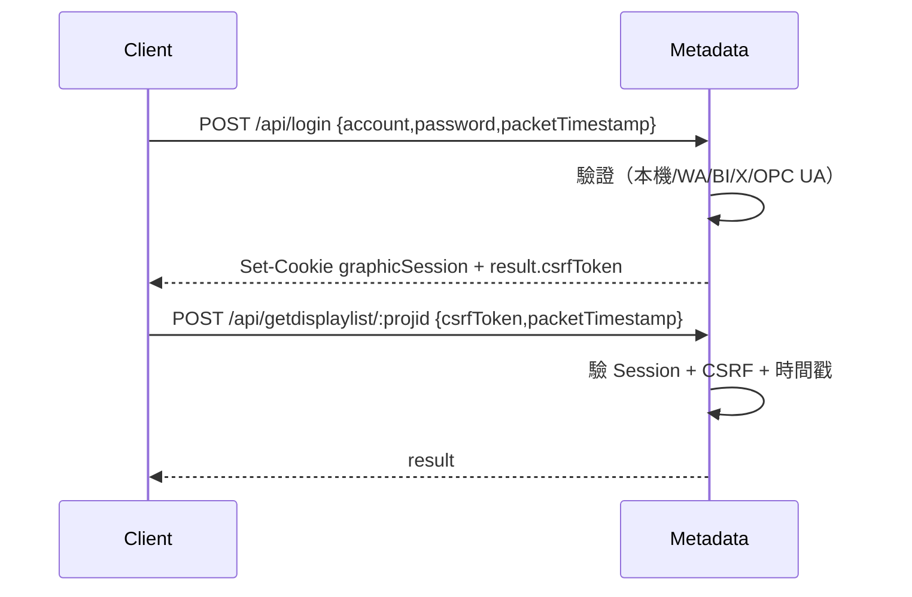
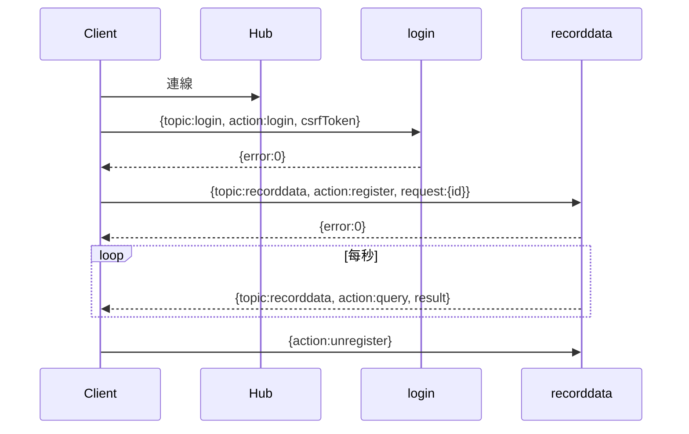

# SDS-07 介面設計（REST / WebSocket / 檔案）

## 1. 通訊總覽

| 介面 | 服務 | 預設 | 協定 | 用途 |
|------|------|------|------|------|
| Metadata REST | Metadata | `127.0.0.1:28883` | HTTP/HTTPS | 設定、認證、資源 |
| Metadata 檔案 | Metadata | 同上 | HTTP | 縮圖、圖片、檔案、字型 |
| Runtime REST | Runtime | `127.0.0.1:28884` | HTTP/HTTPS | Record 查詢/預覽 |
| Runtime WS | Runtime | `ws://…/so`（BI：`/`） | WebSocket | 即時資料/告警/系統 |
| Swagger | 兩者 | `/swagger/*any` | HTTP | API 文件 |

## 2. REST 慣例

### 2.1 請求

| 項目 | 規則 |
|------|------|
| Method | 幾乎全為 `POST`（少數 GET 下載） |
| Content-Type | `application/json` 或 `multipart/form-data` |
| Cookie | `graphicSession`、`settingSession` |
| CSRF | JSON body `csrfToken` 或表單 `csrfToken` |
| 時間戳 | `packetTimestamp`（毫秒），誤差 ≤ `driftseconds`（300 秒） |
| 編碼 | UTF-8 |
| 大小 | Client 上傳 5 MB；Ingress 75 MB |

### 2.2 回應信封

```json
{
  "data": {
    "error": 0,
    "reason": "",
    "result": { }
  }
}
```

| 欄位 | 型別 | 說明 |
|------|------|------|
| `error` | int | `0` 成功；負值失敗 |
| `reason` | string | 錯誤說明 |
| `result` | any | 成功資料；失敗多為 `false` |

### 2.3 錯誤碼

| 代碼 | 意義 | 處理建議 |
|------|------|----------|
| `0` | 成功 | — |
| `-100` | 未授權/Token 失效 | 重新登入 |
| `-101` | 無權限 | 提示權限不足 |
| `-102` | 時間戳逾時 | 校正時間後重試 |
| `-500` | 未知錯誤 | 顯示一般錯誤 |
| `-501` | 參數/業務錯誤 | 顯示 `reason` |

> Metadata 另有 `-519` 等業務碼（如「專案不可移動」）。

### 2.4 認證流程



- 登入成功後 Client 保存 `csrfToken`，後續所有請求附帶。
- WebSocket 以同一個 `csrfToken` 登入。

### 2.5 檔案介面

| Method | Path | 認證 | 說明 |
|--------|------|------|------|
| GET | `/getfile` | 否 | 預設檔案 |
| GET | `/getfile/:pathid/:filename` | 否 | 依路徑取檔 |
| GET | `/gettumb/:objectid` | 否 | 縮圖 |
| GET | `/gettumb/:objectid/:type` | 否 | 行動版縮圖 |
| GET | `/getdmtumb/:projid/:dmid` | 否 | DataModel 縮圖 |
| GET | `/getpluginfile/:projid/:filename` | 否 | 外掛檔案 |
| GET | `/getdisplay/*action` | 是 | 取得畫面檔案 |

> 下載端點多為公開（以難猜 ID/檔名保護），需注意資訊洩漏（見 SDS-11）。

## 3. Metadata REST 目錄

> 說明：表中 `needAuth` 代表控制器常數 `needAuth=true`（全專案皆為 `true`）；`否` 表示明文公開。

### 3.1 認證、租戶、系統

| Method | Path | Auth | Handler |
|--------|------|------|---------|
| POST | `/api/about` | needAuth | `loginController.About` |
| POST | `/api/login` | 否 | `loginController.Login` |
| POST | `/api/logout` | needAuth | `loginController.LogOut` |
| POST | `/api/setting/about` | needAuth | `loginController.About` |
| POST | `/api/setting/logout` | needAuth | `loginController.LogOutSetting` |
| POST | `/api/options` | 否 | `loginController.Options` |
| POST | `/api/source` | 否 | `loginController.Source` |
| POST | `/api/sysstatus` | needAuth | `loginController.SystemStatus` |
| POST | `/api/validateToken` | 否 | `loginController.ValidateToken` |
| POST | `/api/usersecurity/:projectname` | needAuth | `loginController.UserSecurity` |
| POST | `/api/tenantlist` | needAuth | `projectController.tenantlist` |
| POST | `/api/orglist` | needAuth | `projectController.orglist` |
| POST | `/api/userprojlist` | needAuth | `projectController.userprojlist` |
| POST | `/ping/:id` | 是 | `pingController.Ping` |

### 3.2 BI / Edge365

| Method | Path | Auth | Handler |
|--------|------|------|---------|
| POST | `/api/bi/checkToken` | needAuth | `loginController.BICheckToken` |
| POST | `/api/bi/refreshToken` | needAuth | `loginController.BIRefreshToken` |
| POST | `/api/bi/customlogo` | 否 | `loginController.BICustomLogo` |
| POST | `/api/bi/systeminfo` | 否 | `loginController.BISysteminfo` |

### 3.3 專案與主題

| Method | Path | Auth | Handler |
|--------|------|------|---------|
| POST | `/api/project/default/:projid` | needAuth | `projectController.Default` |
| POST | `/api/project/detail/:projid` | needAuth | `projectController.projdetail` |
| POST | `/api/project/theme/detail/:projid` | needAuth | `projectController.GetTheme` |
| POST | `/api/project/update` | needAuth | `projectController.projupdate` |

### 3.4 物件樹與路徑

| Method | Path | Auth | Handler |
|--------|------|------|---------|
| POST | `/api/addfolder` | needAuth | `objectpathController.AddFolder` |
| POST | `/api/copyobject` | needAuth | `objectpathController.CopyObject` |
| POST | `/api/deletefolder` | needAuth | `objectpathController.DeleteFolder` |
| POST | `/api/deletepath` | needAuth | `objectpathController.DeletePath` |
| POST | `/api/export` | needAuth | `objectpathController.Export` |
| POST | `/api/getfolderid/:projid/*action` | needAuth | `objectpathController.GetFolderPathIdByFullPathText` |
| POST | `/api/getnextlevelbyid/:pathid/*type` | needAuth | `objectpathController.GetNextLevelbyID` |
| POST | `/api/getnextlevelpath/:pathid` | needAuth | `objectpathController.GetNextLevelPath` |
| POST | `/api/import` | needAuth | `objectpathController.Import` |
| POST | `/api/moveobject` | needAuth | `objectpathController.MoveObject` |
| POST | `/api/pathdetail/:pathid` | needAuth | `objectpathController.PathDetail` |
| POST | `/api/rename` | needAuth | `objectpathController.ReName` |
| POST | `/api/searchunderpath/:pathid` | needAuth | `objectpathController.SearchUnderPath` |

### 3.5 畫面

| Method | Path | Auth | Handler |
|--------|------|------|---------|
| POST | `/api/createdisplay` | needAuth | `dpController.CreateDisplay` |
| POST | `/api/deletedisplay` | needAuth | `dpController.DeleteDisplay` |
| POST | `/api/disdmlist` | needAuth | `dpController.DisDMList` |
| POST | `/api/getdisplaydetail/:displayid` | needAuth | `dpController.GetDisplayDetail` |
| POST | `/api/getdisplaydetail/:displayid/:type` | needAuth | `dpController.GetDisplayDetailMobile` |
| POST | `/api/getdisplayid/:projid/*action` | needAuth | `dpController.GetDisplayId` |
| POST | `/api/getdisplaylist/:projid` | needAuth | `dpController.GetDisplayList` |
| POST | `/api/getdisplayversion/:displayid` | needAuth | `dpController.GetDisplayVersion` |
| POST | `/api/getdisplayversionlist/:projid` | needAuth | `dpController.GetDisplayVersionList` |

### 3.6 腳本

| Method | Path | Auth | Handler |
|--------|------|------|---------|
| POST | `/api/containjslist` | needAuth | `jsController.ContainJSList` |
| POST | `/api/createjs/:parentpathid` | needAuth | `jsController.CreateJS` |
| POST | `/api/deletejs` | needAuth | `jsController.DeleteJS` |
| POST | `/api/getjsbypathtext` | needAuth | `jsController.GetJSbyPathText` |
| POST | `/api/getjsdetail/:jsid` | needAuth | `jsController.GetJSDetail` |
| POST | `/api/getjslist/:displayid` | needAuth | `jsController.GetJSList` |
| POST | `/api/getjsversionlist` | needAuth | `jsController.GetJSVersionList` |
| POST | `/api/getjsversionlistbyproj/:projid` | needAuth | `jsController.GetJSVersionListByProject` |
| POST | `/api/getprojectjslist/:projectid` | needAuth | `jsController.GetProjectJSList` |

### 3.7 圖片與音訊

| Method | Path | Auth | Handler |
|--------|------|------|---------|
| POST | `/api/deleteimage` | needAuth | `imController.DeleteImage` |
| POST | `/api/deleteprojectimage/:projectid` | needAuth | `imController.DeleteProjectImage` |
| POST | `/api/getimagelist/:displayid` | needAuth | `imController.GetImageList` |
| POST | `/api/getprojectimagelist/:projectid` | needAuth | `imController.GetProjectImageList` |
| POST | `/api/updateimage/:parentpathid` | needAuth | `imController.UpdateImage` |
| POST | `/api/uploadimage/:parentpathid` | needAuth | `imController.UploadImage` |
| POST | `/api/uploadprojectimage/:projectid` | 否 | `imController.UploadProjectImage` |
| POST | `/api/ttsaudio` | needAuth | `adController.TtsAudio` |
| POST | `/api/uploadaudio/:parentpathid` | needAuth | `adController.UploadAudio` |
| POST | `/api/getaudiolist/:displayid` | needAuth | `adController.GetAudioList` |
| POST | `/api/deleteaudio` | needAuth | `adController.DeleteAudio` |
| POST | `/api/getprojectaudiolist/:projectid` | needAuth | `adController.GetProjectAudioList` |

### 3.8 變數與資料模型

| Method | Path | Auth | Handler |
|--------|------|------|---------|
| POST | `/api/variable/change` | needAuth | `variableController.Change` |
| POST | `/api/variable/default/:projid` | needAuth | `variableController.Default` |
| POST | `/api/variable/delete` | needAuth | `variableController.Delete` |
| POST | `/api/variable/export` | needAuth | `variableController.Export` |
| POST | `/api/variable/import` | needAuth | `variableController.Import` |
| POST | `/api/variable/insert` | needAuth | `variableController.Insert` |
| POST | `/api/variable/list/:projid` | needAuth | `variableController.QueryGlobal` |
| POST | `/api/variable/list/:projid/:displayid` | needAuth | `variableController.Query` |
| POST | `/api/variable/update` | needAuth | `variableController.Update` |
| POST | `/api/datamodel/checkimportpw` | needAuth | `dmController.CheckImportpw` |
| POST | `/api/datamodel/checkpw` | needAuth | `dmController.Checkpw` |
| POST | `/api/datamodel/delete` | needAuth | `dmController.Delete` |
| POST | `/api/datamodel/detail` | needAuth | `dmController.Detail` |
| POST | `/api/datamodel/export` | needAuth | `dmController.Export` |
| GET | `/api/datamodel/export/:projid/:dmid` | 否 | `dmController.Export` |
| POST | `/api/datamodel/imagelist` | needAuth | `dmController.ImageList` |
| POST | `/api/datamodel/import` | needAuth | `dmController.Import` |
| POST | `/api/datamodel/jslist` | needAuth | `dmController.JSList` |
| POST | `/api/datamodel/list/:projid` | needAuth | `dmController.Query` |
| POST | `/api/datamodel/upsert` | needAuth | `dmController.Upsert` |
| POST | `/api/datamodel/version` | needAuth | `dmController.GetDMVer` |
| POST | `/api/datamodel/versionlist/:projid` | needAuth | `dmController.GetDMVerList` |
| POST | `/api/dm/variable/change` | needAuth | `dmController.Change` |
| POST | `/api/dm/variable/delete` | needAuth | `dmController.DeleteVari` |
| POST | `/api/dm/variable/import` | needAuth | `dmController.ImportVari` |
| POST | `/api/dm/variable/insert` | needAuth | `dmController.InsertVari` |
| POST | `/api/dm/variable/list` | needAuth | `dmController.QueryVari` |
| POST | `/api/dm/variable/update` | needAuth | `dmController.UpdateVari` |
| POST | `/api/rcmap/detail` | needAuth | `dmController.QueryMap` |
| POST | `/api/rcmap/upsert` | needAuth | `dmController.UpsertMap` |

### 3.9 資料來源與資料庫定義

| Method | Path | Auth | Handler |
|--------|------|------|---------|
| POST | `/api/DataSource/delete/:sourcetype` | needAuth | `dSController.DeleteDataSource` |
| POST | `/api/DataSource/getMQTTBrokerSetting` | needAuth | `dSController.getMQTTBrokerSetting` |
| POST | `/api/DataSource/insert` | needAuth | `dSController.InsertDataSource` |
| POST | `/api/DataSource/query/:sourcetype` | needAuth | `dSController.Query` |
| POST | `/api/DataSource/querybody/:sourcetype` | needAuth | `dSController.QueryBody` |
| POST | `/api/DataSource/querybodykey/:sourcetype` | needAuth | `dSController.QueryBodyKey` |
| POST | `/api/DataSource/queryboth/:sourcetype` | needAuth | `dSController.QueryBoth` |
| POST | `/api/DataSource/update` | needAuth | `dSController.UpdateDataSource` |
| POST | `/api/setting/DataSource/queryboth/:sourcetype` | needAuth | `dSController.QueryBoth` |
| POST | `/api/setting/DataSource/update` | needAuth | `dSController.UpdateDataSource` |
| POST | `/api/DBDefine/query` | needAuth | `DBDefController.Query` |
| POST | `/api/DBDefine/query/:dbtype` | needAuth | `DBDefController.QueryType` |

### 3.10 Record 與 Datalog

| Method | Path | Auth | Handler |
|--------|------|------|---------|
| POST | `/api/getrecordid/:projid/:recordname` | needAuth | `recordController.GetRecordIDByName` |
| POST | `/api/record/delete` | needAuth | `recordController.Delete` |
| POST | `/api/record/detail/:recordid` | needAuth | `recordController.Detail` |
| POST | `/api/record/insert` | needAuth | `recordController.Insert` |
| POST | `/api/record/list/:projid` | needAuth | `recordController.Query` |
| POST | `/api/record/search/:projid` | needAuth | `recordController.Search` |
| POST | `/api/record/update` | needAuth | `recordController.Update` |
| POST | `/api/record/updateenable` | needAuth | `recordController.UpdateEnable` |
| POST | `/api/record/updateinfo` | needAuth | `recordController.UpdateInfo` |
| POST | `/api/datalog/gettop100/:projid` | needAuth | `actionlogController.QueryTop100` |
| POST | `/api/datalog/query` | needAuth | `actionlogController.Query` |
| POST | `/api/datalog/userlist/:projid` | needAuth | `actionlogController.GetUserList` |
| POST | `/api/datalog/write` | needAuth | `actionlogController.Write` |

### 3.11 告警、配方、範本

| Method | Path | Auth | Handler |
|--------|------|------|---------|
| POST | `/api/alarm/allinfo/:projid` | needAuth | `almController.AllInfo` |
| POST | `/api/alarm/delete` | needAuth | `almController.Delete` |
| POST | `/api/alarm/detail` | needAuth | `almController.Detail` |
| POST | `/api/alarm/info/:projid` | needAuth | `almController.Info` |
| POST | `/api/alarm/list/:projid` | needAuth | `almController.Query` |
| POST | `/api/alarm/updateinfo` | needAuth | `almController.UpdateInfo` |
| POST | `/api/alarm/upsert` | needAuth | `almController.Upsert` |
| POST | `/api/recipe/change` | needAuth | `rcpController.Change` |
| POST | `/api/recipe/delete` | needAuth | `rcpController.Delete` |
| POST | `/api/recipe/detail` | needAuth | `rcpController.Detail` |
| POST | `/api/recipe/list/:projid` | needAuth | `rcpController.Query` |
| POST | `/api/recipe/upsert` | needAuth | `rcpController.Upsert` |
| POST | `/api/template/delete` | needAuth | `tmpController.Delete` |
| POST | `/api/template/detail/:tmpid` | needAuth | `tmpController.Detail` |
| POST | `/api/template/list/:projid` | needAuth | `tmpController.List` |
| POST | `/api/template/upsert` | needAuth | `tmpController.Upsert` |
| POST | `/api/template/version/:tmpid` | needAuth | `tmpController.Version` |
| POST | `/api/template/versionlist/:projid` | needAuth | `tmpController.VersionList` |

### 3.12 使用者、群組、權限

| Method | Path | Auth | Handler |
|--------|------|------|---------|
| POST | `/api/user/alllist/:projid` | needAuth | `userController.ProjectUserList` |
| POST | `/api/user/checkdetail` | needAuth | `userController.CheckDetail` |
| POST | `/api/user/copyfromwa` | needAuth | `userController.CopyFromWA` |
| POST | `/api/user/delete` | needAuth | `userController.Delete` |
| POST | `/api/user/detail` | needAuth | `userController.Detail` |
| POST | `/api/user/insert` | needAuth | `userController.Insert` |
| POST | `/api/user/list/:projid` | needAuth | `userController.Query` |
| POST | `/api/user/sourcedetail` | needAuth | `userController.SourceDetail` |
| POST | `/api/user/update` | needAuth | `userController.Update` |
| POST | `/api/user/updatepw` | needAuth | `userController.UpdatePW` |
| POST | `/api/user/updatepwx` | 否 | `userController.UpdatePWX` |
| POST | `/api/userscy/delete` | needAuth | `userController.DeleteScy` |
| POST | `/api/userscy/insert` | needAuth | `userController.InsertScy` |
| POST | `/api/userscy/list/:projid` | needAuth | `userController.QueryScy` |
| POST | `/api/userscy/update` | needAuth | `userController.UpdateScy` |
| POST | `/api/group/delete` | needAuth | `gpController.Delete` |
| POST | `/api/group/detail` | needAuth | `gpController.Detail` |
| POST | `/api/group/insert` | needAuth | `gpController.Insert` |
| POST | `/api/group/list` | needAuth | `gpController.Query` |
| POST | `/api/group/update` | needAuth | `gpController.Update` |

### 3.13 OPC UA

| Method | Path | Auth | Handler |
|--------|------|------|---------|
| POST | `/api/opcua/alarm/detail/:projid` | needAuth | `opcuaAlmController.Detail` |
| POST | `/api/setting/opcua/alarm/detail/:projid` | needAuth | `opcuaAlmController.Detail` |
| POST | `/api/setting/opcua/alarm/upsert` | needAuth | `opcuaAlmController.Upsert` |
| POST | `/api/opcua/connect/delete` | needAuth | `connectionController.Delete` |
| POST | `/api/opcua/connect/detail` | needAuth | `connectionController.Detail` |
| POST | `/api/opcua/connect/insert` | needAuth | `connectionController.Insert` |
| POST | `/api/opcua/connect/update` | needAuth | `connectionController.Update` |
| POST | `/api/opcua/connectlist/:projid` | needAuth | `connectionController.Query` |
| POST | `/api/setting/opcua/connectlist/:projid` | needAuth | `connectionController.Query` |
| POST | `/api/setting/opcua/downloadcert/:projid` | needAuth | `connectionController.DownloadCertFile` |
| POST | `/api/opcua/proj/delete` | needAuth | `projController.Delete` |
| POST | `/api/opcua/proj/detail/:projid` | needAuth | `projController.Detail` |
| POST | `/api/opcua/proj/insert` | needAuth | `projController.Insert` |
| POST | `/api/opcua/proj/update` | needAuth | `projController.Update` |
| POST | `/api/opcua/projectlist` | needAuth | `projController.Query` |
| POST | `/api/opcua/constlist/:projid` | needAuth | `tagController.ConstList` |
| POST | `/api/opcua/nodetag/:projid` | needAuth | `tagController.NodeTagList` |
| POST | `/api/opcua/projtaglist/:projid` | needAuth | `tagController.TagListProj` |
| POST | `/api/opcua/roottag/:projid` | needAuth | `tagController.RootTagList` |
| POST | `/api/opcua/tag/delete` | needAuth | `tagController.Delete` |
| POST | `/api/opcua/tag/detail` | needAuth | `tagController.Detail` |
| POST | `/api/opcua/tag/insert` | needAuth | `tagController.Insert` |
| POST | `/api/opcua/tag/update` | needAuth | `tagController.Update` |
| POST | `/api/opcua/taglist/:projid` | needAuth | `tagController.TagList` |
| POST | `/api/opcua/tagpage/:projid` | needAuth | `tagController.TagPage` |
| POST | `/api/setting/opcua/const/delete` | needAuth | `tagController.ConstDelete` |
| POST | `/api/setting/opcua/const/list/:projid` | needAuth | `tagController.ConstList` |
| POST | `/api/setting/opcua/const/upsert` | needAuth | `tagController.ConstUpsert` |
| POST | `/api/setting/opcua/projtaglist/:projid` | needAuth | `tagController.TagListProjSetting` |
| POST | `/api/setting/opcua/tag/detail` | needAuth | `tagController.Detail` |
| POST | `/api/setting/opcua/tagconfig/:projid` | needAuth | `tagController.TagConfig` |
| POST | `/api/setting/opcua/taglist/:projid` | needAuth | `tagController.TagList` |
| POST | `/api/setting/opcua/tagpage/:projid` | needAuth | `tagController.TagPageSetting` |
| POST | `/api/opcua/conn/upserttest` | needAuth | `testController.UpsertTestData` |
| POST | `/api/opcua/graphic/user/detail` | needAuth | `userController.GDetail` |
| POST | `/api/opcua/graphic/user/existinginsert` | needAuth | `userController.GExistsInsert` |
| POST | `/api/opcua/graphic/user/existinguserlist/:projid` | needAuth | `userController.GExistUserList` |
| POST | `/api/opcua/graphic/user/firstpwdupdate` | needAuth | `userController.GUpdatePW` |
| POST | `/api/opcua/graphic/user/insert` | needAuth | `userController.GInsert` |
| POST | `/api/opcua/graphic/user/remove` | needAuth | `userController.GRemove` |
| POST | `/api/opcua/graphic/user/update` | needAuth | `userController.GUpdate` |
| POST | `/api/opcua/graphic/userlist/:projid` | needAuth | `userController.GUserList` |
| POST | `/api/opcua/loginlock` | needAuth | `userController.LoginLock` |
| POST | `/api/opcua/loginlock/update` | needAuth | `userController.UpdateLoginLock` |
| POST | `/api/opcua/user/activecode/:userid` | needAuth | `userController.ActiveCode` |
| POST | `/api/opcua/user/delete` | needAuth | `userController.Delete` |
| POST | `/api/opcua/user/detail/:userid` | needAuth | `userController.Detail` |
| POST | `/api/opcua/user/enable` | needAuth | `userController.Enable` |
| POST | `/api/opcua/user/insert` | needAuth | `userController.Insert` |
| POST | `/api/opcua/user/update` | needAuth | `userController.Update` |
| POST | `/api/opcua/user/updatepw` | needAuth | `userController.UpdatePW` |
| POST | `/api/opcua/userlist` | needAuth | `userController.Query` |

### 3.14 Tag 下載

| Method | Path | Auth | Handler |
|--------|------|------|---------|
| POST | `/api/ConstTag/:projname/:nodename` | needAuth | `tagController.DownloadedConstTag` |
| POST | `/api/Tag/:projname/:nodename/:devicename` | needAuth | `tagController.DownloadedTag` |
| POST | `/api/TagPage/:projname` | needAuth | `tagController.DownloadedTagPage` |

### 3.15 3D 場景

| Method | Path | Auth | Handler |
|--------|------|------|---------|
| POST | `/api/editor3d/:projid/packages/asset` | needAuth | `scene3DController.FetchAsset` |
| POST | `/api/editor3d/:projid/packages/delete` | needAuth | `scene3DController.DeletePackage` |
| POST | `/api/editor3d/:projid/packages/file` | needAuth | `scene3DController.FetchFile` |
| POST | `/api/editor3d/:projid/packages/list` | needAuth | `scene3DController.ListPackages` |
| POST | `/api/editor3d/:projid/packages/mesh` | needAuth | `scene3DController.FetchMesh` |
| POST | `/api/editor3d/:projid/packages/openApp` | needAuth | `scene3DController.OpenApp` |
| POST | `/api/editor3d/:projid/packages/openModel` | needAuth | `scene3DController.OpenModel` |
| POST | `/api/editor3d/:projid/packages/openQml` | needAuth | `scene3DController.OpenQml` |
| GET | `/api/editor3d/:projid/packages/raw/:sceneid/*relpath` | 否 | `scene3DController.RawFile` |
| POST | `/api/editor3d/:projid/packages/save` | needAuth | `scene3DController.SavePackage` |
| POST | `/api/editor3d/:projid/packages/version` | needAuth | `scene3DController.PackageVersion` |
| POST | `/api/uploadsccene3d/:parentpathid` | needAuth | `scene3DController.UploadScene3D` |

### 3.16 設定、語系、字型、OEM、外掛

| Method | Path | Auth | Handler |
|--------|------|------|---------|
| POST | `/api/settings/detail` | 否 | `settingsController.GetSettings` |
| POST | `/api/settings/update` | needAuth | `settingsController.UpdateSettings` |
| POST | `/api/langfont/deletefont/:fontfamily` | needAuth | `settingsController.DeleteFont` |
| GET | `/api/langfont/font/:fontfamily` | 否 | `settingsController.GetFontFile` |
| GET | `/api/langfont/settings` | 否 | `settingsController.GetI18nFonts` |
| POST | `/api/langfont/updateenabled` | needAuth | `settingsController.UpdateI18nFontEnabled` |
| POST | `/api/langfont/uploadfont` | needAuth | `settingsController.UploadFont` |
| POST | `/api/oem` | 否 | `oemController.GetPublic` |
| GET | `/api/oem/image/:imagetype` | 否 | `oemController.GetImage` |
| POST | `/api/setting/oem/reset` | needAuth | `oemController.Reset` |
| POST | `/api/setting/oem/update` | needAuth | `oemController.Update` |
| POST | `/api/pluginfile/delete` | needAuth | `pluginFileController.Delete` |
| POST | `/api/pluginfile/list/:projid` | needAuth | `pluginFileController.List` |
| POST | `/api/pluginfile/list/:projid/:type` | needAuth | `pluginFileController.ListByType` |
| POST | `/api/pluginfile/upload/:projid` | needAuth | `pluginFileController.Upload` |
| GET | `/getpluginfile/:projid/:filename` | 否 | `pluginFileController.GetFile` |
| POST | `/api/webpluginlist` | needAuth | `webpluginController.ListPlugins` |
| POST | `/api/webpluginmetas` | needAuth | `webpluginController.ListMetas` |
| POST | `/api/symbol/reload` | needAuth | `symbolController.Reload` |
| POST | `/api/getmqttbrokersetting` | needAuth | `mbController.GetMQTTBrokerSetting` |
| POST | `/api/updatemqttbrokersetting` | needAuth | `mbController.UpdateMQTTBrokerSetting` |
| POST | `/api/imageCacheMeta/:projid` | needAuth | `fileCacheController.ImageCacheMeta` |

### 3.17 匯入/匯出與資料庫設定

| Method | Path | Auth | Handler |
|--------|------|------|---------|
| POST | `/api/setting/export` | needAuth | `imexController.Export` |
| POST | `/api/setting/import` | needAuth | `imexController.Import` |
| POST | `/api/setting/projlist` | needAuth | `imexController.Projlist` |
| POST | `/api/setting/datlist` | needAuth | `imexController.Datlist` |
| POST | `/api/setting/changedbname` | needAuth | `imexController.ChangeDB` |
| POST | `/api/setting/setcurdb` | needAuth | `imexController.SetCurDB` |
| POST | `/api/setting/dropdb` | needAuth | `imexController.DropDB` |
| POST | `/api/setting/getconfig` | needAuth | `imexController.GetConfig` |
| POST | `/api/setting/setconfig` | needAuth | `imexController.SetConfig` |
| POST | `/api/setting/updatepw` | needAuth | `imexController.UpdatePW` |
| POST | `/api/v2/export` | needAuth | `importExportV2Controller.ExportV2` |
| POST | `/api/v2/import` | needAuth | `importExportV2Controller.ImportV2` |

### 3.18 稽核與維護

| Method | Path | Auth | Handler |
|--------|------|------|---------|
| POST | `/api/auditlog/export` | needAuth | `auditLogController.Export` |
| POST | `/api/auditlog/query` | needAuth | `auditLogController.Query` |
| POST | `/api/auditlog/write` | needAuth | `auditLogController.Write` |
| POST | `/api/logmaint/detail/:logtype` | needAuth | `maintenanceController.MaintDetail` |
| POST | `/api/logmaint/update` | needAuth | `maintenanceController.UpdateMaint` |

### 3.19 Firebase

| Method | Path | Auth | Handler |
|--------|------|------|---------|
| POST | `/api/firebase/delete/:deviceid` | 否 | `fireController.Delete` |
| POST | `/api/firebase/updateLanguage` | needAuth | `fireController.UpdateLang` |
| POST | `/api/firebase/upsert` | needAuth | `fireController.Upsert` |

### 3.20 檔案與上傳

| Method | Path | Auth | Handler |
|--------|------|------|---------|
| POST | `/api/uploadfile` | needAuth | `fileController.UploadFile` |
| POST | `/getdisplay/*action` | needAuth | `fileController.GetDisplay` |
| GET | `/getdmtumb/:projid/:dmid` | 否 | `fileController.GetDMTumb` |
| GET | `/getfile` | 否 | `fileController.GetDefaultFile` |
| GET | `/getfile/:pathid/:filename` | 否 | `fileController.GetFile` |
| GET | `/gettumb/:objectid` | 否 | `fileController.GetTumb` |
| GET | `/gettumb/:objectid/:type` | 否 | `fileController.GetMobileTumb` |

## 4. Runtime REST 目錄

| Method | Path | Auth | 用途 |
|--------|------|------|------|
| POST | `/record/queryrecord` | — | 已停用（路由未註冊，見 SDS-13 R-003） |
| POST | `/record/schema` | 是 | 資料庫 schema |
| POST | `/record/tableschema` | 是 | 資料表 schema |
| POST | `/record/previewquery` | 是 | 預覽查詢 |
| POST | `/record/preview` | 是 | 預覽 Record |
| POST | `/record/previewhttp` | 是 | HTTP 資料源預覽 |
| POST | `/record/runrecordcmd` | 是 | 執行 Record 指令 |
| POST | `/record/prevpage` | 是 | 上一頁 |
| POST | `/record/nextpage` | 是 | 下一頁 |
| POST | `/record/gotopage` | 是 | 指定頁 |
| POST | `/record/querydatalog` | 是 | 歷史資料 |
| GET | `/foo/serverTime` | 否 | 伺服器時間 |
| POST | `/foo/queryAll` | 是 | 範例查詢 |
| POST | `/foo/insertOne` | 是 | 範例寫入 |
| GET | `/swagger/*any` | 否 | Swagger UI |

### 4.1 範例：`/record/preview`

```json
{
  "csrfToken": "…",
  "packetTimestamp": 1730000000000,
  "request": {
    "source": "PostgreSQL",
    "type": "SQL",
    "info": {
      "sql": "SELECT * FROM history WHERE tag=$1",
      "param": ["AI-001"],
      "max_data_size": 100
    }
  }
}
```

回應：

```json
{
  "data": {
    "error": 0,
    "reason": "",
    "result": {
      "columns": [{ "name": "ts", "type": "timestamp" }],
      "rows": [["2026-01-01T00:00:00Z", 12.3]]
    }
  }
}
```

## 5. WebSocket 介面

### 5.1 連線

| 模式 | URL |
|------|-----|
| WebAccess/OPC UA/X | `ws(s)://<host>/so` |
| BI/Edge365 | `ws(s)://<host>/` |

### 5.2 請求格式

```json
{
  "topic": "recorddata",
  "action": "register",
  "request": { "id": 123, "version": 1, "param": {} }
}
```

### 5.3 回應格式

```json
{
  "topic": "recorddata",
  "action": "register",
  "error": 0,
  "reason": "",
  "result": {}
}
```

### 5.4 Topic/Action 目錄

| Topic | Action | 認證 | Request | Result |
|-------|--------|------|---------|--------|
| `login` | `login` | CSRF | `csrfToken` | 成功/`-100` |
| `recorddata` | `register` | 登入 | `id`、`version`、`param` | 註冊資訊 |
| `recorddata` | `unregister` | 登入 | `id` | `{id}` |
| `recorddata` | `update` | 登入 | `id`、參數 | 查詢結果 |
| `recorddata` | `updatevalue` | 登入 | `id`、值 | 寫入結果 |
| `recorddata` | `prevpage` | 登入 | `id`、`page` | 新頁碼 |
| `recorddata` | `nextpage` | 登入 | `id`、`page` | 新頁碼 |
| `recorddata` | `gotopage` | 登入 | `id`、`page` | 新頁碼 |
| `waalarmsummary` | `register`/`unregister` | 登入 | 專案 | 摘要 |
| `ehalarmsummary` | `register`/`unregister` | 登入 | 專案 | 摘要 |
| `opcuaalarmsummary` | `register`/`unregister` | 登入 | 專案 | 摘要 |
| `xalarmsummary` | `register`/`unregister` | 登入 | 專案 | 摘要 |
| `systeminfo` | 連線即訂閱 | 否 | — | 系統狀態 |
| `default` | ping/pong | 否 | — | 心跳 |

### 5.5 訊息時序



### 5.6 錯誤與斷線

| 情境 | 行為 |
|------|------|
| 未登入 | `error=-100` |
| 未知 topic | 轉 `default` 或忽略 |
| 認證逾時（10 秒） | 伺服器關閉連線 |
| 慢客戶端 | 傳送佇列滿載則關閉 |
| 伺服器關閉 | 關閉所有連線 |

## 6. 版本與相容

| 項目 | 策略 |
|------|------|
| API 路徑 | 沿用 `/api/*`；重大變更以 `/api/v2/*` |
| 匯入格式 | 支援 v1/v2 |
| WebSocket | topic/action 向後相容，新增不改舊 |
| 錯誤碼 | 只新增不移除 |
| 欄位 | 新增可選欄位；移除需公告 |

## 7. 介面追溯

| 介面 | 需求 |
|------|------|
| REST 信封/錯誤碼 | IF-COM-001~004 |
| WebSocket | IF-COM-005~006 |
| 檔案資源 | IF-COM-007 |
| 逾時 | IF-COM-008 |
| Metadata 目錄 | FR-META-001~045 |
| Runtime 目錄 | FR-RT-001~025 |
