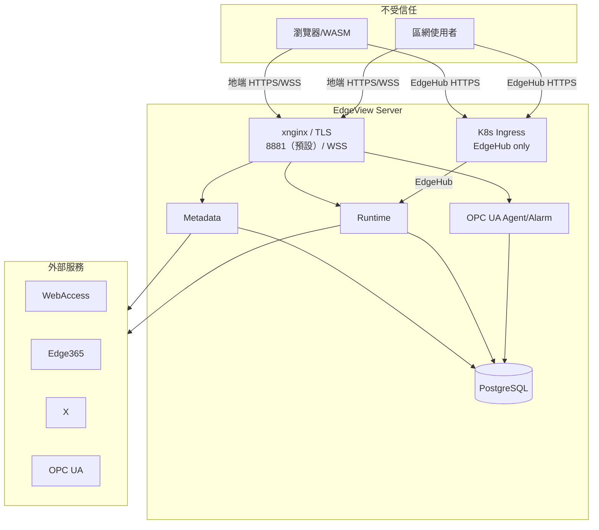
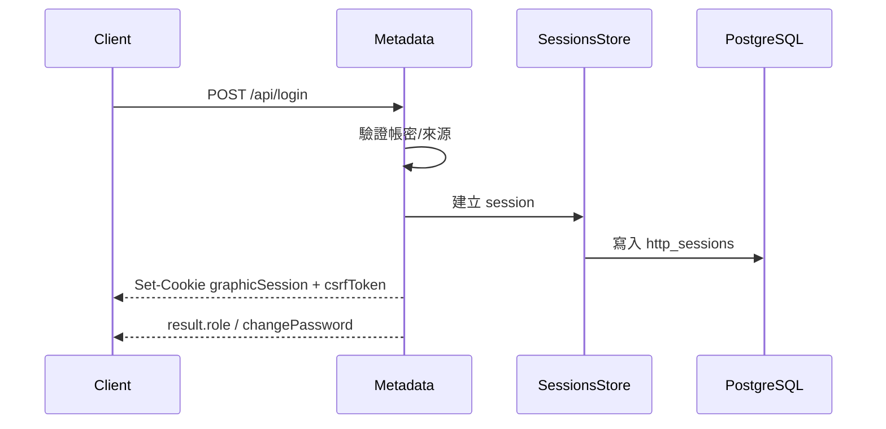

# SDS-08 安全設計

## 1. 安全目標

| 目標 | 說明 |
|------|------|
| 認證 | 確認使用者/裝置身分（本機、WebAccess、Edge365、X、OPC UA） |
| 授權 | 依專案/角色/畫面控制存取 |
| 機密性 | 保護密碼、Session、設定、傳輸 |
| 完整性 | 防止請求竄改與稽核竄改 |
| 可用性 | 抵抗暴力破解、資源耗盡 |
| 可追溯 | 登入、設定變更、匯入匯出可稽核 |

## 2. 信任邊界

**邊界規則**

1. 地端請求經 xnginx（TLS `8881`、限流）；EdgeHub 經 K8s Ingress。
2. 後端之間與外部服務使用獨立的認證（Basic/Token/憑證）。
3. DB 僅限內網，使用最小權限帳號。
4. 瀏覽器不直接連 DB/外部服務。
5. 後端（Metadata/Runtime/Agent/Alarm）僅綁 loopback，對外只暴露 xnginx。

## 3. 認證設計

### 3.1 支援模式

| 模式 | 認證方式 | 實作 |
|------|----------|------|
| 本機 | 帳密 + `UserInfo`/`UserAdmin` | `loginController.Login` |
| WebAccess | Basic → Session/Token | `WebAccessBasicAuth`、`WAAPI.Login` |
| Edge365/EdgeHub | Token 交換 | `BICheckToken`、`BIRefreshToken` |
| X | X Basic/Token | `XBasicAuth` |
| OPC UA | OPC UA 使用者 + 鎖定 | `opcuamodel`、`OPCUA_LoginLock` |

### 3.2 登入流程（本機/WA）

- 隨機 `csrfToken`（UUID/隨機）寫入 Session 與回應。
- `csrfToken` 同時以 Cookie 下發（`HttpOnly=false`，供前端讀取）。
- 登入失敗寫入稽核；OPC UA 連續失敗會鎖定。

### 3.3 Session

| 項目 | 設計 |
|------|------|
| 名稱 | `graphicSession`、`settingSession` |
| 儲存 | PostgreSQL `http_sessions`（pgstore） |
| 有效期 | `sessiontimeout=604800`（7 天） |
| 續期 | 請求時由 store 更新 |
| 登出 | 清除 Cookie + Session |
| 密鑰來源 | 優先 `SESSION_SECRET`；否則 `aes_secret` 經 HKDF-SHA256（`info="edgeview/session-cookie/v1"`）派生；皆無則啟動失敗 |
| 輪替 | `SESSION_SECRET_PREVIOUS` 作為舊 key，保留至少一個 session timeout |
| 跨服務 | Metadata、Runtime、xnginx、OPC UA Alarm Agent 共用同一解析規則與 key |
| 多副本 | 共用 DB，天然共享 Session；key 來源需一致 |

### 3.4 Session 失效處理

- 後端回 `-100`。
- Client `Global.handleUnauthorize()` 清除狀態並導回登入。
- Viewer 依設定顯示通訊中斷。

## 4. 授權設計

### 4.1 授權模型

| 層級 | 資料 | 說明 |
|------|------|------|
| 平台 | `UserAdmin.sourcetype` | 管理員/來源 |
| 專案 | `UserInfo` | 專案成員、`usertype` |
| 角色 | `UserScy` | 角色/區域（`area int[]`） |
| 畫面 | `UserAcc` | 每畫面 `ack`/`change` |
| 功能 | `OPCUA_UserFunc` | OPC UA 功能編輯 |
| 專案映射 | `OPCUA_UserProject` | OPC UA 專案權限 |

### 4.2 檢查點

1. `authorizeCore`：Session + CSRF。
2. Controller/Service：專案成員、角色、畫面權限。
3. Client：依回傳權限隱藏/停用 UI（**非安全邊界**，僅 UX）。
4. Runtime WS：`AlreadyLogin` + 訂閱資源範圍。

### 4.3 權限原則

- 最小權限：一般使用者僅能存取被授權專案/畫面。
- 預設拒絕：未明確允許即拒絕。
- 管理操作（使用者、DB、匯入）僅管理員。

## 5. 請求完整性

### 5.1 CSRF

| 項目 | 設計 |
|------|------|
| Token 產生 | 登入時隨機 |
| 儲存 | Session `csrfToken` |
| 傳遞 | JSON/表單 `csrfToken`，另存 Cookie |
| 驗證 | `authorizeCore` 比對 |
| 無效 | `-100`，記錄來源/IP |
| 例外 | 公開端點（login/about/settings 等） |

> 風險：`csrfToken` Cookie 非 `HttpOnly`，且部分公開端點無 CSRF；需搭配 SameSite。

### 5.2 時間戳

| 項目 | 設計 |
|------|------|
| 欄位 | `packetTimestamp`（Unix ms） |
| 容許 | `driftseconds=300` |
| 驗證 | JSON body `data.packetTimestamp` 或表單 |
| 失敗 | `-102` |
| 目的 | 降低重放攻擊窗口 |

> 限制：時間戳非一次性，仍需 TLS 與 CSRF 共同防護。

## 6. 密碼學設計

### 6.1 密碼儲存

| 項目 | 現況 | 建議 |
|------|------|------|
| 演算法 | SHA-256（`Sha256()`） | Argon2id/bcrypt |
| 鹽 | 無 | 每帳號隨機鹽 |
| 迭代 | 無 | 調整成本 |
| 傳輸 | TLS（建議） | 強制 HTTPS |

### 6.2 資料加密

| 資料 | 機制 | 位置 |
|------|------|------|
| 敏感設定/憑證 | AES-256-CBC | `service/AES.go` |
| 機器金鑰 | `aes_secret` 表（KeyMigrator） | `aes_secret.go` |
| 舊版金鑰 | `legacyAesKey`（回退） | `AES.go` |
| 授權檔 | AES + MAC/TID | `secret_*.go` |
| Client 指令碼 | 壓縮/加密 | `security/aes` |

- 資料加密：機器金鑰不存在時回退舊金鑰（需監控）。
- Session key：不回退舊金鑰；`SESSION_SECRET` 與 `aes_secret` 皆無時啟動失敗（見 SDS-13）。
- CBC 需確保 IV 管理與完整性（建議 GCM）。

### 6.3 稽核完整性

| 項目 | 設計 |
|------|------|
| 演算法 | SHA3-256 |
| 範圍 | 事件欄位正規化序列 |
| 儲存 | `auditlog.checksum` |
| 驗證 | 查詢/匯出時重算比對 |
| 目的 | 偵測竄改 |

## 7. 傳輸安全

> **預設原則**：對外協定預設一律為 **HTTPS**，WebSocket 一律為 **WSS**。xnginx `protocol: https` 為預設值，對外連接埠 `8881`；`http`／`both`（`8880`）僅為相容舊版選項，正式環境不應啟用。

| 介面 | 現況 | 建議 |
|------|------|------|
| Client ↔ Metadata | 預設 HTTPS（xnginx 8881） | 維持強制 HTTPS |
| Client ↔ Runtime | 預設 HTTPS／WSS（xnginx 8881） | 維持強制 WSS |
| xnginx（地端） | 預設 TLS 8881；HTTP 8880 僅 `protocol: http 或 both` | 憑證管理、限流、WS Upgrade |
| K8s Ingress（EdgeHub） | TLS | 憑證管理/自動續期 |
| Runtime → 外部 | 全域 `InsecureSkipVerify` 已移除；個別 client 仍停用 | 逐步改為系統 CA/指定 CA（R-002-R） |
| Metadata → 外部 | 部分 client 停用驗證 | 全面驗證（R-002-R） |

> **現況**：`wxproxy.go` 的全域 `http.DefaultTransport` 覆寫已移除。個別 WA/EdgeHub/X/HTTP client 仍有 `InsecureSkipVerify: true`，列為殘餘風險 R-002-R，正式環境應改為系統 CA 或指定 CA。

## 8. WebSocket 安全

| 項目 | 設計 |
|------|------|
| 連線 | 同源/Ingress 控制 |
| 登入 | `login` topic + `csrfToken` |
| Session 綁定 | handshake 的 `graphicSession` 綁定連線；只比對該 Session 的 `csrfToken`，不掃描 `http_sessions` |
| 逾時 | `websocket_auth_timeout=10` 秒 |
| 授權 | 分派前檢查：非 `login` topic 需 `AlreadyLogin`；action 再有 `needAuth` |
| 未登入 | `-100`，不進入 handler |
| Topic 白名單 | `handlers` map |
| 未知 topic | 未登入不落 `default`；已登入才由 `default` 處理 |
| systeminfo | WS login 成功後才註冊訂閱 |

**已修**

- `systeminfo` 未登入即訂閱：改由 `NotifyAuthenticated` 在登入成功後註冊。
- `default` 未檢查登入：中央 gate 先阻擋，handler 再加一層檢查。
- `verifyToken` 原掃描所有 `http_sessions`（R-007）：改由 WS handshake 綁定 `graphicSession`，登入只與該連線 Session 的 `csrfToken` 做 constant-time 比對；原生 Qt 的 `QWebSocket` handshake 會帶上 Cookie。
- WASM／瀏覽器由原生 WebSocket 自動帶同源 Cookie；HTML WebSocket 不允許自訂 `Cookie` header。

**殘餘風險**

1. 缺少 Origin 檢查。
2. 連線數/訊息大小無明顯上限。
3. `default` 仍會將已登入者的訊息廣播給所有 client；若不需要應移除廣播。

## 8.1 OPC UA 子系統安全

| 機制 | Data Agent | Alarm Agent | 設定 UI |
|------|------------|-------------|---------|
| 認證 | Metadata Session + `csrfToken` 或 loopback Bearer | Session + CSRF、Basic、loopback Bearer | Metadata Session + `settings-csrfToken` |
| 授權 | Metadata 專案/角色 | Metadata 專案/角色 | `role`/`permissions` |
| 傳輸 | 對外 HTTPS（xnginx 預設）、PFX；loopback HTTP | 對外 HTTPS（xnginx 預設）；loopback HTTP | HTTPS（預設） |
| OPC UA | SecurityMode/Policy、UserIdentity、PFX | 透過 Data Agent | — |
| 內部呼叫 | Bearer（`aes_secret` 推導） | Bearer（輪詢 Data Agent） | — |
| 稽核 | Serilog | 警報歷史/Ack | Metadata 稽核 |

**風險**

1. Data Agent `PacketTimestampMiddleware` 已修正：非 GET 強制 Unix 毫秒時間戳，內部呼叫（Metadata／Alarm Agent）已補值；殘餘風險為容差窗口內重放。
2. CORS 已白名單化：`CorsOriginPolicy` 僅允許設定清單與 localhost/loopback/私有網段 Origin 帶 Credentials。
3. `AutoAcceptUntrustedCertificates=true`、`RejectSHA1SignedCertificates=false`。
4. 預設 DB 帳密硬編碼（`Program.cs`、`service/app.go`）：已於 R-018/R-028 移除，改由環境變數/Secret 提供。
5. Runtime/History 同映像，若 `isHistory` 設定錯誤會暴露錯誤端點（以 400 阻擋）。
6. Root path 直連參數（`dbport`/`alarmport`）由 Metadata `config.yaml` 提供；未設定時可能無法連線。
7. Alarm 預設埠已統一為 28889（Go 預設、`config.yaml`、Runtime 設定）。

**建議**

1. 時間戳中介層已修正；`wax_opcua_agent.Tests` 覆蓋缺少／過期／未來時間戳與 CORS Origin 白名單。
2. CORS 已白名單化；公開 FQDN UI 需列入 `MyService:Cors:AllowedOrigins`，並定期檢視 `AllowPrivateNetwork`。
3. 正式環境關閉自動接受憑證，使用信任清單。
4. DB 帳密已改由 Secret/環境變數（R-018/R-028 Fixed）；部署時需設定 `ENSAAS_SERVICES`/`LOG_ENV` 或合併 `RegisterDBEnv.reg`。
5. UI 與 Agent 全面 HTTPS；OPC UA 使用 SignAndEncrypt。
6. 針對 `GetTagValue`/`GetDataLog` 加速率限制與審計。

## 9. 檔案與上傳安全

| 控制 | 現況 |
|------|------|
| 大小 | Client 5 MB、Ingress 75 MB |
| 類型 | 依端點（圖片/音訊/外掛/3D） |
| 檔名 | 伺服器產生/清洗 |
| 儲存 | DB bytea 或檔案系統 |
| 下載 | 多為公開 GET（難猜 ID） |
| 執行 | 外掛/ZIP 需審核 |

**建議**

1. 驗證 MIME 與 magic number。
2. 限制副檔名與路徑穿越。
3. 下載端點加入授權或簽章 URL。
4. 上傳掃毒。

## 10. 輸入與輸出

| 類型 | 控制 |
|------|------|
| SQL | 參數化查詢（`$1`）；動態 SQL 識別字已集中跳脫/白名單（R-019 Fixed） |
| 識別字 | `ConvertDBIdentifier` / `quoteIdent` / `pq.QuoteIdentifier` 跳脫與驗證 |
| 腳本 | 壓縮/加密；執行於 QML JS 引擎 |
| HTML | WebPlugin/iframe 需 CSP |
| 檔案路徑 | 正規化，禁止 `..` |
| JSON | 綁定結構，限制大小 |

**風險（已處理）**：`/record/queryrecord` 原可執行任意查詢且無認證，屬高危；目前已停用路由，不再對外提供。其他 `/record/*` 端點維持 `needAuth=true`。

## 11. 稽核與監控

| 事件 | 內容 |
|------|------|
| 登入成功/失敗 | 使用者、IP、來源、時間 |
| 登出/逾時 | Session |
| 設定變更 | 前後值 |
| 使用者/權限變更 | 目標、角色 |
| 匯入/匯出 | 檔名、範圍 |
| DB 操作 | 變更 DB/設定 |
| API 拒絕 | `-100/-101/-102`、URI、IP |
| 稽核查詢 | 查詢者、條件 |

日誌級別：`klog`（INFO/WARNING/ERROR）；正式環境集中收集。

## 12. 隱私

| 資料 | 處理 |
|------|------|
| 使用者帳號 | 僅必要欄位 |
| IP | 稽核/安全用途，依政策保留 |
| 裝置 Token | 加密/限制存取 |
| 日誌 | 避免記錄密碼/Token |
| 匯出 | 依權限、記錄稽核 |

## 13. 威脅模型（STRIDE）

| 威脅 | 範例 | 現有控制 | 殘餘風險 |
|------|------|----------|----------|
| Spoofing | 冒用 Session | Session + CSRF | Cookie 未 HttpOnly |
| Tampering | 修改請求/稽核 | 時間戳、checksum | 非一次性時間戳 |
| Repudiation | 否認操作 | 稽核日誌 | 日誌可被管理者刪除 |
| Information Disclosure | 攔截 TLS | 全域 `InsecureSkipVerify` 已移除 | 個別 client 仍停用驗證（R-002-R） |
| Denial of Service | 大量查詢/WS | nginx `limit_req`（每 app/來源 IP）、連線池、佇列 | 門檻偏高（預設 4090r/s、burst 256）；非 OPC UA 無帳號鎖定；WS 訊息未限流 |
| Elevation of Privilege | 越權 API | 權限檢查；`/record/queryrecord` 已停用 | 部分公開端點未驗證 |

## 14. 加固清單

### 14.1 必做（P0）

1. 強制 HTTPS/WSS。
2. 移除全域 `InsecureSkipVerify`（已完成）；個別 client 逐步改指定 CA（R-002-R）。
3. `/record/queryrecord` 加認證/授權（已改為停用路由）。
4. `systeminfo`/`default` 加登入檢查（已完成，R-006）。
5. Session secret 改環境變數/密鑰管理（已完成）。
6. 密碼改 Argon2id/bcrypt（含遷移）。
7. CSRF Cookie 設 `HttpOnly` + `SameSite`（前端改用 response body token）。

### 14.2 建議（P1）

1. 速率限制：nginx 已有每 app/來源 IP 的 `limit_req`；仍需針對登入、查詢與 WS 訊息設定更嚴格門檻。
2. 帳號鎖定與 MFA（管理員）；目前只有 OPC UA `OPCUA_LoginLock`。
3. WS Origin/大小/連線數限制。
4. 上傳類型/病毒掃描。
5. 稽核日誌 WORM/外部儲存。
6. 依賴掃描（Go/Qt/CVE）。
7. 安全標頭（CSP、HSTS、X-Frame-Options）。

### 14.3 長期（P2）

1. OAuth2/OIDC/SSO。
2. 硬體金鑰/TPM。
3. 資料加密-at-rest（TDE）。
4. 零信任網路分段。

## 15. 需求對照

| 控制 | 需求 |
|------|------|
| 認證/Session/CSRF | NFR-SEC-001~005 |
| 授權/角色 | NFR-SEC-006 |
| 密碼/AES | NFR-SEC-003~004 |
| 傳輸/TLS | NFR-SEC-004 |
| 稽核 | NFR-AUD-001~005 |
| 輸入/上傳 | NFR-SEC-007~010 |
| WS | NFR-SEC-009 |
| OPC UA 子系統 | NFR-OPC-007~008、R-025~R-028 |
