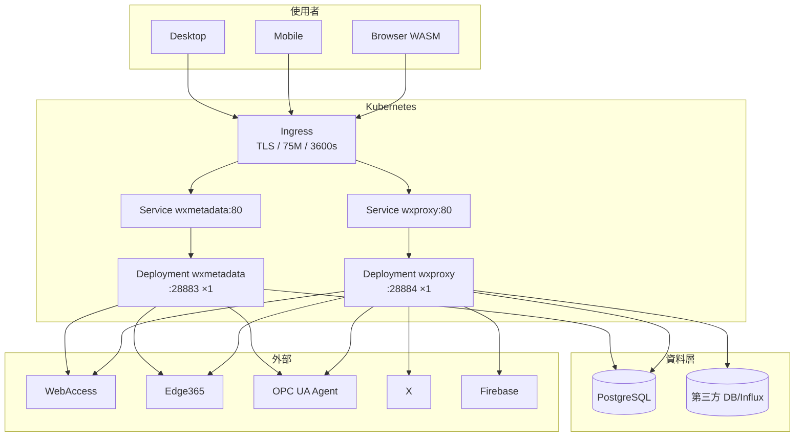
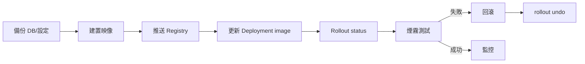

# SDS-10 部署與維運

## 1. 部署單元

| 單元 | 產物 | 平台 | 備註 |
|------|------|------|------|
| Metadata Service | `WxMetaService` | Linux amd64/arm64、Windows、macOS | Go 靜態執行檔 |
| Runtime Proxy | `WxProxy` | Linux amd64/arm64、Windows、macOS | Go 靜態執行檔 |
| Client | `gc-designer` | Windows/macOS/Linux/Android/iOS/WASM | Qt 6 |
| PostgreSQL | 外部/內建 | — | 設定與 Session |
| Ingress | Nginx | K8s | TLS、body 75M、長連線 |

## 2. 參考部署拓撲

## 3. 容器映像

### 3.1 Metadata Dockerfile

| 階段 | 內容 |
|------|------|
| build | `golang:alpine`、`go install`、`go mod tidy`、`go build` |
| runtime | `alpine:edge` |
| 複製 | `WxMetaService`、`config.yaml`、`cert/`、`_public/`、`assets/` |
| 啟動 | `/WxMetaService` |

### 3.2 Runtime Dockerfile

| 階段 | 內容 |
|------|------|
| build | `golang:alpine` |
| runtime | `alpine:edge` |
| 複製 | `WxProxy`、`config.yaml`、`firebase-adminsdk.json` |
| 啟動 | `/WxProxy` |

### 3.3 映像標籤與推送

- Registry：`harbor.arfa.wise-paas.com/...`
- Metadata image：`edgeview/wx-metadata:<version>`
- Runtime image：`wax-edge365-proxy/wxproxy:<version>`
- 建置腳本：`build-and-deploy.sh`（建置/推送/kubectl set image/rollout）。

## 4. Kubernetes 設定

### 4.1 Deployment

| 項目 | Metadata | Runtime |
|------|----------|---------|
| replicas | 1 | 1 |
| containerPort | 28883 | 28884 |
| imagePullPolicy | Always | Always |
| resources.requests | 128Mi / 60m / 256Mi | 同左 |
| resources.limits | 256Mi / 60m / 256Mi | 同左 |
| env | `ENSAAS_SERVICES`、`exdomain`、`DC_PORTAL_URL`、`API_DBMASTER_URL`、授權、ETCD、iapp | `ENSAAS_SERVICES`、`exdomain`、`DC_PORTAL_URL`、`API_DBMASTER_URL`、`API_ALARM_URL`、`APPS` |

### 4.2 Service / Ingress

| 項目 | 設定 |
|------|------|
| Service | ClusterIP，port 80 → targetPort |
| Ingress path | Prefix `/.*` |
| body | 75 MB |
| timeout | 3600 秒（WS） |
| CORS | 允許特定來源與憑證 |
| TLS | 由 Ingress/憑證管理 |

> 目前 `proxy_set_header Origin ""` 與寬鬆 CORS 需依安全政策收斂。

### 4.3 建議補強

1. 增加 `livenessProbe`/`readinessProbe`（`/ping/*`、`/foo/serverTime`）。
2. 設定 `PodDisruptionBudget`。
3. 使用 Secret 管理 Session secret/DB 密碼（Session secret 已完成程式端改造；部署需注入 `SESSION_SECRET`）。
4. 設定 HPA（CPU/記憶體/連線數）。
5. 設定 NetworkPolicy 限制外部存取。

## 5. 設定管理

### 5.1 檔案

| 服務 | 檔案 | 說明 |
|------|------|------|
| Metadata | `config.yaml` | 網路、DB、整合、授權 |
| Runtime | `config.yaml` | 網路、資料源、告警、FCM |
| 兩者 | 環境變數 | 覆寫敏感/環境值 |
| 兩者 | 命令列旗標 | 臨時覆寫 |

### 5.2 建議

- 正式環境以 ConfigMap/Secret 注入，不烘焙進映像。
- 版本控制非敏感設定；敏感值由 Secret/HSM 管理。
- 變更需記錄與審核。

### 5.3 重要環境變數

| 變數 | 用途 |
|------|------|
| `SESSION_SECRET` | Session cookie 簽章金鑰；至少 32 bytes；Metadata/Runtime/xnginx/OPC UA Alarm Agent 需一致 |
| `SESSION_SECRET_PREVIOUS` | 選用；輪替期間保留的舊 Session key |
| `ENSAAS_SERVICES` / `VCAP_SERVICES` | DB 連線資訊 |
| `PG_SCHEMA` | 指定 schema；建議明確設定，確保各服務讀到同一 `aes_secret` |
| `LOG_ENV` | 日誌 DB |
| `exdomain` | Edge365 網域 |
| `DC_PORTAL_URL` / `API_DBMASTER_URL` / `API_ALARM_URL` | Edge365 服務 |
| `APPS` | 路由對應 |
| `ETCD_HOST` / `ETCD_PORT` / `iapp_ns` | IApp |
| `license_type` / `license_*` | 授權 |

### 5.4 Session key 來源與部署

程式依下列順序取得 Session key，**不可回退到硬編碼值**：

1. `SESSION_SECRET`（建議由 K8s Secret 或安裝程式注入）。
2. `aes_secret`（KeyMigrator 建立的 32-byte 機器金鑰），以 HKDF-SHA256 派生：
   `HKDF(machineKey, salt=nil, info="edgeview/session-cookie/v1")`。
3. 兩者皆無：服務啟動失敗。

部署注意：

- Metadata、Runtime、xnginx 共用 `waxconfig` 與同一 schema；若使用 `aes_secret`，`PG_SCHEMA` 必須一致。
- OPC UA Alarm Agent 使用 `waxalarm`；若不共用 cookie，可獨立設定；若需共用 `graphicSession`，必須使用相同 `SESSION_SECRET`。
- 啟動 log 會輸出 `[session] key source=... fingerprint=...`；部署時比對各服務 fingerprint 是否一致，但不要記錄 key 本體。
- 輪替：先同時部署 `SESSION_SECRET` + `SESSION_SECRET_PREVIOUS`，待舊 session 過期後移除 previous。
- K8s 未執行 KeyMigrator 時，`aes_secret` 可能不存在，必須提供 `SESSION_SECRET`。

## 6. 連接埠與網路

| 服務 | Port | 方向 |
|------|------|------|
| Metadata HTTP | 28883 | Ingress → Pod |
| Metadata HTTPS | 可設定（預設 -1） | — |
| Runtime HTTP | 28884 | Ingress → Pod |
| Runtime WS | 28884 `/so`（BI `/`） | Client → Ingress |
| PostgreSQL | 5436/5432 | Pod → DB |
| OPC UA Agent | 5123/5124/8090 | Pod → Agent |
| Edge365 | 443/80 | Pod → 外部 |
| Firebase | 443 | Pod → 外部 |

## 7. 日誌與監控

### 7.1 日誌

| 服務 | 輸出 | 檔案 |
|------|------|------|
| Metadata | klog + Gin | `log/`（`tofile`） |
| Runtime | klog + Gin | `log/`（`tofile`） |
| Client | debuglogger（共享記憶體 ring） | 匯出檔 |
| Ingress | Nginx access/error | 平台 |

- 格式：時間、級別、來源、訊息。
- 建議集中至 Loki/ELK，設定保留與告警。

### 7.2 監控指標（建議）

| 類別 | 指標 |
|------|------|
| 服務 | QPS、延遲、錯誤率、5xx |
| 資源 | CPU、記憶體、Goroutine、GC |
| DB | 連線數、慢查詢、鎖 |
| WS | 連線數、訊息率、斷線率 |
| 業務 | 登入失敗、匯入/匯出、Record 失敗 |

### 7.3 健康檢查

| 端點 | 用途 |
|------|------|
| `POST /ping/:id` | Metadata 存活 |
| `GET /foo/serverTime` | Runtime 存活 |
| `POST /api/about` | 版本/能力 |

## 8. 備份與還原

| 對象 | 方式 | 頻率 |
|------|------|------|
| PostgreSQL | `pg_dump`/PITR | 每日 + WAL |
| 設定檔 | 版控/備份 | 變更時 |
| 憑證/金鑰 | 安全備份 | 變更時 |
| 稽核日誌 | 匯出/歸檔 | 依政策 |
| 3D/圖片 | DB 或檔案備份 | 每日 |

**還原演練**：每季驗證備份可用性與 RTO/RPO。

## 9. 升級與回滾

### 9.1 升級流程

### 9.2 資料庫遷移

1. 服務啟動時執行幂等 DDL。
2. 重大變更以 `migrations/` 腳本。
3. 升級前備份；必要時先跑遷移再切換。
4. 回滾以備份還原為主。

### 9.3 相容性

- 新舊 Client/Server 需支援至少一個版本落差。
- API 只新增不移除；匯入格式版本化。

## 10. 擴縮容

| 情境 | 策略 |
|------|------|
| 高併發 REST | 增加 Metadata 副本（無狀態） |
| 大量 WS | 增加 Runtime 副本 + Sticky Session |
| 大量查詢 | 增加 Runtime 副本 + DB 連線池調校 |
| 記憶體不足 | 提高 limits、調整快取 |

**限制**：Runtime Hub 為程序內狀態，多副本需：
1. Sticky Session（Ingress cookie）。
2. 或外部 Pub/Sub 廣播。

## 11. 故障處理手冊

| 症狀 | 可能原因 | 處理 |
|------|----------|------|
| 無法登入 | DB/Session/來源服務 | 檢查 DB、`http_sessions`、外部認證 |
| `-100` 頻繁 | Session 過期/secret 不一致 | 確認兩服務 secret 相同、時間同步 |
| `-102` | 時間不同步 | 啟用 NTP |
| WS 無法連線 | Ingress timeout/Origin | 檢查 3600s、CORS、憑證 |
| 即時資料停止 | 資料源/輪詢錯誤 | 查 klog、資料源連線 |
| 告警延遲 | 輪詢間隔/來源 | 檢查 interval、來源 API |
| CPU 飆高 | EH/X 間隔 -1、慢查詢 | 設定間隔、優化查詢 |
| 記憶體成長 | WS 訂閱未釋放 | 檢查 unregister、重啟 |
| 3D 載入失敗 | 資產缺失/版本 | 檢查 `scene3d_*`、快取 |
| 匯入失敗 | 格式/版本/衝突 | 檢查 bun 日誌、備份 |

## 12. 安全維運

1. 定期更新基礎映像與依賴。
2. 掃描映像（Trivy）與 SBOM。
3. 輪替 Secret/憑證。
4. 最小權限 DB 帳號。
5. 限制 Ingress 來源與 CORS。
6. 監控異常登入與 `-100`。
7. 稽核日誌異地備份。

## 13. Client 部署

| 平台 | 產物 | 注意 |
|------|------|------|
| Windows | 安裝檔/免安裝 | VC++ Runtime、Crashpad |
| macOS | `.app`/dmg | 簽章/公證 |
| Linux | AppImage/deb | RPATH、Qt 函式庫 |
| Android | APK/AAB | ABI、權限、Firebase |
| iOS | IPA | 簽章、ATS |
| WASM | `.wasm`/`.br` | 靜態伺服、CORS、MIME |

**遠端資源**：Server 可提供 rcc/QML 快取，Client 啟動時檢查版本。

## 14. 營運檢查清單

### 每日

- [ ] 服務健康與錯誤率
- [ ] 備份成功
- [ ] WS 連線數/斷線
- [ ] 磁碟/記憶體

### 每週

- [ ] 慢查詢與容量趨勢
- [ ] 憑證有效期
- [ ] 安全事件

### 每月

- [ ] 還原演練
- [ ] 依賴更新
- [ ] 權限審查

## 15. 需求對照

| 項目 | 需求 |
|------|------|
| 部署/映像 | NFR-PORT-001~005 |
| 可維運/日誌 | NFR-MNT-001~005 |
| 可靠/備份 | NFR-REL-001~010 |
| 安全維運 | NFR-SEC-011~014 |
| 效能/擴容 | NFR-PERF-001~012 |
