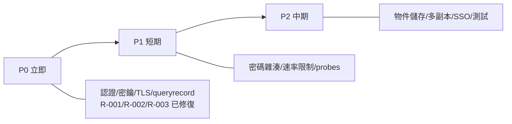

# SDS-11 設計決策與風險

## 1. 架構決策（ADR）

### ADR-001 單一 Client 執行檔支援 Designer/Viewer

| 項目 | 內容 |
|------|------|
| 決策 | 以 `openMode`（0=config、1=edit、2=preview、3=view）區分模式 |
| 理由 | 共用 Widget、渲染、綁定；降低維護與部署成本 |
| 替代方案 | 分離 Designer/Viewer 執行檔 |
| 影響 | 模式切換需徹底清理狀態；權限需在後端把關 |
| 狀態 | 已採用 |

### ADR-002 Metadata 與 Runtime 分離

| 項目 | 內容 |
|------|------|
| 決策 | 設定與執行期資料分屬兩個 Go 服務 |
| 理由 | 職責分離、可獨立擴縮、資料源隔離 |
| 影響 | 共用 DB 契約需同步；部署兩套 |
| 狀態 | 已採用 |

### ADR-003 PostgreSQL + JSONB + ltree

| 項目 | 內容 |
|------|------|
| 決策 | 設定存 PostgreSQL；內容用 JSON/JSONB；物件樹用 ltree |
| 理由 | 關聯查詢、彈性 schema、階層查詢效率 |
| 影響 | schema 分散於程式碼；需幂等遷移 |
| 狀態 | 已採用 |

### ADR-004 WebSocket topic/action 協定

| 項目 | 內容 |
|------|------|
| 決策 | `{topic, action, request}`；每 topic 一個 handler，action 由 `ActionRouter` 分派 |
| 理由 | 擴充容易、職責清楚、可個別授權 |
| 影響 | 需維護 topic/action 目錄；未知 topic 落 default |
| 狀態 | 已採用 |

### ADR-005 共用 Session Store

| 項目 | 內容 |
|------|------|
| 決策 | 兩服務共用 PostgreSQL `http_sessions` 與相同 secret |
| 理由 | 跨服務單一登入、重啟不掉 Session |
| 影響 | secret 一致性與安全至關重要；多副本天然共享 |
| 狀態 | 已採用 |

### ADR-006 畫面內容以 JSON 儲存

| 項目 | 內容 |
|------|------|
| 決策 | `Display.content` 存完整 Widget/綁定/腳本描述的 JSON |
| 理由 | 彈性、版本化、易匯入匯出 |
| 影響 | schema 演化需向後相容；檔案較大 |
| 狀態 | 已採用 |

### ADR-007 Record 輪詢固定 1 秒

| 項目 | 內容 |
|------|------|
| 決策 | 後端每秒查詢並推送 |
| 理由 | 即時性與負載平衡 |
| 影響 | 高頻查詢對資料源壓力；可調但需重啟 |
| 狀態 | 已採用（可調性待改進） |

### ADR-008 多資料源獨立 Manager

| 項目 | 內容 |
|------|------|
| 決策 | SQL/Influx/HTTP 各自 manager 與方言轉換 |
| 理由 | 方言差異大、隔離故障 |
| 影響 | 維護成本、測試矩陣大 |
| 狀態 | 已採用 |

### ADR-009 匯入格式 v1/v2 並存

| 項目 | 內容 |
|------|------|
| 決策 | 同時支援舊版與新版封裝 |
| 理由 | 向後相容 |
| 影響 | 測試與文件負擔 |
| 狀態 | 已採用 |

### ADR-010 2D/3D 渲染技術

| 項目 | 內容 |
|------|------|
| 決策 | SCDraw2D（QRhi 批次）、SCDraw3D（threepp）、NanoCanvas（NanoVG） |
| 理由 | GPU 加速、跨平台、豐富 3D |
| 影響 | 套件大、shader/資產管理複雜 |
| 狀態 | 已採用 |

### ADR-011 OPC UA Data Agent 分 Runtime/History 角色

| 項目 | 內容 |
|------|------|
| 決策 | 同一 C# 程式以 `isHistory` 區分 Runtime（28886）與 History（28887） |
| 理由 | 隔離即時讀值與長歷史查詢，避免互相阻塞 |
| 影響 | 需兩個進程與正確設定；端點以 400 阻擋錯用 |
| 狀態 | 已採用 |

### ADR-012 Client 直連 OPC UA Data Agent

| 項目 | 內容 |
|------|------|
| 決策 | Viewer/Preview 邏輯直連 Data/Alarm Agent，不經 Runtime Proxy；地端實體經 xnginx `/ua`、`/uadb`、`/uaam` |
| 理由 | 降低延遲、降低 Proxy 負載、歷史可獨立擴充 |
| 影響 | 需維護 xnginx 路由；CORS/Cookie/認證需正確 |
| 狀態 | 已採用 |

### ADR-013 Alarm 設定與 runtime 分離

| 項目 | 內容 |
|------|------|
| 決策 | 設定存 `waxconfig`；狀態/歷史存 `waxalarm`；Alarm 只讀設定 |
| 理由 | 職責分離、可獨立備份/擴充 |
| 影響 | 兩 DB 需一致；設定重載依 fingerprint |
| 狀態 | 已採用 |

## 2. 風險登記

> 嚴重度：Critical / High / Medium / Low  
> 狀態：Open / Mitigating / Accepted / Fixed

### R-001 Session secret 硬編碼

| 項目 | 內容 |
|------|------|
| 嚴重度 | Critical |
| 證據 | 原 `meta-agent.go:94`、`wxproxy.go:53` 使用固定字串；現由 `service/session_secret.go` 的 `LoadSessionKeys()` 取代 |
| 影響 | 洩漏即可偽造 Session；跨環境相同 |
| 機率 | 高（原始碼可見） |
| 緩解 | 已完成：優先讀 `SESSION_SECRET`；否則以 `aes_secret` 機器金鑰經 HKDF-SHA256 派生；兩者皆無則啟動失敗；支援 `SESSION_SECRET_PREVIOUS` 輪替 |
| 驗證 | 原始碼不再含固定 secret；啟動 log 僅輸出 fingerprint；Metadata/Runtime/xnginx/OPC UA Alarm Agent 共用同一解析規則 |
| 狀態 | Fixed |

### R-002 全域停用 TLS 憑證驗證

| 項目 | 內容 |
|------|------|
| 嚴重度 | High |
| 證據 | 原 `wxproxy.go:37` 以 `http.DefaultTransport` 全域設定 `InsecureSkipVerify: true`；全域設定已移除 |
| 影響 | 中間人攻擊、資料外洩 |
| 緩解 | 全域設定已移除 |
| 驗證 | `wxproxy.go` 不再有 `http.DefaultTransport` 全域覆寫 |
| 狀態 | Fixed |

### R-003 `/record/queryrecord` 無認證

| 項目 | 內容 |
|------|------|
| 嚴重度 | Critical |
| 證據 | `controller/RecordController.go:20` 路由已註解；handler 不再標註 `@Router`；Swagger 目錄已移除 |
| 影響 | 未授權查詢/濫用資料源 |
| 緩解 | 已完成：功能停用；其他 `/record/*` 端點維持 `needAuth=true`。未來若恢復需加認證、授權與速率限制 |
| 驗證 | `/record/queryrecord` 未註冊，請求回 404；Swagger 不再列出 |
| 狀態 | Fixed |

### R-004 密碼雜湊未加鹽

| 項目 | 內容 |
|------|------|
| 嚴重度 | High |
| 證據 | `UserModel.go:632` SHA-256 單次 |
| 影響 | 彩虹表/暴力破解 |
| 緩解 | Argon2id/bcrypt + 遷移 |
| 狀態 | Open |

### R-005 CSRF Token 存於非 HttpOnly Cookie

| 項目 | 內容 |
|------|------|
| 嚴重度 | Medium |
| 證據 | `loginController.go:130` `SetCookie(..., false, false)` |
| 影響 | XSS 可竊取；CSRF 防護弱化 |
| 緩解 | HttpOnly + SameSite + 前端用 body token |
| 狀態 | Open |

### R-006 WebSocket 部分 topic 未認證

| 項目 | 內容 |
|------|------|
| 嚴重度 | Medium |
| 證據 | 原 `default` PingPong 未檢查 `AlreadyLogin` 即將訊息廣播；`SystemInfoPolling.OnClientAdd` 未檢查即加入訂閱；`_run` 只過濾發送，未保護訂閱 |
| 影響 | 未登入者可觸發 `default` 廣播；systeminfo 未登入即建立訂閱（資料已被 `_run` 過濾，主要為資源/狀態問題） |
| 緩解 | 已完成：`webSocket.go` 在分派前統一檢查，非 `login` topic 未登入直接回 `-100`；`systeminfo` 改為登入成功後由 `NotifyAuthenticated` 註冊；`default` handler 再加一層檢查 |
| 驗證 | 未登入送 `recorddata`/`default` 回 `-100` 且不廣播；未登入不進入 systeminfo polling map；登入後才收到 systeminfo |
| 狀態 | Fixed |

### R-007 WS 登入掃描所有 Session

| 項目 | 內容 |
|------|------|
| 嚴重度 | Medium |
| 證據 | `loginController.verifyToken` 逐筆比對 `http_sessions` |
| 影響 | 效能與時序洩漏；大量 Session 時變慢 |
| 緩解 | 以 Session ID/Cookie 驗證，不掃全表 |
| 狀態 | Open |

### R-008 EH/X 告警輪詢間隔未初始化

| 項目 | 內容 |
|------|------|
| 嚴重度 | High |
| 證據 | 原 `config.go` `EHAlmSummaryIntervalMs=-1`、`XAlmSummaryIntervalMs=-1`；`time.Sleep(-1ms)` 立即返回 |
| 影響 | 忙迴圈、CPU 飆高、外部服務被打爆 |
| 緩解 | 已完成：新增 `eh_alarm_summary_interval_ms`、`x_alarm_summary_interval_ms` 預設 1000ms；讀取後一律經 `normalizeIntervalMs`，<=0 用預設、低於 100ms 夾到 100ms；WA/OPC UA/SystemInfo 一併套用 |
| 驗證 | 啟動 log 顯示 EH/X 間隔為 1000（或設定值）；`time.Sleep` 不再收到負值 |
| 狀態 | Fixed |

### R-009 Record 快取無 TTL

| 項目 | 內容 |
|------|------|
| 嚴重度 | Medium |
| 證據 | 原 `RecordDataPolling` 以訂閱生命週期管理，無閒置回收、訂閱上限與統計 |
| 影響 | 長期連線/忘記 unregister 造成記憶體與 DB manager 累積 |
| 緩解 | 已完成：新增 `recorddata_idle_timeout_seconds`（預設 1800，0=停用）、`recorddata_max_registers`（256）、`recorddata_max_subscriptions_per_client`（256）、`recorddata_reap_interval_seconds`（60）；reaper 回收無訂閱/閒置/初始化逾時 record 並釋放 manager；新增 `Stats()` 與週期 klog 統計；補上初始化併發保護與斷線/取消回傳錯誤 |
| 驗證 | 閒置超過 TTL 收到 expiry 通知且不再推送；超限 register 回錯誤；每分鐘 log 顯示 records/subscriptions/clients/goroutines；設定 `recorddata_idle_timeout_seconds: 0` 可停用 TTL |
| 狀態 | Fixed |

### R-010 多副本 WebSocket 狀態

| 項目 | 內容 |
|------|------|
| 嚴重度 | High |
| 證據 | Hub 為程序內 map；Deployment replicas=1 |
| 影響 | 擴容後跨 Pod 無法廣播/訂閱 |
| 緩解 | Sticky Session 或 Redis/NATS Pub/Sub |
| 狀態 | Accepted（目前單副本） |

### R-011 DataSource 類型編號不一致

| 項目 | 內容 |
|------|------|
| 嚴重度 | Medium |
| 證據 | Metadata `DataSource` 種子：0=WebAccess、2=Opcua、3=X；Runtime `SourceTypeWebAccess=1`、`BI=2`、`OPCUA=3`、`X=4` |
| 影響 | 資料源對應錯誤 |
| 緩解 | 統一常數/轉換表，加測試 |
| 狀態 | Open |

### R-012 公開檔案端點

| 項目 | 內容 |
|------|------|
| 嚴重度 | Medium |
| 證據 | `/getfile`、`/gettumb`、`/getdmtumb`、`/getpluginfile`、`/api/oem/image` 無認證 |
| 影響 | 未授權取得資源；列舉風險 |
| 緩解 | 授權/簽章 URL、難猜 ID、速率限制 |
| 狀態 | Open |

### R-013 MQTT 停用但保留 UI/設定

| 項目 | 內容 |
|------|------|
| 嚴重度 | Low |
| 證據 | Client `main.cpp` MQTT 區塊註解；`MQTTBroker` 表/路由仍在 |
| 影響 | 使用者誤解功能可用 |
| 緩解 | 明確標示停用或移除 |
| 狀態 | Accepted |

### R-014 ODBC 未見實作

| 項目 | 內容 |
|------|------|
| 嚴重度 | Low |
| 證據 | 程式碼未見 ODBC 驅動/連線 |
| 影響 | 文件若宣稱支援會誤導 |
| 緩解 | 文件標示不支援 |
| 狀態 | Accepted |

### R-015 CORS/Origin 設定寬鬆

| 項目 | 內容 |
|------|------|
| 嚴重度 | Medium |
| 證據 | Ingress `proxy_set_header Origin ""`、`Access-Control-Allow-Origin` 固定/寬鬆 |
| 影響 | CSRF/資料竊取風險 |
| 緩解 | 明確白名單、移除強制 Origin |
| 狀態 | Open |

### R-016 缺少速率限制與登入鎖定（除 OPC UA）

| 項目 | 內容 |
|------|------|
| 嚴重度 | High |
| 證據 | `wax_nginx_ingress` 已有每 app `limit_req_zone` + `limit_req`（`xnginx.go`、`xnginx.yaml`），但預設 `4090r/s`、burst 256，對登入暴力破解實質保護有限；只有 OPC UA 有 `OPCUA_LoginLock`，其他來源無帳號鎖定；K8s ingress manifests 未見 rate limit annotation |
| 影響 | 暴力破解、資源耗盡；nginx 限流可被高門檻或直連 backend 繞過；WS 握手後的訊息不受 `limit_req` 保護 |
| 緩解 | 已有 nginx 全站/每 app 限流；待補：登入專用嚴格門檻、非 OPC UA 帳號鎖定、WS 訊息速率限制、K8s Ingress 限流、限制 backend 直連 |
| 狀態 | Mitigating |

### R-017 稽核日誌可被管理者刪除

| 項目 | 內容 |
|------|------|
| 嚴重度 | Medium |
| 證據 | `Maintenance` 支援刪除過期日誌 |
| 影響 | 內部竄改/滅證 |
| 緩解 | WORM/外部儲存、分權 |
| 狀態 | Open |

### R-018 預設 DB 連線字串/密碼

| 項目 | 內容 |
|------|------|
| 嚴重度 | High |
| 證據 | `service/app.go` 預設 `postgres/Postgre@sql1`、`waxpguser` |
| 影響 | 未改設定即暴露 |
| 緩解 | 強制環境變數、啟動檢查 |
| 狀態 | Open |

### R-019 動態 SQL 組裝

| 項目 | 內容 |
|------|------|
| 嚴重度 | Medium |
| 證據 | `service/convert.go`、`fmt.Sprintf` 組 SQL |
| 影響 | 若識別字未驗證可能注入 |
| 緩解 | 白名單、跳脫、測試 |
| 狀態 | Open |

### R-020 數值/時間精度

| 項目 | 內容 |
|------|------|
| 嚴重度 | Low |
| 證據 | `float64`、`date`、Unix ms 混用 |
| 影響 | 顯示/查詢誤差 |
| 緩解 | 定義精度與時區規範 |
| 狀態 | Open |

### R-021 大檔/記憶體

| 項目 | 內容 |
|------|------|
| 嚴重度 | Medium |
| 證據 | 圖片/音訊/3D 存 bytea；上傳上限 75 MB |
| 影響 | 記憶體尖峰、DB 膨脹 |
| 緩解 | 物件儲存、串流、限制 |
| 狀態 | Open |

### R-022 單副本與缺少探針

| 項目 | 內容 |
|------|------|
| 嚴重度 | Medium |
| 證據 | `k8s/*.yaml` replicas=1；無 probes |
| 影響 | 故障不自動恢復、升級中斷 |
| 緩解 | 探針、PDB、多副本 |
| 狀態 | Open |

### R-023 日誌可能含敏感請求

| 項目 | 內容 |
|------|------|
| 嚴重度 | High |
| 證據 | `authorizeCore` 失敗時 `httputil.DumpRequest(..., true)` |
| 影響 | 密碼/Token 進入日誌 |
| 緩解 | 遮罩敏感欄位、降低等級 |
| 狀態 | Open |

### R-024 權限檢查分散

| 項目 | 內容 |
|------|------|
| 嚴重度 | Medium |
| 證據 | 各 controller 自行檢查；無統一 middleware |
| 影響 | 遺漏風險 |
| 緩解 | 集中式授權 middleware + 測試 |
| 狀態 | Open |

### R-025 Data Agent 時間戳未強制

| 項目 | 內容 |
|------|------|
| 嚴重度 | High |
| 證據 | `PacketTimestampMiddleware.InvokeAsync` 開頭即 `await _next(); return;` |
| 影響 | 重放攻擊窗口；與文件不符 |
| 緩解 | 移除短路；補時間戳測試 |
| 狀態 | Open |

### R-026 Data Agent CORS 過寬

| 項目 | 內容 |
|------|------|
| 嚴重度 | High |
| 證據 | `SetIsOriginAllowed(_ => true).AllowCredentials()` |
| 影響 | 任意網站可帶 Session 呼叫 |
| 緩解 | 白名單 Origin；限制 Credentials |
| 狀態 | Open |

### R-027 OPC UA 憑證自動接受

| 項目 | 內容 |
|------|------|
| 嚴重度 | High |
| 證據 | `AutoAcceptUntrustedCertificates=true`、`RejectSHA1SignedCertificates=false` |
| 影響 | 中間人/偽造 Server |
| 緩解 | 信任清單、拒絕 SHA1 |
| 狀態 | Open |

### R-028 OPC UA 預設 DB 帳密

| 項目 | 內容 |
|------|------|
| 嚴重度 | High |
| 證據 | `Program.cs`、`service/app.go` 預設 `postgres/Postgre@sql1` |
| 影響 | 未改設定即暴露 |
| 緩解 | 強制 Secret/環境變數 |
| 狀態 | Open |

### R-029 Alarm 埠預設不一致

| 項目 | 內容 |
|------|------|
| 嚴重度 | Medium |
| 證據 | Go 預設 8090、`config.yaml` 28889、Runtime `opcua.alarm` 8090 |
| 影響 | 部署連錯 |
| 緩解 | 統一預設與文件 |
| 狀態 | Open |

### R-030 Root path 直連參數缺失

| 項目 | 內容 |
|------|------|
| 嚴重度 | Medium |
| 證據 | `DataSourceBody` 無 `dbport`/`alarmport`；`opcua.js` 根路徑使用 `info.dbport`/`alarmport` |
| 影響 | 根路徑部署歷史/警報失效 |
| 緩解 | 補預設或改用 `/uadb`、`/uaam` |
| 狀態 | Open |

### R-031 Alarm/Agent 多副本狀態

| 項目 | 內容 |
|------|------|
| 嚴重度 | Medium |
| 證據 | Alarm 以 DB 共享狀態；Data Agent 以程序內連線池/快取 |
| 影響 | 多副本時快取/連線不一致 |
| 緩解 | Sticky Session 或共享快取/訊息匯流排 |
| 狀態 | Open |

### R-032 OPC UA 大量輪詢

| 項目 | 內容 |
|------|------|
| 嚴重度 | Medium |
| 證據 | Alarm 預設 500–1000 ms 輪詢全部 watched tags |
| 影響 | OPC UA Server 負載 |
| 緩解 | 分組/訂閱/調整間隔 |
| 狀態 | Open |

### R-033 歷史查詢依賴 Server HDA

| 項目 | 內容 |
|------|------|
| 嚴重度 | Medium |
| 證據 | `GetDataLog` 使用 OPC UA HistoryRead |
| 影響 | Server 不支援時無資料 |
| 緩解 | 文件標示、改用其他歷史源 |
| 狀態 | Accepted |

### R-034 Alarm 設定重載與 runtime 落差

| 項目 | 內容 |
|------|------|
| 嚴重度 | Medium |
| 證據 | 每 30 秒 fingerprint 檢查；未變更不重載 |
| 影響 | 設定變更非即時 |
| 緩解 | 提供 `/api/alarm/reload`；調整週期 |
| 狀態 | Accepted |

### R-035 xnginx 設定變體漂移

| 項目 | 內容 |
|------|------|
| 嚴重度 | Medium |
| 證據 | `xnginx.yaml`、`xnginx.webaccess.yaml`、`xnginx.opcua.yaml`、`xnginx.x.yaml` 各自維護 apps/routes |
| 影響 | 路徑/埠/服務清單不一致，導致 404/500 |
| 緩解 | 以 `xnginx.yaml` 為基準、設定比對/啟動煙霧測試、文件同步 |
| 狀態 | Open |

## 3. 技術債

| 編號 | 項目 | 影響 | 建議 |
|------|------|------|------|
| TD-001 | Schema 分散於程式碼 | 難以審閱/遷移 | 集中 migrations |
| TD-002 | 表名大小寫不一致 | 查詢易錯 | 統一命名 |
| TD-003 | 大型 QML/JS 檔案 | 維護/效能 | 模組化、延遲載入 |
| TD-004 | 重複的 WA/EdgeHub/X 邏輯 | 維護成本 | 抽象介面 |
| TD-005 | 錯誤碼不一致（`-1`/`-519`） | 客户端處理複雜 | 統一錯誤目錄 |
| TD-006 | 缺少自動化測試 | 回歸風險 | 單元/整合/E2E |
| TD-007 | 文件與程式碼落差 | 誤導 | 產生式文件/CI 檢查 |
| TD-008 | 設定散落（yaml/env/flag/DB） | 難以追蹤 | 单一設定來源 |

## 4. 已接受限制

1. 單副本 Runtime（WebSocket 狀態）。
2. MQTT 停用。
3. ODBC 不支援。
4. 本機帳密使用 SHA-256（待遷移）。
5. 公開資源端點依賴難猜 ID。
6. WASM 功能受限（無原生檔案/當機回報）。
7. OPC UA 歷史查詢依賴 Server Historical Access。
8. OPC UA Alarm 設定重載為定期檢查（預設 30 秒），非即時。
9. Data Agent Runtime/History 需兩個進程。

## 5. 改善路線



| 階段 | 項目 |
|------|------|
| P0 | R-001、R-002、R-003、R-006、R-008 已修復；待處理 R-023、R-002-R、R-025、R-026、R-027、R-028 |
| P1 | R-004、R-005、R-015、R-016、R-018、R-022、R-029、R-030、R-031、R-032、R-035 |
| P2 | R-010、R-011、R-017、R-021、R-033、R-034、TD-001~008 |

> R-001/R-002/R-003/R-006/R-008/R-009 的修復設計、部署需求與驗收紀錄見 [SDS-13](13_Security_Remediation.md)。R-009 原列 P2，已完成修復。R-002-R 代表個別外部 HTTP client 仍停用 TLS 驗證的殘餘項目。

## 6. 決策記錄格式

新增決策時使用：

```markdown
### ADR-XXX 標題
| 項目 | 內容 |
|------|------|
| 決策 | |
| 理由 | |
| 替代方案 | |
| 影響 | |
| 狀態 | 提案/已採用/棄用 |
```

## 7. 需求對照

| 風險 | 需求 |
|------|------|
| R-001~R-007 | NFR-SEC-001~010 |
| R-008/R-009 | NFR-PERF-001~012 |
| R-016 | NFR-PERF-001~012、NFR-SEC-015 |
| R-010/R-022 | NFR-REL-001~010 |
| R-017/R-023 | NFR-AUD-001~005、NFR-PRV-001~004 |
| R-011/R-019 | NFR-MNT-001~005 |
| R-025~R-028 | NFR-OPC-007~008、NFR-SEC-001~010 |
| R-029~R-032 | NFR-OPC-001~012 |
| R-033~R-034 | NFR-OPC-013~020 |
| R-035 | IF-SW-012、IF-OPC-011、NFR-MNT-001~008 |
