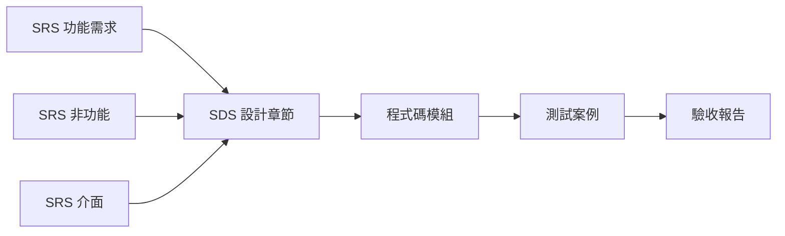

# SDS-12 需求追溯

## 1. 追溯模型

| 代碼 | 意義 |
|------|------|
| `FR-CLI-nnn` | Client 功能需求 |
| `FR-META-nnn` | Metadata 功能需求 |
| `FR-RT-nnn` | Runtime 功能需求 |
| `NFR-*-nnn` | 非功能需求 |
| `IF-*-nnn` | 介面需求 |
| `TC-*-nnn` | 測試案例 |
| `SDS-xx §n` | 設計章節 |

> 下列以群組列示；群組內每個 FR 共用同一設計與主要測試，個別驗收條件見 `SRS/03` 與 `SRS/06`。

## 2. Client 功能追溯

| 需求 | 設計 | 主要程式碼 | 測試 |
|------|------|------------|------|
| FR-CLI-001~005 | SDS-03 §2、§5 | `main.cpp`、`main.qml`、`ui/page/Tenant`、`HttpConnect`、`Login` | TC-CLI-001 啟動/登入 |
| FR-CLI-006~007 | SDS-03 §5.1、SDS-08 §3 | `Login/BaseLogin.qml`、`Common/Api/user.js` | TC-CLI-006 多來源 |
| FR-CLI-008~009 | SDS-03 §12 | `settings/WaSettings`、`WaCache`、`SystemAPI` | TC-CLI-008 連線/版本 |
| FR-CLI-010~011 | SDS-03 §3、SDS-08 §3.4 | `Global.handleUnauthorize`、`sessionmonitor` | TC-CLI-010 逾時 |
| FR-CLI-012、018 | SDS-03 §4、§12 | `i18n/`、`SettingsManager`、`ui/page/GeneralSettings` | TC-CLI-012 語系 |
| FR-CLI-013~014 | SDS-03 §2、§10 | `Global.checkOpenGLVersion`、`main.cpp` | TC-CLI-013 錯誤/降級 |
| FR-CLI-015~016 | SDS-03 §14、SDS-10 §13 | `platform/*`、`wasmsettings`、`DisplayMobile` | TC-CLI-015 平台 |
| FR-CLI-017 | SDS-03 §13 | `Crashpad/` | TC-CLI-017 當機 |
| FR-CLI-019~020 | SDS-08 §5、§7 | `Global.csrfToken`、`io/http`、`WaCache` | TC-CLI-019 安全/快取 |
| FR-CLI-021~023 | SDS-03 §5 | `ui/page/Project/BaseProject.qml`、`ProjectAPI` | TC-CLI-021 專案 |
| FR-CLI-024~026 | SDS-03 §5.2、SDS-09 §3 | `Editor/Index.qml`、`DisplayAPI` | TC-CLI-024 畫面 CRUD |
| FR-CLI-027~030 | SDS-03 §6.8、SDS-07 §3.4 | `PathManager`、`ObjectPathController`、`left/*` | TC-CLI-027 物件樹 |
| FR-CLI-031~032 | SDS-03 §5.2、§7 | `right/Properties.qml`、`Grid` 元件 | TC-CLI-031 搜尋/Grid |
| FR-CLI-033~036 | SDS-03 §3.2、§10 | `ViewerFunction`、`drawcontroller`、`clipboard` | TC-CLI-033 檢視/編輯 |
| FR-CLI-037~039 | SDS-03 §3、§3.1、SDS-09 §4 | `EditorFunction._viewDrawing`、`ViewerContent` | TC-CLI-037 模式切換 |
| FR-CLI-040~042 | SDS-03 §5.2、SDS-06 §4.2 | `TemplateAPI`、`OffscreenRender`、`ImageAPI` | TC-CLI-040 範本/縮圖 |
| FR-CLI-043~045 | SDS-03 §12、§5.2 | `WaCache`、`i18n`、快捷鍵 | TC-CLI-043 自動儲存 |
| FR-CLI-046~049 | SDS-03 §7、SDS-07 §3.5 | `ui/component/widgets/*`、`ResourceManager`、`waobjectJson.js` | TC-CLI-046 Widget |
| FR-CLI-050 | SDS-03 §7、SDS-07 §3.16 | `WebPluginController`、`webpluginmetas` | TC-CLI-050 外掛 |
| FR-CLI-051~055 | SDS-03 §8、SDS-06 §4.3 | `wabindings.js`、`wabindingReceive.js`、`BindingDataForm` | TC-CLI-051 綁定 |
| FR-CLI-056~057 | SDS-03 §7.2、§10 | `BaseWidget` 動畫/效果 | TC-CLI-056 動畫 |
| FR-CLI-058~063 | SDS-03 §9、SDS-08 §6.2 | `WAJavaScriptManager`、`JavaScriptEditorDialog`、`security/aes` | TC-CLI-058 腳本 |
| FR-CLI-064~066 | SDS-03 §7.1、§8 | `chart/Chart.js`、`WAArrayTable`、`WADataLog*` | TC-CLI-064 圖表/表格 |
| FR-CLI-067~069 | SDS-03 §7.1 | `WARecipe`、`WAAlarm*`、`WANavigation` | TC-CLI-067 配方/告警 |
| FR-CLI-070~072 | SDS-03 §10.3 | `ThreedViewer`、`SCDraw3D`、`scene3d.js` | TC-CLI-070 媒體/3D |
| FR-CLI-073~074 | SDS-03 §8、§3.2 | `ViewerDataSourceDialog`、`ViewerVariableDialog` | TC-CLI-073 狀態/變數 |
| FR-CLI-075 | SDS-03 §7.2、§9.2 | `BaseWidget` 生命週期、`_beginAsyncLife` | TC-CLI-075 洩漏 |
| FR-CLI-076~078 | SDS-03 §5、SDS-07 §3.3、§3.12 | `Config/*`、`UserAPI`、`ProjectAPI` | TC-CLI-076 設定 |
| FR-CLI-079 | SDS-07 §3.17、SDS-09 §9 | `ImportExport`、`/api/v2/*` | TC-CLI-079 匯入匯出 |
| FR-CLI-080~081 | SDS-03 §5.2、SDS-07 §3.11 | `RecipeAPI`、`AlarmAPI` | TC-CLI-080 配方/警報 |
| FR-CLI-082~085 | SDS-03 §5.1、SDS-07 §3.18 | `GeneralSettings`、`LogDataMaintenance`、`auditlog` | TC-CLI-082 一般/日誌 |
| FR-CLI-086~087 | SDS-07 §3.13、SDS-09 §11 | `Common/Api/opcua.js`、`opcuaController` | TC-CLI-086 OPC UA |
| FR-CLI-088~089 | SDS-07 §3.4、§3.8 | `objectpathController`、`DataModelAPI` | TC-CLI-088 物件/模型 |
| FR-CLI-090~091 | SDS-07 §3.9、SDS-11 R-013 | `DataSourceAPI`、`MQTT` 設定頁 | TC-CLI-090 資料源 |
| FR-CLI-092~094 | SDS-07 §3.16、§3.18 | `OEMController`、`SettingsController`、`font` | TC-CLI-092 品牌/字型 |
| FR-CLI-095 | SDS-03 §6.1、SDS-07 §3.1 | `SystemAPI`、`about`、`sysstatus` | TC-CLI-095 狀態 |

## 3. Metadata 功能追溯

| 需求 | 設計 | 主要程式碼 | 測試 |
|------|------|------------|------|
| FR-META-001~002 | SDS-04 §2、§3 | `meta-agent.go`、`config`、`service/app.go` | TC-META-001 啟動/設定 |
| FR-META-003~006 | SDS-04 §4、SDS-08 §3~5 | `loginController`、`routes/routes.go`、`basicAuth` | TC-META-003 認證/CSRF |
| FR-META-007~008 | SDS-07 §3.3、SDS-06 §4.1 | `ProjectController`、`projectdetail` | TC-META-007 專案 |
| FR-META-009~012 | SDS-04 §5、SDS-06 §4.1 | `ObjectPathController`、`ObjectPathModel` | TC-META-009 物件樹 |
| FR-META-013~014 | SDS-07 §3.5、SDS-06 §4.2 | `DisplayController`、`DisplayModel` | TC-META-013 畫面 |
| FR-META-015 | SDS-07 §3.6 | `JSController`、`JSTable` | TC-META-015 腳本 |
| FR-META-016 | SDS-07 §3.11 | `TemplateController` | TC-META-016 範本 |
| FR-META-017 | SDS-07 §3.8 | `VariableController`、`VariableModel` | TC-META-017 變數 |
| FR-META-018~019 | SDS-07 §3.8、SDS-06 §4.3 | `DataModelController`、`rcmap` | TC-META-018 模型 |
| FR-META-020~021 | SDS-07 §3.9、SDS-06 §4.4 | `DataSourceController`、`DBDefineController` | TC-META-020 資料源 |
| FR-META-022 | SDS-07 §3.14 | `TagController`、`WAAPI` | TC-META-022 Tag |
| FR-META-023 | SDS-07 §3.10 | `RecordController`、`RecordModel` | TC-META-023 Record |
| FR-META-024 | SDS-07 §3.11 | `RecipeController` | TC-META-024 配方 |
| FR-META-025 | SDS-07 §3.11 | `AlarmController` | TC-META-025 告警 |
| FR-META-026~030 | SDS-07 §3.12、SDS-06 §4.6 | `UserController`、`GroupController`、`UserModel` | TC-META-026 使用者 |
| FR-META-031~035 | SDS-07 §3.13 | `controller/opcua/*`、`model/opcua/*` | TC-META-031 OPC UA |
| FR-META-036~038 | SDS-07 §3.16 | `SettingsController`、`OEMController` | TC-META-036 系統設定 |
| FR-META-039 | SDS-07 §3.7、§3.16、§3.20 | `Image/Audio/File/PluginFile` | TC-META-039 檔案 |
| FR-META-040 | SDS-07 §3.15、SDS-06 §4.8 | `Scene3DController`、`Scene3DModel` | TC-META-040 3D |
| FR-META-041 | SDS-07 §3.17、SDS-09 §9 | `ImpExpController`、`bun-imex` | TC-META-041 匯入匯出 |
| FR-META-042~044 | SDS-07 §3.18、SDS-08 §6.3 | `AuditLogController`、`ActionLogController`、`Maintenance` | TC-META-042 稽核 |
| FR-META-045 | SDS-04 §8、SDS-07 §3.2 | `edge365`、`BIAPI`、`XAPI`、`Firebase`、`license` | TC-META-045 整合 |

## 4. Runtime 功能追溯

| 需求 | 設計 | 主要程式碼 | 測試 |
|------|------|------------|------|
| FR-RT-001 | SDS-05 §2 | `wxproxy.go`、`service/app.go` | TC-RT-001 啟動 |
| FR-RT-002~003 | SDS-05 §6、§9 | `RecordDataPolling`、`RecordController.Preview` | TC-RT-002 查詢/預覽 |
| FR-RT-004 | SDS-05 §6.4 | `databaseService`、`convert.go` | TC-RT-004 Schema |
| FR-RT-005 | SDS-05 §6.3 | `RecordDataPolling` 分頁 | TC-RT-005 分頁 |
| FR-RT-006 | SDS-05 §6、SDS-09 §6 | `RecordController.QueryDatalog`、`influxDBService` | TC-RT-006 Datalog |
| FR-RT-007 | SDS-05 §6.4 | `RunRecordCommand`、`httpService` | TC-RT-007 指令 |
| FR-RT-008 | SDS-05 §6.4 | `DatabaseSQLManager`、`InfluxDBManager` | TC-RT-008 資料源 |
| FR-RT-009 | SDS-05 §6.3 | `max_data_size` 驗證 | TC-RT-009 限制 |
| FR-RT-010~011 | SDS-05 §4、§6 | `RecordDataController`、`RecordDataPolling` | TC-RT-010 即時/寫入 |
| FR-RT-012~015 | SDS-05 §7 | `WA/EH/Opcua/XAlarmPolling`、對應 controller | TC-RT-012 告警 |
| FR-RT-016 | SDS-05 §7 | `SystemInfoPolling`、`systemInfoController` | TC-RT-016 系統資訊 |
| FR-RT-017 | SDS-05 §4.5、SDS-08 §8 | `loginController`、`CheckAuthAndCloseAfter` | TC-RT-017 WS 認證 |
| FR-RT-018 | SDS-05 §5.2 | `verifyPacketTimestamp` | TC-RT-018 時間戳 |
| FR-RT-019~020 | SDS-05 §8 | `edgeHubService`、`scProxyService` | TC-RT-019 代理 |
| FR-RT-021~022 | SDS-05 §8.5 | `firebaseService`、`AlarmNotifyService`、`fcm_device*` | TC-RT-021 推播 |
| FR-RT-023 | SDS-05 §3、SDS-08 §3.3 | `pgstore`、`http_sessions`、`SessionNames` | TC-RT-023 共享 Session |
| FR-RT-024 | SDS-05 §5.3 | `model/baseResponse.go` | TC-RT-024 錯誤格式 |
| FR-RT-025 | SDS-05 §10 | `hub.Shutdown`、`app.Close`、`shutdownServer` | TC-RT-025 關閉 |

## 4.1 OPC UA 子系統追溯

| 需求 | 設計 | 主要程式碼 | 測試 |
|------|------|------------|------|
| FR-OPC-001~004 | SDS-14 §3.2~3.4 | `src/router/*`、`src/views/projects`、`src/api/projects.js` | TC-OPC-001 UI 登入/專案 |
| FR-OPC-005~007 | SDS-14 §3.4、§6.1 | `src/views/orgTree/_components/connect*`、`tag*`、`src/api/orgTree.js` | TC-OPC-005 連線/Tag |
| FR-OPC-008~010 | SDS-14 §3.4 | `src/views/orgTree/_components/{constant,calculation,system}Form.vue`、`alarmSetting` | TC-OPC-008 測點/警報 |
| FR-OPC-011~012 | SDS-14 §3.4 | `src/views/user/*`、`src/views/import`、`src/views/oemSettings`、`logViewer` | TC-OPC-011 使用者/維運 |
| FR-OPC-013~014 | SDS-14 §4.2~4.4 | `Program.cs`、`Authorization/*`、`Services/HttpSessionAuthService.cs` | TC-OPC-013 啟動/認證 |
| FR-OPC-015~019 | SDS-14 §4.5~4.7 | `Controllers/TagValueController.cs`、`TagDetailController.cs`、`DataLogController.cs`、`BrowseController.cs` | TC-OPC-015 讀/寫/歷史 |
| FR-OPC-020 | SDS-14 §4.8 | `OpcUaCacheService.cs`、`sync/OpcUaSync.cs` | TC-OPC-020 連線池 |
| FR-OPC-021 | SDS-14 §4.5 | `CertificateController.cs`、`CertificateBuilder.cs` | TC-OPC-021 憑證 |
| FR-OPC-022 | SDS-14 §4.9 | `Calc*`、`Acc*`、`SystemPoint*`、`ConstTag*` | TC-OPC-022 測點 |
| FR-OPC-023 | SDS-14 §4.5、§6.5 | `AlarmAgentClient.cs`、`AlarmTagFields.cs` | TC-OPC-023 Alarm 欄位 |
| FR-OPC-024~027 | SDS-14 §4.4、§4.10 | `Constraint/*`、`Exception/*`、`Program.cs` | TC-OPC-024 角色/安全 |
| FR-OPC-028~030 | SDS-14 §5.2~5.4 | `opcua_alarm.go`、`alarm/engine.go`、`metadata/postgres.go`、`opcuaagent/poller.go` | TC-OPC-028 啟動/輪詢 |
| FR-OPC-031~034 | SDS-14 §5.5~5.6 | `alarm/evaluator.go`、`precedence.go`、`workflow.go`、`state_machine.go` | TC-OPC-031 評估/流程 |
| FR-OPC-035~038 | SDS-14 §5.8 | `controller/alarmController.go`、`alarm/fields.go` | TC-OPC-035 API |
| FR-OPC-039~040 | SDS-14 §5.7 | `storage/postgres.go`、`alarm/recovery.go`、`model/system_config.go` | TC-OPC-039 復原 |
| FR-OPC-041~045 | SDS-14 §5.9、§5.8 | `routes/routes.go`、`service/basicAuth.go`、`alarm/reloader.go` | TC-OPC-041 認證/重載 |
| 直連資料源 | SDS-14 §8 | `Common/Api/opcua.js`、`WADataSourceManager.qml`、`Opcua.qml` | TC-OPC-DIRECT |
| FR-UM-001~014 | SDS-15 §10、SDS-10 §2.1 | 安裝/授權/服務管理 | TC-UM-001 安裝 |
| FR-UM-015~030 | SDS-03 §3~5、SDS-15 §3~4 | `HttpConnect`、`Editor`、`Display*` | TC-UM-015 連線/繪圖 |
| FR-UM-031~046 | SDS-03 §7~9、SDS-15 §5~7 | `widgets/*`、`waobjectProperties.js`、`WAJavaScriptManager` | TC-UM-031 控件/腳本 |
| FR-UM-047~064 | SDS-15 §8~12 | `WACustom*`、DataModel、User、Plugin | TC-UM-047 模型/權限 |

## 5. 非功能需求追溯

| 需求群組 | 設計 | 驗證 |
|----------|------|------|
| NFR-PERF-001~012 | SDS-03 §10、SDS-05 §12、SDS-10 §7 | 效能測試、壓測、監控 |
| NFR-SEC-001~015 | SDS-08 全章、SDS-10 §4.2、SDS-11 §2、SDS-13 | 滲透測試、組態檢查 |
| NFR-REL-001~010 | SDS-05 §10、SDS-10 §8~11 | 故障注入、備份還原 |
| NFR-SCL-001~005 | SDS-02 §4、SDS-10 §10 | 擴縮容測試 |
| NFR-MNT-001~008 | SDS-10 全章 | 維運演練 |
| NFR-OPC-001~020 | SDS-14 §7、§11 | 壓測/故障/互通/安全 |
| NFR-UM-001~008 | SDS-15 §13、SDS-10 | 更新率/相容/權限/備份 |
| NFR-PORT-001~005 | SDS-03 §14、SDS-10 §13 | 各平台建置/煙霧 |
| NFR-USE-001~006 | SDS-03 §5、SDS-07 | UAT |
| NFR-I18N-001~006 | SDS-03 §4、§12 | 語系/時區測試 |
| NFR-AUD-001~006 | SDS-08 §6.3、§11 | 稽核查詢/checksum |
| NFR-PRV-001~004 | SDS-08 §12 | 隱私審查 |
| NFR-CMP-001~004 | SDS-04 §8、SDS-05 §8 | 相容性/整合測試 |

## 6. 介面需求追溯

| 需求 | 設計 | 實作/驗證 |
|------|------|-----------|
| IF-UI-001~006 | SDS-03 §3~§5 | UAT、跨平台 |
| IF-HW-001~007 | SDS-03 §10、§14 | 硬體/GPU 測試 |
| IF-SW-001~012 | SDS-04 §8、SDS-05 §8、SDS-10 §2.3 | 整合測試 |
| IF-COM-001~004 | SDS-07 §2 | API 契約測試 |
| IF-COM-005~006 | SDS-05 §4、SDS-07 §5 | WS 測試 |
| IF-COM-007 | SDS-07 §2.5、§3.20 | 檔案測試 |
| IF-COM-008 | SDS-05 §5.2、SDS-07 | 逾時測試 |
| IF-OPC-001~011 | SDS-14 §6、SDS-07 §4.2~4.4、SDS-10 §2.3 | 介面/整合測試 |

## 7. 設計章節覆蓋

| SDS | 覆蓋需求 |
|-----|----------|
| SDS-01 | 全部（總覽） |
| SDS-02 | 架構、NFR-PERF/REL/SCL |
| SDS-03 | FR-CLI-001~095、IF-UI/HW、NFR-PORT/I18N/USE |
| SDS-04 | FR-META-001~045、IF-COM、NFR-MNT/SEC |
| SDS-05 | FR-RT-001~025、IF-COM、NFR-PERF/REL |
| SDS-06 | 資料相關 FR |
| SDS-07 | IF-COM-001~008、API 目錄 |
| SDS-08 | NFR-SEC/AUD/PRV |
| SDS-09 | 端到端流程 |
| SDS-10 | NFR-MNT/PORT/REL |
| SDS-11 | 風險與技術債 |
| SDS-12 | 追溯 |
| SDS-14 | FR-OPC-001~045、IF-OPC-001~011、NFR-OPC-001~020、直連資料源 |
| SDS-15 | FR-UM-001~064、NFR-UM-001~008、IF-UM-001~007、手冊功能對照 |
| SDS-13 | R-001/R-002/R-003/R-006/R-008/R-009 修復設計與驗收 |

## 8. 反向追溯（程式碼 → 需求）

| 模組 | 需求 |
|------|------|
| `main.cpp`、`main.qml`、`ui/page/*` | FR-CLI-001~095 |
| `ui/component/widgets/*`、`ui/global/*` | FR-CLI-046~075 |
| `SCDraw2D`、`SCDraw3D`、`NanoCanvas` | FR-CLI-033、056、064、071 |
| `controller/*`、`io/*`、`settings/*` | FR-CLI-002~020、075 |
| `meta-agent.go`、`routes/*`、`controller/device/*` | FR-META-001~045 |
| `service/*`（Metadata） | FR-META-004~006、030、036~045 |
| `wxproxy.go`、`controller/websocket/*` | FR-RT-001、010~017 |
| `service/*Polling.go` | FR-RT-002~016 |
| `service/databaseService.go`、`convert.go` | FR-RT-002~009 |
| `service/scProxyService.go`、`edgeHubService.go` | FR-RT-019~020 |
| `service/firebaseService.go`、`AlarmNotifyService.go` | FR-RT-021~022 |
| `pgstore/*`、`routes/routes.go` | FR-RT-017~018、023~024 |
| `service/session_secret.go`（Metadata/Runtime/xnginx/Alarm） | R-001、NFR-SEC-008 |
| `controller/RecordController.go`（queryrecord 停用） | R-003、NFR-SEC-001 |
| `service/webSocket.go`、`controller/websocket/*`（WS 認證） | R-006、NFR-SEC-009 |
| `config/config.go`、`EHAlarmPolling.go`、`XAlarmPolling.go` | R-008、NFR-PERF-004 |
| `service/RecordDataPolling.go`（TTL/上限/回收） | R-009、NFR-PERF-004 |
| `xnginx.go`、`xnginx.yaml`、`nginx.conf.templ`（rate limit） | R-016、NFR-SEC-015 |
| `wax_opcua_agent_ui/src/*` | FR-OPC-001~012 |
| `wax_opcua_agent/Controllers/*`、`Services/*` | FR-OPC-013~027 |
| `wax_opcua_alarm_agent/alarm/*`、`metadata/*`、`storage/*` | FR-OPC-028~045 |
| `wa-hmi-designer/Common/Api/opcua.js`、`WADataSourceManager.qml` | FR-OPC-015/018、直連資料源 |
| `wax_nginx_ingress/xnginx.yaml`、`xnginx.*.yaml` | IF-OPC-011、地端路由/TLS/限流 |
| `wax_nginx_ingress/xnginx.go`、`appconfig.go` | xnginx upstream、location、服務監督 |

## 9. 未對應/待確認

| 項目 | 說明 | 建議 |
|------|------|------|
| `/foo/*` | 範例/測試端點 | 正式環境停用 |
| `/api/getmqttbrokersetting` | MQTT 停用 | 標示或移除 |
| ODBC | 未見實作 | 文件標示不支援 |
| `/api/uploadprojectimage` 等公開端點 | 未認證 | 補授權 |
| `testtable` | 測試資料表 | 正式環境移除 |
| `/api/settings/detail` | 公開讀取 | 確認是否需授權 |
| Scene3D raw 檔 | 公開下載 | 加授權/簽章 |
| `/api/oem`、`/api/langfont/settings` | 公開 | 確認資訊暴露範圍 |
| OPC UA Data Agent `/swagger` | 公開 | 正式環境限制或關閉 |
| OPC UA `GetTagValue`/`GetDataLog` | 直連端點 | 補速率限制與審計 |
| Data Agent `packetTimestamp` | 目前未強制 | 修正中介層（R-025） |

## 10. 測試案例目錄（建議）

| 類別 | 編號 | 內容 |
|------|------|------|
| Client | TC-CLI-001~095 | 對應 FR-CLI |
| Metadata | TC-META-001~045 | 對應 FR-META |
| Runtime | TC-RT-001~025 | 對應 FR-RT |
| OPC UA | TC-OPC-001~045 | 對應 FR-OPC |
| 使用手冊 | TC-UM-001~064 | 對應 FR-UM |
| 效能 | TC-PERF-001~012 | 延遲/吞吐/資源/TTL |
| 安全 | TC-SEC-001~014 | 認證/授權/加密/WS |
| 可靠 | TC-REL-001~010 | 斷線/重啟/備份 |
| 介面 | TC-IF-001~008 | REST/WS/檔案 |
| UAT | TC-UAT-001~010 | 角色情境 |

## 11. 變更記錄

| 日期 | 版本 | 變更 | 作者 |
|------|------|------|------|
| 2026-11-13 | 1.0 | 初版 SRS/SDS | Junyu.Ke |
| 2026-11-13 | 1.1 | 補 R-001/R-002/R-003 修復紀錄與介面現況 | 工程團隊 |
| 2026-11-13 | 1.2 | 補 R-006 WebSocket 認證修復與驗收 | 工程團隊 |
| 2026-11-13 | 1.3 | 補 R-008 EH/X 告警輪詢間隔修復與驗收 | 工程團隊 |
| 2026-11-13 | 1.4 | 補 R-016 nginx 限流現況與殘餘風險 | 工程團隊 |
| 2026-11-13 | 1.5 | 補 R-009 Record 訂閱 TTL、上限與 reaper 修復 | 工程團隊 |

> 需求變更時，需同步更新 SRS-03、SDS-12 與測試案例。
