# SDS-14 OPC UA 子系統設計

> 對應需求：`SRS/07_OPCUA_Subsystem.md`

## 1. 設計概述

OPC UA 子系統由三個程式庫組成，職責分離：

| 元件 | 技術 | 角色 | 預設位址 |
|------|------|------|----------|
| `wax_opcua_agent_ui` | Vue 2.7 / Vue Router / Vuex / Axios | 設定 UI | `/sc/opcua/`（靜態） |
| `wax_opcua_agent` | C# / ASP.NET Core / OPC UA .NET SDK | Data Agent（Runtime + History） | 上游 `127.0.0.1:28886`／`28887`；對外 `/ua`／`/uadb` |
| `wax_opcua_alarm_agent` | Go / Gin / PostgreSQL | Alarm Engine | 上游 `127.0.0.1:28889`；對外 `/uaam` |
| `xnginx` | Go + Nginx | 地端反向代理/服務監督 | `0.0.0.0:8880`／`8881` |

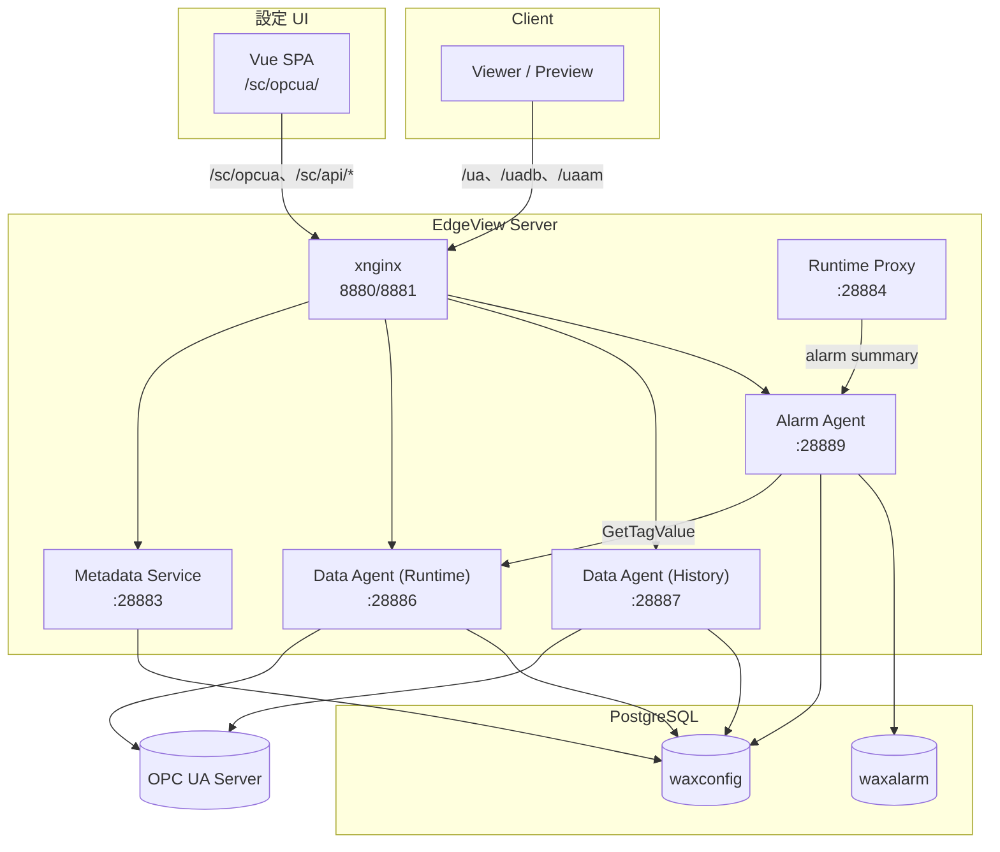

### 1.1 關鍵設計決策

| 決策 | 理由 | 影響 |
|------|------|------|
| Data Agent 分 Runtime/History 兩種角色 | 隔離即時查詢與歷史長查詢，避免互相阻塞 | 需兩個進程/連接埠 |
| Client 邏輯直連 Data Agent | 降低即時值延遲，不經 Runtime Proxy | 實體經 xnginx `/ua`、`/uadb`；Client 不需直連 28886/28887 |
| Alarm 與 Data Agent 分離 | 警報邏輯可獨立重啟/擴充 | 需共享 Session/metadata/內部 Token |
| 設定 UI 走 Metadata API | 沿用既有權限、稽核、Session | UI 不直接連 DB |
| Alarm 規則存 Metadata、狀態存 waxalarm | 設定與 runtime 分離 | 兩 DB 需一致 |

## 2. 部署與連接埠

| 元件 | Port | 對外路徑（範例） | 說明 |
|------|------|------------------|------|
| xnginx HTTP/HTTPS | 8880/8881 | `/sc`、`/wxproxy`、`/ws`、`/ua`、`/uadb`、`/uaam` | 地端統一入口 |
| Metadata | 28883 | `/sc/api` | UI 與 Client 設定（上游 loopback） |
| Runtime Proxy | 28884 | `/wxproxy`、`/ws/so` | 即時資料/告警摘要（上游 loopback） |
| Data Agent Runtime | 28886 | `/ua` | 即時值、寫值、Tag 明細、瀏覽、憑證（上游 loopback） |
| Data Agent History | 28887 | `/uadb` | 歷史值（上游 loopback） |
| Alarm Agent | 28889 | `/uaam` | 告警清單/歷史/Ack/設定欄位（上游 loopback） |
| OPC UA Server | 依現場 | — | OPC UA TCP（可加密） |
| UI | 8880/8881 | `/sc/opcua/` | xnginx 靜態/路由 |

> Client 的 URL 規則：`Global.serverInfo.opcuaPathname` 預設 `/ua`；非根路徑時 `dburl = opcuaUrlPrefix + "db"`、`alarmurl = opcuaUrlPrefix + "am"`，即 `/uadb`、`/uaam`。

## 3. 設定 UI 設計（wax_opcua_agent_ui）

### 3.1 技術與目錄

| 路徑 | 責任 |
|------|------|
| `src/api/base.js` | Axios 實例、`csrfToken`/`packetTimestamp` 注入、401/-100 導向 |
| `src/api/login.js` | 登入/登出/改密 |
| `src/api/projects.js` | OPC UA 專案 CRUD、Tag 預設 |
| `src/api/orgTree.js` | 連線、Tag、警報、常數/計算/系統測點 |
| `src/api/user.js` | OPC UA 使用者、Graphic 使用者、登入鎖定 |
| `src/api/dataSource.js` | 資料源/匯入匯出 |
| `src/api/oem.js`、`log.js` | OEM、稽核日誌 |
| `src/router/*` | login/projects/orgTree/user/settings/oem/log |
| `src/views/*` | 頁面與表單 |
| `src/lang/{en,tw,zh}.json` | 多語系 |

### 3.2 啟動與路由

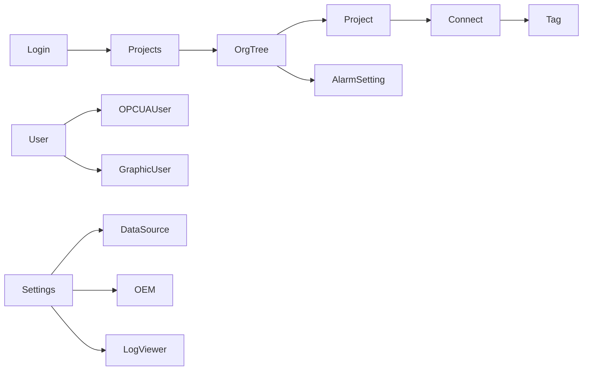

`router.beforeEach`：

1. 讀取 Cookie `role`、`permissions`、`account`。
2. `role=graphic` 且非登入頁 → 導向 `/`。
3. 非 `admin` 依 `permissions` 對應 `project/user/settings`，無權限導向 `/noAccess`。
4. `meta.requireAuth` 檢查 `settings-csrfToken`，缺失導向 `/`。

### 3.3 登入

- `POST /api/login`（Metadata），body `{username,password,setting:true}`。
- 回應 `result.csrfToken`、`role`；UI 寫入 Cookie `settings-csrfToken`、`role`、`account`、`userId`、`permissions`。
- `role=graphic` 僅能使用 HMI；其他角色依權限進入模組。
- `-100` 時 `base.js` 攔截並清除 Cookie、導向 `/sc/opcua/`。

### 3.4 頁面責任

| 頁面 | 功能 | Metadata API |
|------|------|--------------|
| `projects` | 專案清單、建立/修改/刪除 | `/api/opcua/projectlist`、`/api/opcua/proj/*` |
| `orgTree/project` | 專案樹、連線/常數/計算/系統測點 | `/api/setting/opcua/*` |
| `orgTree/connect` | 連線屬性、Tag 清單、節點瀏覽 | `/api/setting/opcua/connect*`、`/api/opcua/roottag`、`/api/opcua/nodetag` |
| `orgTree/tagCreateForm`/`tagUpdateForm` | Tag 編輯 | `/api/opcua/tag/*` |
| `orgTree/tag/alarm`、`alarmSetting` | 警報規則/等級/顏色/門檻 | `/api/setting/opcua/alarm/*` |
| `user` | OPC UA 使用者、Graphic 使用者、鎖定 | `/api/opcua/user*`、`/api/opcua/graphic/*` |
| `settings/dataSource` | OPC UA 資料源參數 | `/api/source`、`/api/setting/DataSource/*` |
| `import/export` | 匯入/匯出專案 | `/api/setting/export`、`/api/setting/import` |
| `oemSettings` | 品牌 | `/api/oem`、`/api/setting/oem/*` |
| `logViewer` | 稽核日誌 | `/api/auditlog/*` |

### 3.5 狀態管理

- Vuex 模組 `$_orgTree`：`editPage`、`formMode`、`treeActive`、`tagDataTyps`。
- 樹狀態存 `localStorage`（`opcua_treeActive`）。
- 表單以 `vee-validate` 驗證（IP、port 1–65535、必填、長度）。
- 檔案上傳使用 `multipart/form-data`（連線憑證 PFX）。

### 3.6 建置與部署

| 變數 | 值 | 說明 |
|------|----|------|
| `VUE_APP_PUBPATH` | `/sc/opcua/` | 靜態資源基底 |
| `VUE_APP_APIROOT` | `/sc/` | API 基底，實際 `/sc/api` |

- `npm run build` 產生 `dist`，由 Nginx/Ingress 提供。
- History fallback 指向 `/sc/opcua/index.html`。

## 4. Data Agent 設計（wax_opcua_agent）

### 4.1 專案結構

| 目錄 | 責任 |
|------|------|
| `Program.cs` | 啟動、Kestrel、DI、中介層、Swagger |
| `Controllers/` | REST 端點 |
| `Model/` | `Connection`、`Tag`、`ConstTag`（讀 `waxconfig`） |
| `Services/` | OPC UA 連線池/快取、常數/計算/累計、系統測點、Alarm 客戶端、Session/內部認證 |
| `Authorization/` | `AuthorizeAttribute`、Session/Bearer 中介層、時間戳中介層 |
| `Constraint/` | `RuntimActionOnly`、`HistoryActionOnly` |
| `sync/OpcUaSync.cs` | 以 OPC UA URI 為 key 的非同步鎖 |
| `deploy/` | 各平台執行檔與 `appsettings.json` |

### 4.2 啟動流程

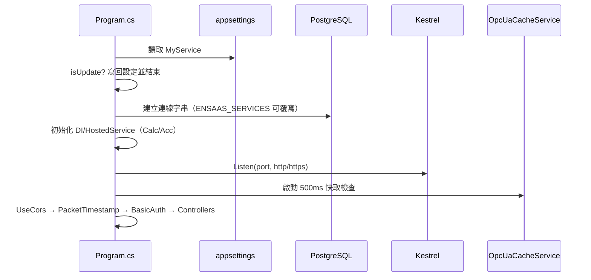

### 4.3 設定

`appsettings.json`：

| 鍵 | 預設 | 說明 |
|----|------|------|
| `MyService:PostgresShema` | `public` | schema |
| `MyService:SessionTimeout` | `604800` | Session 秒數 |
| `MyService:DriftSeconds` | `300` | 時間戳容差 |
| `MyService:isHistory` | `false` | `true` 只允許歷史端點 |
| `MyService:isUpdate` | `false` | 寫回設定後結束 |
| `MyService:Kestrel:Protocol` | `http` | `http`/`https` |
| `MyService:Kestrel:Port` | `28886` | Runtime 或 History 實例的埠 |
| `MyService:Kestrel:DbPort` | `28887` | 歷史埠參考值；實際仍由該進程的 `Port` 綁定（部署時以另一個 `appsettings` 設 `Port=28887`、`isHistory=true`） |
| `MyService:Kestrel:Pfx`/`PfxPassword` | 空 | HTTPS 憑證 |
| `MyService:LogUaServer` | `false` | OPC UA SDK 日誌 |
| `MyService:MetadataBaseUrl` | `http://127.0.0.1:28883` | Metadata |
| `MyService:AlarmAgentEnabled` | `true` | 是否轉發 Alarm 欄位 |
| `MyService:AlarmAgentBaseUrl` | `http://127.0.0.1:28889` | Alarm Agent |

- PostgreSQL 連線可由 `ENSAAS_SERVICES` 的 `postgresql[0].credentials` 覆寫。
- HTTPS 若 PFX 不存在，會嘗試使用 Proxy 的 `_cert` PEM；再失敗則回 HTTP。
- `isUpdate=true` 時只把命令列參數寫回 `appsettings.json` 後結束。

### 4.4 認證與中介層

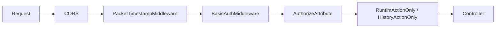

- **Session**：讀 `graphicSession` 或 `settingSession` Cookie，解 SecureCookie → 查 `http_sessions` → 比對 `csrfToken`；`csrfToken` 可來自 body、`csrfToken` header、`X-CSRF-Token` header。
- **Internal Bearer**：由 `aes_secret` 推導的服務 Token；僅接受 loopback。
- **角色限制**：`RuntimActionOnly` 在 `isHistory=true` 回 400；`HistoryActionOnly` 在 `isHistory=false` 回 400。
- **時間戳**：`PacketTimestampMiddleware` 目前於進入方法即 `await _next(); return;`，實務上**未強制**（見 §12）。

### 4.5 REST 端點目錄

| Method | Path | 角色 | 認證 | 用途 |
|--------|------|------|------|------|
| POST | `/Browse/one/{projid}` | Runtime | 是 | 瀏覽單一節點 |
| POST | `/Browse/all/{projid}` | Runtime | 是 | 瀏覽全部節點 |
| POST | `/TagDetail/{projid}` | Runtime | 是 | Tag 明細 |
| POST | `/GetTagValue/{projid}` | Runtime | 是 | 原始值（含 Alarm 欄位轉發） |
| POST | `/GetTagValueText/{projid}` | Runtime | 是 | 文字值（Client 主要使用） |
| POST | `/GetTagList/{projid}` | Runtime | 是 | Tag 清單 |
| POST | `/SetTagValue/{projid}` | Runtime | 是 | 寫入原始值 |
| POST | `/SetTagValueText/{projid}` | Runtime | 是 | 寫入文字值 |
| POST | `/GetDataLog/{projid}` | History | 是 | 聚合歷史 |
| POST | `/GetRawDataLog/{projid}` | History | 是 | 原始歷史 |
| POST | `/Certificate/create` | Runtime | 是 | 產生 PFX |
| GET | `/swagger/*` | 兩者 | 否 | API 文件 |

### 4.6 即時讀取流程

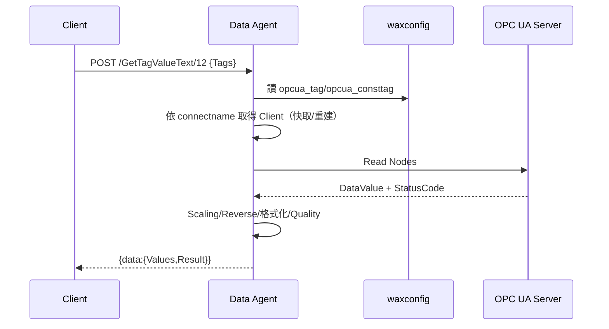

**Tag 後綴**：

| 後綴 | 意義 |
|------|------|
| `.value` | 值 |
| `.type` | 型別標籤（ANALOG/TEXT） |
| `.spanhi` / `.spanlo` | 範圍 |
| `.descrp` | 描述 |
| `.dspfmt` | 顯示格式（整數位.小數位） |
| `.seca` / `.secl` | 安全區/等級 |
| `.ALMST`/`.ALMTP`/`.ALMVA`/`.ALMTM`/`.ALMDT` | Alarm 執行期欄位（轉發 Alarm Agent） |
| `.ALMHH`/`.ALMHI`/… | Alarm 設定欄位 |

- 陣列：`tag(0)`、`tag(1)`；`GetTagValue` 支援整批陣列。
- 未知 Tag/無效欄位：`Value="*"`、`Quality=1`。
- Const/Calc/Acc/System 測點不經 OPC UA，由本地服務計算。

### 4.7 歷史查詢流程

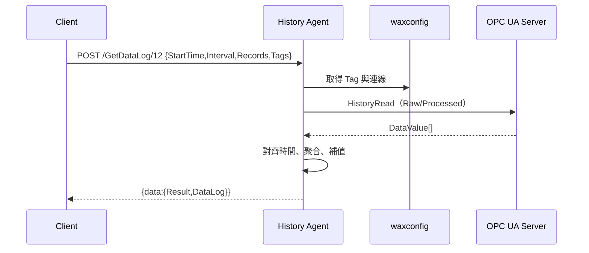

- `GetDataLog`：依 `IntervalType`（`m`/`S`/`M`/`H`/`D`）與 `Interval` 產生時間格；每格取樣/聚合。
- `GetRawDataLog`：回傳原始時間/值序列。
- `NumberOfValues` 限制單點取樣數；無資料回空 `DataLog`。
- 歷史查詢需 OPC UA Server 支援 Historical Access。

### 4.8 連線池、快取與同步

| 機制 | 設計 |
|------|------|
| `OpcUaCacheService.ConnPoolV2` | 以 OPC UA URI 為 key 的 Client 池 |
| Session 驗證 | `IsSessionValid`；失效移除重建 |
| 快取 | `_checkCache` 每 500 ms；`maxIdleTimeUaRequest=10 分鐘` |
| 同步 | `OpcUaSync.LockAsync(uri)` 保證同一 Server 操作序列化 |
| DB 池 | `NpgsqlDataSourcePool` 重用連線 |
| 憑證 | PFX + SecurityMode/SecurityPolicy；`AutoAcceptUntrustedCertificates=true` |

### 4.9 測點服務

| 服務 | 責任 |
|------|------|
| `ConstTagService` | 常數測點記憶體值 |
| `CalcTagEvaluateHostedService` / `CalcTagEvaluator` | 公式計算、依賴拓撲排序、快取 |
| `AccTagEvaluateHostedService` / `AccTagEvaluator` | 累計、除以係數、Value Limit、週期重置 |
| `SystemPointValueResolver` | 年/月/日/時/分/秒/星期、SN、狀態、隨機、時間、磁碟/記憶體 |
| `TagListMerger` | `opcua_tag` + `opcua_consttag` 合併清單 |
| `AlarmAgentClient` | 轉發 Alarm 欄位（Bearer） |

### 4.10 錯誤與日誌

- 例外由 `ApiExceptionFilter` 轉為 `{errors:[{code,message}]}`。
- Serilog：Console + 每日檔案（`logs/log-.txt`，500 MB，保留 3 份）。
- OPC UA SDK 日誌由 `LogUaServer` 開啟。
- 常見錯誤：URI 空、憑證缺失、連線失敗、Session 無效、角色不符（400）。

## 5. Alarm Agent 設計（wax_opcua_alarm_agent）

### 5.1 專案結構

| 目錄 | 責任 |
|------|------|
| `opcua_alarm.go` | 啟動、DB、Session、Engine、Poller、HTTP |
| `config/` | Viper 設定 |
| `controller/` | `/api/alarm/*`、`/GetTagValue/:projid`、`/ping/:id` |
| `model/` | AlarmDefinition、ActiveAlarm、Event、Policy |
| `alarm/` | Engine、Evaluator、Precedence、Workflow、Recovery、Reloader |
| `metadata/` | 讀 `opcua_tagalarm`/`action`/`level` 並編譯 |
| `storage/` | `opcua_active_alarm`/`opcua_alarm_history` CRUD |
| `opcuaagent/` | 輪詢 Data Agent |
| `opcua/` | 直接 OPC UA Subscription（選用） |
| `pgstore/` | Session Store |

### 5.2 啟動流程

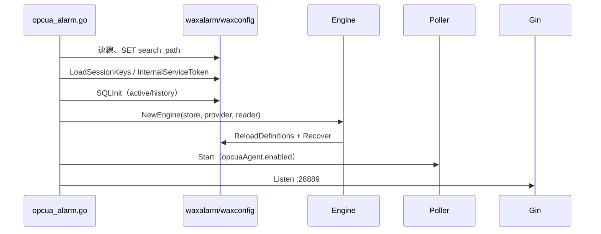

### 5.3 設定

| 鍵 | 預設 | 說明 |
|----|------|------|
| `alarm.net.http` | `0.0.0.0:8090`（預設值）；`config.yaml` 為 `:28889` | HTTP |
| `alarm.net.https` | `-1` | HTTPS |
| `alarm.metadataReloadMs` | `30000` | 定期檢查 metadata |
| `sessiontimeout` | `604800` | Session |
| `opcuaAgent.enabled` | `true` | 輪詢 Data Agent |
| `opcuaAgent.baseUrl` | `http://127.0.0.1:28886` | Data Agent |
| `opcuaAgent.pollIntervalMs` | `500` | 輪詢間隔 |
| `opcua.enabled` | `false` | 直連 OPC UA Subscription |
| `metadata.schema`/`dbname`/`dsn` | `public`/`waxconfig`/空 | Metadata DB |
| `cert.crt`/`cert.key` | 空 | HTTPS |

> 預設值 8090 與 `config.yaml` 28889 不同；部署時以設定檔/環境為準。

### 5.4 告警定義編譯

```mermaid
flowchart LR
    Rows[opcua_tagalarm EAV] --> Parse[ParseTagAlarmRows]
    Span[opcua_tag/consttag span] --> Parse
    Parse --> Analog[AnalogTagAlarm]
    Parse --> Discrete[DiscreteTagAlarm]
    Analog --> Compile[CompileAnalog]
    Discrete --> CompileD[CompileDiscrete]
    Compile --> Defs[AlarmDefinition[]]
    CompileD --> Defs
    Policy[opcua_alarmaction/level] --> Engine
    Defs --> Engine
```

- Analog：HH/H/L/LL/DEV_HI/DEV_LO/ROC；deadband 可為值或 Span 百分比。
- Discrete：狀態 0–7，各自 Level/Message/Delay/Value。
- Definition ID 以 `projid|tag|type|state` 產生 UUIDv5，重啟穩定。
- `AlarmLevel` 同時作為優先級 tie-break。

### 5.5 評估與優先級

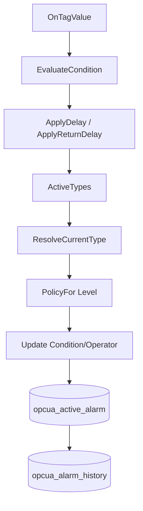

- 條件：`HH/H` 為 `>= setpoint`，`L/LL` 為 `<= setpoint`；clear 需跨 deadband。
- ROC：連續取樣差絕對值 > 門檻（Span 百分比或工程值）。
- Deviation：`value - reference`（DEV_HI）或 `reference - value`（DEV_LO）。
- Discrete：四捨五入後等於設定狀態。
- 優先級：`HH/LL=100`、`H/L=80`、`ROC=60`、`DEV=40`、`DISCRETE=20`；同分比 Level。
- 同一 Tag 僅保留一個未 CLOSED 的 active alarm（partial unique index）。

### 5.6 雙狀態與工作流程

| ConditionState | 意義 |
|----------------|------|
| `NORMAL` | 正常 |
| `ACTIVE` | 條件成立 |
| `RETURNED` | 已恢復但流程未完成 |

| OperatorState | 狀態碼 | 意義 |
|---------------|--------|------|
| `OPEN` | 1 | 未確認 |
| `ACKED` | 2 | 已確認 |
| `IN_PROCESS` | 3 | 處理中 |
| `LOCKED` | 4 | 鎖定/暫停 |
| `PROCESSED` | 5 | 已處理 |
| `CLOSED` | 0 | 已關閉 |

- `CanClose = ConditionState==RETURNED && WorkflowCompleted`。
- Scenario 由 `opcua_alarmaction` 門檻決定：
  - `ack>0 && level>=ack` → 需 Ack。
  - `report>0 && level>=report` → 需 Process。
  - `alarmsummary>0 && level>=alarmsummary` → 顯示於摘要。
  - `alarmlog`：`level>=alarmlog` 寫歷史（`0` 仍寫）。
- 轉換限制：
  - Scenario 1：無操作員流程，恢復即關閉。
  - Scenario 2：`OPEN→ACKED`。
  - Scenario 3：`OPEN→IN_PROCESS/LOCKED`，可 `IN_PROCESS↔LOCKED/PROCESSED`。
  - Scenario 4：`OPEN→ACKED`，再進 `IN_PROCESS/LOCKED/PROCESSED`。

### 5.7 持久化與復原

- `opcua_active_alarm`：每次評估寫入/更新。
- `opcua_alarm_history`：事件（Activated/Acked/InProcess/Locked/Processed/Returned/Closed/Reactivated）。
- `Engine.Recover()`：
  1. 載入未 CLOSED 的 active alarm。
  2. 推導缺少的 `active_types`。
  3. 種回 delay 狀態。
  4. 首次 poll 對帳（同 AlarmID 更新、恢復、關閉或新建）。
- 停機期間的中間事件不補寫，只記最終狀態。

### 5.8 REST API

> 對外路徑加 xnginx 前綴：`/uaam/api/alarm/*`、`/uaam/GetTagValue/:projid`、`/uaam/ping/:id`。

| Method | Path | 認證 | 用途 |
|--------|------|------|------|
| POST | `/api/alarm/list` | 是 | 進行中警報（summary 過濾） |
| POST | `/api/alarm/log` | 是 | 已關閉警報（等級/時間/排序/分頁/連線） |
| POST | `/api/alarm/ack` | 是 | Ack/Process/Lock（批次） |
| POST | `/api/alarm/processhistory` | 是 | 單一警報歷程 |
| POST | `/api/alarm/definition/list` | 是 | 編譯後規則 |
| POST | `/api/alarm/simulate` | 是 | 注入值測試 |
| POST | `/api/alarm/reload` | 是 | 強制重載 metadata |
| POST | `/GetTagValue/:projid` | 是 | Alarm 欄位（Data Agent 格式） |
| POST | `/ping/:id` | 是 | 健康檢查 |

回應信封：`{data:{error,reason,result}}`；錯誤 `-100/-101/-102/-500/-501`。

### 5.9 認證

1. **Session + CSRF**：Metadata `graphicSession`，body 或 header `csrfToken`。
2. **Basic Auth**：僅限本機（loopback 且無外部 `X-Real-IP`/`X-Forwarded-For`）；`admin`/`UserAdmin` 或 `OPCUA_User`；結果快取 5 分鐘。
3. **Internal Bearer**：由 `aes_secret` 推導，僅 loopback；供 Data Agent/Runtime Proxy 輪詢。
4. 權限失敗仍回 HTTP 200 + `error=-100`。

## 6. 介面設計

### 6.1 UI → xnginx → Metadata

| UI 功能 | API |
|---------|-----|
| 登入/登出 | `/api/login`、`/api/setting/logout` |
| 專案 | `/api/opcua/projectlist`、`/api/opcua/proj/*` |
| 連線 | `/api/setting/opcua/connectlist/:projid`、`/api/opcua/connect/*` |
| 瀏覽 | `/api/opcua/roottag/:projid`、`/api/opcua/nodetag/:projid` |
| Tag | `/api/setting/opcua/taglist/:projid`、`/api/opcua/tag/*` |
| 常數/計算/系統 | `/api/setting/opcua/const/*` |
| 警報 | `/api/setting/opcua/alarm/detail/:projid`、`/api/setting/opcua/alarm/upsert`、`/api/setting/opcua/tagconfig/:projid` |
| 使用者 | `/api/opcua/user*`、`/api/opcua/graphic/*` |
| 資料源 | `/api/source`、`/api/setting/DataSource/*` |
| 匯入/匯出 | `/api/setting/export`、`/api/setting/import` |

> 對外實際路徑為 `/sc` + 上表（例如 `/sc/api/opcua/projectlist`），由 xnginx 去前綴後轉 Metadata。

### 6.2 Client → xnginx → Data Agent

```json
POST /ua/GetTagValueText/12
Headers: { "csrfToken": "<token>" }
{
  "Tags": [{ "Name": "Line1.Temp" }]
}
```

```json
{
  "data": {
    "Values": [{ "Name": "Line1.Temp", "Value": "72.5", "Quality": 0 }],
    "Result": { "Ret": 0, "Total": 1 }
  }
}
```

### 6.3 Client → xnginx → History Agent

```json
POST /uadb/GetDataLog/12
{
  "StartTime": "2026-11-19 00:00:00",
  "IntervalType": "M",
  "Interval": 1,
  "Records": 60,
  "Tags": [{ "Name": "Line1.Temp", "DataType": 11 }],
  "NumberOfValues": 1
}
```

### 6.4 Client → xnginx → Alarm Agent

```json
POST /uaam/api/alarm/list
{ "csrfToken": "<token>", "projid": 12 }
```

```json
POST /uaam/api/alarm/ack
{
  "csrfToken": "<token>",
  "alarmid": [123],
  "status": 2,
  "handler": "op1",
  "commenter": "op1",
  "record": "checked"
}
```

### 6.5 Alarm → Data Agent

```json
POST http://127.0.0.1:28886/GetTagValue/12
Authorization: Bearer <internal-service-token>
{ "Tags": [{ "Name": "Line1.Temp" }] }
```

## 7. 資料模型

### 7.1 Metadata（waxconfig）

| 資料表 | 主鍵 | 主要欄位 |
|--------|------|----------|
| `OPCUA_Project` | `projid` | `projname`（unique）、`description`、時間戳 |
| `OPCUA_Connect` | `projid`,`name` | `uri`、時間戳；FK→Project |
| `OPCUA_ConnectBody` | `projid`,`name`,`item` | `value`、`cert bytea`；FK→Connect |
| `OPCUA_Tag` | `projid`,`tagname` | `connectname`、`nodeid`、`description`、`spanhi/lo`、`datatype`、`displayint/dec`、`scalingtype/factor1/factor2`、`reverse`、`area`、`level` |
| `OPCUA_TagConfig` | `projid`,`type` | `spanhi/lo`、`displayint/dec` |
| `OPCUA_ConstTag` | `projid`,`tagname` | `description`、`datatype`、`value`、`area`、`level`、`spanhi/lo`、`arylen` |
| `OPCUA_Consttagbody` | `projid`,`tagname`,`item` | `value`（公式/設定） |
| `OPCUA_TagAlarm` | `projid`,`tagname`,`item` | `alarmtype`、`value`（EAV） |
| `OPCUA_AlarmAction` | `projid` | `report`、`alarmsummary`、`ack`、`alarmlog`、時間戳 |
| `OPCUA_AlarmLevel` | `projid`,`level` | `levelname`、`colorcode`、時間戳 |
| `OPCUA_User` | `name`（unique） | `password`、active code、啟用 |
| `OPCUA_UserFunc` | `id`,`function` | `edit` |
| `OPCUA_UserProject` | `userid`,`projid` | `usertype` |
| `OPCUA_LoginLock` | 依實作 | 鎖定狀態 |

### 7.2 Alarm Runtime（waxalarm）

`opcua_active_alarm`：

| 欄位 | 型別 | 說明 |
|------|------|------|
| `id` | bigserial | 警報 ID |
| `projid` | int | 專案 |
| `tag` | text | Tag |
| `alarm_type` | text | HH/H/L/LL/ROC/DEV_HI/DEV_LO/DISCRETE |
| `alarm_level` | smallint | 等級 |
| `alarm_limit` | double | 門檻 |
| `discrete_state` | smallint | 狀態 |
| `alarm_message` | text | 訊息 |
| `condition_state` | text | NORMAL/ACTIVE/RETURNED |
| `status` | smallint | 0–5 |
| `current_value` / `alarm_value` | double | 目前/觸發值 |
| `to_normal_time` / `close_time` | bigint | ms |
| `handler` | text | 處理者 |
| `active_types` | jsonb | 同時成立的條件 |
| `alarm_time` | bigint | ms |

索引：`UNIQUE (projid, tag) WHERE status <> 0`（同 Tag 僅一個未關閉）。

`opcua_alarm_history`：

| 欄位 | 型別 | 說明 |
|------|------|------|
| `alarm_id` | bigint | 對應 active id |
| `status` | smallint | 事件狀態 |
| `alarm_time` | bigint | 事件時間 |
| `handler` | text | 操作者 |
| `commenter` | text | 備註者 |
| `record` | text | 文字 |

索引：`(alarm_id, alarm_time DESC)`。

### 7.3 列舉

| 類型 | 值 |
|------|----|
| AlarmType（字串） | `HH`、`H`、`L`、`LL`、`ROC`、`DEV_HI`、`DEV_LO`、`DISCRETE` |
| AlarmType（API 數字） | 1=HH、2=HI、3=LO、4=LL、5=ROC、6=DEVH、7=DEVL、8=DIS |
| AlarmStatus | 0=Clear、1=Open、2=Acked、3=InProcess、4=Locked、5=Processed、6=Returned |
| ConditionState | `NORMAL`、`ACTIVE`、`RETURNED` |
| OperatorState | `OPEN`、`ACKED`、`IN_PROCESS`、`LOCKED`、`PROCESSED`、`CLOSED` |

### 7.4 非功能設計對照

| 需求 | 設計 |
|------|------|
| NFR-OPC-001~003 | Data Agent 批次讀取、連線池、歷史獨立進程 |
| NFR-OPC-004 | Alarm 輪詢 500–1000 ms、評估 O(n) per tag |
| NFR-OPC-005~006 | Alarm Recover、Data Agent Session 重建、Bad Quality |
| NFR-OPC-007~008 | Session/Bearer、HTTPS/PFX、OPC UA SecurityMode |
| NFR-OPC-009 | Metadata 稽核 + Alarm history |
| NFR-OPC-010 | UI en/tw/zh |
| NFR-OPC-011 | 多專案 map、History 可水平擴充 |
| NFR-OPC-012 | Swagger、`/ping`、Serilog/klog |
| NFR-OPC-013~014 | OPC UA 1.04 SDK、時間格式/UTC |
| NFR-OPC-015~020 | 資源限制、備份、分層、模擬、表單驗證、文件 |

## 8. Client 直連資料源設計（邏輯直連／xnginx）

### 8.1 為什麼直連

Viewer/Preview 的即時 Tag 值與歷史 Tag 值由 Client **直接**呼叫 Data Agent（不經 Runtime Proxy）。**實體路徑**為 Client → xnginx `/ua`、`/uadb`、`/uaam` → Data/Alarm Agent；這是「邏輯直連」，避免多一層 Proxy，同時保留 xnginx 的 TLS/路由/限流。優點：

1. 不經 Runtime Proxy，值更新更即時。
2. Proxy 不需承擔高頻 Tag 查詢。
3. 歷史查詢可獨立擴充 History Agent。
4. 對外僅開 xnginx `8880/8881`，Agent 維持 loopback。

### 8.2 Client 端實作

| 模組 | 行為 |
|------|------|
| `Common/Api/opcua.js` | `Opcua` 類別；建立 `http`（即時）、`httpdb`（歷史）、`httpalarm`（警報） |
| `ui/component/datasource/Opcua.qml` | `getTagValue` → `tagvaluetext`；`getNodeList`/`getTagList`/`getTagAry` |
| `Common/WADataSourceManager.qml` | `connect(dbID)` 讀 `DataSourceBody`；`dataValueCache`；33 ms 批次；`Global.treetimer` 週期掃描 |
| `ui/component/chart/ChartWidgetHelper.qml` | `getRawDataLog`/`getDataLog` → History Agent |
| `Common/Api/ws/OpcuaalarmsummaryController.qml` | 警報摘要仍走 Runtime Proxy WebSocket（xnginx `/ws`） |

### 8.3 URL 規則

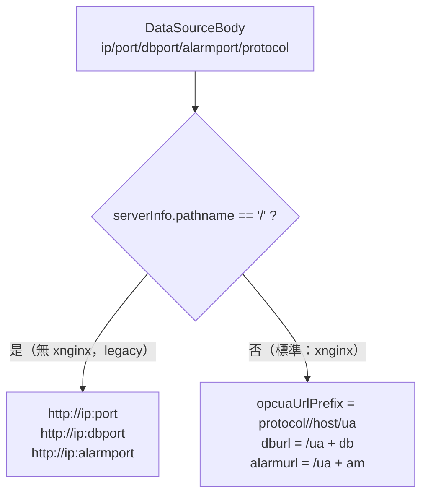

- 即時：`POST {url}/GetTagValueText/{projid}` → xnginx `/ua/`
- 歷史：`POST {dburl}/GetDataLog/{projid}` 或 `/GetRawDataLog/{projid}` → xnginx `/uadb/`
- 警報：`{alarmurl}/api/alarm/*` → xnginx `/uaam/`
- 認證：`csrfToken` header；同 Metadata Session Cookie。
- 僅在**無 xnginx 的根路徑部署**才直接使用 `DataSourceBody.ip/port/dbport/alarmport`。

### 8.4 更新週期

| 設定 | 預設 | 說明 |
|------|------|------|
| `client_data_update_interval`（Settings） | 3000 ms | 伺服器預設 |
| 本機 `dataUpdateInterval` | 跟隨伺服器 | 可覆寫 |
| `Define.minDatasourceScanInterval` | 500 ms | 下限 |
| `Define.defaultDatasourceScanInterval` | 1000 ms | 預設 |
| `_batchTagTimer` | 33 ms | 合併同一事件迴圈請求 |
| Data Agent 快取 | 500 ms | OPC UA 快取更新 |
| Alarm 輪詢 | 500–1000 ms | 依 `opcuaAgent.pollIntervalMs` |

> 實際即時性受限於 `Global.treetimer` 週期（預設 1 秒）與 Data Agent 快取（500 ms）；若要更即時，可調低 Client 掃描間隔（最低 500 ms）。

### 8.5 與 Proxy 的分工

| 資料 | 路徑 | 備註 |
|------|------|------|
| OPC UA 即時 Tag | Client → xnginx `/ua` → Data Agent `:28886` | 邏輯直連 |
| OPC UA 歷史 Tag | Client → xnginx `/uadb` → History Agent `:28887` | 邏輯直連 |
| OPC UA 警報清單/歷史/Ack | Client → xnginx `/uaam` → Alarm Agent `:28889` | 邏輯直連 |
| OPC UA 警報摘要（WS） | Client → xnginx `/ws` → Runtime Proxy → Alarm Agent | `opcuaalarmsummary` |
| Record/第三方 DB 查詢 | Client → xnginx `/wxproxy` → Runtime Proxy | 不變 |
| 設定/專案/Tag 定義 | Client → xnginx `/sc` → Metadata | 不變 |

> Runtime Proxy 仍保留 `opcuaalarmsummary`，用於既有 Widget 的摘要訂閱；**不承載即時/歷史 Tag 值**。

## 9. 安全設計

| 機制 | 設計 |
|------|------|
| Session | Metadata `graphicSession`/`settingSession`；SecureCookie + `http_sessions` |
| CSRF | Body/header `csrfToken` |
| 內部呼叫 | `aes_secret` 推導 Bearer；僅 loopback |
| 傳輸 | HTTPS/PFX；OPC UA SecurityMode/Policy |
| OPC UA 憑證 | PFX 儲存於 `OPCUA_ConnectBody.cert` |
| 權限 | Metadata 專案/使用者/角色；UI 依 `permissions` |
| 稽核 | Metadata 登入/設定；Alarm Ack/Process 歷史 |

## 10. 關鍵流程

### 10.1 設定連線與 Tag

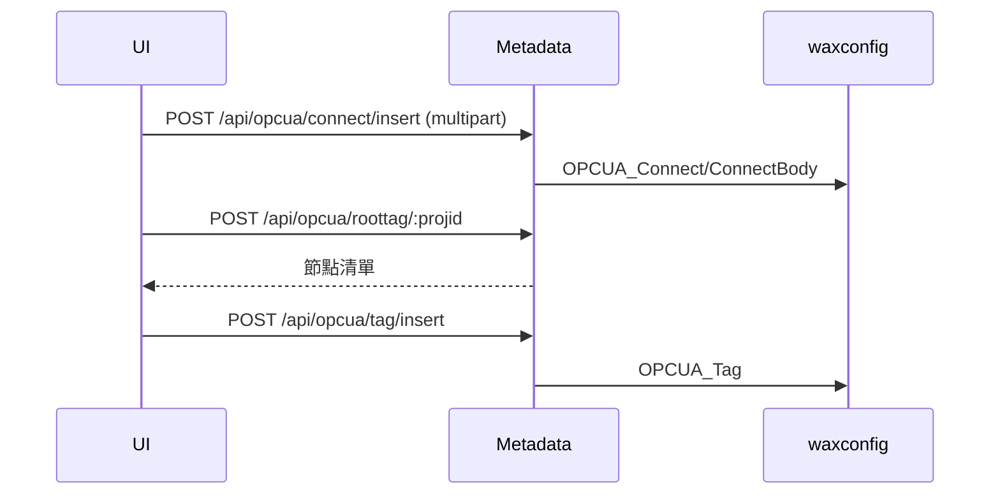

### 10.2 Viewer 即時值（經 xnginx）

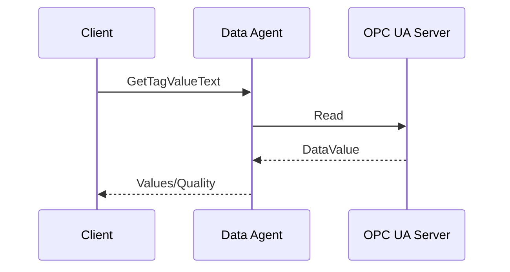

### 10.3 歷史趨勢（經 xnginx）

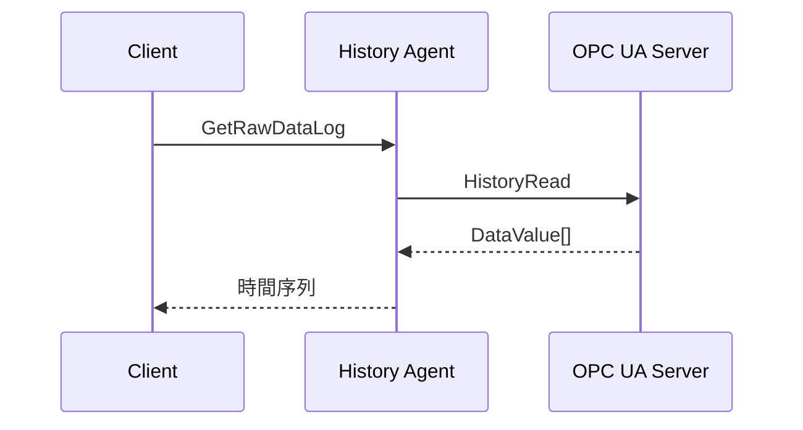

### 10.4 警報生命週期

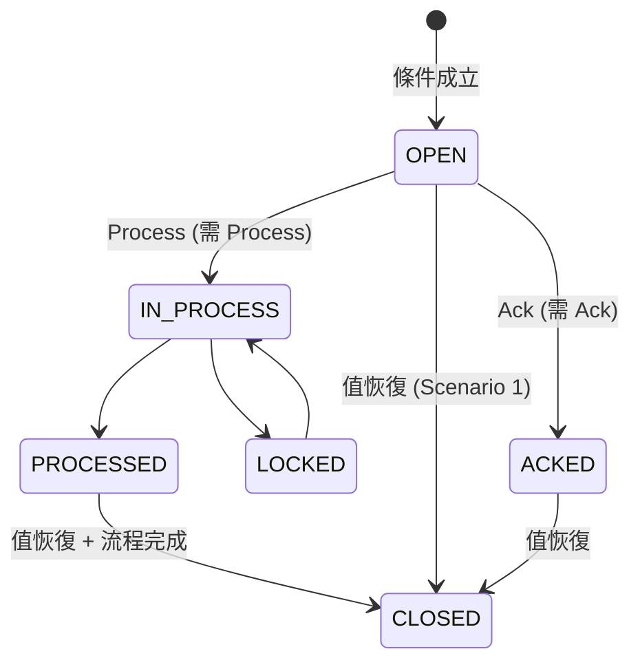

## 11. 部署與維運

### 11.1 程序

| 程序 | 設定 | 埠 |
|------|------|----|
| Data Agent Runtime | `isHistory=false` | 28886 |
| Data Agent History | `isHistory=true` | 28887 |
| Alarm Agent | `config.yaml` | 28889 |
| UI | xnginx 靜態/路由 | 8880/8881 |

### 11.2 xnginx（地端）/ K8s Ingress（BI）路由

| 路徑 | 目標 |
|------|------|
| `/sc/api/*` | Metadata `:28883` |
| `/sc/opcua/*` | UI 靜態 |
| `/ua/*` | Data Agent `:28886` |
| `/uadb/*` | History Agent `:28887` |
| `/uaam/*` | Alarm Agent `:28889` |
| `/wxproxy/*`、`/ws/so` | Runtime Proxy `:28884` |
| `/system/*` | system `:28888` |

> 地端路徑 `http(s)://<EVS>:8880|8881` 由 xnginx 提供。EdgeHub/BI 例外：Client 走 K8s Ingress `wxproxy<suffix>`，不由地端 xnginx 代理。

- WebSocket 需 `proxy_http_version 1.1`、`Upgrade`/`Connection`。
- Body 大小依歷史/憑證需求調整。

### 11.3 健康與日誌

| 元件 | 健康 | 日誌 |
|------|------|------|
| Data Agent | `/swagger`、連線測試 | Serilog `logs/` |
| Alarm | `POST /ping/:id` | klog `log/` |
| UI | 靜態首頁 | Nginx |
| OPC UA | Session 狀態 | SDK（可選） |

### 11.4 備份

- `waxconfig`：OPC UA 設定。
- `waxalarm`：active/history。
- 憑證 PFX/私鑰。
- 設定檔 `appsettings.json`、`config.yaml`。

## 12. 風險與限制

| 編號 | 風險 | 嚴重度 | 說明 |
|------|------|--------|------|
| R-OPC-001 | Data Agent 時間戳未強制 | High | `PacketTimestampMiddleware` 立即 `_next()` 後返回 |
| R-OPC-002 | CORS 允許任意 Origin + Credentials | High | `SetIsOriginAllowed(_=>true).AllowCredentials()` |
| R-OPC-003 | 自動接受不受信任憑證 | High | `AutoAcceptUntrustedCertificates=true` |
| R-OPC-004 | 預設 DB 帳密硬編碼 | High | `Program.cs`/`service/app.go` 預設 `postgres/Postgre@sql1` |
| R-OPC-005 | Runtime/History 同映像不同埠 | Medium | 需两个進程與正確 `isHistory`，部署易錯 |
| R-OPC-006 | Alarm 預設埠不一致 | Medium | 程式預設 8090、`config.yaml` 28889、Runtime 設定 8090 |
| R-OPC-007 | Root path 直連參數不足 | Medium | `DataSourceBody` 無 `dbport`/`alarmport`，根路徑部署可能失效 |
| R-OPC-008 | Alarm 設定與 runtime DB 分離 | Medium | 需確保 `waxconfig` 與 `waxalarm` 同步/備份 |
| R-OPC-009 | 歷史查詢依賴 Server HDA | Medium | 未支援 Historical Access 時無資料 |
| R-OPC-010 | 多副本 Alarm/Agent | Medium | 需共享 DB/Session/Token，否則狀態不一致 |
| R-OPC-011 | 大量 Tag 輪詢 | Medium | 500 ms 輪詢可能造成 OPC UA Server 負載 |
| R-OPC-012 | 憑證管理 | Medium | PFX 儲存於 DB；需保護與輪替 |

## 13. 需求追溯

| 需求 | 設計章節 |
|------|----------|
| FR-OPC-001~012 | §3 |
| FR-OPC-013~027 | §4 |
| FR-OPC-028~045 | §5 |
| IF-OPC-001~011 | §6 |
| NFR-OPC-001~020 | §7、§11 |
| Client 直連 | §8 |
| 安全 | §9 |
