# SDS-16 使用手冊截圖對照（OPC UA 版）

> 對應：`SRS/09_Manual_Screenshot_Evidence.md`、`62443/Evidence.md`  
> 範圍：datasource = OPC UA 的 EdgeView 完整系統

## 1. 截圖 ↔ 設計/程式碼

| 證據 | 畫面 | Client/UI | 後端/API | 設計章節 |
|------|------|-----------|----------|----------|
| SS-01 | 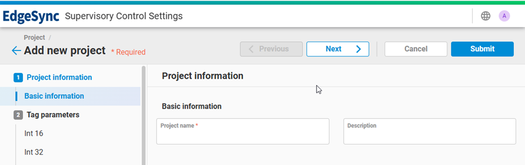 | OPC UA 設定 UI → Projects | `/api/opcua/proj/insert`、`OPCUA_Project` | SDS-14 §3.4、§7.1 |
| SS-02 | 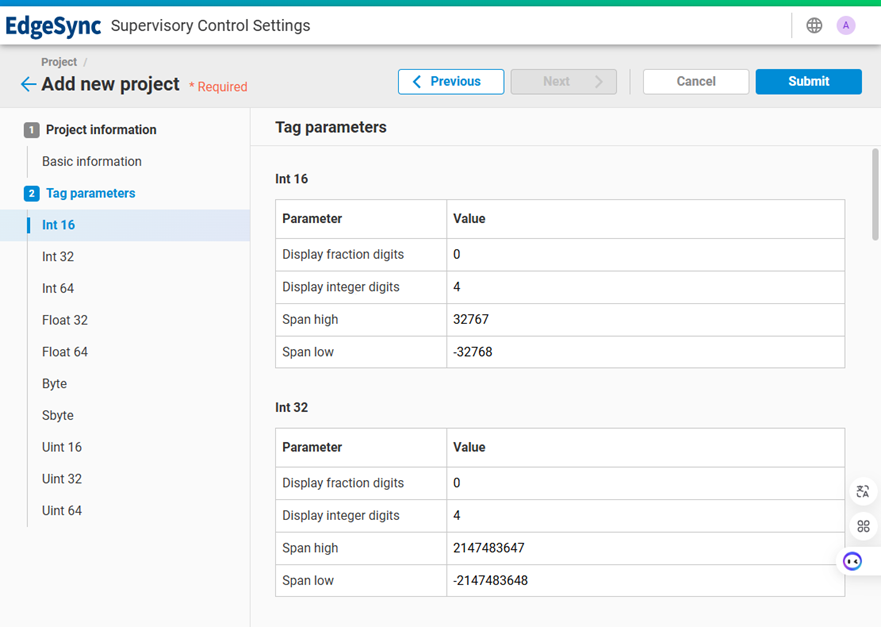 | Projects/專案設定 | `/api/opcua/proj/update`、`projectdetail` | SDS-14 §3.4 |
| SS-03 | 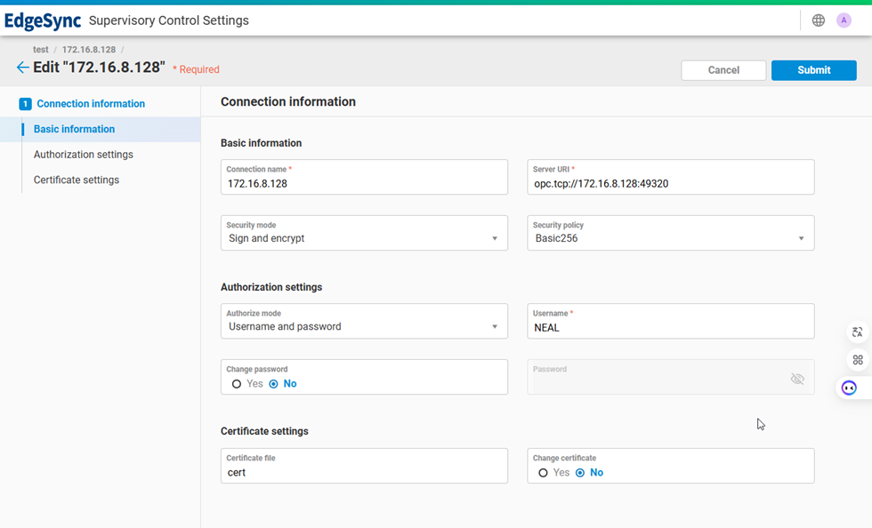 | OrgTree → Connect | `/api/opcua/connect/*`、`OPCUA_Connect/ConnectBody` | SDS-14 §3.4、§7.1 |
| SS-04 | 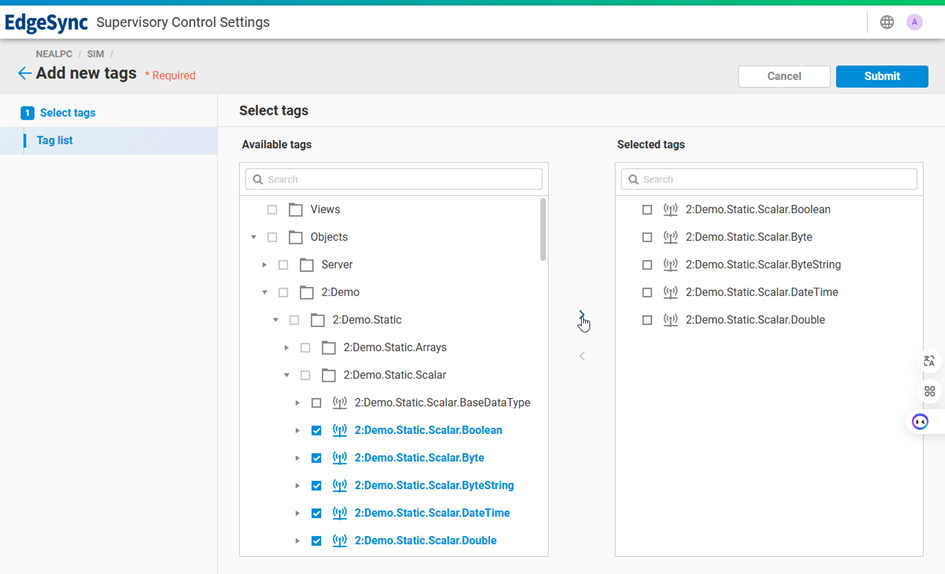 | OrgTree → Connect → Tags | `/api/opcua/roottag`、`/nodetag`、`/tag/insert` | SDS-14 §3.4、§4.5 |
| SS-05 | 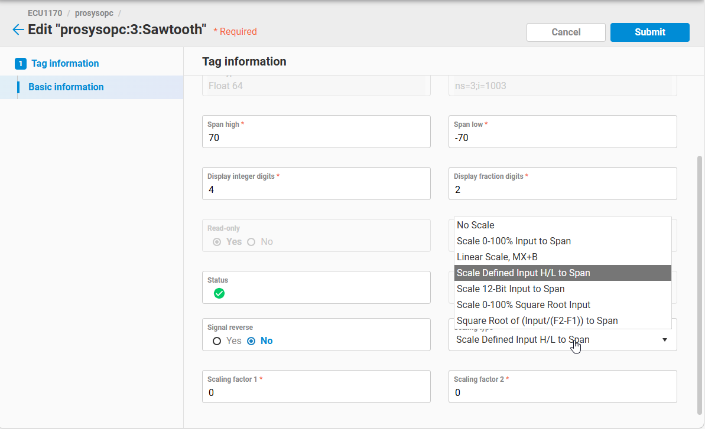 | OrgTree → Tag edit | `OPCUA_Tag`（span/scaling/display） | SDS-14 §4.6、SDS-06 §4.7 |
| SS-06 | 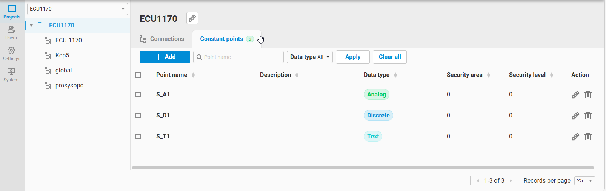 | OrgTree → Constant/Calc/System | `/api/setting/opcua/const/*`、`OPCUA_ConstTag` | SDS-14 §4.9、§7.1 |
| SS-07 | 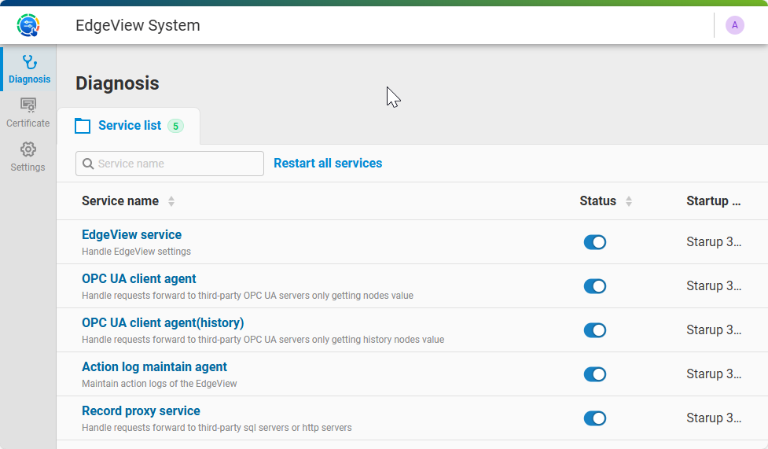 | Server `/system` | xnginx 服務監督、system `28888` | SDS-10 §2.3、§7.3 |
| SS-08 | 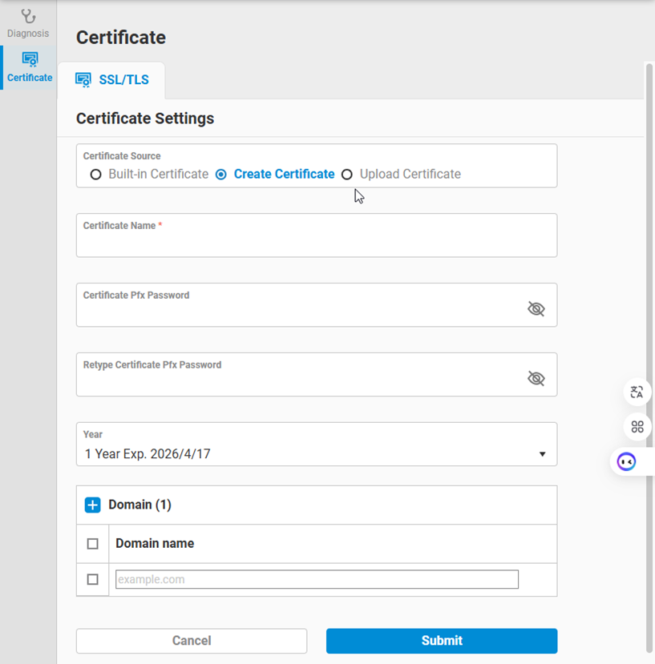 | Server `/system` → Certificate | `/Certificate/create`、`cert`；xnginx TLS | SDS-14 §4.5、SDS-08 §7、§8.1 |
| SS-09 | 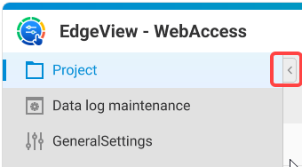 | Client 管理選單 | Session/權限、`/api/user*` | SDS-03 §5、SDS-15 §9 |
| SS-10 | 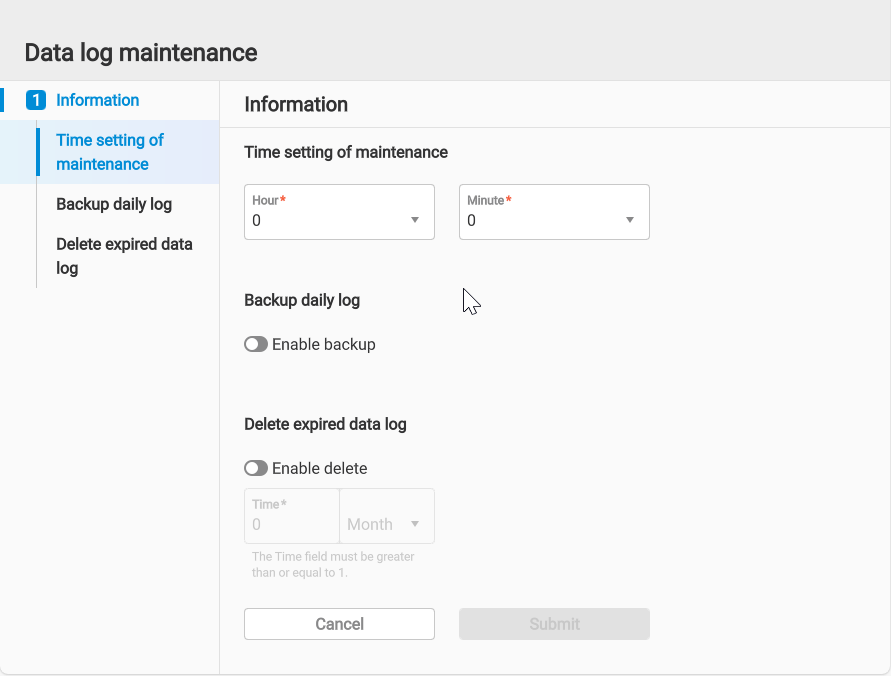 | EdgeView 設定 → Data log maintenance | `/api/logmaint/*`、`Maintenance` | SDS-10 §8、SDS-15 §10 |
| SS-11 | 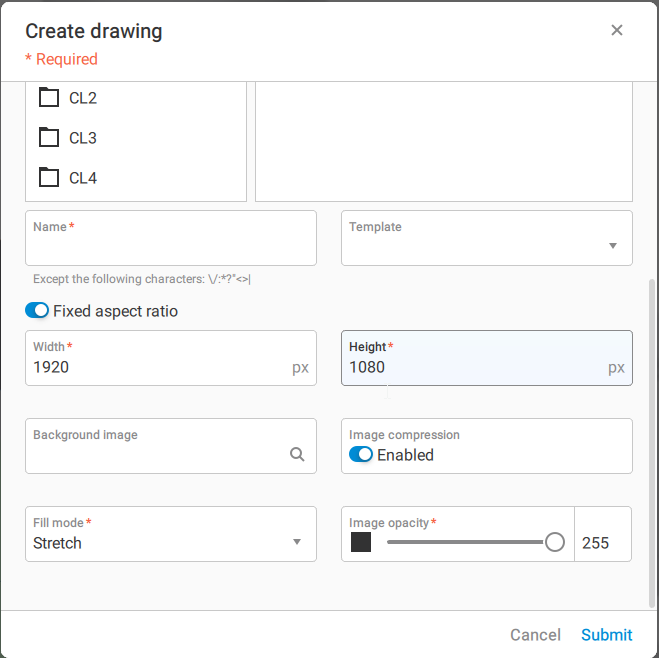 | Editor → Create drawing | `/api/createdisplay`、`Display` | SDS-03 §5、SDS-15 §4 |
| SS-12 | 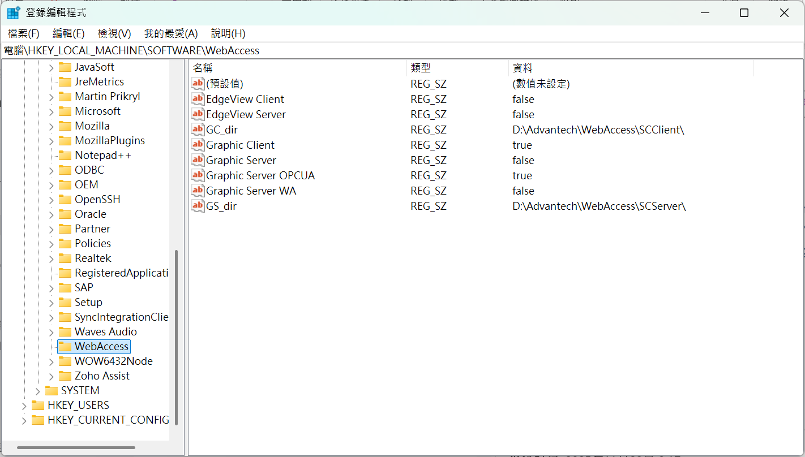 | 安裝/版本 | 安裝程式、`about` | SDS-10 §2.1、SDS-15 §10 |
| SS-13 | 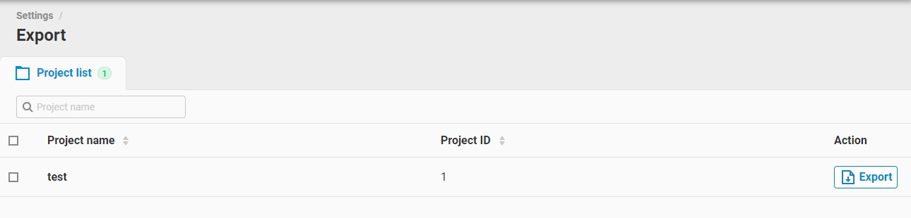 | Server `/system` | `/api/setting/export` | SDS-10 §8、SDS-15 §10 |
| SS-14 | 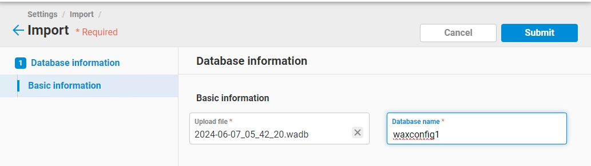 | Server `/system` | `/api/setting/import`、`/api/setting/setcurdb` | SDS-10 §8、SDS-15 §10 |

## 2. 安全設計對照

| 截圖 | 安全機制 | 設計/程式碼 |
|------|----------|-------------|
| SS-03 | OPC UA Sign/SignAndEncrypt、Basic256、帳密、PFX | `OpcUaClientV2`、`OPCUA_ConnectBody`、`OpcUaCacheService` |
| SS-04 | 需登入/授權才能瀏覽/訂閱 Tag | Session/CSRF、`/api/opcua/*`、專案權限 |
| SS-06 | 常數點 Security area/level | `OPCUA_ConstTag.area/level`、`UserInfo.area/level`、`OPCUA_UserProject` |
| SS-07 | 服務清單/開關、監督 | `xnginx` app supervisor、system `28888` |
| SS-08 | 憑證建立/上傳/內建、TLS | `CertificateBuilder`、`cert`、xnginx `ssl` |
| SS-09 | 角色/權限入口 | `UserInfo`/`UserScy`/`OPCUA_User*`、`/api/user*` |
| SS-10 | 日誌保留/備份/刪除 | `Maintenance`、`/api/logmaint/*` |
| SS-13/14 | DB 備份/還原 | `/api/setting/export|import`、`projectmap`/`projectdetail` |

## 3. IEC 62443 證據對應

| 證據 | 主要 CR |
|------|---------|
| SS-03 | CR 1.08、1.09、3.01、3.01 RE(1)、4.01、4.03 |
| SS-04 | CR 2.01、2.01 RE(1) |
| SS-05 | CR 3.05、3.06 |
| SS-06 | CR 2.01、2.01 RE(2) |
| SS-07 | CR 3.10、7.07、7.08 |
| SS-08 | CR 1.08、1.09、4.03 |
| SS-09 | CR 1.03、2.01 |
| SS-10 | CR 2.09、7.03 |
| SS-13/14 | CR 7.03、7.04 |

## 4. 限制

- 截圖可作為 **UI/設定證據**，不取代功能/安全測試報告。
- 手冊版本與部署版本需一致；不一致時重新截圖。
- 負向測試（登入失敗、權限拒絕、憑證錯誤、鎖定）需另附測試紀錄。
