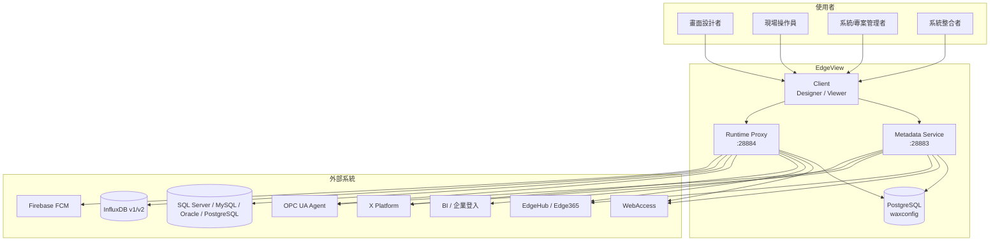

# SRS-02 整體描述（Overall Description）

## 1. 產品定位（Product Perspective）

EdgeView 是 WebAccess/SCADA X 生態系中的圖控前端與執行平台。Client 以 Qt 6/QML 建構，可在桌面、行動裝置與瀏覽器（WebAssembly）執行；後端由 Metadata Service 與 Runtime Proxy 兩個 Go 服務組成，共用 PostgreSQL 設定資料庫，並透過 HTTP REST 與 WebSocket 與 Client 溝通。

### 1.1 系統介面摘要

| 介面 | 方向 | 協定 | 說明 |
|------|------|------|------|
| Client ↔ Metadata Service | 雙向 | HTTP/HTTPS REST、Cookie Session | 設定、專案、使用者、授權、OPC UA、匯入匯出 |
| Client ↔ Runtime Proxy | 雙向 | HTTP/HTTPS REST、WebSocket | Record 查詢、即時資料、告警摘要、系統資訊 |
| Metadata ↔ PostgreSQL | 雙向 | PostgreSQL wire protocol | 設定資料、Session、稽核 |
| Runtime ↔ PostgreSQL | 雙向 | PostgreSQL wire protocol | Record 定義、資料來源設定、Session、FCM |
| Runtime ↔ 第三方 DB | 唯讀/讀寫 | 各 DB 原生協定 | Record 查詢、Datalog、配方資料 |
| Runtime ↔ OPC UA Agent | 雙向 | HTTP | 警報摘要、連線資訊 |
| Metadata ↔ OPC UA Agent | 雙向 | HTTP | 憑證建立、登入驗證 |
| Metadata/Runtime ↔ Edge365 | 雙向 | HTTPS / etcd / 反向代理 | 應用註冊、API Hub、DB Master、Alarm |
| Runtime → Firebase | 單向 | FCM HTTP v1 | 警報推播 |
| Client ↔ 檔案系統/瀏覽器儲存 | 雙向 | 本機檔案、QSettings、WASM 儲存 | 設定快取、Cookie、離線資源 |

## 2. 產品功能摘要（Product Functions）

### 2.1 Client（Designer / Viewer）

| 群組 | 主要功能 |
|------|----------|
| 啟動與連線 | 租戶/組織選擇、伺服器連線、OpenGL/渲染能力檢查、版本檢查、遠端 rcc 載入 |
| 登入 | 帳密登入、BI/EdgeHub 登入、OPC UA 首次登入改密、記住連線、錯誤處理、Session 逾時 |
| 專案 | 專案清單/樹、開啟專案、專案主題、圖片更新檢查、單一專案自動進入 Viewer |
| 畫面設計 | 新增/開啟/儲存/另存畫面、畫面屬性、Grid/RWD、縮放、裁剪、圖層 |
| Widget | 內建 Widget 庫、屬性編輯、群組、批次建立、JSON 匯入匯出、自訂 Widget |
| 資料綁定 | Tag、Variable、Record、Data Source Group 綁定；範圍、間隔、格式化、動畫 |
| 腳本 | JavaScript 編輯器、事件腳本、事件觸發器、巨集、壓縮儲存、非同步觸發 |
| 圖表/資料清單 | 折線、柱狀、圓餅、雷達、散佈、泡泡、狀態時間軸、Datalog 表格 |
| 3D | 3D Viewer Widget、模型/材質/光源/相機設定、場景套件上傳與版本 |
| Viewer 執行 | 即時資料、警報摘要、縮放、巡邏、通訊狀態、資料來源狀態、變數監看、全螢幕 |
| 設定模組 | 使用者管理、群組/安全、專案設定、匯入匯出、配方管理、搜尋取代、警報通知 |
| 系統 | 多語系、字型管理、資料更新設定、日誌維護、Crashpad、離線/WASM |

### 2.2 Metadata Service

| 群組 | 主要功能 |
|------|----------|
| 認證/授權 | 多來源登入、Session、CSRF、Token 驗證、專案使用者安全、BI Token |
| 專案/物件樹 | 專案清單、資料夾、物件移動/複製/改名/刪除、路徑查詢、搜尋、匯入匯出 |
| 畫面/腳本/模板 | Display/DisplayMobile/DisplaySystem、JS、Template 的 CRUD 與版本 |
| 變數/資料模型 | Variable、Variablebody、DataModel、DataModel_Variable、rcmap |
| 資料來源/Tag | DataSource、DBDefine、下載 Tag/ConstTag/TagPage |
| Record/Recipe/Alarm | Record 定義、Recipe 與單位、Alarm/Area/Tag |
| 使用者/群組 | UserInfo、UserAcc、UserScy、Group、OPC UA User |
| OPC UA | Project、Connection、Tag、ConstTag、TagConfig、Alarm、User/權限 |
| 系統設定 | Settings、i18n/font、OEM、MQTT Broker、WebPlugin、Symbol 資源 |
| 檔案/資產 | Image、Audio、File、PluginFile、FileCache、3D Scene |
| 稽核/維護 | ActionLog、AuditLog、Maintenance、日誌匯出 |
| 平台整合 | WebAccess、EdgeHub/Edge365、X、BI、Firebase、授權 |

### 2.3 Runtime Proxy

| 群組 | 主要功能 |
|------|----------|
| Record 查詢 | preview、previewquery、previewhttp、schema、tableschema（`queryrecord` 已停用） |
| 分頁 | prevpage、nextpage、gotopage |
| Datalog | querydatalog（時間範圍、間隔、時間欄位） |
| 指令 | runrecordcmd（SQL/Influx/HTTP） |
| 即時資料 | WebSocket recorddata register/unregister/update/updatevalue |
| 告警摘要 | WebSocket wa/ehalarm/opcuaalarm/xalarm summary |
| 系統資訊 | WebSocket systeminfo |
| 代理 | Edge365 apihub/dbmaster/alarm 反向代理、`/fw` HTTP 代理 |
| 通知 | 警報通知輪詢、Firebase 推播 |

## 3. 使用者角色（User Classes）

| 角色 | 能力 | 典型操作 |
|------|------|----------|
| 系統管理員（Admin） | 全域設定、使用者/群組、專案建立、OPC UA 管理、授權、稽核 | 管理伺服器、匯入匯出專案、設定資料來源 |
| 專案管理員 | 單一專案設定、專案使用者與權限、畫面/變數管理 | 指派專案成員、維護專案設定 |
| 畫面設計者（Designer） | 編輯畫面、Widget、綁定、腳本、動畫、3D | 建立 HMI 畫面、測試預覽 |
| 現場操作員（Operator） | Viewer 操作、警報確認、配方切換、資料查詢 | 監控、操作按鈕、查看趨勢 |
| 系統整合者（Integrator） | 資料來源、Record、OPC UA 連線、API 整合 | 設定第三方 DB、OPC UA、匯入資料模型 |
| 唯讀/稽核者 | 檢視與匯出日誌、報表 | 查詢稽核與操作日誌 |

權限以專案為單位，並由 `UserInfo.usertype`、`UserAcc`、`UserScy.area`、OPC UA `OPCUA_UserFunc`/`OPCUA_UserProject` 等機制控制。

## 4. 營運環境（Operating Environment）

### 4.1 Client

| 平台 | 說明 |
|------|------|
| Windows 10/11 | 主要桌面環境，支援 Crashpad、Session 監控 |
| macOS | 桌面環境 |
| Linux | 桌面環境 |
| Android | 手機/平板，RWD 版面 |
| iOS | 手機/平板，RWD 版面 |
| WebAssembly/HTML5 | 瀏覽器執行，使用 `wasmsettings`、`wahttp_web`、Web AES 函式庫 |

需求：

- Qt 6（含 Qt Quick、QuickControls2、Svg、WebSockets、Multimedia；選用 WebView、Firebase、ZXing）。
- 圖形支援 OpenGL/OpenGL ES/Vulkan（依平台與 `WaSettings.getRender()`）。
- 網路可達 Metadata Service 與 Runtime Proxy；瀏覽器模式需允許 Cookie 與 WebSocket。

### 4.2 Server

| 元件 | 需求 |
|------|------|
| OS | Linux（容器/K8s）或 Windows（服務/執行檔） |
| 執行環境 | Go 1.23（Runtime Proxy）、Go（Metadata Service） |
| 資料庫 | PostgreSQL（必要），需 `ltree`、`uuid-ossp` 擴充 |
| 網路 | Metadata 預設 `127.0.0.1:28883`；Runtime 預設 `127.0.0.1:28884`；可透過 Ingress 對外 |
| 憑證 | TLS 憑證與私鑰（`cert.crt`/`cert.key`） |
| 資源 | 依使用者與輪詢連線數調整；建議獨立 PostgreSQL 與適當連線池 |

### 4.3 外部系統

- WebAccess（REST API，Basic Auth）。
- EdgeHub/Edge365（反向代理、etcd 註冊、GraphQL 登入）。
- X Platform（`/waxapi`）。
- OPC UA Agent（`http://host:port/api/alarm/list`、憑證 API）。
- Firebase（FCM 服務帳號 JSON）。
- 第三方資料庫：PostgreSQL、SQL Server、Oracle、MySQL、InfluxDB v1/v2、HTTP API。

## 5. 限制與假設（Constraints and Assumptions）

### 5.1 限制

1. 伺服器端設定資料庫以 PostgreSQL 為唯一支援的設定儲存。
2. Metadata Service 與 Runtime Proxy 為獨立進程，預設僅綁定 loopback，需透過 Ingress/反向代理對外。
3. Client 的 Designer 與 Viewer 為同一執行檔（`gc-designer`），以 `openMode` 區分。
4. 資料來源若為 WebAccess/EdgeHub/X/OPC UA，需對應平台可用且網路可達。
5. 瀏覽器（WASM）模式部分原生能力（檔案系統、Session 監控、Crashpad）不可用。
6. 既有程式碼中 MQTT Client 功能停用；ODBC 資料源未實作。
7. 所有 REST/WS 請求需符合封包時間戳防重放（`packetTimestamp`，預設 300 秒容差）。

### 5.2 假設

1. 使用者具備瀏覽器或已安裝 Client 的裝置。
2. 系統管理員已完成 PostgreSQL、憑證與網路設定。
3. 外部系統（WebAccess、Edge365、OPC UA Agent）遵循既有 API 契約。
4. 時間同步（NTP）可用，以避免封包時間戳與 Session 驗證失敗。
5. 專案資料量與同時上線人數在產品設定容量內。

### 5.3 相依性

| 相依項目 | 影響 |
|----------|------|
| PostgreSQL | 設定、Session、稽核、Record 定義；不可用時後端無法啟動 |
| OPC UA Agent | OPC UA 專案/Tag/警報功能 |
| 第三方資料庫 | Record/Datalog 查詢與配方 |
| Firebase 服務帳號 | 行動推播 |
| Edge365/etcd | 雲端代理與應用註冊 |
| 系統時間 | 封包時間戳、Session、Token、稽核 |

## 6. 設計與實作限制（Design Constraints）

- Client 以 QML 為主要 UI 技術，C++ 提供控制器、渲染與 I/O。
- 後端以 Go + Gin 實作，採 controller/service/model/repository 分層。
- 設定資料以 PostgreSQL 關聯表 + JSONB 混合儲存。
- 密碼與敏感資料處理需符合既有機制（詳見 SDS-08）。
- 國際化以 Qt `.ts/.qm` 與伺服器字型/i18n 設定為基礎。

## 7. 文件關係

本文件描述「要做什麼」；實作方式、模組責任、資料結構與介面細節請參閱 SDS。需求與設計的對應關係見 `SDS/12_Traceability.md`。
