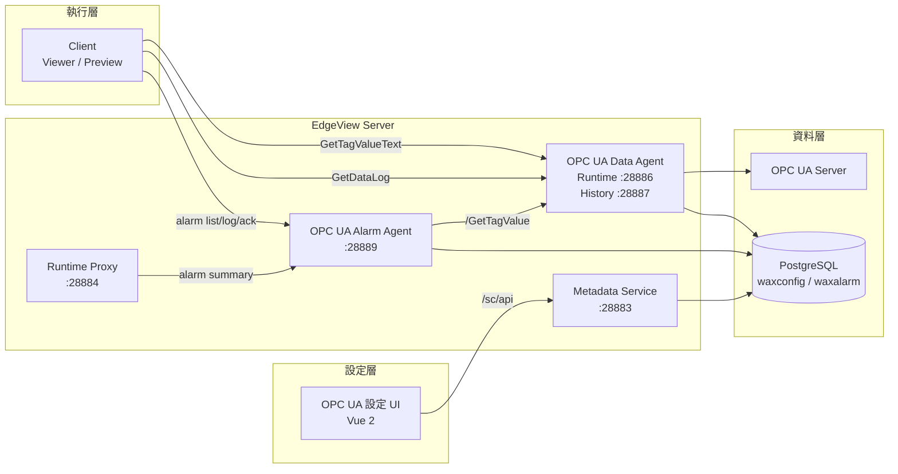

# SRS-07 OPC UA 子系統需求（OPC UA Subsystem）

## 1. 目的與範圍

本章定義 EdgeView 的 OPC UA 子系統需求。子系統由三個程式庫組成：

| 元件 | 角色 | 程式碼庫 |
|------|------|----------|
| OPC UA 設定 UI | 專案、連線、Tag、常數/計算/系統測點、警報、使用者設定 | `wax_opcua_agent_ui` |
| OPC UA Data Agent | OPC UA 連線、即時值、寫值、歷史值、瀏覽、憑證、測點計算 | `wax_opcua_agent` |
| OPC UA Alarm Agent | 警報規則編譯、條件評估、操作員流程、警報清單/歷史 | `wax_opcua_alarm_agent` |

本子系統與 EdgeView 的關係：

- 設定 UI 不直接連線 OPC UA Server，而是透過 **Metadata Service** 的 OPC UA API 讀寫設定。
- Client（`wa-hmi-designer`）在 Viewer/Preview 時**直接**呼叫 Data Agent 取得即時值與歷史值，不經 Runtime Proxy。
- Alarm Agent 由 Data Agent 輪詢或直接 OPC UA Subscription 取得 Tag 值，並直接提供 Client 警報清單、歷史、Ack/Process API；Runtime Proxy 只讀取警報摘要。

## 2. 系統定位



### 2.1 與既有子系統的邊界

| 邊界 | 說明 |
|------|------|
| UI ↔ Metadata | UI 只使用 Metadata OPC UA API；不直接寫 DB |
| Client ↔ Data Agent | 即時/歷史 Tag 值直連，降低 Proxy 延遲 |
| Client ↔ Alarm Agent | 警報清單、歷史、Ack/Process 直連 |
| Runtime Proxy ↔ Alarm Agent | 既有 `opcuaalarmsummary` WebSocket 摘要 |
| Data Agent ↔ Alarm Agent | Alarm 輪詢 Data Agent 取得評估值 |
| Data Agent ↔ OPC UA Server | OPC UA binary/TCP（可加密） |

## 3. 使用者角色

| 角色 | 能力 |
|------|------|
| 系統管理員 | 專案、連線、Tag、警報等級、使用者、匯入匯出 |
| 專案管理員 | 單一專案連線/Tag/警報/專案使用者 |
| 系統整合者 | OPC UA 連線、安全模式、憑證、Tag 對應 |
| 操作員 | Viewer 檢視即時值/歷史、警報 Ack/Process |
| 唯讀/稽核 | 檢視日誌與設定（不含修改） |

UI 權限沿用 Metadata Service 的 `role`、`permissions`、`account` Cookie；`graphic` 角色會被導回 HMI。

## 4. 功能需求

### 4.1 設定 UI（FR-OPC-001 ~ FR-OPC-012）

| ID | 名稱 | 優先級 | 描述 | 驗收條件 |
|----|------|--------|------|----------|
| FR-OPC-001 | UI 登入與權限 | Must | 以 Metadata Session 登入；依 `role`/`permissions` 顯示模組。 | 未登入導向登入頁；`graphic` 導回 HMI；無權限顯示 No Access。 |
| FR-OPC-002 | 專案清單/選擇 | Must | 顯示可存取 OPC UA 專案，支援切換。 | 僅顯示有權限專案；切換後樹與內容更新。 |
| FR-OPC-003 | 專案 CRUD | Must | 新增/修改/刪除 OPC UA 專案（名稱唯一）。 | 名稱重複被拒；刪除需確認。 |
| FR-OPC-004 | 連線 CRUD | Must | 設定 URI、安全模式/政策、認證、使用者/密碼、憑證 PFX。 | 連線可建立/修改/刪除；設定可回讀。 |
| FR-OPC-005 | 憑證管理 | Must | 上傳/下載/產生 OPC UA 應用憑證。 | 憑證可下載；產生成功可被 OPC UA Server 信任。 |
| FR-OPC-006 | 節點瀏覽 | Must | 瀏覽 OPC UA 位址空間（root/child/all）。 | 可展開節點；大量節點可分批載入。 |
| FR-OPC-007 | Tag CRUD | Must | 建立/修改/刪除 Tag：NodeId、資料型別、Span、顯示位數、Scaling、Reverse、Area/Level。 | Tag 可儲存並在清單顯示；重複名稱被拒。 |
| FR-OPC-008 | 常數/計算/系統測點 | Should | 管理 Const、Calc、System 測點與屬性。 | 可新增/修改/刪除；計算與系統測點可被 Client 讀取。 |
| FR-OPC-009 | 警報設定 | Must | 設定警報等級（1–8）、名稱、顏色、Report/Summary/Ack/Log 門檻。 | 設定可儲存；層級與門檻正確反映。 |
| FR-OPC-010 | Tag 警報規則 | Must | 設定 Analog（HH/H/L/LL/ROC/DEV）與 Discrete（狀態 0–7）規則。 | 規則可儲存；啟用/等級/訊息/延遲正確。 |
| FR-OPC-011 | 使用者管理 | Must | 管理 OPC UA 使用者、Graphic 使用者、專案授權、登入鎖定。 | 權限生效；鎖定政策可設定。 |
| FR-OPC-012 | 匯入/匯出與維運 | Should | 匯入/匯出專案；設定資料來源、OEM、檢視日誌。 | 匯出可再匯入；設定與日誌可查詢。 |

### 4.2 Data Agent（FR-OPC-013 ~ FR-OPC-027）

| ID | 名稱 | 優先級 | 描述 | 驗收條件 |
|----|------|--------|------|----------|
| FR-OPC-013 | 啟動與角色 | Must | 讀取 `appsettings.json`，依 `isHistory` 啟動 Runtime 或 History 角色，監聽 `Kestrel:Port`。 | 兩角色可同時啟動；`/swagger` 可用。 |
| FR-OPC-014 | 認證 | Must | 接受 Metadata Session Cookie + `csrfToken`，或 loopback 內部 Bearer Token。 | 未認證回 401；Bearer 非 loopback 被拒。 |
| FR-OPC-015 | 即時 Tag 值 | Must | `GetTagValue`/`GetTagValueText` 批次讀取，支援陣列、`.value/.type/.spanhi/.spanlo/.descrp/.dspfmt/.seca/.secl` 與 Alarm 欄位轉發。 | 值與 Quality 正確；未知 Tag 回 `*`/Bad。 |
| FR-OPC-016 | Tag 明細 | Must | 回傳 NodeId、BrowseName、DataType、Value、Access、Historizing、Writable 等。 | 明細與 OPC UA Server 一致。 |
| FR-OPC-017 | 寫入 Tag | Must | `SetTagValue`/`SetTagValueText` 支援單值、陣列索引與型別轉換。 | 寫入成功；不可寫入回錯誤。 |
| FR-OPC-018 | 歷史資料 | Must | `GetDataLog` 聚合查詢（StartTime/Interval/Records/IntervalType）；`GetRawDataLog` 原始值。 | 時間、間隔、筆數正確；無資料回空。 |
| FR-OPC-019 | 瀏覽 | Must | `Browse/one`、`Browse/all` 回傳節點樹。 | 可瀏覽 root 與子節點。 |
| FR-OPC-020 | 連線池與同步 | Must | 依 OPC UA URI 快取 Client；Session 失效重建；同一 URI 操作序列化；閒置回收。 | 重複請求不重複連線；併發不交錯。 |
| FR-OPC-021 | 憑證建立 | Must | `Certificate/create` 產生 PFX。 | 回傳可下載 PFX。 |
| FR-OPC-022 | 常數/計算/累計/系統測點 | Should | Const 值、Calc 公式、Acc 累計、System 時間/狀態/資源測點。 | 計算結果正確；系統值可更新。 |
| FR-OPC-023 | 警報欄位 | Must | 將 `tag.ALMST` 等後綴轉發 Alarm Agent。 | 回傳 Alarm 欄位值與 Quality。 |
| FR-OPC-024 | 角色限制 | Must | Runtime 端點在 History 角色回 400；History 端點在 Runtime 角色回 400。 | 角色錯用被拒。 |
| FR-OPC-025 | 健康與日誌 | Should | 提供 Swagger、結構化日誌、例外統一格式。 | 例外回 `errors`；日誌可追蹤。 |
| FR-OPC-026 | 效能 | Must | 批次讀取、快取、連線重用；大量 Tag 不阻塞。 | 1000 Tags 回應時間符合 NFR-OPC-001。 |
| FR-OPC-027 | 傳輸安全 | Should | 支援 HTTPS/PFX；OPC UA 安全模式/政策可設定。 | 啟用後可連線；憑證錯誤可診斷。 |

### 4.3 Alarm Agent（FR-OPC-028 ~ FR-OPC-045）

| ID | 名稱 | 優先級 | 描述 | 驗收條件 |
|----|------|--------|------|----------|
| FR-OPC-028 | 啟動與資料庫 | Must | 連線 `waxalarm`（runtime）與 `waxconfig`（metadata/Session），建立資料表並啟動 HTTP。 | 服務啟動；`/ping/:id` 正常。 |
| FR-OPC-029 | 定義載入 | Must | 從 `opcua_tagalarm`/`opcua_alarmaction`/`opcua_alarmlevel` 編譯 AlarmDefinition。 | 規則數量與設定一致。 |
| FR-OPC-030 | Tag 值來源 | Must | 支援輪詢 Data Agent（程式預設 500 ms；`config.yaml` 常用 1000 ms）或直接 OPC UA Subscription。 | 值可持續更新；來源可切換。 |
| FR-OPC-031 | 條件評估 | Must | HH/H/L/LL/ROC/DEV_HI/DEV_LO/DISCRETE；支援 deadband（值/百分比）、DELAYA、DELAYN。 | 邊界與延遲行為正確。 |
| FR-OPC-032 | 優先級 | Must | 同一 Tag 同時多條件時，依 HH/LL > H/L > ROC > DEV > DISCRETE 選一；同等比 AlarmLevel。 | 僅一個 CurrentType。 |
| FR-OPC-033 | 雙狀態機 | Must | ConditionState（NORMAL/ACTIVE/RETURNED）與 OperatorState（OPEN/ACKED/IN_PROCESS/LOCKED/PROCESSED/CLOSED）分離。 | 狀態轉換正確；RETURNED 可重新 ACTIVE。 |
| FR-OPC-034 | 操作員流程 | Must | 依 AlarmLevel 對應 Scenario 1–4，限制 Ack/Process/Lock 轉換。 | 非法轉換被拒。 |
| FR-OPC-035 | 警報清單/歷史 | Must | `/api/alarm/list`、`/api/alarm/log` 支援專案、等級、時間、排序、分頁、連線名稱。 | 結果與 DB 一致。 |
| FR-OPC-036 | Ack/Process | Must | `/api/alarm/ack` 批次更新狀態、Handler、Commenter、Record。 | 成功回 true；非法狀態被拒。 |
| FR-OPC-037 | 歷程 | Must | `/api/alarm/processhistory` 依 AlarmId/Tag 回傳事件。 | 事件順序與內容正確。 |
| FR-OPC-038 | Tag 欄位 API | Must | `/GetTagValue/:projid` 提供 ALMST/ALMTP/ALMVA/ALMTM/ALMDT 與設定欄位。 | 值與 Quality 正確。 |
| FR-OPC-039 | 持久化與復原 | Must | 每次評估寫入 `opcua_active_alarm`；重啟載入未關閉警報並對帳。 | 重啟後狀態不遺失。 |
| FR-OPC-040 | 政策門檻 | Must | `opcua_alarmaction` 的 report/summary/ack/log 依等級決定流程與顯示。 | 門檻 0 表示停用（log 例外）。 |
| FR-OPC-041 | 認證 | Must | 支援 Metadata Session + CSRF、**本機** Basic Auth、loopback 內部 Bearer。 | 未認證回 `-100`；Basic 僅限本機且不快取密碼。 |
| FR-OPC-042 | 重載 | Must | `/api/alarm/reload` 與 `metadataReloadMs` 定期檢查 fingerprint 重載。 | 設定變更後生效；未變更不重載。 |
| FR-OPC-043 | 健康與關閉 | Should | `/ping/:id`；SIGTERM 優雅關閉 HTTP 與輪詢。 | 連線正常結束；無 panic。 |
| FR-OPC-044 | 效能與併發 | Must | 評估與查詢不互相阻塞；支援多專案/多 Tag。 | 評估延遲符合 NFR-OPC-004。 |
| FR-OPC-045 | 模擬與診斷 | Should | `/api/alarm/simulate` 可注入 Tag 值測試規則。 | 模擬可觸發/恢復警報。 |

## 5. 外部介面需求

| ID | 介面 | 協定 | 說明 |
|----|------|------|------|
| IF-OPC-001 | UI ↔ Metadata | HTTPS REST | `/sc/api/opcua/*`、`/sc/api/setting/opcua/*`、`/sc/api/source`、`/sc/api/setting/DataSource/*` |
| IF-OPC-002 | Client ↔ Data Agent | HTTP/HTTPS | `/GetTagValue*`、`/SetTagValue*`、`/TagDetail`、`/Browse/*` |
| IF-OPC-003 | Client ↔ History Agent | HTTP/HTTPS | `/GetDataLog`、`/GetRawDataLog` |
| IF-OPC-004 | Client/Runtime ↔ Alarm Agent | HTTP/HTTPS | `/api/alarm/*`、`/GetTagValue/:projid` |
| IF-OPC-005 | Data Agent ↔ OPC UA Server | OPC UA TCP | SecurityMode/Policy、UserIdentity、Certificate |
| IF-OPC-006 | Data Agent ↔ PostgreSQL | PostgreSQL | `opcua_*` 設定、Session |
| IF-OPC-007 | Alarm Agent ↔ PostgreSQL | PostgreSQL | `waxalarm` runtime、`waxconfig` 設定/Session |
| IF-OPC-008 | Alarm Agent ↔ Data Agent | HTTP | 輪詢 `/GetTagValue/{projid}`（Bearer） |
| IF-OPC-009 | Agent/Alarm ↔ Metadata Session | PostgreSQL/HTTP | 驗證 `graphicSession`/`settingSession` 與 CSRF |
| IF-OPC-010 | UI 靜態資源 | HTTP | Nginx `/sc/opcua/`；`VUE_APP_PUBPATH`/`VUE_APP_APIROOT` |

### 5.1 即時值請求範例

```json
POST /GetTagValueText/12
Headers: csrfToken: <token>
{
  "Tags": [
    { "Name": "Line1.Temp" },
    { "Name": "Line1.Temp.spanhi" },
    { "Name": "Line1.Temp.ALMST" }
  ]
}
```

回應（Data Agent 格式）：

```json
{
  "data": {
    "Values": [
      { "Name": "Line1.Temp", "Value": "72.5", "Quality": 0 },
      { "Name": "Line1.Temp.spanhi", "Value": "100", "Quality": 0 },
      { "Name": "Line1.Temp.ALMST", "Value": 1, "Quality": 0 }
    ],
    "Result": { "Ret": 0, "Total": 3 }
  }
}
```

### 5.2 歷史值請求範例

```json
POST /GetDataLog/12
{
  "StartTime": "2026-11-19 00:00:00",
  "IntervalType": "M",
  "Interval": 1,
  "Records": 60,
  "Tags": [{ "Name": "Line1.Temp", "DataType": 11 }],
  "NumberOfValues": 1
}
```

## 6. 非功能需求

| ID | 類別 | 需求 | 驗證 |
|----|------|------|------|
| NFR-OPC-001 | 效能 | 100 Tags 即時讀取 ≤ 1 秒（區網、正常 Server）。 | 壓測 |
| NFR-OPC-002 | 效能 | 1000 Tags 批次讀取 ≤ 5 秒；支援分頁/分批。 | 壓測 |
| NFR-OPC-003 | 效能 | 歷史查詢 60 點 × 10 Tags ≤ 3 秒（依 Server）。 | 壓測 |
| NFR-OPC-004 | 效能 | Alarm 評估延遲 ≤ 2 × 輪詢間隔。 | 量測 |
| NFR-OPC-005 | 可靠 | Agent/Alarm 重啟後 30 秒內恢復服務與狀態。 | 故障演練 |
| NFR-OPC-006 | 可靠 | OPC UA Server 斷線時回 Bad Quality，不崩潰；恢復後自動重連。 | 斷線測試 |
| NFR-OPC-007 | 安全 | 所有外部請求需認證（Session/Bearer）；Bearer 僅 loopback。 | 滲透測試 |
| NFR-OPC-008 | 安全 | 支援 HTTPS/PFX；OPC UA Sign/SignAndEncrypt。 | 組態檢查 |
| NFR-OPC-009 | 稽核 | 登入、設定變更、Ack/Process 可追溯。 | 日誌檢查 |
| NFR-OPC-010 | 國際化 | UI 支援 en/tw/zh；時間格式依 Server。 | UAT |
| NFR-OPC-011 | 擴充 | 多專案、多連線、多 Tag；水平擴充 History。 | 容量測試 |
| NFR-OPC-012 | 可觀測 | 結構化日誌、健康端點、錯誤碼。 | 運維演練 |
| NFR-OPC-013 | 相容 | 相容 OPC UA 1.04+；支援常見 DataType。 | 互通測試 |
| NFR-OPC-014 | 時間 | 依賴 NTP；歷史時間戳需標示 UTC/本地。 | 時區測試 |
| NFR-OPC-015 | 資源 | Runtime 256–512 MB；History 依快取調整。 | 監控 |
| NFR-OPC-016 | 備份 | 設定 DB 與警報 DB 可備份/還原。 | 還原演練 |
| NFR-OPC-017 | 可維護 | 分層、可測試、設定外部化。 | Code Review |
| NFR-OPC-018 | 可測試 | 提供模擬值與 Swagger。 | 測試 |
| NFR-OPC-019 | 易用 | UI 表單驗證、錯誤提示、載入狀態。 | UAT |
| NFR-OPC-020 | 文件 | API、設定、部署、限制需文件化。 | 文件審查 |

## 7. 驗收準則

| 群組 | 驗收 |
|------|------|
| UI | 完成登入→專案→連線→Tag→警報→使用者；權限正確 |
| Agent | 即時/歷史/寫值/瀏覽/憑證；Runtime/History 角色正確 |
| Alarm | 規則觸發、優先級、Ack/Process、重啟復原 |
| 整合 | Client 直連即時/歷史；Alarm 清單/歷史/Ack |
| 安全 | 未認證被拒；Bearer 僅 loopback；TLS 可啟用 |
| 效能 | 符合 NFR-OPC-001~004 |

## 8. 限制與假設

1. 設定 UI 依賴 Metadata Service 的 OPC UA API；Metadata 不可用時無法設定。
2. Client 直連 Data Agent 需網路可達 28886/28887；瀏覽器模式需 CORS/Cookie。
3. OPC UA Server 需支援 Historical Access 才能查歷史。
4. 憑證信任需人工於 OPC UA Server 端設定。
5. Alarm Agent 不提供設定寫入；設定由 Metadata/UI 管理。
6. 多副本 Alarm/Agent 需共享 DB 與一致的 Session key。
7. `packetTimestamp` 在 Data Agent 目前未實際強制（見 SDS-14 風險）。

## 9. 追溯

| 需求 | 設計 |
|------|------|
| FR-OPC-001~012 | SDS-14 §3 |
| FR-OPC-013~027 | SDS-14 §4 |
| FR-OPC-028~045 | SDS-14 §5 |
| IF-OPC-001~010 | SDS-14 §6、SDS-07 |
| NFR-OPC-001~020 | SDS-14 §7.4、§11 |
