# SRS-09 使用手冊截圖證據（OPC UA 版）

> 來源：`C:\Users\Junyu.ke\Downloads\EdgeView User Manual.docx`  
> 範圍：**datasource = OPC UA** 的 EdgeView 完整系統  
> 用途：補充 `SRS/07`、`SRS/08` 的手冊截圖證據；截圖檔案位於 `62443/evidence/`。

## 1. 證據清單

| 證據 ID | 截圖 | 手冊章節 | 內容 | 對應需求 |
|---------|------|----------|------|----------|
| SS-01 | 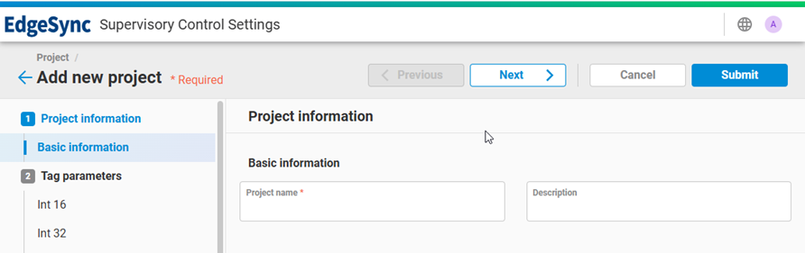 | 15.3.2 | OPC UA 新建工程（名稱/描述） | FR-UM-011、FR-OPC-002/003 |
| SS-02 | 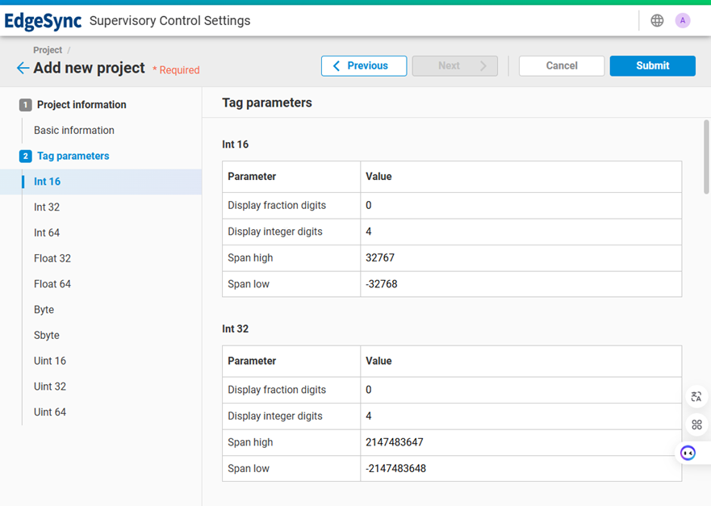 | 15.3.2 | 工程數據顯示範圍 | FR-UM-011、FR-OPC-007 |
| SS-03 | 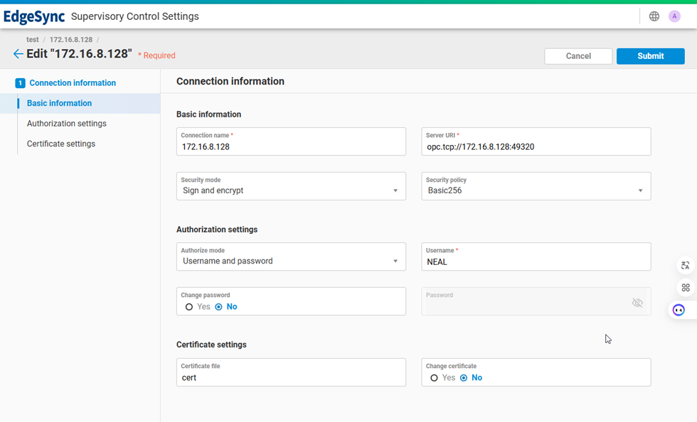 | 15.3.2、1.6 | 連線 URI、Security mode、Policy、帳密、憑證 | FR-OPC-004、IF-SW-005、IF-OPC-002 |
| SS-04 | 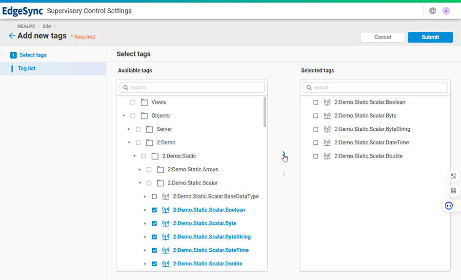 | 15.3.2 | OPC UA Server Tag 訂閱/多選 | FR-OPC-006/007 |
| SS-05 | 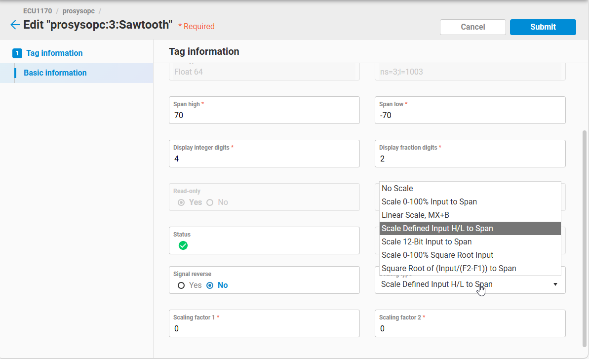 | 15.3.2 | Span、顯示位數、Scaling 類型 | FR-OPC-007 |
| SS-06 | 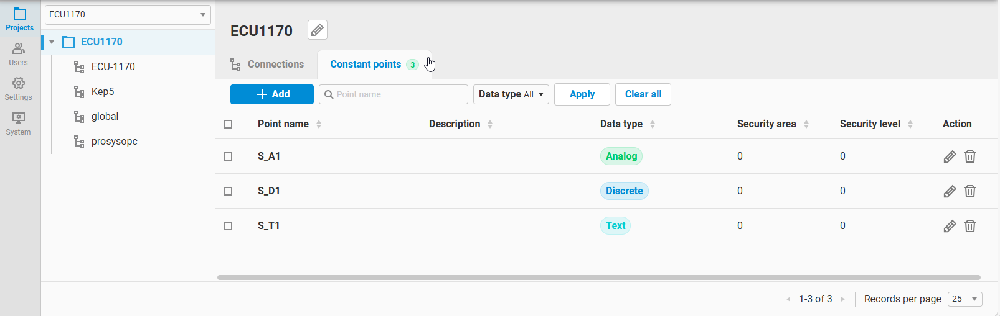 | 15.3.2 | 常數點 Analog/Discrete/Text、安全區/級別 | FR-OPC-008、FR-OPC-022 |
| SS-07 | 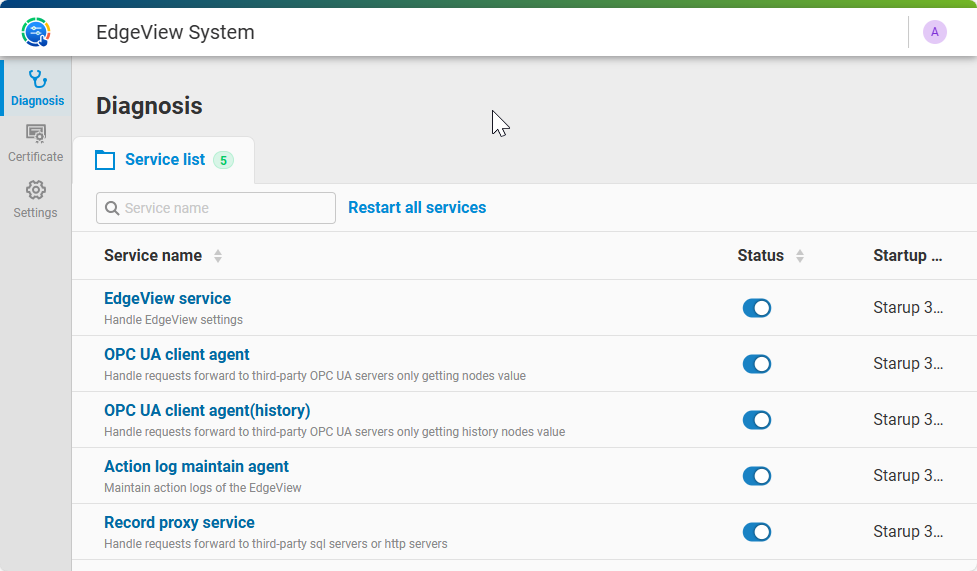 | 15.6 | EdgeView/OPC UA client agent/history 等服務狀態 | FR-OPC-013、FR-RT-001 |
| SS-08 | 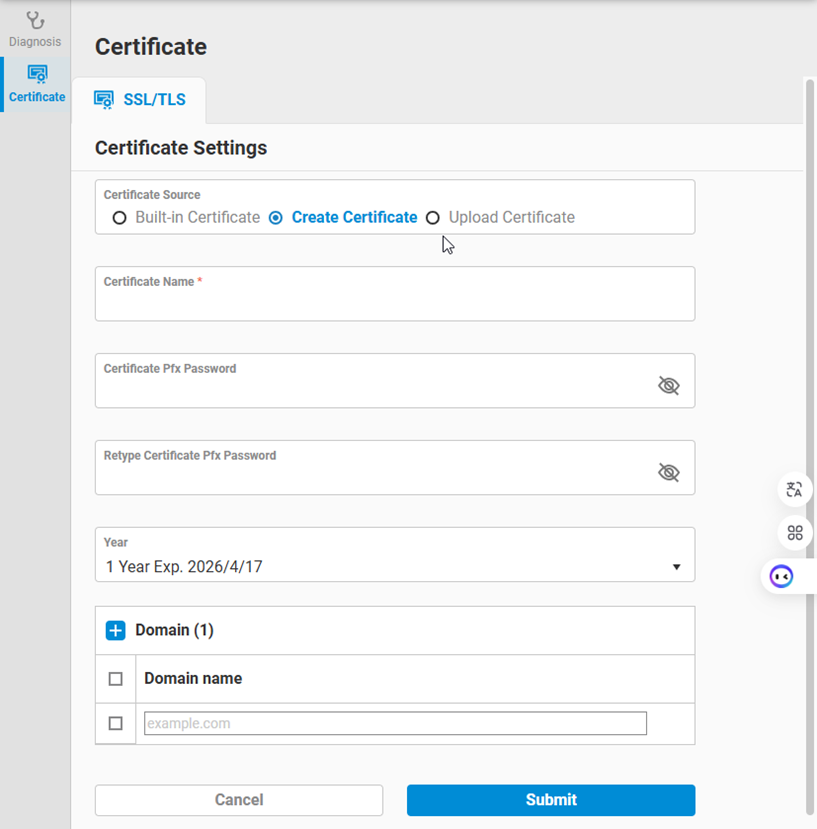 | 15.6 | Built-in/Create/Upload Certificate、SSL/TLS | FR-OPC-005、FR-OPC-021 |
| SS-09 | 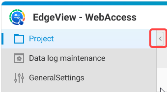 | 16.2 | 專案管理、資料記錄維護、偏好設定 | FR-UM-050、FR-OPC-012 |
| SS-10 | 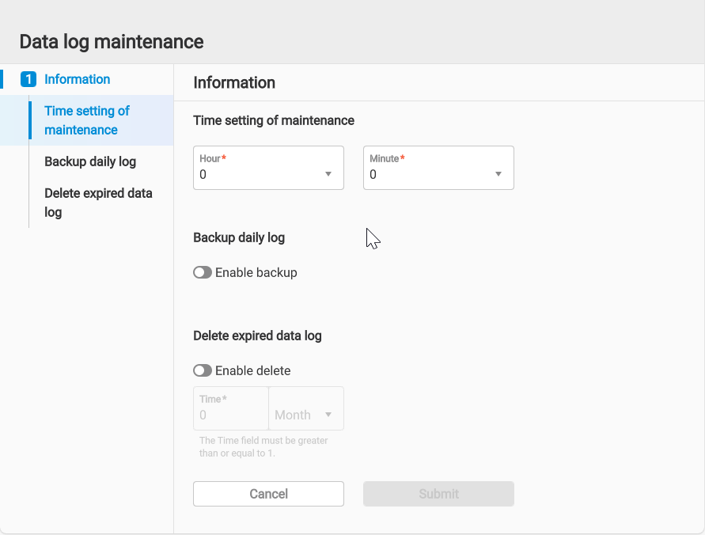 | 16.2.2 | 每日維護、備份、刪除過期記錄 | FR-UM-057、FR-RT-006 |
| SS-11 | 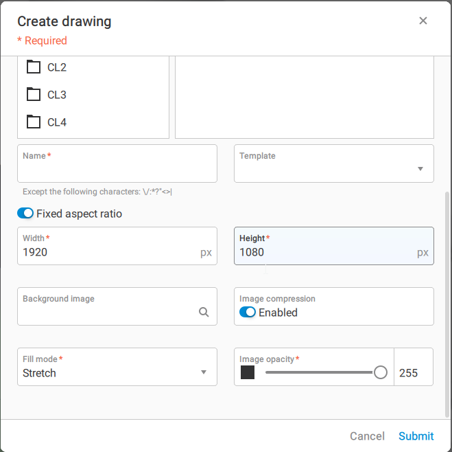 | 3.1 | 圖紙名稱、範本、尺寸、背景/壓縮/透明度 | FR-UM-024/030 |
| SS-12 | 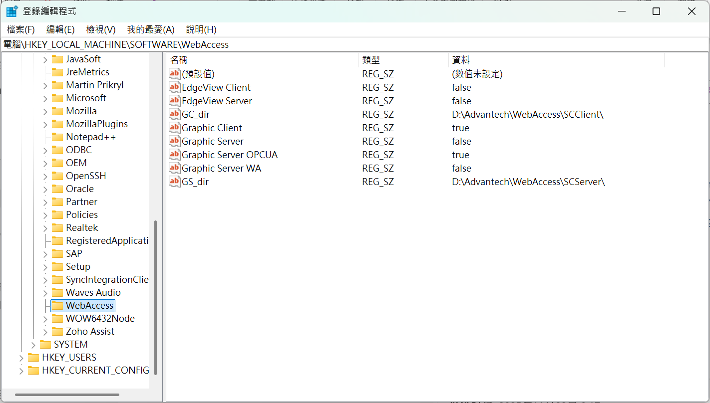 | 1.5.2 | OPC UA 版本安裝識別 | FR-UM-001/007/009 |
| SS-13 | 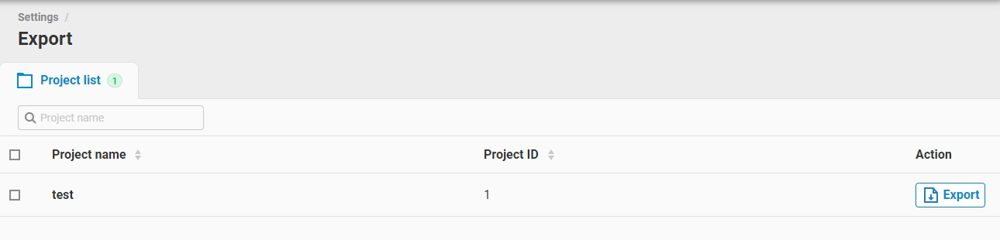 | 15.1 | 工程資料庫匯出 | FR-UM-057 |
| SS-14 | 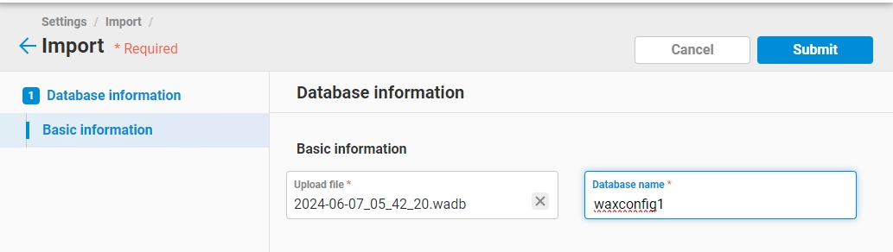 | 15.2 | 工程資料庫匯入/更名 | FR-UM-057 |

## 2. 安全相關截圖重點

| 證據 | 可佐證 |
|------|--------|
| SS-03 | OPC UA `Sign and encrypt`、`Basic256`、使用者名稱/密碼、憑證設定；對應 CR 3.01/3.01 RE(1)、4.01、4.03、1.08、1.09。 |
| SS-04 | Tag 訂閱清單，可佐證資料來源與測點選擇；對應 CR 2.01（授權後才能設定）。 |
| SS-05 | 縮放/顯示格式設定；對應 CR 3.05（輸入驗證）與資料正確性。 |
| SS-06 | 常數點的 **Security area / Security level**；對應 CR 2.01/2.01 RE(2)。 |
| SS-07 | 服務清單（EdgeView、OPC UA client agent、history、log、record proxy）；對應 CR 7.07/7.08、3.10。 |
| SS-08 | 憑證建立/上傳/內建；對應 CR 1.08、1.09、4.03。 |
| SS-09 | 管理選單與權限入口；對應 CR 1.03、2.01。 |
| SS-10 | 備份/保留/刪除；對應 CR 2.09、7.03。 |
| SS-13/14 | DB 匯出/匯入；對應 CR 7.03、7.04。 |

## 3. 證據限制

1. 截圖屬 **UI/設定證據**，可證明功能存在與設定選項，不取代執行期測試報告。
2. 截圖未包含登入失敗、鎖定、權限拒絕、憑證錯誤等負向案例；需另附測試紀錄。
3. 截圖取自手冊，版本以手冊為準；與實際部署版本不同時需重新截圖。
4. 雜湊/簽章與 SBOM 證據見 `62443/Evidence.md`。
